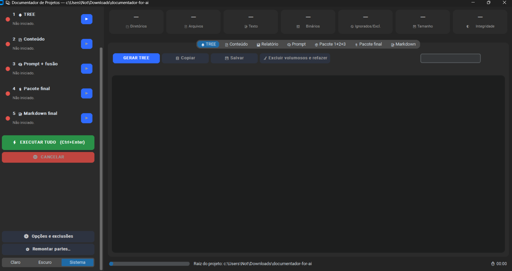
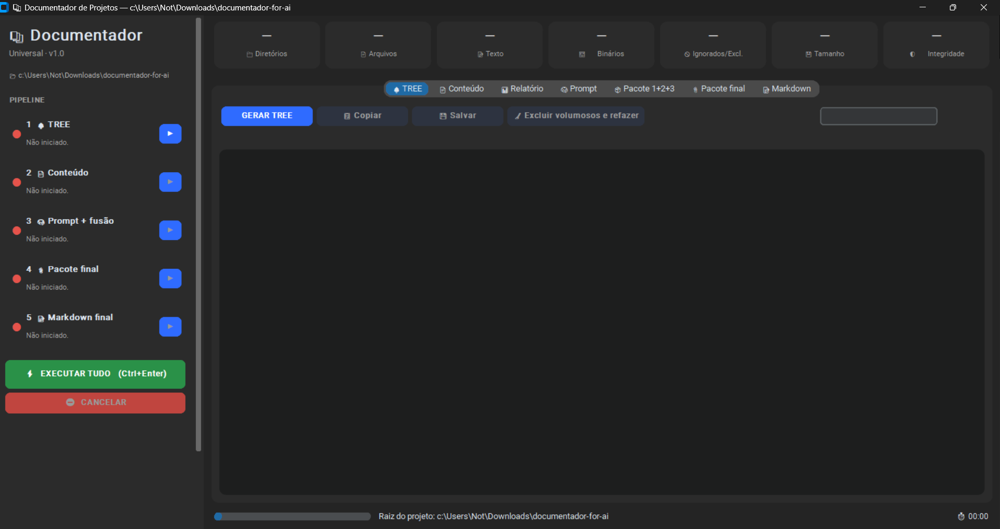
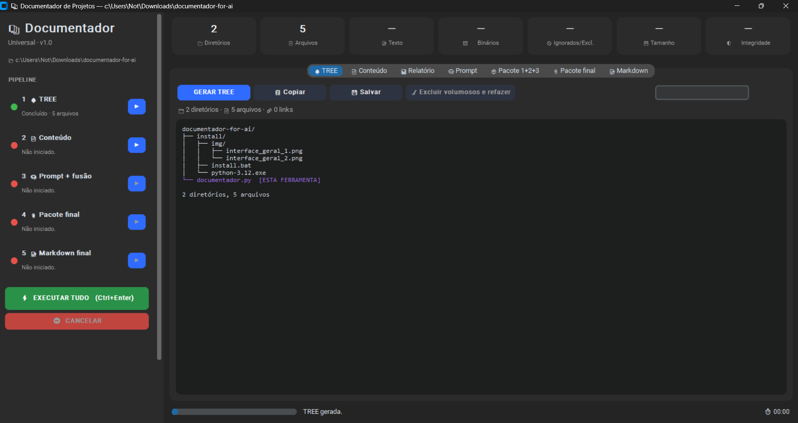
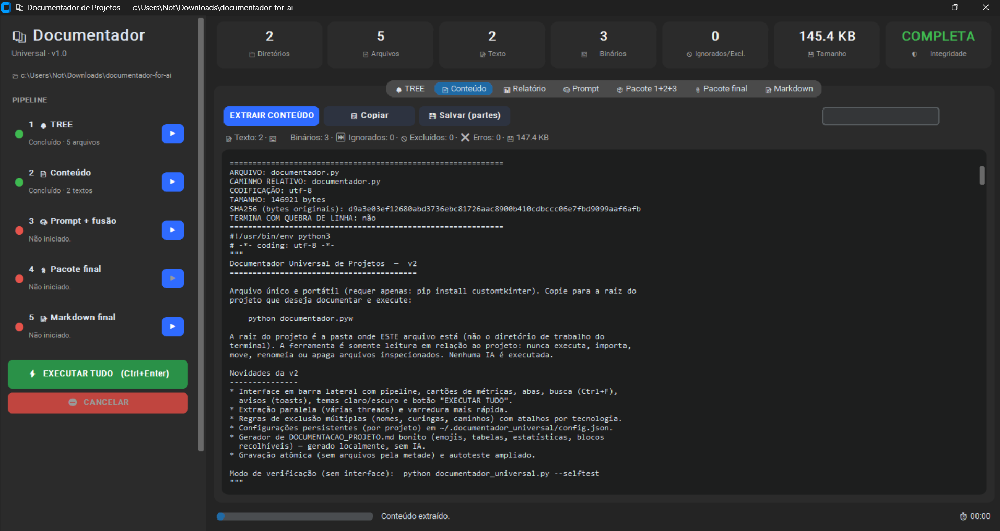
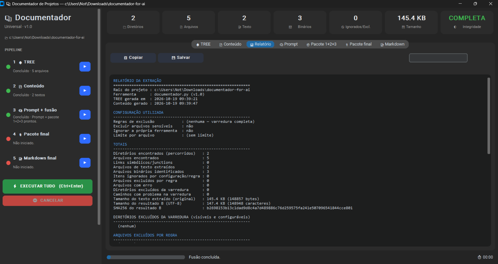
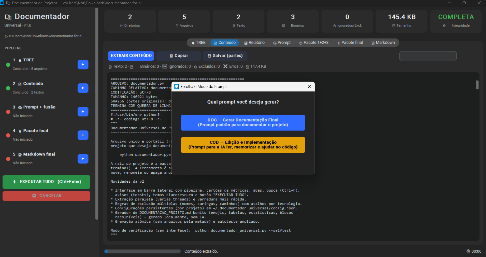
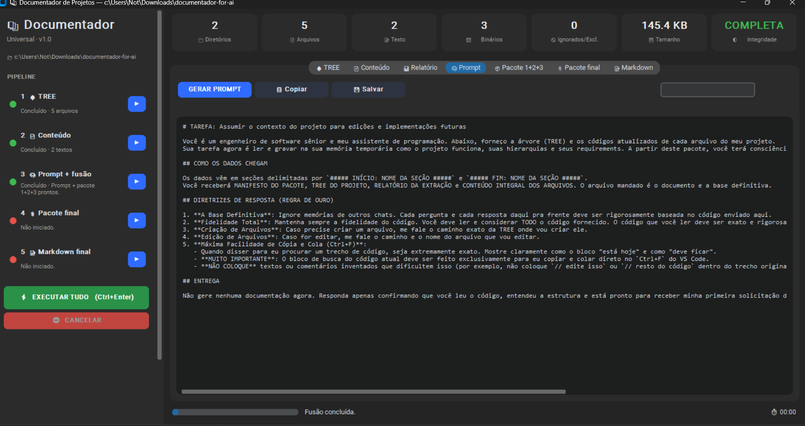
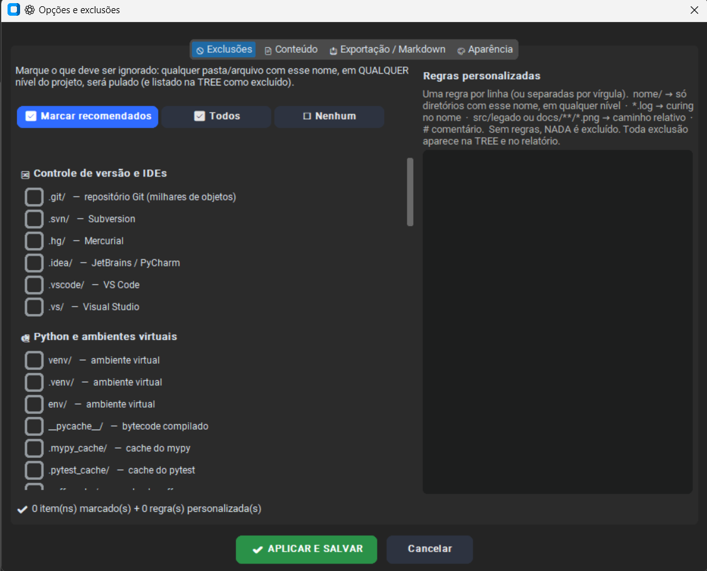

# 📚 documentador-for-ai

> 🏷️ **Inventário técnico do projeto**, gerado automaticamente em 03/11/2026 às 10:23 por *documentador.py* v1.0. Este arquivo é um retrato fiel dos arquivos analisados (sem interpretação por IA).
>
> 🛡️ **Integridade da extração:** ✅ completa

## 🧭 Sumário

- [📋 Resumo executivo](#sec-resumo)
- [🧰 Tecnologias detectadas](#sec-tech)
- [📊 Linguagens e métricas](#sec-langs)
- [🌳 Estrutura do projeto](#sec-tree)
- [🗂️ Índice de arquivos](#sec-index)
- [📄 Conteúdo dos arquivos](#sec-content)
- [🚫 Itens não incorporados](#sec-noinc)
- [✅ Integridade da extração](#sec-integ)

---

<a id="sec-resumo"></a>

## 📋 Resumo executivo

| Item | Valor |
|---|---|
| 📂 Raiz | `C:\Scripts\documentador-for-ai` |
| 🕒 Gerado em | 2026-11-03 10:23:10 |
| 📁 Diretórios | 44 |
| 📄 Arquivos encontrados | 68 |
| 📝 Arquivos de texto incorporados | 31 |
| 🧮 Linhas de texto | 7.796 |
| 🖼️ Binários (somente metadados) | 37 |
| ⏭️ Ignorados | 0 |
| 🚫 Excluídos por regra | 0 |
| 🔗 Links simbólicos | 0 |
| ❌ Erros | 0 |
| 💾 Tamanho do texto | 353.7 KB |
| 🔑 SHA256 do conteúdo | `a680f55a5209c16897b1e67666d4040f125f14273fcea43a7bf17a7c38da5ae8` |

<a id="sec-tech"></a>

## 🧰 Tecnologias detectadas

_Nenhum marcador de tecnologia conhecido foi detectado._

<a id="sec-langs"></a>

## 📊 Linguagens e métricas

| Linguagem | Arquivos | Linhas | Tamanho | Participação |
|---|---:|---:|---:|---|
| 📄 Texto | 1 | 3274 | 157.2 KB | `█████████░░░░░░░░░░░` 44.4% |
| 🐍 Python | 1 | 3270 | 154.2 KB | `█████████░░░░░░░░░░░` 43.6% |
| 📄 Outros | 27 | 924 | 28.8 KB | `██░░░░░░░░░░░░░░░░░░` 8.1% |
| 📝 Markdown | 1 | 225 | 10.0 KB | `█░░░░░░░░░░░░░░░░░░░` 2.8% |
| 🪟 Batch | 1 | 103 | 3.5 KB | `░░░░░░░░░░░░░░░░░░░░` 1.0% |

<a id="sec-tree"></a>

## 🌳 Estrutura do projeto

```text
documentador-for-ai/
├── .git/
│   ├── hooks/
│   │   ├── applypatch-msg.sample
│   │   ├── commit-msg.sample
│   │   ├── fsmonitor-watchman.sample
│   │   ├── post-update.sample
│   │   ├── pre-applypatch.sample
│   │   ├── pre-commit.sample
│   │   ├── pre-merge-commit.sample
│   │   ├── pre-push.sample
│   │   ├── pre-rebase.sample
│   │   ├── pre-receive.sample
│   │   ├── prepare-commit-msg.sample
│   │   ├── push-to-checkout.sample
│   │   ├── sendemail-validate.sample
│   │   └── update.sample
│   ├── info/
│   │   └── exclude
│   ├── logs/
│   │   ├── refs/
│   │   │   ├── heads/
│   │   │   │   └── main
│   │   │   └── remotes/
│   │   │       └── origin/
│   │   │           └── main
│   │   └── HEAD
│   ├── objects/
│   │   ├── 03/
│   │   │   └── 14200bc4a742802355bf2103169847d0f19105
│   │   ├── 14/
│   │   │   └── 523501d52c7ee4d1caf8d2255c9f6133b63fbc
│   │   ├── 23/
│   │   │   └── 71f25c404d23ba260b3d9d605244a0fa5c38fc
│   │   ├── 2a/
│   │   │   └── 0301c37ddb20e6c82d238581f94d1f81c342df
│   │   ├── 2f/
│   │   │   └── 6089388a03ca759ae1a95f6fb23b0c63d41dff
│   │   ├── 34/
│   │   │   └── c94aa973b5f2a87bcdf51c3aa1328225141d3f
│   │   ├── 35/
│   │   │   └── 17c30b33e93a1c581df47043bf086536af07c1
│   │   ├── 41/
│   │   │   └── 22d922e28886413f93f52c827a399ffc9b757a
│   │   ├── 42/
│   │   │   └── 477200be9cf161f7b0d92144dd11cbf68a52dd
│   │   ├── 43/
│   │   │   ├── 739623df3b861537c89e732f1592506dc3888c
│   │   │   └── 87417b76d51b0d93211ac9c7e1a55dea312bf7
│   │   ├── 4b/
│   │   │   └── 8f5a91066f23bb1d3d0c643e7bae3069235eb2
│   │   ├── 4d/
│   │   │   └── 54b7c9682aa3c65e1c14388ddb4b6489ab8e01
│   │   ├── 53/
│   │   │   └── 5d604057d726402a93319fdddcbceb38ae5602
│   │   ├── 60/
│   │   │   └── 3b057e2443c555b008078c8c43c11499de7055
│   │   ├── 6b/
│   │   │   └── 1504b8ee4a2f2245b149ef6c93fa63d99bf4a4
│   │   ├── 71/
│   │   │   └── 24e5df5efe418d0ee0eaaae970dd05a80c30f6
│   │   ├── 84/
│   │   │   └── ee562f14861a0e8b1016da54e1693225706c64
│   │   ├── a3/
│   │   │   └── 5bc10d45207f42d080185bb1c2e25a4a5700fe
│   │   ├── a9/
│   │   │   └── 614e5b59a8ff6e63533b996cbaa2d88a317bd4
│   │   ├── af/
│   │   │   └── 3a92f1a9ebedb06164c6b3b16cc878a1ea74b4
│   │   ├── b3/
│   │   │   └── 47d0ce6aece1bef3a8b13680454c5ae74cfaa3
│   │   ├── bc/
│   │   │   └── 06f218c08acb4fec0676bea9db6ceb6e107753
│   │   ├── d0/
│   │   │   └── c8805ac58faaacc4ef70ae4a9c69e0920a7080
│   │   ├── f0/
│   │   │   └── bf431768048ee1e6adb9cd370d893807e6e27f
│   │   ├── f3/
│   │   │   └── ca37435a7522a9009f1ffb537120478216db6b
│   │   ├── f6/
│   │   │   └── 3b631eb5ab8af03158b6577c347832338c5d5c
│   │   ├── info/
│   │   └── pack/
│   ├── refs/
│   │   ├── heads/
│   │   │   └── main
│   │   ├── remotes/
│   │   │   └── origin/
│   │   │       └── main
│   │   └── tags/
│   ├── COMMIT_EDITMSG
│   ├── config
│   ├── description
│   ├── FETCH_HEAD
│   ├── HEAD
│   ├── index
│   └── ORIG_HEAD
├── install/
│   ├── exemple/
│   │   ├── config.png
│   │   ├── conteudo.png
│   │   ├── interface_geral_1.png
│   │   ├── interface_geral_2.png
│   │   ├── pack_1+2+3.txt
│   │   ├── prompt_1.png
│   │   ├── prompt_2.png
│   │   ├── relatorio.png
│   │   └── tree.png
│   ├── install.bat
│   └── python-3.12.exe
├── documentador.py  [ESTA FERRAMENTA]
├── LICENSE
└── README.md

44 diretórios, 68 arquivos
```

<a id="sec-index"></a>

## 🗂️ Índice de arquivos

| # | Tipo | Arquivo | Linguagem | Tamanho | Linhas | Situação |
|--:|:-:|---|---|--:|--:|---|
| 1 | 📄 | [`.git/hooks/applypatch-msg.sample`](#f-0) | Outros | 478 B | 15 | ✅ Incluído |
| 2 | 📄 | [`.git/hooks/commit-msg.sample`](#f-1) | Outros | 896 B | 24 | ✅ Incluído |
| 3 | 📄 | [`.git/hooks/fsmonitor-watchman.sample`](#f-2) | Outros | 4.6 KB | 174 | ✅ Incluído |
| 4 | 📄 | [`.git/hooks/post-update.sample`](#f-3) | Outros | 189 B | 8 | ✅ Incluído |
| 5 | 📄 | [`.git/hooks/pre-applypatch.sample`](#f-4) | Outros | 424 B | 14 | ✅ Incluído |
| 6 | 📄 | [`.git/hooks/pre-commit.sample`](#f-5) | Outros | 1.6 KB | 49 | ✅ Incluído |
| 7 | 📄 | [`.git/hooks/pre-merge-commit.sample`](#f-6) | Outros | 416 B | 13 | ✅ Incluído |
| 8 | 📄 | [`.git/hooks/pre-push.sample`](#f-7) | Outros | 1.3 KB | 53 | ✅ Incluído |
| 9 | 📄 | [`.git/hooks/pre-rebase.sample`](#f-8) | Outros | 4.8 KB | 169 | ✅ Incluído |
| 10 | 📄 | [`.git/hooks/pre-receive.sample`](#f-9) | Outros | 544 B | 24 | ✅ Incluído |
| 11 | 📄 | [`.git/hooks/prepare-commit-msg.sample`](#f-10) | Outros | 1.5 KB | 42 | ✅ Incluído |
| 12 | 📄 | [`.git/hooks/push-to-checkout.sample`](#f-11) | Outros | 2.7 KB | 78 | ✅ Incluído |
| 13 | 📄 | [`.git/hooks/sendemail-validate.sample`](#f-12) | Outros | 2.3 KB | 77 | ✅ Incluído |
| 14 | 📄 | [`.git/hooks/update.sample`](#f-13) | Outros | 3.6 KB | 128 | ✅ Incluído |
| 15 | 📄 | [`.git/info/exclude`](#f-14) | Outros | 240 B | 6 | ✅ Incluído |
| 16 | 📄 | [`.git/logs/refs/heads/main`](#f-15) | Outros | 572 B | 3 | ✅ Incluído |
| 17 | 📄 | [`.git/logs/refs/remotes/origin/main`](#f-16) | Outros | 344 B | 2 | ✅ Incluído |
| 18 | 📄 | [`.git/logs/HEAD`](#f-17) | Outros | 760 B | 4 | ✅ Incluído |
| 19 | 🖼️ | `.git/objects/03/14200bc4a742802355bf2103169847d0f19105` | Binário não identificado | 51 B | - | 🖼️ Binário |
| 20 | 🖼️ | `.git/objects/14/523501d52c7ee4d1caf8d2255c9f6133b63fbc` | Binário não identificado | 308 B | - | 🖼️ Binário |
| 21 | 🖼️ | `.git/objects/23/71f25c404d23ba260b3d9d605244a0fa5c38fc` | Binário não identificado | 493.7 KB | - | 🖼️ Binário |
| 22 | 🖼️ | `.git/objects/2a/0301c37ddb20e6c82d238581f94d1f81c342df` | Binário não identificado | 128 B | - | 🖼️ Binário |
| 23 | 🖼️ | `.git/objects/2f/6089388a03ca759ae1a95f6fb23b0c63d41dff` | Binário não identificado | 138.4 KB | - | 🖼️ Binário |
| 24 | 🖼️ | `.git/objects/34/c94aa973b5f2a87bcdf51c3aa1328225141d3f` | Binário não identificado | 132 B | - | 🖼️ Binário |
| 25 | 🖼️ | `.git/objects/35/17c30b33e93a1c581df47043bf086536af07c1` | Binário não identificado | 419.6 KB | - | 🖼️ Binário |
| 26 | 🖼️ | `.git/objects/41/22d922e28886413f93f52c827a399ffc9b757a` | Binário não identificado | 25.0 MB | - | 🖼️ Binário |
| 27 | 🖼️ | `.git/objects/42/477200be9cf161f7b0d92144dd11cbf68a52dd` | Binário não identificado | 50.3 KB | - | 🖼️ Binário |
| 28 | 🖼️ | `.git/objects/43/739623df3b861537c89e732f1592506dc3888c` | Binário não identificado | 159 B | - | 🖼️ Binário |
| 29 | 🖼️ | `.git/objects/43/87417b76d51b0d93211ac9c7e1a55dea312bf7` | Binário não identificado | 178.0 KB | - | 🖼️ Binário |
| 30 | 🖼️ | `.git/objects/4b/8f5a91066f23bb1d3d0c643e7bae3069235eb2` | Binário não identificado | 52 B | - | 🖼️ Binário |
| 31 | 🖼️ | `.git/objects/4d/54b7c9682aa3c65e1c14388ddb4b6489ab8e01` | Binário não identificado | 655 B | - | 🖼️ Binário |
| 32 | 🖼️ | `.git/objects/53/5d604057d726402a93319fdddcbceb38ae5602` | Binário não identificado | 239 B | - | 🖼️ Binário |
| 33 | 🖼️ | `.git/objects/60/3b057e2443c555b008078c8c43c11499de7055` | Binário não identificado | 432.1 KB | - | 🖼️ Binário |
| 34 | 🖼️ | `.git/objects/6b/1504b8ee4a2f2245b149ef6c93fa63d99bf4a4` | Binário não identificado | 86 B | - | 🖼️ Binário |
| 35 | 🖼️ | `.git/objects/71/24e5df5efe418d0ee0eaaae970dd05a80c30f6` | Binário não identificado | 805 B | - | 🖼️ Binário |
| 36 | 🖼️ | `.git/objects/84/ee562f14861a0e8b1016da54e1693225706c64` | Binário não identificado | 179.1 KB | - | 🖼️ Binário |
| 37 | 🖼️ | `.git/objects/a3/5bc10d45207f42d080185bb1c2e25a4a5700fe` | Binário não identificado | 899 B | - | 🖼️ Binário |
| 38 | 🖼️ | `.git/objects/a9/614e5b59a8ff6e63533b996cbaa2d88a317bd4` | Binário não identificado | 142.6 KB | - | 🖼️ Binário |
| 39 | 🖼️ | `.git/objects/af/3a92f1a9ebedb06164c6b3b16cc878a1ea74b4` | Binário não identificado | 93 B | - | 🖼️ Binário |
| 40 | 🖼️ | `.git/objects/b3/47d0ce6aece1bef3a8b13680454c5ae74cfaa3` | Binário não identificado | 4.8 KB | - | 🖼️ Binário |
| 41 | 🖼️ | `.git/objects/bc/06f218c08acb4fec0676bea9db6ceb6e107753` | Binário não identificado | 54.0 KB | - | 🖼️ Binário |
| 42 | 🖼️ | `.git/objects/d0/c8805ac58faaacc4ef70ae4a9c69e0920a7080` | Binário não identificado | 665 B | - | 🖼️ Binário |
| 43 | 🖼️ | `.git/objects/f0/bf431768048ee1e6adb9cd370d893807e6e27f` | Binário não identificado | 356.5 KB | - | 🖼️ Binário |
| 44 | 🖼️ | `.git/objects/f3/ca37435a7522a9009f1ffb537120478216db6b` | Binário não identificado | 854 B | - | 🖼️ Binário |
| 45 | 🖼️ | `.git/objects/f6/3b631eb5ab8af03158b6577c347832338c5d5c` | Binário não identificado | 1.2 KB | - | 🖼️ Binário |
| 46 | 📄 | [`.git/refs/heads/main`](#f-45) | Outros | 41 B | 1 | ✅ Incluído |
| 47 | 📄 | [`.git/refs/remotes/origin/main`](#f-46) | Outros | 41 B | 1 | ✅ Incluído |
| 48 | 📄 | [`.git/COMMIT_EDITMSG`](#f-47) | Outros | 16 B | 1 | ✅ Incluído |
| 49 | 📄 | [`.git/config`](#f-48) | Outros | 315 B | 13 | ✅ Incluído |
| 50 | 📄 | [`.git/description`](#f-49) | Outros | 73 B | 1 | ✅ Incluído |
| 51 | 📄 | [`.git/FETCH_HEAD`](#f-50) | Outros | 116 B | 1 | ✅ Incluído |
| 52 | 📄 | [`.git/HEAD`](#f-51) | Outros | 21 B | 1 | ✅ Incluído |
| 53 | 🖼️ | `.git/index` | Binário não identificado | 1.4 KB | - | 🖼️ Binário |
| 54 | 📄 | [`.git/ORIG_HEAD`](#f-53) | Outros | 41 B | 1 | ✅ Incluído |
| 55 | 🖼️ | `install/exemple/config.png` | Imagem PNG | 187.6 KB | - | 🖼️ Binário |
| 56 | 🖼️ | `install/exemple/conteudo.png` | Imagem PNG | 441.0 KB | - | 🖼️ Binário |
| 57 | 🖼️ | `install/exemple/interface_geral_1.png` | Imagem PNG | 152.6 KB | - | 🖼️ Binário |
| 58 | 🖼️ | `install/exemple/interface_geral_2.png` | Imagem PNG | 148.0 KB | - | 🖼️ Binário |
| 59 | 📄 | [`install/exemple/pack_1+2+3.txt`](#f-58) | Texto | 157.2 KB | 3274 | ✅ Incluído |
| 60 | 🖼️ | `install/exemple/prompt_1.png` | Imagem PNG | 427.0 KB | - | 🖼️ Binário |
| 61 | 🖼️ | `install/exemple/prompt_2.png` | Imagem PNG | 503.1 KB | - | 🖼️ Binário |
| 62 | 🖼️ | `install/exemple/relatorio.png` | Imagem PNG | 366.4 KB | - | 🖼️ Binário |
| 63 | 🖼️ | `install/exemple/tree.png` | Imagem PNG | 187.0 KB | - | 🖼️ Binário |
| 64 | 🪟 | [`install/install.bat`](#f-63) | Batch | 3.5 KB | 103 | ✅ Incluído |
| 65 | 🖼️ | `install/python-3.12.exe` | Executável/DLL Windows (PE) | 25.3 MB | - | 🖼️ Binário |
| 66 | 🐍 | [`documentador.py`](#f-65) | Python | 154.2 KB | 3270 | ✅ Incluído |
| 67 | 📄 | [`LICENSE`](#f-66) | Outros | 1.1 KB | 21 | ✅ Incluído |
| 68 | 📝 | [`README.md`](#f-67) | Markdown | 10.0 KB | 225 | ✅ Incluído |

<a id="sec-content"></a>

## 📄 Conteúdo dos arquivos

<a id="f-0"></a>
<details>
<summary>📄 <b>.git/hooks/applypatch-msg.sample</b> — Outros · 478 B · 15 linhas · utf-8</summary>

```
#!/bin/sh
#
# An example hook script to check the commit log message taken by
# applypatch from an e-mail message.
#
# The hook should exit with non-zero status after issuing an
# appropriate message if it wants to stop the commit.  The hook is
# allowed to edit the commit message file.
#
# To enable this hook, rename this file to "applypatch-msg".

. git-sh-setup
commitmsg="$(git rev-parse --git-path hooks/commit-msg)"
test -x "$commitmsg" && exec "$commitmsg" ${1+"$@"}
:
```

</details>

<a id="f-1"></a>
<details>
<summary>📄 <b>.git/hooks/commit-msg.sample</b> — Outros · 896 B · 24 linhas · utf-8</summary>

```
#!/bin/sh
#
# An example hook script to check the commit log message.
# Called by "git commit" with one argument, the name of the file
# that has the commit message.  The hook should exit with non-zero
# status after issuing an appropriate message if it wants to stop the
# commit.  The hook is allowed to edit the commit message file.
#
# To enable this hook, rename this file to "commit-msg".

# Uncomment the below to add a Signed-off-by line to the message.
# Doing this in a hook is a bad idea in general, but the prepare-commit-msg
# hook is more suited to it.
#
# SOB=$(git var GIT_AUTHOR_IDENT | sed -n 's/^\(.*>\).*$/Signed-off-by: \1/p')
# grep -qs "^$SOB" "$1" || echo "$SOB" >> "$1"

# This example catches duplicate Signed-off-by lines.

test "" = "$(grep '^Signed-off-by: ' "$1" |
	 sort | uniq -c | sed -e '/^[ 	]*1[ 	]/d')" || {
	echo >&2 Duplicate Signed-off-by lines.
	exit 1
}
```

</details>

<a id="f-2"></a>
<details>
<summary>📄 <b>.git/hooks/fsmonitor-watchman.sample</b> — Outros · 4.6 KB · 174 linhas · utf-8</summary>

```
#!/usr/bin/perl

use strict;
use warnings;
use IPC::Open2;

# An example hook script to integrate Watchman
# (https://facebook.github.io/watchman/) with git to speed up detecting
# new and modified files.
#
# The hook is passed a version (currently 2) and last update token
# formatted as a string and outputs to stdout a new update token and
# all files that have been modified since the update token. Paths must
# be relative to the root of the working tree and separated by a single NUL.
#
# To enable this hook, rename this file to "query-watchman" and set
# 'git config core.fsmonitor .git/hooks/query-watchman'
#
my ($version, $last_update_token) = @ARGV;

# Uncomment for debugging
# print STDERR "$0 $version $last_update_token\n";

# Check the hook interface version
if ($version ne 2) {
	die "Unsupported query-fsmonitor hook version '$version'.\n" .
	    "Falling back to scanning...\n";
}

my $git_work_tree = get_working_dir();

my $retry = 1;

my $json_pkg;
eval {
	require JSON::XS;
	$json_pkg = "JSON::XS";
	1;
} or do {
	require JSON::PP;
	$json_pkg = "JSON::PP";
};

launch_watchman();

sub launch_watchman {
	my $o = watchman_query();
	if (is_work_tree_watched($o)) {
		output_result($o->{clock}, @{$o->{files}});
	}
}

sub output_result {
	my ($clockid, @files) = @_;

	# Uncomment for debugging watchman output
	# open (my $fh, ">", ".git/watchman-output.out");
	# binmode $fh, ":utf8";
	# print $fh "$clockid\n@files\n";
	# close $fh;

	binmode STDOUT, ":utf8";
	print $clockid;
	print "\0";
	local $, = "\0";
	print @files;
}

sub watchman_clock {
	my $response = qx/watchman clock "$git_work_tree"/;
	die "Failed to get clock id on '$git_work_tree'.\n" .
		"Falling back to scanning...\n" if $? != 0;

	return $json_pkg->new->utf8->decode($response);
}

sub watchman_query {
	my $pid = open2(\*CHLD_OUT, \*CHLD_IN, 'watchman -j --no-pretty')
	or die "open2() failed: $!\n" .
	"Falling back to scanning...\n";

	# In the query expression below we're asking for names of files that
	# changed since $last_update_token but not from the .git folder.
	#
	# To accomplish this, we're using the "since" generator to use the
	# recency index to select candidate nodes and "fields" to limit the
	# output to file names only. Then we're using the "expression" term to
	# further constrain the results.
	my $last_update_line = "";
	if (substr($last_update_token, 0, 1) eq "c") {
		$last_update_token = "\"$last_update_token\"";
		$last_update_line = qq[\n"since": $last_update_token,];
	}
	my $query = <<"	END";
		["query", "$git_work_tree", {$last_update_line
			"fields": ["name"],
			"expression": ["not", ["dirname", ".git"]]
		}]
	END

	# Uncomment for debugging the watchman query
	# open (my $fh, ">", ".git/watchman-query.json");
	# print $fh $query;
	# close $fh;

	print CHLD_IN $query;
	close CHLD_IN;
	my $response = do {local $/; <CHLD_OUT>};

	# Uncomment for debugging the watch response
	# open ($fh, ">", ".git/watchman-response.json");
	# print $fh $response;
	# close $fh;

	die "Watchman: command returned no output.\n" .
	"Falling back to scanning...\n" if $response eq "";
	die "Watchman: command returned invalid output: $response\n" .
	"Falling back to scanning...\n" unless $response =~ /^\{/;

	return $json_pkg->new->utf8->decode($response);
}

sub is_work_tree_watched {
	my ($output) = @_;
	my $error = $output->{error};
	if ($retry > 0 and $error and $error =~ m/unable to resolve root .* directory (.*) is not watched/) {
		$retry--;
		my $response = qx/watchman watch "$git_work_tree"/;
		die "Failed to make watchman watch '$git_work_tree'.\n" .
		    "Falling back to scanning...\n" if $? != 0;
		$output = $json_pkg->new->utf8->decode($response);
		$error = $output->{error};
		die "Watchman: $error.\n" .
		"Falling back to scanning...\n" if $error;

		# Uncomment for debugging watchman output
		# open (my $fh, ">", ".git/watchman-output.out");
		# close $fh;

		# Watchman will always return all files on the first query so
		# return the fast "everything is dirty" flag to git and do the
		# Watchman query just to get it over with now so we won't pay
		# the cost in git to look up each individual file.
		my $o = watchman_clock();
		$error = $output->{error};

		die "Watchman: $error.\n" .
		"Falling back to scanning...\n" if $error;

		output_result($o->{clock}, ("/"));
		$last_update_token = $o->{clock};

		eval { launch_watchman() };
		return 0;
	}

	die "Watchman: $error.\n" .
	"Falling back to scanning...\n" if $error;

	return 1;
}

sub get_working_dir {
	my $working_dir;
	if ($^O =~ 'msys' || $^O =~ 'cygwin') {
		$working_dir = Win32::GetCwd();
		$working_dir =~ tr/\\/\//;
	} else {
		require Cwd;
		$working_dir = Cwd::cwd();
	}

	return $working_dir;
}
```

</details>

<a id="f-3"></a>
<details>
<summary>📄 <b>.git/hooks/post-update.sample</b> — Outros · 189 B · 8 linhas · utf-8</summary>

```
#!/bin/sh
#
# An example hook script to prepare a packed repository for use over
# dumb transports.
#
# To enable this hook, rename this file to "post-update".

exec git update-server-info
```

</details>

<a id="f-4"></a>
<details>
<summary>📄 <b>.git/hooks/pre-applypatch.sample</b> — Outros · 424 B · 14 linhas · utf-8</summary>

```
#!/bin/sh
#
# An example hook script to verify what is about to be committed
# by applypatch from an e-mail message.
#
# The hook should exit with non-zero status after issuing an
# appropriate message if it wants to stop the commit.
#
# To enable this hook, rename this file to "pre-applypatch".

. git-sh-setup
precommit="$(git rev-parse --git-path hooks/pre-commit)"
test -x "$precommit" && exec "$precommit" ${1+"$@"}
:
```

</details>

<a id="f-5"></a>
<details>
<summary>📄 <b>.git/hooks/pre-commit.sample</b> — Outros · 1.6 KB · 49 linhas · utf-8</summary>

```
#!/bin/sh
#
# An example hook script to verify what is about to be committed.
# Called by "git commit" with no arguments.  The hook should
# exit with non-zero status after issuing an appropriate message if
# it wants to stop the commit.
#
# To enable this hook, rename this file to "pre-commit".

if git rev-parse --verify HEAD >/dev/null 2>&1
then
	against=HEAD
else
	# Initial commit: diff against an empty tree object
	against=$(git hash-object -t tree /dev/null)
fi

# If you want to allow non-ASCII filenames set this variable to true.
allownonascii=$(git config --type=bool hooks.allownonascii)

# Redirect output to stderr.
exec 1>&2

# Cross platform projects tend to avoid non-ASCII filenames; prevent
# them from being added to the repository. We exploit the fact that the
# printable range starts at the space character and ends with tilde.
if [ "$allownonascii" != "true" ] &&
	# Note that the use of brackets around a tr range is ok here, (it's
	# even required, for portability to Solaris 10's /usr/bin/tr), since
	# the square bracket bytes happen to fall in the designated range.
	test $(git diff-index --cached --name-only --diff-filter=A -z $against |
	  LC_ALL=C tr -d '[ -~]\0' | wc -c) != 0
then
	cat <<\EOF
Error: Attempt to add a non-ASCII file name.

This can cause problems if you want to work with people on other platforms.

To be portable it is advisable to rename the file.

If you know what you are doing you can disable this check using:

  git config hooks.allownonascii true
EOF
	exit 1
fi

# If there are whitespace errors, print the offending file names and fail.
exec git diff-index --check --cached $against --
```

</details>

<a id="f-6"></a>
<details>
<summary>📄 <b>.git/hooks/pre-merge-commit.sample</b> — Outros · 416 B · 13 linhas · utf-8</summary>

```
#!/bin/sh
#
# An example hook script to verify what is about to be committed.
# Called by "git merge" with no arguments.  The hook should
# exit with non-zero status after issuing an appropriate message to
# stderr if it wants to stop the merge commit.
#
# To enable this hook, rename this file to "pre-merge-commit".

. git-sh-setup
test -x "$GIT_DIR/hooks/pre-commit" &&
        exec "$GIT_DIR/hooks/pre-commit"
:
```

</details>

<a id="f-7"></a>
<details>
<summary>📄 <b>.git/hooks/pre-push.sample</b> — Outros · 1.3 KB · 53 linhas · utf-8</summary>

```
#!/bin/sh

# An example hook script to verify what is about to be pushed.  Called by "git
# push" after it has checked the remote status, but before anything has been
# pushed.  If this script exits with a non-zero status nothing will be pushed.
#
# This hook is called with the following parameters:
#
# $1 -- Name of the remote to which the push is being done
# $2 -- URL to which the push is being done
#
# If pushing without using a named remote those arguments will be equal.
#
# Information about the commits which are being pushed is supplied as lines to
# the standard input in the form:
#
#   <local ref> <local oid> <remote ref> <remote oid>
#
# This sample shows how to prevent push of commits where the log message starts
# with "WIP" (work in progress).

remote="$1"
url="$2"

zero=$(git hash-object --stdin </dev/null | tr '[0-9a-f]' '0')

while read local_ref local_oid remote_ref remote_oid
do
	if test "$local_oid" = "$zero"
	then
		# Handle delete
		:
	else
		if test "$remote_oid" = "$zero"
		then
			# New branch, examine all commits
			range="$local_oid"
		else
			# Update to existing branch, examine new commits
			range="$remote_oid..$local_oid"
		fi

		# Check for WIP commit
		commit=$(git rev-list -n 1 --grep '^WIP' "$range")
		if test -n "$commit"
		then
			echo >&2 "Found WIP commit in $local_ref, not pushing"
			exit 1
		fi
	fi
done

exit 0
```

</details>

<a id="f-8"></a>
<details>
<summary>📄 <b>.git/hooks/pre-rebase.sample</b> — Outros · 4.8 KB · 169 linhas · utf-8</summary>

```
#!/bin/sh
#
# Copyright (c) 2006, 2008 Junio C Hamano
#
# The "pre-rebase" hook is run just before "git rebase" starts doing
# its job, and can prevent the command from running by exiting with
# non-zero status.
#
# The hook is called with the following parameters:
#
# $1 -- the upstream the series was forked from.
# $2 -- the branch being rebased (or empty when rebasing the current branch).
#
# This sample shows how to prevent topic branches that are already
# merged to 'next' branch from getting rebased, because allowing it
# would result in rebasing already published history.

publish=next
basebranch="$1"
if test "$#" = 2
then
	topic="refs/heads/$2"
else
	topic=`git symbolic-ref HEAD` ||
	exit 0 ;# we do not interrupt rebasing detached HEAD
fi

case "$topic" in
refs/heads/??/*)
	;;
*)
	exit 0 ;# we do not interrupt others.
	;;
esac

# Now we are dealing with a topic branch being rebased
# on top of master.  Is it OK to rebase it?

# Does the topic really exist?
git show-ref -q "$topic" || {
	echo >&2 "No such branch $topic"
	exit 1
}

# Is topic fully merged to master?
not_in_master=`git rev-list --pretty=oneline ^master "$topic"`
if test -z "$not_in_master"
then
	echo >&2 "$topic is fully merged to master; better remove it."
	exit 1 ;# we could allow it, but there is no point.
fi

# Is topic ever merged to next?  If so you should not be rebasing it.
only_next_1=`git rev-list ^master "^$topic" ${publish} | sort`
only_next_2=`git rev-list ^master           ${publish} | sort`
if test "$only_next_1" = "$only_next_2"
then
	not_in_topic=`git rev-list "^$topic" master`
	if test -z "$not_in_topic"
	then
		echo >&2 "$topic is already up to date with master"
		exit 1 ;# we could allow it, but there is no point.
	else
		exit 0
	fi
else
	not_in_next=`git rev-list --pretty=oneline ^${publish} "$topic"`
	/usr/bin/perl -e '
		my $topic = $ARGV[0];
		my $msg = "* $topic has commits already merged to public branch:\n";
		my (%not_in_next) = map {
			/^([0-9a-f]+) /;
			($1 => 1);
		} split(/\n/, $ARGV[1]);
		for my $elem (map {
				/^([0-9a-f]+) (.*)$/;
				[$1 => $2];
			} split(/\n/, $ARGV[2])) {
			if (!exists $not_in_next{$elem->[0]}) {
				if ($msg) {
					print STDERR $msg;
					undef $msg;
				}
				print STDERR " $elem->[1]\n";
			}
		}
	' "$topic" "$not_in_next" "$not_in_master"
	exit 1
fi

<<\DOC_END

This sample hook safeguards topic branches that have been
published from being rewound.

The workflow assumed here is:

 * Once a topic branch forks from "master", "master" is never
   merged into it again (either directly or indirectly).

 * Once a topic branch is fully cooked and merged into "master",
   it is deleted.  If you need to build on top of it to correct
   earlier mistakes, a new topic branch is created by forking at
   the tip of the "master".  This is not strictly necessary, but
   it makes it easier to keep your history simple.

 * Whenever you need to test or publish your changes to topic
   branches, merge them into "next" branch.

The script, being an example, hardcodes the publish branch name
to be "next", but it is trivial to make it configurable via
$GIT_DIR/config mechanism.

With this workflow, you would want to know:

(1) ... if a topic branch has ever been merged to "next".  Young
    topic branches can have stupid mistakes you would rather
    clean up before publishing, and things that have not been
    merged into other branches can be easily rebased without
    affecting other people.  But once it is published, you would
    not want to rewind it.

(2) ... if a topic branch has been fully merged to "master".
    Then you can delete it.  More importantly, you should not
    build on top of it -- other people may already want to
    change things related to the topic as patches against your
    "master", so if you need further changes, it is better to
    fork the topic (perhaps with the same name) afresh from the
    tip of "master".

Let's look at this example:

		   o---o---o---o---o---o---o---o---o---o "next"
		  /       /           /           /
		 /   a---a---b A     /           /
		/   /               /           /
	       /   /   c---c---c---c B         /
	      /   /   /             \         /
	     /   /   /   b---b C     \       /
	    /   /   /   /             \     /
    ---o---o---o---o---o---o---o---o---o---o---o "master"


A, B and C are topic branches.

 * A has one fix since it was merged up to "next".

 * B has finished.  It has been fully merged up to "master" and "next",
   and is ready to be deleted.

 * C has not merged to "next" at all.

We would want to allow C to be rebased, refuse A, and encourage
B to be deleted.

To compute (1):

	git rev-list ^master ^topic next
	git rev-list ^master        next

	if these match, topic has not merged in next at all.

To compute (2):

	git rev-list master..topic

	if this is empty, it is fully merged to "master".

DOC_END
```

</details>

<a id="f-9"></a>
<details>
<summary>📄 <b>.git/hooks/pre-receive.sample</b> — Outros · 544 B · 24 linhas · utf-8</summary>

```
#!/bin/sh
#
# An example hook script to make use of push options.
# The example simply echoes all push options that start with 'echoback='
# and rejects all pushes when the "reject" push option is used.
#
# To enable this hook, rename this file to "pre-receive".

if test -n "$GIT_PUSH_OPTION_COUNT"
then
	i=0
	while test "$i" -lt "$GIT_PUSH_OPTION_COUNT"
	do
		eval "value=\$GIT_PUSH_OPTION_$i"
		case "$value" in
		echoback=*)
			echo "echo from the pre-receive-hook: ${value#*=}" >&2
			;;
		reject)
			exit 1
		esac
		i=$((i + 1))
	done
fi
```

</details>

<a id="f-10"></a>
<details>
<summary>📄 <b>.git/hooks/prepare-commit-msg.sample</b> — Outros · 1.5 KB · 42 linhas · utf-8</summary>

```
#!/bin/sh
#
# An example hook script to prepare the commit log message.
# Called by "git commit" with the name of the file that has the
# commit message, followed by the description of the commit
# message's source.  The hook's purpose is to edit the commit
# message file.  If the hook fails with a non-zero status,
# the commit is aborted.
#
# To enable this hook, rename this file to "prepare-commit-msg".

# This hook includes three examples. The first one removes the
# "# Please enter the commit message..." help message.
#
# The second includes the output of "git diff --name-status -r"
# into the message, just before the "git status" output.  It is
# commented because it doesn't cope with --amend or with squashed
# commits.
#
# The third example adds a Signed-off-by line to the message, that can
# still be edited.  This is rarely a good idea.

COMMIT_MSG_FILE=$1
COMMIT_SOURCE=$2
SHA1=$3

/usr/bin/perl -i.bak -ne 'print unless(m/^. Please enter the commit message/..m/^#$/)' "$COMMIT_MSG_FILE"

# case "$COMMIT_SOURCE,$SHA1" in
#  ,|template,)
#    /usr/bin/perl -i.bak -pe '
#       print "\n" . `git diff --cached --name-status -r`
# 	 if /^#/ && $first++ == 0' "$COMMIT_MSG_FILE" ;;
#  *) ;;
# esac

# SOB=$(git var GIT_COMMITTER_IDENT | sed -n 's/^\(.*>\).*$/Signed-off-by: \1/p')
# git interpret-trailers --in-place --trailer "$SOB" "$COMMIT_MSG_FILE"
# if test -z "$COMMIT_SOURCE"
# then
#   /usr/bin/perl -i.bak -pe 'print "\n" if !$first_line++' "$COMMIT_MSG_FILE"
# fi
```

</details>

<a id="f-11"></a>
<details>
<summary>📄 <b>.git/hooks/push-to-checkout.sample</b> — Outros · 2.7 KB · 78 linhas · utf-8</summary>

```
#!/bin/sh

# An example hook script to update a checked-out tree on a git push.
#
# This hook is invoked by git-receive-pack(1) when it reacts to git
# push and updates reference(s) in its repository, and when the push
# tries to update the branch that is currently checked out and the
# receive.denyCurrentBranch configuration variable is set to
# updateInstead.
#
# By default, such a push is refused if the working tree and the index
# of the remote repository has any difference from the currently
# checked out commit; when both the working tree and the index match
# the current commit, they are updated to match the newly pushed tip
# of the branch. This hook is to be used to override the default
# behaviour; however the code below reimplements the default behaviour
# as a starting point for convenient modification.
#
# The hook receives the commit with which the tip of the current
# branch is going to be updated:
commit=$1

# It can exit with a non-zero status to refuse the push (when it does
# so, it must not modify the index or the working tree).
die () {
	echo >&2 "$*"
	exit 1
}

# Or it can make any necessary changes to the working tree and to the
# index to bring them to the desired state when the tip of the current
# branch is updated to the new commit, and exit with a zero status.
#
# For example, the hook can simply run git read-tree -u -m HEAD "$1"
# in order to emulate git fetch that is run in the reverse direction
# with git push, as the two-tree form of git read-tree -u -m is
# essentially the same as git switch or git checkout that switches
# branches while keeping the local changes in the working tree that do
# not interfere with the difference between the branches.

# The below is a more-or-less exact translation to shell of the C code
# for the default behaviour for git's push-to-checkout hook defined in
# the push_to_deploy() function in builtin/receive-pack.c.
#
# Note that the hook will be executed from the repository directory,
# not from the working tree, so if you want to perform operations on
# the working tree, you will have to adapt your code accordingly, e.g.
# by adding "cd .." or using relative paths.

if ! git update-index -q --ignore-submodules --refresh
then
	die "Up-to-date check failed"
fi

if ! git diff-files --quiet --ignore-submodules --
then
	die "Working directory has unstaged changes"
fi

# This is a rough translation of:
#
#   head_has_history() ? "HEAD" : EMPTY_TREE_SHA1_HEX
if git cat-file -e HEAD 2>/dev/null
then
	head=HEAD
else
	head=$(git hash-object -t tree --stdin </dev/null)
fi

if ! git diff-index --quiet --cached --ignore-submodules $head --
then
	die "Working directory has staged changes"
fi

if ! git read-tree -u -m "$commit"
then
	die "Could not update working tree to new HEAD"
fi
```

</details>

<a id="f-12"></a>
<details>
<summary>📄 <b>.git/hooks/sendemail-validate.sample</b> — Outros · 2.3 KB · 77 linhas · utf-8</summary>

```
#!/bin/sh

# An example hook script to validate a patch (and/or patch series) before
# sending it via email.
#
# The hook should exit with non-zero status after issuing an appropriate
# message if it wants to prevent the email(s) from being sent.
#
# To enable this hook, rename this file to "sendemail-validate".
#
# By default, it will only check that the patch(es) can be applied on top of
# the default upstream branch without conflicts in a secondary worktree. After
# validation (successful or not) of the last patch of a series, the worktree
# will be deleted.
#
# The following config variables can be set to change the default remote and
# remote ref that are used to apply the patches against:
#
#   sendemail.validateRemote (default: origin)
#   sendemail.validateRemoteRef (default: HEAD)
#
# Replace the TODO placeholders with appropriate checks according to your
# needs.

validate_cover_letter () {
	file="$1"
	# TODO: Replace with appropriate checks (e.g. spell checking).
	true
}

validate_patch () {
	file="$1"
	# Ensure that the patch applies without conflicts.
	git am -3 "$file" || return
	# TODO: Replace with appropriate checks for this patch
	# (e.g. checkpatch.pl).
	true
}

validate_series () {
	# TODO: Replace with appropriate checks for the whole series
	# (e.g. quick build, coding style checks, etc.).
	true
}

# main -------------------------------------------------------------------------

if test "$GIT_SENDEMAIL_FILE_COUNTER" = 1
then
	remote=$(git config --default origin --get sendemail.validateRemote) &&
	ref=$(git config --default HEAD --get sendemail.validateRemoteRef) &&
	worktree=$(mktemp --tmpdir -d sendemail-validate.XXXXXXX) &&
	git worktree add -fd --checkout "$worktree" "refs/remotes/$remote/$ref" &&
	git config --replace-all sendemail.validateWorktree "$worktree"
else
	worktree=$(git config --get sendemail.validateWorktree)
fi || {
	echo "sendemail-validate: error: failed to prepare worktree" >&2
	exit 1
}

unset GIT_DIR GIT_WORK_TREE
cd "$worktree" &&

if grep -q "^diff --git " "$1"
then
	validate_patch "$1"
else
	validate_cover_letter "$1"
fi &&

if test "$GIT_SENDEMAIL_FILE_COUNTER" = "$GIT_SENDEMAIL_FILE_TOTAL"
then
	git config --unset-all sendemail.validateWorktree &&
	trap 'git worktree remove -ff "$worktree"' EXIT &&
	validate_series
fi
```

</details>

<a id="f-13"></a>
<details>
<summary>📄 <b>.git/hooks/update.sample</b> — Outros · 3.6 KB · 128 linhas · utf-8</summary>

```
#!/bin/sh
#
# An example hook script to block unannotated tags from entering.
# Called by "git receive-pack" with arguments: refname sha1-old sha1-new
#
# To enable this hook, rename this file to "update".
#
# Config
# ------
# hooks.allowunannotated
#   This boolean sets whether unannotated tags will be allowed into the
#   repository.  By default they won't be.
# hooks.allowdeletetag
#   This boolean sets whether deleting tags will be allowed in the
#   repository.  By default they won't be.
# hooks.allowmodifytag
#   This boolean sets whether a tag may be modified after creation. By default
#   it won't be.
# hooks.allowdeletebranch
#   This boolean sets whether deleting branches will be allowed in the
#   repository.  By default they won't be.
# hooks.denycreatebranch
#   This boolean sets whether remotely creating branches will be denied
#   in the repository.  By default this is allowed.
#

# --- Command line
refname="$1"
oldrev="$2"
newrev="$3"

# --- Safety check
if [ -z "$GIT_DIR" ]; then
	echo "Don't run this script from the command line." >&2
	echo " (if you want, you could supply GIT_DIR then run" >&2
	echo "  $0 <ref> <oldrev> <newrev>)" >&2
	exit 1
fi

if [ -z "$refname" -o -z "$oldrev" -o -z "$newrev" ]; then
	echo "usage: $0 <ref> <oldrev> <newrev>" >&2
	exit 1
fi

# --- Config
allowunannotated=$(git config --type=bool hooks.allowunannotated)
allowdeletebranch=$(git config --type=bool hooks.allowdeletebranch)
denycreatebranch=$(git config --type=bool hooks.denycreatebranch)
allowdeletetag=$(git config --type=bool hooks.allowdeletetag)
allowmodifytag=$(git config --type=bool hooks.allowmodifytag)

# check for no description
projectdesc=$(sed -e '1q' "$GIT_DIR/description")
case "$projectdesc" in
"Unnamed repository"* | "")
	echo "*** Project description file hasn't been set" >&2
	exit 1
	;;
esac

# --- Check types
# if $newrev is 0000...0000, it's a commit to delete a ref.
zero=$(git hash-object --stdin </dev/null | tr '[0-9a-f]' '0')
if [ "$newrev" = "$zero" ]; then
	newrev_type=delete
else
	newrev_type=$(git cat-file -t $newrev)
fi

case "$refname","$newrev_type" in
	refs/tags/*,commit)
		# un-annotated tag
		short_refname=${refname##refs/tags/}
		if [ "$allowunannotated" != "true" ]; then
			echo "*** The un-annotated tag, $short_refname, is not allowed in this repository" >&2
			echo "*** Use 'git tag [ -a | -s ]' for tags you want to propagate." >&2
			exit 1
		fi
		;;
	refs/tags/*,delete)
		# delete tag
		if [ "$allowdeletetag" != "true" ]; then
			echo "*** Deleting a tag is not allowed in this repository" >&2
			exit 1
		fi
		;;
	refs/tags/*,tag)
		# annotated tag
		if [ "$allowmodifytag" != "true" ] && git rev-parse $refname > /dev/null 2>&1
		then
			echo "*** Tag '$refname' already exists." >&2
			echo "*** Modifying a tag is not allowed in this repository." >&2
			exit 1
		fi
		;;
	refs/heads/*,commit)
		# branch
		if [ "$oldrev" = "$zero" -a "$denycreatebranch" = "true" ]; then
			echo "*** Creating a branch is not allowed in this repository" >&2
			exit 1
		fi
		;;
	refs/heads/*,delete)
		# delete branch
		if [ "$allowdeletebranch" != "true" ]; then
			echo "*** Deleting a branch is not allowed in this repository" >&2
			exit 1
		fi
		;;
	refs/remotes/*,commit)
		# tracking branch
		;;
	refs/remotes/*,delete)
		# delete tracking branch
		if [ "$allowdeletebranch" != "true" ]; then
			echo "*** Deleting a tracking branch is not allowed in this repository" >&2
			exit 1
		fi
		;;
	*)
		# Anything else (is there anything else?)
		echo "*** Update hook: unknown type of update to ref $refname of type $newrev_type" >&2
		exit 1
		;;
esac

# --- Finished
exit 0
```

</details>

<a id="f-14"></a>
<details>
<summary>📄 <b>.git/info/exclude</b> — Outros · 240 B · 6 linhas · utf-8</summary>

```
# git ls-files --others --exclude-from=.git/info/exclude
# Lines that start with '#' are comments.
# For a project mostly in C, the following would be a good set of
# exclude patterns (uncomment them if you want to use them):
# *.[oa]
# *~
```

</details>

<a id="f-15"></a>
<details>
<summary>📄 <b>.git/logs/refs/heads/main</b> — Outros · 572 B · 3 linhas · utf-8</summary>

```
0000000000000000000000000000000000000000 34c94aa973b5f2a87bcdf51c3aa1328225141d3f Pedro <joaopedrotavarres@gmail.com> 1792414706 -0300	commit (initial): Primeiro commit
34c94aa973b5f2a87bcdf51c3aa1328225141d3f 34c94aa973b5f2a87bcdf51c3aa1328225141d3f Pedro <joaopedrotavarres@gmail.com> 1792414711 -0300	Branch: renamed refs/heads/master to refs/heads/main
34c94aa973b5f2a87bcdf51c3aa1328225141d3f 535d604057d726402a93319fdddcbceb38ae5602 Pedro <joaopedrotavarres@gmail.com> 1792414858 -0300	pull origin main --allow-unrelated-histories: Merge made by the 'ort' strategy.
```

</details>

<a id="f-16"></a>
<details>
<summary>📄 <b>.git/logs/refs/remotes/origin/main</b> — Outros · 344 B · 2 linhas · utf-8</summary>

```
0000000000000000000000000000000000000000 a35bc10d45207f42d080185bb1c2e25a4a5700fe Pedro <joaopedrotavarres@gmail.com> 1792414858 -0300	pull origin main --allow-unrelated-histories: storing head
a35bc10d45207f42d080185bb1c2e25a4a5700fe 535d604057d726402a93319fdddcbceb38ae5602 Pedro <joaopedrotavarres@gmail.com> 1792415010 -0300	update by push
```

</details>

<a id="f-17"></a>
<details>
<summary>📄 <b>.git/logs/HEAD</b> — Outros · 760 B · 4 linhas · utf-8</summary>

```
0000000000000000000000000000000000000000 34c94aa973b5f2a87bcdf51c3aa1328225141d3f Pedro <joaopedrotavarres@gmail.com> 1792414706 -0300	commit (initial): Primeiro commit
34c94aa973b5f2a87bcdf51c3aa1328225141d3f 0000000000000000000000000000000000000000 Pedro <joaopedrotavarres@gmail.com> 1792414711 -0300	Branch: renamed refs/heads/master to refs/heads/main
0000000000000000000000000000000000000000 34c94aa973b5f2a87bcdf51c3aa1328225141d3f Pedro <joaopedrotavarres@gmail.com> 1792414711 -0300	Branch: renamed refs/heads/master to refs/heads/main
34c94aa973b5f2a87bcdf51c3aa1328225141d3f 535d604057d726402a93319fdddcbceb38ae5602 Pedro <joaopedrotavarres@gmail.com> 1792414858 -0300	pull origin main --allow-unrelated-histories: Merge made by the 'ort' strategy.
```

</details>

<a id="f-45"></a>
<details>
<summary>📄 <b>.git/refs/heads/main</b> — Outros · 41 B · 1 linhas · utf-8</summary>

```
535d604057d726402a93319fdddcbceb38ae5602
```

</details>

<a id="f-46"></a>
<details>
<summary>📄 <b>.git/refs/remotes/origin/main</b> — Outros · 41 B · 1 linhas · utf-8</summary>

```
535d604057d726402a93319fdddcbceb38ae5602
```

</details>

<a id="f-47"></a>
<details>
<summary>📄 <b>.git/COMMIT_EDITMSG</b> — Outros · 16 B · 1 linhas · utf-8</summary>

```
Primeiro commit
```

</details>

<a id="f-48"></a>
<details>
<summary>📄 <b>.git/config</b> — Outros · 315 B · 13 linhas · utf-8</summary>

```
[core]
	repositoryformatversion = 0
	filemode = false
	bare = false
	logallrefupdates = true
	symlinks = false
	ignorecase = true
[remote "origin"]
	url = https://github.com/pedro-tavares-dev/documentador-for-ai
	fetch = +refs/heads/*:refs/remotes/origin/*
[branch "main"]
	remote = origin
	merge = refs/heads/main
```

</details>

<a id="f-49"></a>
<details>
<summary>📄 <b>.git/description</b> — Outros · 73 B · 1 linhas · utf-8</summary>

```
Unnamed repository; edit this file 'description' to name the repository.
```

</details>

<a id="f-50"></a>
<details>
<summary>📄 <b>.git/FETCH_HEAD</b> — Outros · 116 B · 1 linhas · utf-8</summary>

```
a35bc10d45207f42d080185bb1c2e25a4a5700fe		branch 'main' of https://github.com/pedro-tavares-dev/documentador-for-ai
```

</details>

<a id="f-51"></a>
<details>
<summary>📄 <b>.git/HEAD</b> — Outros · 21 B · 1 linhas · utf-8</summary>

```
ref: refs/heads/main
```

</details>

<a id="f-53"></a>
<details>
<summary>📄 <b>.git/ORIG_HEAD</b> — Outros · 41 B · 1 linhas · utf-8</summary>

```
34c94aa973b5f2a87bcdf51c3aa1328225141d3f
```

</details>

<a id="f-58"></a>
<details>
<summary>📄 <b>install/exemple/pack_1+2+3.txt</b> — Texto · 157.2 KB · 3274 linhas · utf-8</summary>

``````text
# TAREFA: Assumir o contexto do projeto para edições e implementações futuras

Você é um engenheiro de software sênior e meu assistente de programação. Abaixo, forneço a árvore (TREE) e os códigos atualizados de cada arquivo do meu projeto. 
Sua tarefa agora é ler e gravar na sua memória temporária como o projeto funciona, suas hierarquias e seus requirements. A partir deste pacote, você terá consciência total do estado atual do projeto.

## COMO OS DADOS CHEGAM

Os dados vêm em seções delimitadas por `##### INÍCIO: NOME DA SEÇÃO #####` e `##### FIM: NOME DA SEÇÃO #####`. 
Você receberá MANIFESTO DO PACOTE, TREE DO PROJETO, RELATÓRIO DA EXTRAÇÃO e CONTEÚDO INTEGRAL DOS ARQUIVOS. O arquivo mandado é o documento e a base definitiva.

## DIRETRIZES DE RESPOSTA (REGRA DE OURO)

1. **A Base Definitiva**: Ignore memórias de outros chats. Cada pergunta e cada resposta daqui pra frente deve ser rigorosamente baseada no código enviado aqui.
2. **Fidelidade Total**: Mantenha sempre a fidelidade do código. Você deve ler e considerar TODO o código fornecido. O código que você ler deve ser exato e rigorosamente o mesmo.
3. **Criação de Arquivos**: Caso precise criar um arquivo, me fale o caminho exato da TREE onde vou criar ele.
4. **Edição de Arquivos**: Caso for editar, me fale o caminho e o nome do arquivo que vou editar.
5. **Máxima Facilidade de Cópia e Cola (Ctrl+F)**:
   - Quando disser para eu procurar um trecho de código, seja extremamente exato. Mostre claramente como o bloco "está hoje" e como "deve ficar".
   - **MUITO IMPORTANTE**: O bloco de busca do código atual deve ser feito exclusivamente para eu copiar e colar direto no `Ctrl+F` do VS Code. 
   - **NÃO COLOQUE** textos ou comentários inventados que dificultem isso (por exemplo, não coloque `// edite isso` ou `// resto do código` dentro do trecho original), pois se você adicionar isso, quando eu pesquisar no VS Code ele não vai achar. Seja conciso.

## ENTREGA

Não gere nenhuma documentação agora. Responda apenas confirmando que você leu o código, entendeu a estrutura e está pronto para receber minha primeira solicitação de edição ou implementação.

##### INÍCIO: MANIFESTO DO PACOTE #####
Gerado em: 2026-10-19 09:40:46
Raiz do projeto: c:\Users\Not\Downloads\documentador-for-ai
Tipo de pacote: fusão das etapas 1, 2 e 3
Cenário aplicável: Cenário A (não há seção de documentação anterior).
Integridade da extração: COMPLETA
Regras de exclusão: (nenhuma)
Diretórios: 2 | Arquivos: 5 | Links: 0
Arquivos de texto incluídos: 2 | Binários (metadados): 3 | Ignorados: 0 | Excluídos por regra: 0 | Com erro: 0
SHA256 da TREE: 47dbf18d165f8019f5b1c4892d5977d855a5fa63a1f63998a8602308d5add3aa
SHA256 do conteúdo extraído: b2698153b13c1dad9d8c4a7d489886c76d259575fa241e507096541844cce801
Documentação anterior: NÃO INCLUÍDA (pacote da fusão das etapas 1, 2 e 3, sem documentação anterior).
Seções: TREE DO PROJETO; RELATÓRIO DA EXTRAÇÃO; CONTEÚDO INTEGRAL DOS ARQUIVOS
Observação: este pacote apenas reúne dados e instruções; nenhuma IA foi executada e nenhuma documentação foi gerada por esta ferramenta.
##### FIM: MANIFESTO DO PACOTE #####

##### INÍCIO: TREE DO PROJETO #####
documentador-for-ai/
├── install/
│   ├── img/
│   │   ├── interface_geral_1.png
│   │   └── interface_geral_2.png
│   ├── install.bat
│   └── python-3.12.exe
└── documentador.py  [ESTA FERRAMENTA]

2 diretórios, 5 arquivos
##### FIM: TREE DO PROJETO #####

##### INÍCIO: RELATÓRIO DA EXTRAÇÃO #####
RELATÓRIO DA EXTRAÇÃO
============================================================
Raiz do projeto : c:\Users\Not\Downloads\documentador-for-ai
Ferramenta      : documentador.py (v1.0)
TREE gerada em  : 2026-10-19 09:39:21
Conteúdo gerado : 2026-10-19 09:39:47

CONFIGURAÇÃO UTILIZADA
------------------------------------------------------------
Regras de exclusão            : (nenhuma — varredura completa)
Excluir arquivos sensíveis    : não
Ignorar a própria ferramenta  : não
Limite por arquivo            : (sem limite)

TOTAIS
------------------------------------------------------------
Diretórios encontrados (percorridos)   : 2
Arquivos encontrados                   : 5
Links simbólicos/junctions             : 0
Arquivos de texto extraídos            : 2
Arquivos binários identificados        : 3
Itens ignorados por configuração/regra : 0
Arquivos excluídos por regra           : 0
Arquivos com erro                      : 0
Diretórios excluídos da varredura      : 0
Caminhos com problema na varredura     : 0
Tamanho do texto extraído (original)   : 145.4 KB (148857 bytes)
Tamanho do resultado B (UTF-8)         : 147.4 KB (148948 caracteres)
SHA256 do resultado B                  : b2698153b13c1dad9d8c4a7d489886c76d259575fa241e507096541844cce801

DIRETÓRIOS EXCLUÍDOS DA VARREDURA (visíveis e configuráveis)
------------------------------------------------------------
  (nenhum)

ARQUIVOS EXCLUÍDOS POR REGRA
------------------------------------------------------------
  (nenhum)

DIRETÓRIOS VOLUMOSOS PRESENTES NA EXTRAÇÃO (considere excluí-los se não forem relevantes)
------------------------------------------------------------
  (nenhum)

PROBLEMAS NA VARREDURA (caminhos não inspecionados)
------------------------------------------------------------
  (nenhum)

ERROS NA EXTRAÇÃO DE CONTEÚDO
------------------------------------------------------------
  (nenhum)

ARQUIVOS POTENCIALMENTE SENSÍVEIS ENCONTRADOS
------------------------------------------------------------
  (nenhum)

ARQUIVOS BINÁRIOS (apenas metadados)
------------------------------------------------------------
  install/img/interface_geral_1.png  |  Imagem PNG  |  152.6 KB
  install/img/interface_geral_2.png  |  Imagem PNG  |  148.0 KB
  install/python-3.12.exe  |  Executável/DLL Windows (PE)  |  25.3 MB

ITENS IGNORADOS
------------------------------------------------------------
  (nenhum)

LINKS SIMBÓLICOS (não seguidos)
------------------------------------------------------------
  (nenhum)

ARQUIVOS DE TEXTO EM CODIFICAÇÃO DIFERENTE DE UTF-8
------------------------------------------------------------
  (nenhum)

ARQUIVOS CUJA VERIFICAÇÃO DE RECONSTRUÇÃO FALHOU
------------------------------------------------------------
  (nenhum)

CONCLUSÃO
------------------------------------------------------------
Extração concluída sem erros de leitura.
##### FIM: RELATÓRIO DA EXTRAÇÃO #####

##### INÍCIO: CONTEÚDO INTEGRAL DOS ARQUIVOS #####
============================================================
ARQUIVO: interface_geral_1.png
CAMINHO RELATIVO: install/img/interface_geral_1.png
CONTEÚDO NÃO INCORPORADO: sim
EXTENSÃO: .png
TAMANHO: 156258 bytes
TIPO: Imagem PNG
MOTIVO: arquivo binário — bytes não inseridos no documento (assinatura de formato binário)
============================================================
<<< FIM DO ARQUIVO: install/img/interface_geral_1.png >>>

============================================================
ARQUIVO: interface_geral_2.png
CAMINHO RELATIVO: install/img/interface_geral_2.png
CONTEÚDO NÃO INCORPORADO: sim
EXTENSÃO: .png
TAMANHO: 151576 bytes
TIPO: Imagem PNG
MOTIVO: arquivo binário — bytes não inseridos no documento (assinatura de formato binário)
============================================================
<<< FIM DO ARQUIVO: install/img/interface_geral_2.png >>>

============================================================
ARQUIVO: install.bat
CAMINHO RELATIVO: install/install.bat
CODIFICAÇÃO: utf-8
TAMANHO: 1936 bytes
SHA256 (bytes originais): 2fb9e6b5759b3b94ea3247e3e6e836c6b0f83f2808a5ad4292078fe6bafa8901
TERMINA COM QUEBRA DE LINHA: não
============================================================
@echo off
chcp 65001 >nul
title Instalador - Documentador de Projetos
echo ===================================================
echo      Instalador de Dependencias do Documentador
echo ===================================================
echo.

:: 1. Verifica se o comando padrão 'python' aponta para o 3.12
python --version 2>nul | findstr /C:"Python 3.12" >nul
if %errorlevel% equ 0 (
    echo [OK] Python 3.12 ja esta instalado na maquina.
    goto :install_lib
)

:: 2. Verifica se o Python 3.12 está acessível via 'py launcher' (padrão do Windows)
py -3.12 --version 2>nul >nul
if %errorlevel% equ 0 (
    echo [OK] Python 3.12 encontrado via py launcher.
    goto :install_lib_py
)

:: 3. Se não encontrou, tenta instalar a partir da pasta
echo [!] Python 3.12 nao detectado.
echo Iniciando a instalacao do Python...

if not exist "%~dp0python-3.12.exe" (
    echo [ERRO] O instalador "python-3.12.exe" nao foi encontrado nesta pasta.
    echo Baixe o instalador oficial do Python 3.12, renomeie para "python-3.12.exe",
    echo coloque na mesma pasta deste arquivo .bat e tente novamente.
    echo.
    pause
    exit /b
)

echo Instalando o Python 3.12 silenciosamente (isso pode demorar um pouco)...
:: Instala o Python apenas para o usuário atual, adicionando ao PATH automaticamente
start /wait "" "%~dp0python-3.12.exe" /quiet InstallAllUsers=0 PrependPath=1 Include_test=0
echo Instalacao do Python concluida.

:install_lib_py
echo.
echo Instalando a biblioteca customtkinter...
py -3.12 -m pip install --upgrade pip >nul 2>&1
py -3.12 -m pip install customtkinter
goto :fim

:install_lib
echo.
echo Instalando a biblioteca customtkinter...
python -m pip install --upgrade pip >nul 2>&1
python -m pip install customtkinter
goto :fim

:fim
echo.
echo ===================================================
echo [SUCESSO] Tudo pronto! Pode usar o Documentador.
echo ===================================================
pause
<<< FIM DO ARQUIVO: install/install.bat >>>

============================================================
ARQUIVO: python-3.12.exe
CAMINHO RELATIVO: install/python-3.12.exe
CONTEÚDO NÃO INCORPORADO: sim
EXTENSÃO: .exe
TAMANHO: 26507904 bytes
TIPO: Executável/DLL Windows (PE)
MOTIVO: arquivo binário — bytes não inseridos no documento (bytes nulos detectados)
============================================================
<<< FIM DO ARQUIVO: install/python-3.12.exe >>>

============================================================
ARQUIVO: documentador.py
CAMINHO RELATIVO: documentador.py
CODIFICAÇÃO: utf-8
TAMANHO: 146921 bytes
SHA256 (bytes originais): d9a3e03ef12680abd3736ebc81726aac8900b410cdbccc06e7fbd9099aaf6afb
TERMINA COM QUEBRA DE LINHA: não
============================================================
#!/usr/bin/env python3
# -*- coding: utf-8 -*-
"""
Documentador Universal de Projetos  —  v2
=========================================

Arquivo único e portátil (requer apenas: pip install customtkinter). Copie para a raiz do
projeto que deseja documentar e execute:

    python documentador.pyw

A raiz do projeto é a pasta onde ESTE arquivo está (não o diretório de trabalho do
terminal). A ferramenta é somente leitura em relação ao projeto: nunca executa, importa,
move, renomeia ou apaga arquivos inspecionados. Nenhuma IA é executada.

Novidades da v2
---------------
* Interface em barra lateral com pipeline, cartões de métricas, abas, busca (Ctrl+F),
  avisos (toasts), temas claro/escuro e botão "EXECUTAR TUDO".
* Extração paralela (várias threads) e varredura mais rápida.
* Regras de exclusão múltiplas (nomes, curingas, caminhos) com atalhos por tecnologia.
* Configurações persistentes (por projeto) em ~/.documentador_universal/config.json.
* Gerador de DOCUMENTACAO_PROJETO.md bonito (emojis, tabelas, estatísticas, blocos
  recolhíveis) — gerado localmente, sem IA.
* Gravação atômica (sem arquivos pela metade) e autoteste ampliado.

Modo de verificação (sem interface):  python documentador_universal.py --selftest
"""

import atexit
import codecs
import fnmatch
import hashlib
import html
import json
import os
import queue
import re
import sys
import tempfile
import threading
import time
import traceback
from concurrent.futures import ThreadPoolExecutor
from datetime import datetime
from pathlib import Path

try:
    import customtkinter as ctk
    import tkinter as tk
    from tkinter import filedialog, messagebox
except Exception:  # sem CustomTkinter/Tk: o modo --selftest continua funcionando
    ctk = None
    tk = None

# ----------------------------------------------------------------------------
# Constantes e configuração
# ----------------------------------------------------------------------------

APP_TITLE = "Documentador de Projetos"
APP_VERSION = "1.0"

if getattr(sys, "frozen", False):  # executável empacotado
    SCRIPT_PATH = Path(os.path.abspath(sys.executable))
else:
    SCRIPT_PATH = Path(os.path.abspath(__file__))
ROOT = SCRIPT_PATH.parent  # raiz do projeto = pasta do script

# Diretórios volumosos conhecidos: usados SÓ para detecção/aviso. Nada é excluído por padrão.
HEAVY_DIRS = [
    ".git", ".svn", ".hg", "node_modules", ".venv", "venv", "env",
    "__pycache__", "dist", "build", ".idea", ".vscode", ".mypy_cache",
    ".pytest_cache", ".tox", "target", "vendor", ".next", ".nuxt", "bower_components",
    ".gradle", "obj", "bin", ".cache", "coverage",
]

# Lista de exclusões prontas (caixas de seleção na janela de opções). Marcou = qualquer
# pasta/arquivo com esse nome, em qualquer nível do projeto, é pulado. Nada vem marcado
# por padrão; use "Marcar recomendados" para um começo rápido.
PRESET_GROUPS = [
    ("🔀 Controle de versão e IDEs", [
        (".git/", "repositório Git (milhares de objetos)"), (".svn/", "Subversion"),
        (".hg/", "Mercurial"), (".idea/", "JetBrains / PyCharm"),
        (".vscode/", "VS Code"), (".vs/", "Visual Studio")]),
    ("🐍 Python e ambientes virtuais", [
        ("venv/", "ambiente virtual"), (".venv/", "ambiente virtual"), ("env/", "ambiente virtual"),
        ("__pycache__/", "bytecode compilado"), (".mypy_cache/", "cache do mypy"),
        (".pytest_cache/", "cache do pytest"), (".ruff_cache/", "cache do ruff"),
        (".tox/", "ambientes do tox"), (".nox/", "ambientes do nox"),
        (".ipynb_checkpoints/", "checkpoints do Jupyter"), ("*.egg-info/", "metadados de pacote"),
        (".eggs/", "eggs do setuptools"), ("site-packages/", "pacotes instalados"),
        ("htmlcov/", "relatório de cobertura")]),
    ("🟩 Node e front-end", [
        ("node_modules/", "dependências npm (às vezes 50 mil arquivos)"), (".next/", "build do Next.js"),
        (".nuxt/", "build do Nuxt"), (".svelte-kit/", "build do SvelteKit"), (".angular/", "cache do Angular"),
        (".parcel-cache/", "cache do Parcel"), (".turbo/", "cache do Turborepo"),
        (".yarn/", "cache do Yarn"), (".pnpm-store/", "store do pnpm"),
        ("bower_components/", "dependências Bower")]),
    ("🏗️ Build, saída e dependências", [
        ("dist/", "saída de build"), ("build/", "saída de build"), ("target/", "Maven / Rust"),
        ("out/", "saída de build"), ("bin/", "binários compilados"), ("obj/", ".NET intermediário"),
        (".gradle/", "cache do Gradle"), ("coverage/", "cobertura de testes"),
        ("vendor/", "dependências (PHP/Go/Ruby)"), ("Pods/", "CocoaPods"),
        ("DerivedData/", "Xcode"), (".terraform/", "plugins do Terraform")]),
    ("🧠 Caches e temporários", [
        (".cache/", "cache genérico"), ("cache/", "cache genérico"), ("tmp/", "temporários"),
        ("temp/", "temporários"), (".tmp/", "temporários"), ("logs/", "pasta de logs")]),
    ("🌐 Navegador, Selenium e drivers", [
        ("chrome_profile/", "perfil do Chrome (Selenium)"), ("chrome-profile/", "perfil do Chrome"),
        ("selenium_profile/", "perfil do Selenium"), ("browser_profile/", "perfil de navegador"),
        ("user-data/", "user-data-dir do navegador"), (".wdm/", "cache do webdriver-manager"),
        ("Cache/", "cache de navegador"), ("Code Cache/", "cache de código do Chromium"),
        ("GPUCache/", "cache de GPU do Chromium"), ("Service Worker/", "service workers"),
        ("IndexedDB/", "banco do navegador")]),
    ("🗑️ Arquivos descartáveis", [
        ("*.log", "arquivos de log"), ("*.pyc", "bytecode Python"), ("*.tmp", "temporários"),
        ("*.bak", "backups"), ("*.swp", "swap do Vim"), (".DS_Store", "lixo do macOS"),
        ("Thumbs.db", "lixo do Windows"), ("*.min.js", "JS minificado"), ("*.min.css", "CSS minificado"),
        ("*.map", "source maps")]),
]
PRESET_ALL = [p for _, items in PRESET_GROUPS for p, _ in items]
PRESET_RECOMMENDED = {
    ".git/", ".svn/", ".hg/", ".idea/", ".vscode/", ".vs/", "venv/", ".venv/", "env/", "__pycache__/",
    ".mypy_cache/", ".pytest_cache/", ".ruff_cache/", ".tox/", ".ipynb_checkpoints/", "*.egg-info/",
    "node_modules/", ".next/", ".nuxt/", ".parcel-cache/", ".turbo/", "dist/", "build/", "target/",
    ".gradle/", "coverage/", ".cache/", ".wdm/", "chrome_profile/", "chrome-profile/", "selenium_profile/",
    "browser_profile/", "Code Cache/", "GPUCache/", "*.pyc", ".DS_Store", "Thumbs.db",
}

# Saídas geradas por esta ferramenta (reconhecidas pelo nome).
OUTPUT_RE = re.compile(
    r"^(TREE_PROJETO|CONTEUDO_PROJETO|RELATORIO_EXTRACAO|PROMPT_IA|PACOTE_FUSAO_1_2_3|PACOTE_FINAL|"
    r"DOCUMENTACAO_PROJETO)(_PARTE_\d{3,})?(_REMONTADO)?\.(txt|md)$", re.IGNORECASE)

SENSITIVE_SUFFIXES = (".pem", ".key", ".pfx", ".p12", ".jks", ".keystore", ".ppk", ".kdbx")
SENSITIVE_PREFIXES = ("id_rsa", "id_dsa", "id_ecdsa", "id_ed25519")
SENSITIVE_NAMES = {".env", ".npmrc", ".pypirc", ".netrc", ".htpasswd", "wp-config.php",
                   "credentials", "credentials.json", "secrets.json", "secrets.yml",
                   "secrets.yaml", "service-account.json"}

PREVIEW_LIMIT = 300_000          # apenas a PRÉ-VISUALIZAÇÃO na janela; cópia/export usam tudo
CLIPBOARD_WARN_CHARS = 8_000_000
SEP = "=" * 60

CONFIG_DIR = Path(os.environ.get("DOCUMENTADOR_CONFIG_DIR") or (Path.home() / ".documentador_universal"))
CONFIG_FILE = CONFIG_DIR / "config.json"
DEFAULT_CFG = dict(
    rules_text="", excl_checked=[], sens=False, selfign=False, maxmb=0.0, part=0, workers=0,
    md_emoji=True, md_collapse=True, md_contents=True, md_tree=True, md_stats=True,
    appearance="System", scale=1.0,
)
GLOBAL_CFG_KEYS = {"appearance", "scale", "workers", "part", "md_emoji", "md_collapse",
                   "md_contents", "md_tree", "md_stats"}

STRONG_SIGNATURES = [
    (b"\x89PNG\r\n\x1a\n", "Imagem PNG"), (b"\xff\xd8\xff", "Imagem JPEG"),
    (b"GIF87a", "Imagem GIF"), (b"GIF89a", "Imagem GIF"), (b"%PDF", "Documento PDF"),
    (b"PK\x03\x04", "Arquivo ZIP/OOXML/JAR"), (b"\x7fELF", "Executável ELF"),
    (b"Rar!", "Arquivo RAR"), (b"7z\xbc\xaf\x27\x1c", "Arquivo 7z"),
    (b"\x1f\x8b", "Arquivo GZIP"), (b"\xd0\xcf\x11\xe0", "Documento OLE (Office antigo)"),
    (b"SQLite format 3\x00", "Banco de dados SQLite"),
]
WEAK_SIGNATURES = [
    (b"MZ", "Executável/DLL Windows (PE)"), (b"BM", "Imagem BMP"),
    (b"RIFF", "Contêiner RIFF (WAV/AVI/WEBP)"), (b"\x00\x00\x01\x00", "Ícone ICO"),
    (b"wOFF", "Fonte WOFF"), (b"wOF2", "Fonte WOFF2"), (b"OTTO", "Fonte OpenType"),
    (b"\x00\x01\x00\x00", "Fonte TrueType"),
]
BINARY_EXT = {
    ".png": "Imagem PNG", ".jpg": "Imagem JPEG", ".jpeg": "Imagem JPEG", ".gif": "Imagem GIF",
    ".bmp": "Imagem BMP", ".ico": "Ícone", ".webp": "Imagem WEBP", ".exe": "Executável",
    ".dll": "Biblioteca dinâmica", ".so": "Biblioteca compartilhada", ".zip": "Arquivo ZIP",
    ".rar": "Arquivo RAR", ".7z": "Arquivo 7z", ".gz": "Arquivo GZIP", ".tar": "Arquivo TAR",
    ".ttf": "Fonte TrueType", ".otf": "Fonte OpenType", ".woff": "Fonte WOFF",
    ".woff2": "Fonte WOFF2", ".pdf": "Documento PDF", ".pyc": "Bytecode Python",
    ".class": "Bytecode Java", ".jar": "Arquivo JAR", ".mp3": "Áudio MP3", ".mp4": "Vídeo MP4",
    ".wav": "Áudio WAV", ".db": "Banco de dados", ".sqlite": "Banco SQLite",
    ".docx": "Documento Word", ".xlsx": "Planilha Excel", ".pptx": "Apresentação PowerPoint",
}

# Linguagens: extensão -> (cerca Markdown, nome, emoji)
LANGS = {
    ".py": ("python", "Python", "🐍"), ".pyw": ("python", "Python", "🐍"),
    ".js": ("javascript", "JavaScript", "🟨"), ".mjs": ("javascript", "JavaScript", "🟨"),
    ".cjs": ("javascript", "JavaScript", "🟨"), ".jsx": ("jsx", "React (JSX)", "⚛️"),
    ".ts": ("typescript", "TypeScript", "🔷"), ".tsx": ("tsx", "React (TSX)", "⚛️"),
    ".vue": ("vue", "Vue", "💚"), ".svelte": ("svelte", "Svelte", "🧡"),
    ".php": ("php", "PHP", "🐘"), ".java": ("java", "Java", "☕"), ".kt": ("kotlin", "Kotlin", "🟣"),
    ".cs": ("csharp", "C#", "🟪"), ".vb": ("vbnet", "VB.NET", "🟦"),
    ".c": ("c", "C", "🔧"), ".h": ("c", "C/C++ (header)", "🔧"),
    ".cpp": ("cpp", "C++", "⚙️"), ".cc": ("cpp", "C++", "⚙️"), ".hpp": ("cpp", "C++", "⚙️"),
    ".go": ("go", "Go", "🐹"), ".rs": ("rust", "Rust", "🦀"), ".rb": ("ruby", "Ruby", "💎"),
    ".swift": ("swift", "Swift", "🧡"), ".dart": ("dart", "Dart", "🎯"), ".lua": ("lua", "Lua", "🌙"),
    ".r": ("r", "R", "📈"), ".pl": ("perl", "Perl", "🐪"), ".scala": ("scala", "Scala", "🔺"),
    ".sh": ("bash", "Shell", "🐚"), ".bash": ("bash", "Shell", "🐚"), ".zsh": ("bash", "Shell", "🐚"),
    ".bat": ("batch", "Batch", "🪟"), ".cmd": ("batch", "Batch", "🪟"),
    ".ps1": ("powershell", "PowerShell", "🪟"),
    ".html": ("html", "HTML", "🌐"), ".htm": ("html", "HTML", "🌐"),
    ".css": ("css", "CSS", "🎨"), ".scss": ("scss", "SCSS", "🎨"), ".sass": ("sass", "Sass", "🎨"),
    ".less": ("less", "Less", "🎨"), ".sql": ("sql", "SQL", "🗄️"),
    ".json": ("json", "JSON", "🧾"), ".yml": ("yaml", "YAML", "⚙️"), ".yaml": ("yaml", "YAML", "⚙️"),
    ".toml": ("toml", "TOML", "⚙️"), ".ini": ("ini", "INI", "⚙️"), ".cfg": ("ini", "Config", "⚙️"),
    ".conf": ("ini", "Config", "⚙️"), ".xml": ("xml", "XML", "📰"), ".csv": ("csv", "CSV", "📊"),
    ".md": ("markdown", "Markdown", "📝"), ".rst": ("rst", "reStructuredText", "📝"),
    ".txt": ("text", "Texto", "📄"), ".gradle": ("groovy", "Gradle", "🐘"),
    ".proto": ("protobuf", "Protobuf", "📡"), ".graphql": ("graphql", "GraphQL", "🔮"),
}
SPECIAL_NAMES = {
    "dockerfile": ("dockerfile", "Docker", "🐳"), "makefile": ("makefile", "Makefile", "🛠️"),
    ".gitignore": ("gitignore", "Git", "🔀"), ".gitattributes": ("gitattributes", "Git", "🔀"),
    ".env": ("dotenv", "Variáveis de ambiente", "🔐"), ".editorconfig": ("ini", "Config", "⚙️"),
}
TECH_MARKERS = {
    "package.json": "🟩 Node.js / npm", "yarn.lock": "🧶 Yarn", "pnpm-lock.yaml": "📦 pnpm",
    "tsconfig.json": "🔷 TypeScript", "vite.config.js": "⚡ Vite", "vite.config.ts": "⚡ Vite",
    "webpack.config.js": "📦 Webpack", "next.config.js": "▲ Next.js", "angular.json": "🅰️ Angular",
    "requirements.txt": "🐍 Python (pip)", "pyproject.toml": "🐍 Python (pyproject)",
    "setup.py": "🐍 Python (setuptools)", "pipfile": "🐍 Python (Pipenv)",
    "manage.py": "🎸 Django", "pom.xml": "☕ Java (Maven)", "build.gradle": "🐘 Gradle",
    "build.gradle.kts": "🐘 Gradle (Kotlin)", "composer.json": "🐘 PHP (Composer)",
    "artisan": "🅻 Laravel", "gemfile": "💎 Ruby (Bundler)", "cargo.toml": "🦀 Rust (Cargo)",
    "go.mod": "🐹 Go modules", "dockerfile": "🐳 Docker", "docker-compose.yml": "🐳 Docker Compose",
    "docker-compose.yaml": "🐳 Docker Compose", "makefile": "🛠️ Make", "cmakelists.txt": "🛠️ CMake",
    "pubspec.yaml": "🎯 Flutter / Dart", "wp-config.php": "📰 WordPress", ".gitignore": "🔀 Git",
}
TECH_EXT = {".csproj": "🟪 .NET (csproj)", ".sln": "🟪 .NET (solução)", ".vbproj": "🟦 VB.NET (vbproj)"}


class Cancelled(Exception):
    pass


def human_size(n):
    if n is None:
        return "?"
    n = float(n)
    for unit in ("B", "KB", "MB", "GB", "TB"):
        if n < 1024 or unit == "TB":
            return f"{int(n)} B" if unit == "B" else f"{n:.1f} {unit}"
        n /= 1024


def human_time(sec):
    sec = int(sec)
    return f"{sec // 60:02d}:{sec % 60:02d}"


def longpath(p):
    """No Windows, caminhos longos exigem o prefixo \\\\?\\."""
    p = str(p)
    if os.name == "nt" and len(p) >= 240 and not p.startswith("\\\\?\\"):
        return "\\\\?\\" + os.path.abspath(p)
    return p


def is_sensitive(name):
    n = name.lower()
    return (n in SENSITIVE_NAMES or n.startswith(".env.") or n.endswith(SENSITIVE_SUFFIXES)
            or n.startswith(SENSITIVE_PREFIXES))


def fence_for(text):
    """Cerca Markdown mais longa que qualquer sequência de crases no texto."""
    longest = max((len(m) for m in re.findall(r"`+", text)), default=0)
    return "`" * max(3, longest + 1)


def lang_of(name):
    low = name.lower()
    if low in SPECIAL_NAMES:
        return SPECIAL_NAMES[low]
    if low.startswith(".env"):
        return SPECIAL_NAMES[".env"]
    return LANGS.get(os.path.splitext(low)[1], ("", "Outros", "📄"))


class AtomicWriter:
    """Grava em arquivo temporário e só então substitui o destino (sem arquivos pela metade)."""

    def __init__(self, path):
        self.path = Path(path)
        self.tmp = self.path.with_name(self.path.name + ".gravando_tmp")
        self.f = None

    def __enter__(self):
        self.f = open(longpath(self.tmp), "w", encoding="utf-8", newline="")
        return self.f

    def __exit__(self, et, ev, tb):
        try:
            self.f.close()
        finally:
            if et is None:
                os.replace(longpath(self.tmp), longpath(self.path))
            else:
                try:
                    os.remove(longpath(self.tmp))
                except OSError:
                    pass
        return False


# ----------------------------------------------------------------------------
# Configurações persistentes
# ----------------------------------------------------------------------------

def _root_key(root):
    return os.path.normcase(os.path.abspath(str(root)))


def load_config(root, path=None):
    path = Path(path or CONFIG_FILE)
    cfg = dict(DEFAULT_CFG)
    cfg["excl_checked"] = []
    try:
        data = json.loads(path.read_text(encoding="utf-8"))
        merged = dict(data.get("global", {}))
        merged.update(data.get("projects", {}).get(_root_key(root), {}))
        for k, v in merged.items():
            if k not in DEFAULT_CFG:
                continue
            try:
                d = DEFAULT_CFG[k]
                if isinstance(d, list):
                    cfg[k] = [str(x) for x in v] if isinstance(v, list) else []
                elif isinstance(d, bool):
                    cfg[k] = bool(v)
                elif isinstance(d, float):
                    cfg[k] = float(v)
                elif isinstance(d, int):
                    cfg[k] = int(v)
                else:
                    cfg[k] = str(v)
            except (TypeError, ValueError):
                pass
    except (OSError, ValueError):
        pass
    cfg["scale"] = min(1.6, max(0.7, cfg["scale"]))
    return cfg


def save_config(root, cfg, path=None):
    path = Path(path or CONFIG_FILE)
    try:
        try:
            data = json.loads(path.read_text(encoding="utf-8"))
        except (OSError, ValueError):
            data = {}
        data.setdefault("global", {})
        data.setdefault("projects", {})
        for k, v in cfg.items():
            if k in GLOBAL_CFG_KEYS:
                data["global"][k] = v
        data["projects"][_root_key(root)] = {k: v for k, v in cfg.items() if k not in GLOBAL_CFG_KEYS}
        path.parent.mkdir(parents=True, exist_ok=True)
        with AtomicWriter(path) as f:
            json.dump(data, f, ensure_ascii=False, indent=2)
        return True
    except (OSError, TypeError, ValueError):
        return False


# ----------------------------------------------------------------------------
# Regras de exclusão
# ----------------------------------------------------------------------------

def parse_rules(text):
    """Uma regra por linha (ou separadas por vírgula). '#' inicia comentário.
    'nome/' = só diretórios; 'a/b' ou 'a/**/b' = caminho relativo; '*.log' = curinga no nome."""
    lines = text.splitlines() if isinstance(text, str) else list(text)
    rules, seen = [], set()
    for line in lines:
        for part in line.split(","):
            s = part.strip().replace("\\", "/")
            if not s or s.startswith("#"):
                continue
            display = s
            dir_only = s.endswith("/")
            s = s.strip("/")
            while s.startswith("./"):
                s = s[2:]
            if not s:
                continue
            key = (s.lower(), dir_only)
            if key in seen:
                continue
            seen.add(key)
            rules.append((s.lower(), dir_only, display))
    return rules


def effective_rules(cfg):
    """Regras marcadas na lista + regras digitadas à mão."""
    return parse_rules(list(cfg.get("excl_checked", [])) + cfg.get("rules_text", "").splitlines())


def match_rule(rules, name, rel, is_dir):
    """Retorna o texto da regra que casou (ou None)."""
    if not rules:
        return None
    nl, rl = name.lower(), rel.lower()
    for pat, dir_only, display in rules:
        if dir_only and not is_dir:
            continue
        if "/" in pat:
            if fnmatch.fnmatchcase(rl, pat):
                return display
        elif fnmatch.fnmatchcase(nl, pat):
            return display
    return None


# ----------------------------------------------------------------------------
# A) Varredura / TREE
# ----------------------------------------------------------------------------

class ScanResult:
    def __init__(self, root, rules):
        self.root = Path(root)
        self.rules = list(rules)
        self.entries = []        # um dict por arquivo/link, na ordem da TREE
        self.dirs = 0
        self.files = 0
        self.symlinks = 0
        self.errors = []         # (caminho_relativo, mensagem)
        self.excluded_dirs = []  # caminhos relativos de diretórios excluídos
        self.excluded_rules = {}  # rel -> regra que casou
        self.heavy = {}          # diretório volumoso detectado -> nº de arquivos dentro
        self.tree_text = ""
        self.when = datetime.now()


def _is_link(entry):
    try:
        if entry.is_symlink():
            return True
    except OSError:
        pass
    isj = getattr(os.path, "isjunction", None)  # Python 3.12+
    if isj:
        try:
            return bool(isj(entry.path))
        except OSError:
            return False
    return False


def scan_project(root, rules, self_path, cancel, progress=None):
    """Percorre o projeto SEM seguir links e sem limites arbitrários."""
    root = Path(root)
    res = ScanResult(root, rules)
    rules = res.rules
    self_norm = os.path.normcase(os.path.abspath(self_path)) if self_path else None
    visited = {os.path.normcase(os.path.realpath(str(root)))}
    lines = [f"{root.name or str(root)}/"]
    counter = [0]
    clock = [0.0]

    def list_dir(path):
        try:
            with os.scandir(longpath(path)) as it:
                return list(it), None
        except OSError as exc:
            return [], f"{exc.__class__.__name__}: {exc}"

    def walk(items, prefix, relparts, heavy):
        if cancel.is_set():
            raise Cancelled()
        classified = []
        for e in items:
            try:
                d = e.is_dir(follow_symlinks=False)
            except OSError:
                d = False
            classified.append((e, d))
        dirs = sorted([c for c in classified if c[1]], key=lambda c: (c[0].name.lower(), c[0].name))
        others = sorted([c for c in classified if not c[1]], key=lambda c: (c[0].name.lower(), c[0].name))
        ordered = dirs + others
        for i, (e, is_dir) in enumerate(ordered):
            last = i == len(ordered) - 1
            conn = "└── " if last else "├── "
            child_prefix = prefix + ("    " if last else "│   ")
            rel_parts = relparts + [e.name]
            rel = "/".join(rel_parts)
            full = e.path
            counter[0] += 1
            if progress and counter[0] % 200 == 0:
                now = time.time()
                if now - clock[0] > 0.1:
                    clock[0] = now
                    progress(counter[0], None, f"Varrendo... {counter[0]} itens")

            # ---- links simbólicos / junctions: nunca seguidos
            if _is_link(e):
                try:
                    target = os.readlink(full)
                except OSError:
                    target = "?"
                res.symlinks += 1
                tgt_dir = os.path.isdir(full)
                if tgt_dir:
                    lines.append(f"{prefix}{conn}{e.name}/ -> {target}  [LINK SIMBÓLICO PARA DIRETÓRIO — não percorrido]")
                else:
                    lines.append(f"{prefix}{conn}{e.name} -> {target}  [LINK SIMBÓLICO]")
                try:
                    size = e.stat(follow_symlinks=False).st_size
                except OSError:
                    size = None
                res.entries.append(dict(rel=rel, name=e.name, path=full, kind="symlink",
                                        status="link", size=size, target=target,
                                        target_is_dir=tgt_dir, heavy=heavy))
                continue

            rule = match_rule(rules, e.name, rel, is_dir)

            # ---- diretórios reais
            if is_dir:
                if rule:
                    lines.append(f"{prefix}{conn}{e.name}/  [EXCLUÍDO POR REGRA: {rule}]")
                    res.excluded_dirs.append(rel)
                    res.excluded_rules[rel] = rule
                    continue
                rp = os.path.normcase(os.path.realpath(full))
                if rp in visited:
                    lines.append(f"{prefix}{conn}{e.name}/  [JÁ VISITADO / CICLO — não percorrido]")
                    res.errors.append((rel, "diretório já visitado (ciclo ou duplicidade); não percorrido novamente"))
                    continue
                visited.add(rp)
                sub, err = list_dir(full)
                note = f"  [INACESSÍVEL: {err}]" if err else ""
                lines.append(f"{prefix}{conn}{e.name}/{note}")
                res.dirs += 1
                h = heavy
                if h is None and e.name.lower() in HEAVY_DIRS:
                    h = rel
                    res.heavy.setdefault(h, 0)
                if err:
                    res.errors.append((rel, "diretório inacessível: " + err))
                    continue
                walk(sub, child_prefix, rel_parts, h)
                continue

            # ---- arquivos
            size, err = None, None
            try:
                size = e.stat(follow_symlinks=False).st_size
            except OSError as exc:
                err = f"{exc.__class__.__name__}: {exc}"
                res.errors.append((rel, "não foi possível obter metadados: " + err))
            status, notes = "file", []
            if self_norm and os.path.normcase(os.path.abspath(full)) == self_norm:
                status = "self"
                notes.append("[ESTA FERRAMENTA]")
            elif OUTPUT_RE.match(e.name):
                status = "output"
                notes.append("[SAÍDA GERADA PELA FERRAMENTA]")
            elif rule:
                status = "excluded"
                notes.append(f"[EXCLUÍDO POR REGRA: {rule}]")
            if err:
                notes.append("[ERRO DE METADADOS]")
            lines.append(f"{prefix}{conn}{e.name}" + ("  " + " ".join(notes) if notes else ""))
            res.files += 1
            if heavy:
                res.heavy[heavy] = res.heavy.get(heavy, 0) + 1
            res.entries.append(dict(rel=rel, name=e.name, path=full, kind="file",
                                    status=status, size=size, heavy=heavy, rule=rule))

    items, err = list_dir(root)
    if err:
        res.errors.append((".", "raiz inacessível: " + err))
    walk(items, "", [], None)
    summary = f"{res.dirs} diretórios, {res.files} arquivos"
    if res.symlinks:
        summary += f", {res.symlinks} links simbólicos"
    lines.append("")
    lines.append(summary)
    res.tree_text = "\n".join(lines)
    return res


# ----------------------------------------------------------------------------
# B) Leitura segura de arquivos
# ----------------------------------------------------------------------------

def describe_binary(raw, name):
    head = raw[:64]
    for sig, desc in STRONG_SIGNATURES + WEAK_SIGNATURES:
        if head.startswith(sig):
            return desc
    ext = os.path.splitext(name)[1].lower()
    return BINARY_EXT.get(ext, "Binário não identificado")


def decode_bytes(raw, name=""):
    """Classifica e decodifica com segurança. Retorna dict:
       kind: 'text' | 'binary' | 'undecodable'; text; encoding; verified; note; type."""
    out = dict(kind="text", text="", encoding="vazio", verified=True, note="", type="")
    if not raw:
        return out
    try:  # BOMs primeiro (UTF-16/32 contêm bytes nulos)
        if raw.startswith(codecs.BOM_UTF32_LE) or raw.startswith(codecs.BOM_UTF32_BE):
            text = raw.decode("utf-32")
            le = raw.startswith(codecs.BOM_UTF32_LE)
            out.update(text=text, encoding="utf-32 (com BOM)",
                       verified=text.encode("utf-32-le" if le else "utf-32-be") == raw[4:])
            return out
        if raw.startswith(codecs.BOM_UTF16_LE) or raw.startswith(codecs.BOM_UTF16_BE):
            text = raw.decode("utf-16")
            le = raw.startswith(codecs.BOM_UTF16_LE)
            out.update(text=text, encoding="utf-16 (com BOM)",
                       verified=text.encode("utf-16-le" if le else "utf-16-be") == raw[2:])
            return out
    except UnicodeDecodeError:
        pass
    head = raw[:8192]
    for sig, desc in STRONG_SIGNATURES:
        if raw.startswith(sig):
            return dict(out, kind="binary", type=desc, note="assinatura de formato binário")
    if b"\x00" in head:
        return dict(out, kind="binary", type=describe_binary(raw, name), note="bytes nulos detectados")
    ctrl = sum(1 for b in head if b < 32 and b not in (9, 10, 12, 13, 27))
    if ctrl / max(1, len(head)) > 0.10:
        return dict(out, kind="binary", type=describe_binary(raw, name), note="alta proporção de bytes de controle")
    if raw.startswith(codecs.BOM_UTF8):
        try:
            text = raw[3:].decode("utf-8")
            out.update(text=text, encoding="utf-8 (com BOM)",
                       verified=(codecs.BOM_UTF8 + text.encode("utf-8")) == raw)
            return out
        except UnicodeDecodeError:
            pass
    try:
        text = raw.decode("utf-8")
        out.update(text=text, encoding="utf-8", verified=text.encode("utf-8") == raw)
        return out
    except UnicodeDecodeError:
        pass
    try:
        text = raw.decode("cp1252")
        out.update(text=text, encoding="cp1252 (heurística, não confirmada)",
                   verified=text.encode("cp1252") == raw,
                   note="não é UTF-8 válido; decodificado como Windows-1252")
        return out
    except UnicodeDecodeError:
        return dict(out, kind="undecodable",
                    note="não é UTF-8 válido nem Windows-1252; decodificar poderia corromper o conteúdo")


def block_for_text(rel, name, enc, raw, text, verified, note=""):
    """Retorna (bloco, offset_bytes_do_corpo, bytes_do_corpo, sha256)."""
    if text == "":
        flag = "vazio"
    else:
        flag = "sim" if text.endswith(("\n", "\r")) else "não"
    sha = hashlib.sha256(raw).hexdigest()
    meta = [
        f"CODIFICAÇÃO: {enc}",
        f"TAMANHO: {len(raw)} bytes",
        f"SHA256 (bytes originais): {sha}",
        f"TERMINA COM QUEBRA DE LINHA: {flag}",
    ]
    if not verified:
        meta.append("AVISO: verificação de reconstrução dos bytes FALHOU")
    if note:
        meta.append(f"OBSERVAÇÃO: {note}")
    head = f"{SEP}\nARQUIVO: {name}\nCAMINHO RELATIVO: {rel}\n" + "\n".join(meta) + f"\n{SEP}\n"
    body = text + ("\n" if flag == "não" else "")
    block = head + body + f"<<< FIM DO ARQUIVO: {rel} >>>\n\n"
    return block, len(head.encode("utf-8")), len(text.encode("utf-8")), sha


def block_for_meta(rel, name, size, tipo, reason, extra=None):
    ext = os.path.splitext(name)[1] or "(sem extensão)"
    meta = [
        "CONTEÚDO NÃO INCORPORADO: sim",
        f"EXTENSÃO: {ext}",
        f"TAMANHO: {size if size is not None else '?'} bytes",
        f"TIPO: {tipo}",
        f"MOTIVO: {reason}",
    ] + (extra or [])
    return (f"{SEP}\nARQUIVO: {name}\nCAMINHO RELATIVO: {rel}\n" + "\n".join(meta)
            + f"\n{SEP}\n<<< FIM DO ARQUIVO: {rel} >>>\n\n")


class ContentStore:
    """Guarda resultados em arquivo temporário (não em memória)."""

    def __init__(self):
        fd, self.path = tempfile.mkstemp(prefix="documentador_", suffix=".tmp")
        self._f = os.fdopen(fd, "wb")
        self.index = []
        self.total_bytes = 0
        self.total_chars = 0
        self._sha = hashlib.sha256()
        self.sha = None
        atexit.register(self.cleanup)

    def append(self, rel, label, text, meta=None):
        data = text.encode("utf-8")
        self.index.append(dict(rel=rel, label=label, offset=self.total_bytes,
                               nbytes=len(data), nchars=len(text), meta=meta or {}))
        self._f.write(data)
        self._sha.update(data)
        self.total_bytes += len(data)
        self.total_chars += len(text)

    def finish(self):
        self._f.close()
        self.sha = self._sha.hexdigest()

    def read_block(self, i):
        b = self.index[i]
        with open(self.path, "rb") as f:
            f.seek(b["offset"])
            return f.read(b["nbytes"]).decode("utf-8")

    def read_slice(self, i, off, n):
        b = self.index[i]
        with open(self.path, "rb") as f:
            f.seek(b["offset"] + off)
            return f.read(n).decode("utf-8")

    def read_all(self):
        with open(self.path, "rb") as f:
            return f.read().decode("utf-8")

    def read_preview(self, limit):
        parts, n = [], 0
        for i in range(len(self.index)):
            t = self.read_block(i)
            parts.append(t)
            n += len(t)
            if n >= limit:
                break
        return "".join(parts), n < self.total_chars

    def cleanup(self):
        try:
            if not self._f.closed:
                self._f.close()
        except Exception:
            pass
        try:
            if os.path.exists(self.path):
                os.remove(self.path)
        except OSError:
            pass


class Options:
    def __init__(self, rules=(), exclude_sensitive=False, ignore_self=False, max_bytes=0,
                 part_chars=0, workers=0, md_emoji=True, md_collapse=True, md_contents=True,
                 md_tree=True, md_stats=True):
        self.rules = list(rules)
        self.exclude_sensitive = exclude_sensitive
        self.ignore_self = ignore_self
        self.max_bytes = max_bytes
        self.part_chars = part_chars
        self.workers = workers
        self.md_emoji, self.md_collapse = md_emoji, md_collapse
        self.md_contents, self.md_tree, self.md_stats = md_contents, md_tree, md_stats

    @classmethod
    def from_cfg(cls, c):
        return cls(effective_rules(c), c["sens"], c["selfign"],
                   int(c["maxmb"] * 1024 * 1024), c["part"], c["workers"], c["md_emoji"],
                   c["md_collapse"], c["md_contents"], c["md_tree"], c["md_stats"])


class Stats:
    def __init__(self):
        self.ok = []            # (rel, encoding)
        self.binary = []        # (rel, tipo, size)
        self.ignored = []       # (rel, motivo)
        self.excluded = []      # (rel, regra)
        self.errors = []        # (rel, motivo)
        self.nonutf8 = []
        self.unverified = []
        self.sensitive = []
        self.links = []
        self.langs = {}         # nome -> [arquivos, bytes, linhas, emoji]
        self.text_bytes = 0
        self.started = datetime.now()
        self.finished = None


def process_entry(rec, opts):
    """Trabalho puro (thread-safe) sobre UM arquivo. Retorna dict para o consolidador."""
    rel, name, size = rec["rel"], rec["name"], rec["size"]
    sens = is_sensitive(name)

    def meta(kind, label, tipo, reason, extra=None, sz=None):
        return dict(kind=kind, label=label, sens=sens, reason=reason, type=tipo,
                    size=size if sz is None else sz,
                    text=block_for_meta(rel, name, size if sz is None else sz, tipo, reason, extra),
                    meta=dict(kind=label, type=tipo, reason=reason, size=size if sz is None else sz))

    if rec["status"] == "output":
        return meta("ignored", "ignorado", "Saída da ferramenta",
                    "saída gerada pela própria ferramenta (evita contaminar execuções seguintes)")
    if rec["kind"] == "symlink":
        r = meta("link", "link", "Link simbólico", "link simbólico/junction não seguido (evita ciclos e duplicação)",
                 [f"DESTINO: {rec.get('target', '?')}"])
        r["target"] = rec.get("target", "?")
        return r
    if rec["status"] == "excluded":
        r = meta("excluded", "excluído", "Excluído por regra",
                 f"excluído por regra de exclusão: {rec.get('rule')}")
        r["rule"] = rec.get("rule")
        return r
    if sens and opts.exclude_sensitive:
        return meta("ignored", "ignorado", "Possivelmente sensível",
                    "arquivo potencialmente sensível excluído por configuração explícita")
    if rec["status"] == "self" and opts.ignore_self:
        return meta("ignored", "ignorado", "Script da ferramenta", "a própria ferramenta, ignorada por configuração")
    if opts.max_bytes and size is not None and size > opts.max_bytes:
        return meta("ignored", "ignorado", "Arquivo grande",
                    f"maior que o limite configurado ({human_size(opts.max_bytes)})")
    try:
        with open(longpath(rec["path"]), "rb") as f:
            raw = f.read()
    except OSError as exc:
        return meta("error", "erro", "Ilegível", f"erro de leitura ({exc.__class__.__name__}: {exc})")
    info = decode_bytes(raw, name)
    if info["kind"] == "text":
        text = info["text"]
        block, boff, blen, sha = block_for_text(rel, name, info["encoding"], raw, text, info["verified"], info["note"])
        lang = lang_of(name)
        lines = text.count("\n") + (1 if text and not text.endswith("\n") else 0)
        return dict(kind="text", label="texto", sens=sens, text=block, size=len(raw),
                    enc=info["encoding"], verified=info["verified"], lang=lang, lines=lines,
                    meta=dict(kind="texto", size=len(raw), enc=info["encoding"], sha=sha,
                              body_off=boff, body_len=blen, lang=lang[1], fence=lang[0],
                              emoji=lang[2], lines=lines))
    if info["kind"] == "binary":
        return meta("binary", "binário", info["type"],
                    "arquivo binário — bytes não inseridos no documento (" + info["note"] + ")", sz=len(raw))
    return meta("error", "erro", "Texto não decodificável", info["note"], sz=len(raw))


def _absorb(store, stats, rec, r):
    rel, k = rec["rel"], r["kind"]
    if r["sens"]:
        stats.sensitive.append(rel)
    if k == "text":
        stats.ok.append((rel, r["enc"]))
        stats.text_bytes += r["size"]
        if not r["enc"].startswith(("utf-8", "vazio")):
            stats.nonutf8.append((rel, r["enc"]))
        if not r["verified"]:
            stats.unverified.append(rel)
        _, lname, emoji = r["lang"]
        cur = stats.langs.setdefault(lname, [0, 0, 0, emoji])
        cur[0] += 1
        cur[1] += r["size"]
        cur[2] += r["lines"]
    elif k == "binary":
        stats.binary.append((rel, r["type"], r["size"]))
    elif k == "ignored":
        stats.ignored.append((rel, r["reason"]))
    elif k == "excluded":
        stats.excluded.append((rel, r.get("rule")))
    elif k == "link":
        stats.links.append((rel, r["target"]))
    else:
        stats.errors.append((rel, r["reason"]))
    store.append(rel, r["label"], r["text"], meta=r["meta"])


def _batches(entries, max_count, max_bytes=64 * 1024 * 1024):
    batch, nbytes = [], 0
    for rec in entries:
        batch.append(rec)
        nbytes += rec["size"] or 0
        if len(batch) >= max_count or nbytes >= max_bytes:
            yield batch
            batch, nbytes = [], 0
    if batch:
        yield batch


def extract_contents(scan, opts, cancel, progress=None):
    """Lê, decodifica e hash dos arquivos em paralelo; a ordem do resultado é sempre a da TREE."""
    store, stats = ContentStore(), Stats()
    entries = scan.entries
    total = len(entries)
    workers = opts.workers or min(8, (os.cpu_count() or 2) * 2)
    done, last = 0, 0.0
    t0 = time.time()
    try:
        ex = ThreadPoolExecutor(max_workers=workers) if workers > 1 else None
        try:
            for batch in _batches(entries, max(16, workers * 8)):
                if cancel.is_set():
                    raise Cancelled()
                if ex:
                    results = list(ex.map(lambda r: process_entry(r, opts), batch))
                else:
                    results = [process_entry(r, opts) for r in batch]
                for rec, res in zip(batch, results):
                    _absorb(store, stats, rec, res)
                done += len(batch)
                now = time.time()
                if progress and (now - last > 0.1 or done == total):
                    rate = done / max(0.001, now - t0)
                    progress(done, total, f"Lendo arquivos {done}/{total}  ·  {rate:.0f} arq/s")
                    last = now
        finally:
            if ex:
                ex.shutdown(wait=True)
        store.finish()
    except BaseException:
        store.cleanup()
        raise
    stats.finished = datetime.now()
    return store, stats


# ----------------------------------------------------------------------------
# C) Relatório
# ----------------------------------------------------------------------------

def build_report(scan, stats, store, opts):
    L = []
    add = L.append
    add("RELATÓRIO DA EXTRAÇÃO")
    add("=" * 60)
    add(f"Raiz do projeto : {scan.root}")
    add(f"Ferramenta      : {SCRIPT_PATH.name} (v{APP_VERSION})")
    add(f"TREE gerada em  : {scan.when:%Y-%m-%d %H:%M:%S}")
    add(f"Conteúdo gerado : {stats.finished:%Y-%m-%d %H:%M:%S}")
    add("")
    add("CONFIGURAÇÃO UTILIZADA")
    add("-" * 60)
    add("Regras de exclusão            : " + (", ".join(r[2] for r in scan.rules) or "(nenhuma — varredura completa)"))
    add(f"Excluir arquivos sensíveis    : {'sim' if opts.exclude_sensitive else 'não'}")
    add(f"Ignorar a própria ferramenta  : {'sim' if opts.ignore_self else 'não'}")
    add("Limite por arquivo            : " + (human_size(opts.max_bytes) if opts.max_bytes else "(sem limite)"))
    add("")
    add("TOTAIS")
    add("-" * 60)
    add(f"Diretórios encontrados (percorridos)   : {scan.dirs}")
    add(f"Arquivos encontrados                   : {scan.files}")
    add(f"Links simbólicos/junctions             : {scan.symlinks}")
    add(f"Arquivos de texto extraídos            : {len(stats.ok)}")
    add(f"Arquivos binários identificados        : {len(stats.binary)}")
    add(f"Itens ignorados por configuração/regra : {len(stats.ignored)}")
    add(f"Arquivos excluídos por regra           : {len(stats.excluded)}")
    add(f"Arquivos com erro                      : {len(stats.errors)}")
    add(f"Diretórios excluídos da varredura      : {len(scan.excluded_dirs)}")
    add(f"Caminhos com problema na varredura     : {len(scan.errors)}")
    add(f"Tamanho do texto extraído (original)   : {human_size(stats.text_bytes)} ({stats.text_bytes} bytes)")
    add(f"Tamanho do resultado B (UTF-8)         : {human_size(store.total_bytes)} ({store.total_chars} caracteres)")
    add(f"SHA256 do resultado B                  : {store.sha}")
    add("")

    def section(title, rows, fmt):
        add(title)
        add("-" * 60)
        if rows:
            for r in rows:
                add("  " + fmt(r))
        else:
            add("  (nenhum)")
        add("")

    section("DIRETÓRIOS EXCLUÍDOS DA VARREDURA (visíveis e configuráveis)", scan.excluded_dirs,
            lambda r: f"{r}/  [regra: {scan.excluded_rules.get(r)}]")
    section("ARQUIVOS EXCLUÍDOS POR REGRA", stats.excluded, lambda r: f"{r[0]}  [regra: {r[1]}]")
    heavy = [(k, v) for k, v in sorted(scan.heavy.items())]
    section("DIRETÓRIOS VOLUMOSOS PRESENTES NA EXTRAÇÃO (considere excluí-los se não forem relevantes)",
            heavy, lambda r: f"{r[0]}/  ({r[1]} arquivos dentro)")
    section("PROBLEMAS NA VARREDURA (caminhos não inspecionados)", scan.errors, lambda r: f"{r[0]}: {r[1]}")
    section("ERROS NA EXTRAÇÃO DE CONTEÚDO", stats.errors, lambda r: f"{r[0]}: {r[1]}")
    section("ARQUIVOS POTENCIALMENTE SENSÍVEIS ENCONTRADOS", stats.sensitive,
            lambda r: r + ("  [conteúdo EXCLUÍDO]" if opts.exclude_sensitive else "  [conteúdo INCLUÍDO — revise antes de compartilhar]"))
    section("ARQUIVOS BINÁRIOS (apenas metadados)", stats.binary,
            lambda r: f"{r[0]}  |  {r[1]}  |  {human_size(r[2])}")
    section("ITENS IGNORADOS", stats.ignored, lambda r: f"{r[0]}: {r[1]}")
    section("LINKS SIMBÓLICOS (não seguidos)", stats.links, lambda r: f"{r[0]} -> {r[1]}")
    section("ARQUIVOS DE TEXTO EM CODIFICAÇÃO DIFERENTE DE UTF-8", stats.nonutf8, lambda r: f"{r[0]}: {r[1]}")
    section("ARQUIVOS CUJA VERIFICAÇÃO DE RECONSTRUÇÃO FALHOU", stats.unverified, str)
    problems = bool(scan.errors or stats.errors or stats.unverified)
    add("CONCLUSÃO")
    add("-" * 60)
    add("Extração COM RESSALVAS: há caminhos com erro; o inventário não é 100% integral."
        if problems else "Extração concluída sem erros de leitura.")
    if scan.excluded_dirs or stats.excluded or opts.exclude_sensitive or stats.ignored:
        add("Atenção: há exclusões/ignorados configurados; o inventário reflete essas escolhas.")
    return "\n".join(L) + "\n"


# ----------------------------------------------------------------------------
# D) Exportação dividida e remontagem
# ----------------------------------------------------------------------------

def plan_parts(index, limit):
    """Divide em partes preferencialmente entre arquivos. Um bloco maior que o
    limite é fatiado em segmentos (cada um em sua própria parte)."""
    parts, cur, cur_len = [], [], 0
    for i, b in enumerate(index):
        n = b["nchars"]
        if n > limit:
            if cur:
                parts.append(cur)
                cur, cur_len = [], 0
            m = -(-n // limit)
            for k in range(m):
                parts.append([(i, k * limit, min(n, (k + 1) * limit), k + 1, m)])
            continue
        if cur and cur_len + n > limit:
            parts.append(cur)
            cur, cur_len = [], 0
        cur.append((i, 0, n, 1, 1))
        cur_len += n
    if cur:
        parts.append(cur)
    return parts


def piece_text(store, piece):
    i, s, e, k, m = piece
    rel = store.index[i]["rel"]
    text = store.read_block(i)
    if m > 1:
        text = text[s:e]
    if k > 1:
        text = f"<<<CONTINUACAO_SEGMENTO {k}/{m}: {rel}>>>\n" + text
    if k < m:
        text = text + f"\n<<<FIM_SEGMENTO {k}/{m}: {rel}>>>\n"
    return text


MIOLO_BEGIN = "#### INÍCIO DO MIOLO ####\n"
MIOLO_END = "\n#### FIM DO MIOLO ####"


def write_store_file(store, path):
    """Grava o store inteiro em um único arquivo (atômico)."""
    with AtomicWriter(path) as f:
        for i in range(len(store.index)):
            f.write(store.read_block(i))
    return Path(path).stat().st_size


def write_content_files(store, directory, base="CONTEUDO_PROJETO", part_chars=0, progress=None, ext=".txt"):
    """Escreve o resultado B. Retorna lista de (caminho, bytes)."""
    directory = Path(directory)
    written = []
    if part_chars <= 0:
        path = directory / f"{base}{ext}"  # <-- ALTERADO
        written.append((path, write_store_file(store, path)))
        return written
    parts = plan_parts(store.index, part_chars)
    n = len(parts)
    for pi, pieces in enumerate(parts, 1):
        path = directory / f"{base}_PARTE_{pi:03d}{ext}"  # <-- ALTERADO
        header = (f"#### DOCUMENTADOR | {base} | PARTE {pi:03d} DE {n:03d} ####\n"
                  f"#### SHA256 DO CONTEUDO COMPLETO: {store.sha} | PARTES: {n} ####\n"
                  + MIOLO_BEGIN)
        with AtomicWriter(path) as f:
            f.write(header)
            for pc in pieces:
                f.write(piece_text(store, pc))
            f.write(MIOLO_END + "\n")
        written.append((path, path.stat().st_size))
        if progress:
            progress(pi, n, f"Parte {pi}/{n} gravada")
    return written


def remount_parts(paths):
    """Remonta partes em ordem. Retorna (texto, sha_confere, mensagem)."""
    found = {}
    total = sha = None
    for p in paths:
        with open(p, "rb") as f:
            text = f.read().decode("utf-8")
        m = re.match(r"#### DOCUMENTADOR \| .*? \| PARTE (\d+) DE (\d+) ####\n"
                     r"#### SHA256 DO CONTEUDO COMPLETO: ([0-9a-f]{64}) \| PARTES: (\d+) ####\n", text)
        if not m:
            raise ValueError(f"Cabeçalho de parte inválido em {p}")
        num, tot, h = int(m.group(1)), int(m.group(2)), m.group(3)
        if total is None:
            total, sha = tot, h
        elif (tot, h) != (total, sha):
            raise ValueError("As partes pertencem a extrações diferentes.")
        s = text.index(MIOLO_BEGIN) + len(MIOLO_BEGIN)
        e = text.rindex(MIOLO_END)
        found[num] = text[s:e]
    missing = [i for i in range(1, (total or 0) + 1) if i not in found]
    if missing:
        raise ValueError("Partes ausentes: " + ", ".join(f"{i:03d}" for i in missing))
    joined = "".join(found[i] for i in sorted(found))
    joined = re.sub(r"\n<<<FIM_SEGMENTO [^\n]*>>>\n<<<CONTINUACAO_SEGMENTO [^\n]*>>>\n", "", joined)
    ok = hashlib.sha256(joined.encode("utf-8")).hexdigest() == sha
    return joined, ok, f"{total} partes remontadas; SHA256 {'confere' if ok else 'NÃO confere'}"


# ----------------------------------------------------------------------------
# E) Prompt padrão para IA (texto estático; os dados vão em seções delimitadas)
# ----------------------------------------------------------------------------

SEC_BEGIN = "##### INÍCIO: "
SEC_END = "##### FIM: "
SEC_TREE = "TREE DO PROJETO"
SEC_REPORT = "RELATÓRIO DA EXTRAÇÃO"
SEC_CONTENT = "CONTEÚDO INTEGRAL DOS ARQUIVOS"
SEC_PREV = "DOCUMENTAÇÃO ANTERIOR (DOCUMENTACAO.md)"
SEC_MANIFEST = "MANIFESTO DO PACOTE"


def build_prompt(mode="DOC"):
    """Prompt padrão em português com opções DOC ou COD."""
    if mode == "COD":
        return f'''# TAREFA: Assumir o contexto do projeto para edições e implementações futuras

Você é um engenheiro de software sênior e meu assistente de programação. Abaixo, forneço a árvore (TREE) e os códigos atualizados de cada arquivo do meu projeto. 
Sua tarefa agora é ler e gravar na sua memória temporária como o projeto funciona, suas hierarquias e seus requirements. A partir deste pacote, você terá consciência total do estado atual do projeto.

## COMO OS DADOS CHEGAM

Os dados vêm em seções delimitadas por `{SEC_BEGIN}NOME DA SEÇÃO #####` e `{SEC_END}NOME DA SEÇÃO #####`. 
Você receberá {SEC_MANIFEST}, {SEC_TREE}, {SEC_REPORT} e {SEC_CONTENT}. O arquivo mandado é o documento e a base definitiva.

## DIRETRIZES DE RESPOSTA (REGRA DE OURO)

1. **A Base Definitiva**: Ignore memórias de outros chats. Cada pergunta e cada resposta daqui pra frente deve ser rigorosamente baseada no código enviado aqui.
2. **Fidelidade Total**: Mantenha sempre a fidelidade do código. Você deve ler e considerar TODO o código fornecido. O código que você ler deve ser exato e rigorosamente o mesmo.
3. **Criação de Arquivos**: Caso precise criar um arquivo, me fale o caminho exato da TREE onde vou criar ele.
4. **Edição de Arquivos**: Caso for editar, me fale o caminho e o nome do arquivo que vou editar.
5. **Máxima Facilidade de Cópia e Cola (Ctrl+F)**:
   - Quando disser para eu procurar um trecho de código, seja extremamente exato. Mostre claramente como o bloco "está hoje" e como "deve ficar".
   - **MUITO IMPORTANTE**: O bloco de busca do código atual deve ser feito exclusivamente para eu copiar e colar direto no `Ctrl+F` do VS Code. 
   - **NÃO COLOQUE** textos ou comentários inventados que dificultem isso (por exemplo, não coloque `// edite isso` ou `// resto do código` dentro do trecho original), pois se você adicionar isso, quando eu pesquisar no VS Code ele não vai achar. Seja conciso.

## ENTREGA

Não gere nenhuma documentação agora. Responda apenas confirmando que você leu o código, entendeu a estrutura e está pronto para receber minha primeira solicitação de edição ou implementação.
'''

    # O fallback é o modo DOC original
    return f'''# TAREFA: criar ou atualizar o arquivo DOCUMENTACAO.md de um projeto de software

Você é um engenheiro de software e redator técnico. Vou fornecer o inventário de um projeto: a TREE da estrutura, o conteúdo integral dos arquivos, o relatório da extração e, quando existir, a documentação anterior. Sua tarefa é produzir o arquivo `DOCUMENTACAO.md` COMPLETO e ATUALIZADO.

O projeto pode estar em qualquer linguagem (Python, PHP, JavaScript, Java, C#, C, C++, web, automações, desktop etc.). Não presuma linguagem, framework ou estrutura: descubra-os pelas evidências.

## COMO OS DADOS CHEGAM

Os dados vêm em seções delimitadas por linhas como `{SEC_BEGIN}NOME DA SEÇÃO #####` e `{SEC_END}NOME DA SEÇÃO #####`, neste pacote ou em mensagens seguintes (possivelmente em partes numeradas; aguarde todas antes de responder). Seções possíveis: {SEC_MANIFEST}, {SEC_TREE}, {SEC_REPORT}, {SEC_CONTENT} e {SEC_PREV}. Leia primeiro o {SEC_MANIFEST}, se existir: ele informa o que foi incluído e se a extração é completa ou PARCIAL.

## CENÁRIO A — não há seção "{SEC_PREV}"

Baseie-se EXCLUSIVAMENTE nas informações fornecidas e produza documentação técnica completa, incluindo, quando houver evidência:
- Visão geral do projeto.
- Estrutura completa de diretórios e arquivos.
- Responsabilidade de cada módulo, arquivo e componente.
- Tecnologias, linguagens e dependências detectadas.
- Arquitetura e relações entre componentes (somente as comprovadas pelo código).
- Fluxos de execução e funcionamento identificáveis.
- Configurações e variáveis de ambiente relevantes.
- Instruções de instalação e execução (somente se sustentadas pelos arquivos).
- Endpoints, interfaces, rotas e integrações, se existirem.
- Banco de dados e estruturas de persistência, se identificáveis.
- Limitações, problemas observados e informações que não puderam ser confirmadas.
- A TREE completa e o conteúdo integral de todos os arquivos de texto extraídos.

## CENÁRIO B — há seção "{SEC_PREV}"

Compare a documentação anterior com o estado atual do projeto e identifique, quando possível: arquivos novos; arquivos removidos; arquivos renomeados ou movidos (quando a relação puder ser inferida); alterações de conteúdo; mudanças na estrutura de diretórios; funcionalidades adicionadas ou removidas; informações desatualizadas; mudanças de dependências, configurações e arquitetura.

A documentação anterior é referência HISTÓRICA, não fonte de verdade quando contradiz o código atual. Preserve informações úteis que não podem ser recuperadas do código (decisões arquiteturais, contexto de negócio, procedimentos manuais) enquanto continuarem válidas. Se houver contradições, SINALIZE-AS em vez de inventar uma resolução.

## REGRAS OBRIGATÓRIAS

1. **Não invente** comportamentos, funcionalidades, dependências, comandos ou instruções de execução. Sem evidência suficiente, registre a incerteza explicitamente.
2. **Retorne o `DOCUMENTACAO.md` COMPLETO e atualizado**, nunca apenas uma lista de alterações ou um resumo das diferenças. O arquivo final deve ser autossuficiente.
3. O arquivo final deve conter, separados claramente: (a) a documentação técnica explicativa; (b) a TREE integral, exatamente como extraída; (c) o conteúdo INTEGRAL de todos os arquivos de texto extraídos, cada um com seu caminho relativo; (d) os registros de arquivos não incorporados (binários, ignorados, com erro) e seus motivos.
4. **Nunca** substitua conteúdo por descrições. É PROIBIDO usar expressões como "código inalterado", "restante do arquivo", "conteúdo omitido", "continua igual à versão anterior" ou equivalentes no lugar de conteúdo real. Não retorne somente trechos modificados e não omita partes por as considerar irrelevantes.
5. Não reescreva, não corrija, não reformate e não traduza o código ao incorporá-lo. Preserve comentários, docstrings, linhas em branco e indentação.
6. Apresente o conteúdo de cada arquivo em bloco de código Markdown, com a linguagem quando identificável (sem linguagem reconhecida, use bloco genérico). Use delimitadores consistentes por arquivo. Se o código contiver sequências de crases que possam encerrar o bloco, use uma cerca externa MAIS LONGA. Formato sugerido por arquivo:

   ### ARQUIVO: caminho/relativo/arquivo.ext
   (cerca)linguagem
   [conteúdo integral, sem alterações]
   (cerca)

## COMO LER O CONTEÚDO EXTRAÍDO

Cada arquivo começa com uma linha de `=` seguida de `ARQUIVO:` e `CAMINHO RELATIVO:`, metadados (codificação, tamanho, SHA256, `TERMINA COM QUEBRA DE LINHA`) e outra linha de `=`. O conteúdo real vai dessa linha até a linha `<<< FIM DO ARQUIVO: ... >>>`. Se `TERMINA COM QUEBRA DE LINHA: não`, o `\\n` imediatamente antes do marcador de fim foi acrescentado pela ferramenta e NÃO faz parte do arquivo. Esses cabeçalhos e marcadores são da ferramenta, não do código. Arquivos com `CONTEÚDO NÃO INCORPORADO: sim` são binários, ignorados ou com erro e só têm metadados. Se houver marcadores `<<<FIM_SEGMENTO ...>>>` / `<<<CONTINUACAO_SEGMENTO ...>>>`, concatene os trechos na ordem e ignore apenas esses marcadores.

## EXTRAÇÃO PARCIAL

Se o {SEC_MANIFEST} ou o {SEC_REPORT} indicar extração PARCIAL, erros de leitura ou arquivos não inspecionados, informe isso explicitamente na documentação e NUNCA afirme que o inventário é integral.

## REGRA DE INTEGRIDADE DIANTE DE LIMITES DE CONTEXTO E DE SAÍDA

Você NÃO pode afirmar que gerou a documentação integral se não conseguir incluir TODO o material fornecido. Se o resultado completo não couber em uma única resposta:
- Avise que a documentação integral não cabe em uma resposta.
- Proponha uma geração controlada em partes numeradas, preservando a ordem e os limites entre arquivos.
- Informe exatamente quais partes foram produzidas e quais faltam.
- Não declare o documento finalizado antes de todas as partes serem produzidas.

A prioridade é a integridade dos dados, não a brevidade da resposta. Se não for possível incluir todos os arquivos, a documentação não deve ser apresentada como completa. O mesmo vale se o material recebido não couber no seu contexto: avise em vez de trabalhar com dados incompletos.

## ENTREGA

Responda com o `DOCUMENTACAO.md` completo (ou, se não couber, siga a regra de integridade acima).
'''


# ----------------------------------------------------------------------------
# Controle de etapas (lógica pura, testável sem interface)
# ----------------------------------------------------------------------------

class Pipeline:
    """Estados vermelho/amarelo/verde das 5 etapas e regras de dependência.
    1 TREE · 2 conteúdo · 3 prompt+fusão · 4 pacote final · 5 Markdown."""
    RED, YELLOW, GREEN = "red", "yellow", "green"

    def __init__(self):
        self.state = {k: self.RED for k in (1, 2, 3, 4, 5)}
        self.fusion_ready = False

    def green(self, *stages):
        return all(self.state[s] == self.GREEN for s in stages)

    def invalidate_from(self, n):
        """Volta a vermelho a etapa n e as posteriores (o Markdown cai junto se n <= 2)."""
        changed = []
        for k in range(n, 5):
            if self.state[k] != self.RED:
                changed.append(k)
                self.state[k] = self.RED
        if n <= 2 and self.state[5] != self.RED:
            changed.append(5)
            self.state[5] = self.RED
        if n <= 3:
            self.fusion_ready = False
        return changed

    def allowed(self, prev_attached=False):
        g = self.green
        return {
            "tree": True,
            "copy_tree": g(1), "save_tree": g(1),
            "content": g(1),
            "copy_content": g(2), "save_content": g(2),
            "copy_report": g(2), "save_report": g(2),
            "prompt": g(1, 2),
            "copy_prompt": g(3), "save_prompt": g(3),
            "fuse": g(1, 2, 3),
            "copy_pkg": self.fusion_ready, "save_pkg": self.fusion_ready,
            "attach": True, "detach": prev_attached,
            "final": g(1, 2, 3),
            "copy_final": g(4), "save_final": g(4),
            "md": g(1, 2), "copy_md": g(5), "save_md": g(5),
            "run_all": True, "options": True, "remount": True,
        }


# ----------------------------------------------------------------------------
# Pacotes de contexto (fusão 1+2+3 e união final)
# ----------------------------------------------------------------------------

def build_package(kind, scan, store, stats, report, prompt, prev, partial_notes,
                  cancel, progress=None):
    """Monta o pacote como um ContentStore (arquivo temporário), para permitir
    cópia, exportação e divisão em partes sem truncar nada.
    kind: 'fusao' (etapas 1+2+3) ou 'final' (inclui documentação anterior, se houver).
    prev: dict(name, path, text, size, sha) ou None."""
    pkg = ContentStore()
    try:
        def add(label, text):
            pkg.append(label, "pacote", text)

        def begin(title):
            add(f"[{title}]", f"{SEC_BEGIN}{title} #####\n")

        def end(title):
            add(f"[/{title}]", f"{SEC_END}{title} #####\n\n")

        tree_sha = hashlib.sha256(scan.tree_text.encode("utf-8")).hexdigest()
        if kind == "fusao":
            prev_line = "NÃO INCLUÍDA (pacote da fusão das etapas 1, 2 e 3, sem documentação anterior)."
            scen = "Cenário A (não há seção de documentação anterior)."
        elif prev:
            prev_line = (f"INCLUÍDA integralmente: {prev['name']} ({prev['size']} bytes, "
                         f"SHA256 {prev['sha']}).")
            scen = "Cenário B (atualizar a documentação anterior)."
        else:
            prev_line = "NÃO ANEXADA — o usuário confirmou que deseja criar a documentação inicial."
            scen = "Cenário A (criar documentação inicial)."
        integrity = "COMPLETA" if not partial_notes else "PARCIAL — " + "; ".join(partial_notes)

        add("[PROMPT]", prompt.rstrip("\n") + "\n\n")
        manifest = [
            f"Gerado em: {datetime.now():%Y-%m-%d %H:%M:%S}",
            f"Raiz do projeto: {scan.root}",
            f"Tipo de pacote: {'fusão das etapas 1, 2 e 3' if kind == 'fusao' else 'união final (etapas 1 a 4)'}",
            f"Cenário aplicável: {scen}",
            f"Integridade da extração: {integrity}",
            "Regras de exclusão: " + (", ".join(r[2] for r in scan.rules) or "(nenhuma)"),
            f"Diretórios: {scan.dirs} | Arquivos: {scan.files} | Links: {scan.symlinks}",
            f"Arquivos de texto incluídos: {len(stats.ok)} | Binários (metadados): {len(stats.binary)} | "
            f"Ignorados: {len(stats.ignored)} | Excluídos por regra: {len(stats.excluded)} | Com erro: {len(stats.errors)}",
            f"SHA256 da TREE: {tree_sha}",
            f"SHA256 do conteúdo extraído: {store.sha}",
            f"Documentação anterior: {prev_line}",
            f"Seções: {SEC_TREE}; {SEC_REPORT}; {SEC_CONTENT}" + (f"; {SEC_PREV}" if (kind == 'final' and prev) else ""),
            "Observação: este pacote apenas reúne dados e instruções; nenhuma IA foi executada e nenhuma documentação foi gerada por esta ferramenta.",
        ]
        begin(SEC_MANIFEST)
        add("[MANIFESTO]", "\n".join(manifest) + "\n")
        end(SEC_MANIFEST)

        begin(SEC_TREE)
        add("[TREE]", scan.tree_text + "\n")
        end(SEC_TREE)

        begin(SEC_REPORT)
        add("[RELATÓRIO]", report if report.endswith("\n") else report + "\n")
        end(SEC_REPORT)

        begin(SEC_CONTENT)
        total = len(store.index)
        for i, b in enumerate(store.index):
            if cancel.is_set():
                raise Cancelled()
            pkg.append(b["rel"], "conteúdo", store.read_block(i))
            if progress and (i % 25 == 0 or i == total - 1):
                progress(i + 1, total, f"Montando pacote {i + 1}/{total}")
        end(SEC_CONTENT)

        if kind == "final" and prev:
            begin(SEC_PREV)
            text = prev["text"]
            add("[DOC ANTERIOR]", text if text.endswith("\n") else text + "\n")
            end(SEC_PREV)
        pkg.finish()
    except BaseException:
        pkg.cleanup()
        raise
    return pkg


def read_previous_doc(path):
    """Lê a documentação anterior sem modificá-la. Lança ValueError/OSError."""
    raw = Path(path).read_bytes()
    info = decode_bytes(raw, Path(path).name)
    if info["kind"] != "text":
        raise ValueError("O arquivo não é texto legível (" + (info["note"] or info["kind"]) + ").")
    return dict(name=Path(path).name, path=str(path), text=info["text"], size=len(raw),
                sha=hashlib.sha256(raw).hexdigest(), encoding=info["encoding"])


# ----------------------------------------------------------------------------
# F) Gerador de Markdown final (local, sem IA) — bonito, com emojis e tabelas
# ----------------------------------------------------------------------------

def build_markdown(scan, store, stats, opts, prev, partial, cancel, progress=None):
    """Gera DOCUMENTACAO_PROJETO.md como um ContentStore. Inventário estruturado do projeto:
    resumo, tecnologias, métricas por linguagem, TREE, índice, conteúdo integral (blocos
    recolhíveis), itens não incorporados, alertas de sensíveis e integridade."""
    md = ContentStore()
    emo = opts.md_emoji

    def E(x):
        return x + " " if emo else ""

    def cell(s):
        return str(s).replace("|", "\\|").replace("\n", " ")

    def code(s):
        return "`" + str(s).replace("`", "'") + "`"

    def add(t):
        md.append("md", "md", t)

    try:
        name = scan.root.name or str(scan.root)
        now = datetime.now()
        parcial = bool(partial)
        total_lines = sum(v[2] for v in stats.langs.values())
        sections = [("resumo", "Resumo executivo", "📋"), ("tech", "Tecnologias detectadas", "🧰")]
        if opts.md_stats:
            sections.append(("langs", "Linguagens e métricas", "📊"))
        if opts.md_tree:
            sections.append(("tree", "Estrutura do projeto", "🌳"))
        sections.append(("index", "Índice de arquivos", "🗂️"))
        if opts.md_contents:
            sections.append(("content", "Conteúdo dos arquivos", "📄"))
        sections.append(("noinc", "Itens não incorporados", "🚫"))
        if stats.sensitive:
            sections.append(("sens", "Arquivos sensíveis", "🔐"))
        sections.append(("integ", "Integridade da extração", "✅"))
        if prev:
            sections.append(("prev", "Documentação anterior", "🕰️"))
        meta_of = {k: (t, e) for k, t, e in sections}

        def head(key):
            t, e = meta_of[key]
            return f'<a id="sec-{key}"></a>\n\n## {E(e)}{t}\n\n'

        # ---- cabeçalho
        add(f"# {E('📚')}{name}\n\n")
        add(f"> {E('🏷️')}**Inventário técnico do projeto**, gerado automaticamente em "
            f"{now:%d/%m/%Y às %H:%M} por *{SCRIPT_PATH.name}* v{APP_VERSION}. "
            f"Este arquivo é um retrato fiel dos arquivos analisados (sem interpretação por IA).\n>\n")
        status = ("⚠️ PARCIAL — " + "; ".join(partial)) if parcial else "✅ completa"
        if not emo:
            status = ("PARCIAL — " + "; ".join(partial)) if parcial else "completa"
        add(f"> {E('🛡️')}**Integridade da extração:** {status}\n\n")
        add(f"## {E('🧭')}Sumário\n\n")
        for k, t, e in sections:
            add(f"- [{E(e)}{t}](#sec-{k})\n")
        add("\n---\n\n")

        # ---- resumo
        add(head("resumo"))
        add("| Item | Valor |\n|---|---|\n")

        def row(emoji, label, value):
            add(f"| {E(emoji)}{label} | {value} |\n")
        row("📂", "Raiz", code(scan.root))
        row("🕒", "Gerado em", f"{now:%Y-%m-%d %H:%M:%S}")
        row("📁", "Diretórios", scan.dirs)
        row("📄", "Arquivos encontrados", scan.files)
        row("📝", "Arquivos de texto incorporados", len(stats.ok))
        row("🧮", "Linhas de texto", f"{total_lines:,}".replace(",", "."))
        row("🖼️", "Binários (somente metadados)", len(stats.binary))
        row("⏭️", "Ignorados", len(stats.ignored))
        row("🚫", "Excluídos por regra", len(stats.excluded) + len(scan.excluded_dirs))
        row("🔗", "Links simbólicos", scan.symlinks)
        row("❌", "Erros", len(stats.errors) + len(scan.errors))
        row("💾", "Tamanho do texto", human_size(stats.text_bytes))
        row("🔑", "SHA256 do conteúdo", code(store.sha))
        add("\n")

        # ---- tecnologias
        add(head("tech"))
        techs = {}
        for rec in scan.entries:
            low = rec["name"].lower()
            t = TECH_MARKERS.get(low) or TECH_EXT.get(os.path.splitext(low)[1])
            if t is None and rec["rel"].lower().startswith(".github/workflows/"):
                t = "🤖 GitHub Actions"
            if t:
                techs.setdefault(t, []).append(rec["rel"])
        if techs:
            add("| Tecnologia | Evidência |\n|---|---|\n")
            for t, rels in sorted(techs.items()):
                ev = ", ".join(code(r) for r in rels[:3]) + (f" (+{len(rels) - 3})" if len(rels) > 3 else "")
                tt = t if emo else t.split(" ", 1)[1]
                add(f"| {tt} | {ev} |\n")
        else:
            add("_Nenhum marcador de tecnologia conhecido foi detectado._\n")
        add("\n")

        # ---- linguagens
        if opts.md_stats:
            add(head("langs"))
            if stats.langs:
                tot = max(1, sum(v[1] for v in stats.langs.values()))
                add("| Linguagem | Arquivos | Linhas | Tamanho | Participação |\n|---|---:|---:|---:|---|\n")
                for lname, (nf, nb, nl, em) in sorted(stats.langs.items(), key=lambda kv: -kv[1][1]):
                    pct = nb * 100 / tot
                    filled = int(round(pct / 5))
                    bar = "█" * filled + "░" * (20 - filled)
                    add(f"| {E(em)}{lname} | {nf} | {nl} | {human_size(nb)} | `{bar}` {pct:.1f}% |\n")
            else:
                add("_Nenhum arquivo de texto incorporado._\n")
            add("\n")

        # ---- tree
        if opts.md_tree:
            add(head("tree"))
            fc = fence_for(scan.tree_text)
            add(f"{fc}text\n{scan.tree_text}\n{fc}\n\n")

        # ---- índice
        add(head("index"))
        add("| # | Tipo | Arquivo | Linguagem | Tamanho | Linhas | Situação |\n|--:|:-:|---|---|--:|--:|---|\n")
        sit_emo = {"texto": "✅ Incluído", "binário": "🖼️ Binário", "ignorado": "⏭️ Ignorado",
                   "excluído": "🚫 Excluído", "link": "🔗 Link", "erro": "❌ Erro"}
        sit_txt = {"texto": "Incluído", "binário": "Binário", "ignorado": "Ignorado",
                   "excluído": "Excluído", "link": "Link", "erro": "Erro"}
        for i, b in enumerate(store.index):
            m = b["meta"]
            label = b["label"]
            if label == "texto":
                icon, lang, lines = m.get("emoji", "📄"), m.get("lang", "-"), m.get("lines", 0)
            else:
                icon = {"binário": "🖼️", "ignorado": "⏭️", "excluído": "🚫", "link": "🔗", "erro": "❌"}.get(label, "📄")
                lang, lines = m.get("type", "-"), "-"
            size = human_size(m.get("size")) if m.get("size") is not None else "?"
            if opts.md_contents and label == "texto":
                fcell = f"[{code(b['rel'])}](#f-{i})"
            else:
                fcell = code(b["rel"])
            sit = (sit_emo if emo else sit_txt).get(label, label)
            add(f"| {i + 1} | {icon if emo else ''} | {fcell} | {cell(lang)} | {size} | {lines} | {sit} |\n")
        add("\n")

        # ---- conteúdo
        if opts.md_contents:
            add(head("content"))
            total = len(store.index)
            for i, b in enumerate(store.index):
                if cancel.is_set():
                    raise Cancelled()
                if progress and (i % 20 == 0 or i == total - 1):
                    progress(i + 1, total, f"Gerando Markdown {i + 1}/{total}")
                if b["label"] != "texto":
                    continue
                m = b["meta"]
                body = store.read_slice(i, m["body_off"], m["body_len"])
                info = f"{m['lang']} · {human_size(m['size'])} · {m['lines']} linhas · {m['enc']}"
                title = html.escape(b["rel"])
                if opts.md_collapse:
                    add(f'<a id="f-{i}"></a>\n<details>\n<summary>{E(m["emoji"])}<b>{title}</b> — {html.escape(info)}</summary>\n\n')
                else:
                    add(f'<a id="f-{i}"></a>\n\n### {E(m["emoji"])}{title}\n\n_{info}_\n\n')
                if body == "":
                    add("_(arquivo vazio)_\n")
                else:
                    fc = fence_for(body)
                    add(f"{fc}{m['fence']}\n{body}{'' if body.endswith(chr(10)) else chr(10)}{fc}\n")
                add("\n</details>\n\n" if opts.md_collapse else "\n")

        # ---- não incorporados
        add(head("noinc"))
        add(f"### {E('🖼️')}Binários ({len(stats.binary)})\n\n")
        if stats.binary:
            add("| Arquivo | Tipo | Tamanho |\n|---|---|--:|\n")
            for rel, tipo, size in stats.binary:
                add(f"| {code(rel)} | {cell(tipo)} | {human_size(size)} |\n")
        else:
            add("_Nenhum._\n")
        add(f"\n### {E('🚫')}Excluídos por regra ({len(stats.excluded) + len(scan.excluded_dirs)})\n\n")
        excl = [(r + "/", scan.excluded_rules.get(r)) for r in scan.excluded_dirs] + list(stats.excluded)
        if excl:
            add("| Caminho | Regra |\n|---|---|\n")
            for rel, rule in excl:
                add(f"| {code(rel)} | {code(rule)} |\n")
        else:
            add("_Nenhum._\n")
        add(f"\n### {E('⏭️')}Ignorados ({len(stats.ignored)})\n\n")
        if stats.ignored:
            add("| Arquivo | Motivo |\n|---|---|\n")
            for rel, reason in stats.ignored:
                add(f"| {code(rel)} | {cell(reason)} |\n")
        else:
            add("_Nenhum._\n")
        add(f"\n### {E('🔗')}Links simbólicos ({len(stats.links)})\n\n")
        if stats.links:
            for rel, tgt in stats.links:
                add(f"- {code(rel)} → {code(tgt)}\n")
        else:
            add("_Nenhum._\n")
        add(f"\n### {E('❌')}Erros ({len(stats.errors) + len(scan.errors)})\n\n")
        errs = list(scan.errors) + list(stats.errors)
        if errs:
            for rel, reason in errs:
                add(f"- {code(rel)}: {reason}\n")
        else:
            add("_Nenhum._\n")
        add("\n")

        # ---- sensíveis
        if stats.sensitive:
            add(head("sens"))
            incl = not opts.exclude_sensitive
            add("> [!WARNING]\n> Foram encontrados arquivos potencialmente sensíveis"
                + (" e o conteúdo deles **foi incluído** neste documento. Revise antes de compartilhar.\n\n"
                   if incl else "; o conteúdo deles foi **excluído** por configuração.\n\n"))
            for rel in stats.sensitive:
                add(f"- {E('🔐')}{code(rel)}\n")
            add("\n")

        # ---- integridade
        add(head("integ"))
        add("| Verificação | Resultado |\n|---|---|\n")
        add(f"| {E('🔑')}SHA256 do conteúdo extraído | {code(store.sha)} |\n")
        add(f"| {E('🌳')}SHA256 da TREE | {code(hashlib.sha256(scan.tree_text.encode('utf-8')).hexdigest())} |\n")
        add(f"| {E('🛡️')}Situação | {status} |\n")
        add(f"| {E('📏')}Regras de exclusão | {cell(', '.join(r[2] for r in scan.rules) or 'nenhuma')} |\n")
        nonutf = len(stats.nonutf8)
        add(f"| {E('🔤')}Arquivos fora de UTF-8 | {nonutf}" + (" — " + ", ".join(code(r) for r, _ in stats.nonutf8[:5]) if nonutf else "") + " |\n")
        add(f"| {E('🧪')}Falhas de verificação de bytes | {len(stats.unverified)} |\n\n")

        # ---- documentação anterior
        if prev:
            add(head("prev"))
            add(f"_Arquivo anexado:_ {code(prev['name'])} · {human_size(prev['size'])} · SHA256 {code(prev['sha'])}\n\n"
                "<details>\n<summary>Mostrar documentação anterior (referência histórica)</summary>\n\n")
            fc = fence_for(prev["text"])
            add(f"{fc}markdown\n{prev['text']}{'' if prev['text'].endswith(chr(10)) else chr(10)}{fc}\n\n</details>\n\n")

        add(f"---\n\n<sub>{E('📚')}Gerado por {SCRIPT_PATH.name} v{APP_VERSION} · {now:%Y-%m-%d %H:%M:%S}</sub>\n")
        md.finish()
    except BaseException:
        md.cleanup()
        raise
    return md


# ----------------------------------------------------------------------------
# Interface gráfica (CustomTkinter) — barra lateral, abas, cartões e avisos
# ----------------------------------------------------------------------------

STATE_COLORS = {"red": "#e5534b", "yellow": "#e3a008", "green": "#3fb950", "partial": "#d4a72c"}
STATE_TEXT = {"red": "Pendente", "yellow": "Processando…", "green": "Concluído", "partial": "Parcial"}
MONO = "Consolas" if os.name == "nt" else ("Menlo" if sys.platform == "darwin" else "DejaVu Sans Mono")

BTN_STYLES = {
    "primary": (("#2f6bff", "#2f6bff"), ("#1f4fd1", "#4a82ff"), "white"),
    "secondary": (("#d7dce6", "#2d3340"), ("#c3cada", "#3a4252"), ("gray10", "gray90")),
    "success": (("#2da04f", "#2a9148"), ("#23853f", "#35ad59"), "white"),
    "danger": (("#d6453d", "#c0453f"), ("#b53730", "#df5a52"), "white"),
    "ghost": (("transparent", "transparent"), ("#d7dce6", "#2d3340"), ("gray10", "gray90")),
}

RULES_HELP = ("Uma regra por linha (ou separadas por vírgula).  nome/ → só diretórios com esse nome, em qualquer nível  ·  "
              "*.log → curinga no nome  ·  src/legado ou docs/**/*.png → caminho relativo  ·  # comentário.  "
              "Sem regras, NADA é excluído. Toda exclusão aparece na TREE e no relatório.")


def mk_btn(parent, text, command, kind="secondary", width=0, height=30):
    fg, hv, tc = BTN_STYLES[kind]
    kw = dict(text=text, command=command, height=height, corner_radius=8, fg_color=fg, hover_color=hv,
              text_color=tc, font=ctk.CTkFont(size=12, weight="bold"))
    if width:
        kw["width"] = width
    return ctk.CTkButton(parent, **kw)


class StatCard:
    def __init__(self, parent, icon, label):
        self.frame = ctk.CTkFrame(parent, corner_radius=12)
        self.value = ctk.CTkLabel(self.frame, text="—", font=ctk.CTkFont(size=20, weight="bold"))
        self.value.pack(padx=12, pady=(8, 0))
        ctk.CTkLabel(self.frame, text=f"{icon} {label}", font=ctk.CTkFont(size=11),
                     text_color=("gray35", "gray65")).pack(padx=12, pady=(0, 8))

    def set(self, value, color=None):
        self.value.configure(text=str(value), text_color=color or ("gray10", "gray95"))


class Step:
    """Cartão de uma etapa do pipeline na barra lateral."""

    def __init__(self, parent, n, title, on_run, on_open):
        self.frame = ctk.CTkFrame(parent, corner_radius=10)
        self.frame.pack(fill="x", padx=10, pady=3)
        self.frame.grid_columnconfigure(1, weight=1)
        self.dot = ctk.CTkLabel(self.frame, text="●", width=24, font=ctk.CTkFont(size=22), text_color=STATE_COLORS["red"])
        self.dot.grid(row=0, column=0, rowspan=2, padx=(8, 2), pady=6)
        self.title = ctk.CTkLabel(self.frame, text=f"{n}  {title}", anchor="w", font=ctk.CTkFont(size=13, weight="bold"))
        self.title.grid(row=0, column=1, sticky="ew", pady=(6, 0))
        self.state = ctk.CTkLabel(self.frame, text=STATE_TEXT["red"], anchor="w", font=ctk.CTkFont(size=11),
                                  text_color=("gray35", "gray65"), wraplength=150, justify="left")
        self.state.grid(row=1, column=1, sticky="ew", pady=(0, 6))
        self.run = mk_btn(self.frame, "▶", on_run, "primary", width=34, height=30)
        self.run.grid(row=0, column=2, rowspan=2, padx=8)
        for w in (self.frame, self.dot, self.title, self.state):
            w.bind("<Button-1>", lambda e: on_open())

    def show(self, state, msg=""):
        self.dot.configure(text_color=STATE_COLORS[state])
        base = STATE_TEXT[state]
        self.state.configure(text=f"{base} · {msg}" if msg and state != "red" else (msg or base))


class Pane:
    """Aba com barra de ações, informação, busca e caixa de texto somente leitura."""

    def __init__(self, app, parent, colorize=None):
        self.app = app
        self.colorize = colorize
        self.frame = ctk.CTkFrame(parent, fg_color="transparent")
        self.frame.pack(fill="both", expand=True)
        self.frame.grid_columnconfigure(0, weight=1)
        self.frame.grid_rowconfigure(2, weight=1)
        top = ctk.CTkFrame(self.frame, fg_color="transparent")
        top.grid(row=0, column=0, sticky="ew", pady=(2, 4))
        top.grid_columnconfigure(0, weight=1)
        self.bar = ctk.CTkFrame(top, fg_color="transparent")
        self.bar.grid(row=0, column=0, sticky="w")
        fb = ctk.CTkFrame(top, fg_color="transparent")
        fb.grid(row=0, column=1, sticky="e")
        self.find_var = tk.StringVar()
        self.find_entry = ctk.CTkEntry(fb, textvariable=self.find_var, width=180, height=28, placeholder_text="🔎 buscar na prévia")
        self.find_entry.pack(side="left", padx=2)
        self.find_lbl = ctk.CTkLabel(fb, text="", width=70, font=ctk.CTkFont(size=11))
        self.find_lbl.pack(side="left")
        self.find_entry.bind("<Return>", lambda e: self.find())
        self.find_entry.bind("<KeyRelease>", lambda e: self.find(reset=True) if e.keysym != "Return" else None)
        self.info = ctk.CTkLabel(self.frame, text="", anchor="w", justify="left", wraplength=1000,
                                 text_color=("gray30", "gray70"))
        self.info.grid(row=1, column=0, sticky="ew", padx=4)
        self.box = ctk.CTkTextbox(self.frame, wrap="none", font=(MONO, 12), corner_radius=10)
        self.box.grid(row=2, column=0, sticky="nsew", pady=(4, 0))
        self._pos = "1.0"
        for tag, kw in (("hit", dict(background="#e3a008", foreground="black")),
                        ("warn", dict(foreground="#e3a008")), ("err", dict(foreground="#e5534b")),
                        ("link", dict(foreground="#39c5cf")), ("tool", dict(foreground="#a371f7")),
                        ("h", dict(foreground="#58a6ff"))):
            self.box.tag_config(tag, **kw)

        def guard(ev):  # somente leitura, mas permite selecionar/copiar/navegar
            if ev.keysym in ("Left", "Right", "Up", "Down", "Home", "End", "Prior", "Next"):
                return None
            if ev.state & 0x4 or ev.state & 0x8:  # Ctrl / Cmd
                return None
            return "break"
        self.box.bind("<Key>", guard)

    def button(self, key, text, command, kind="secondary", width=0):
        b = mk_btn(self.bar, text, command, kind, width)
        b.pack(side="left", padx=3)
        self.app.btn[key] = b
        return b

    def set_text(self, text, truncated_total=None, mode=None):
        tb = self.box._textbox
        tb.delete("1.0", "end")
        if truncated_total:
            text += (f"\n\n⚠ PRÉ-VISUALIZAÇÃO LIMITADA A ~{PREVIEW_LIMIT} CARACTERES. O resultado completo "
                     f"({truncated_total} caracteres) está preservado; copiar/salvar usam o conteúdo integral.\n")
        if text:
            tb.insert("1.0", text)
            if mode and len(text) < 600_000:
                self._tags(text, mode)
        self.find_lbl.configure(text="")
        self._pos = "1.0"

    def _tags(self, text, mode):
        tb = self.box._textbox
        for n, line in enumerate(text.split("\n"), 1):
            tag = None
            if mode == "tree":
                if "[EXCLU" in line or "[JÁ VISITADO" in line:
                    tag = "warn"
                elif "[LINK" in line:
                    tag = "link"
                elif "[ESTA FERRAMENTA]" in line or "[SAÍDA" in line:
                    tag = "tool"
                elif "[INACESS" in line or "[ERRO" in line:
                    tag = "err"
            elif mode == "md" and line.startswith("#"):
                tag = "h"
            elif mode == "report" and line and line.isupper() and not line.startswith(" "):
                tag = "h"
            if tag:
                tb.tag_add(tag, f"{n}.0", f"{n}.end")

    def find(self, reset=False):
        tb = self.box._textbox
        term = self.find_var.get()
        tb.tag_remove("hit", "1.0", "end")
        if reset:
            self._pos = "1.0"
        if not term:
            self.find_lbl.configure(text="")
            return
        idx, n = "1.0", 0
        while n < 3000:
            idx = tb.search(term, idx, nocase=True, stopindex="end")
            if not idx:
                break
            end = f"{idx}+{len(term)}c"
            tb.tag_add("hit", idx, end)
            n += 1
            idx = end
        if not n:
            self.find_lbl.configure(text="0 result.")
            return
        nxt = tb.search(term, self._pos, nocase=True, stopindex="end") or tb.search(term, "1.0", nocase=True, stopindex="end")
        if nxt:
            tb.see(nxt)
            self._pos = f"{nxt}+{len(term)}c"
        self.find_lbl.configure(text=f"{n}{'+' if n >= 3000 else ''} result.")


_CTkBase = ctk.CTk if ctk is not None else object

class PromptModeDialog:
    """Caixa de diálogo para escolher entre o prompt DOC e o COD."""
    def __init__(self, parent):
        self.top = ctk.CTkToplevel(parent)
        self.top.title("Escolha o Modo do Prompt")
        self.top.geometry("450x260")
        self.top.transient(parent)
        self.result = None
        
        # Centraliza a janela
        self.top.update_idletasks()
        x = parent.winfo_x() + (parent.winfo_width() // 2) - 225
        y = parent.winfo_y() + (parent.winfo_height() // 2) - 130
        self.top.geometry(f"+{x}+{y}")
        
        lbl = ctk.CTkLabel(self.top, text="Qual prompt você deseja gerar?", font=ctk.CTkFont(size=14, weight="bold"))
        lbl.pack(pady=(20, 15))
        
        btn_doc = ctk.CTkButton(self.top, text="DOC — Gerar Documentação Final\n(Prompt padrão para documentar o projeto)", 
                                command=lambda: self.set_res("DOC"), height=50, 
                                fg_color="#2f6bff", hover_color="#1f4fd1", font=ctk.CTkFont(weight="bold"))
        btn_doc.pack(pady=10, fill="x", padx=30)
        
        btn_cod = ctk.CTkButton(self.top, text="COD — Edição e Implementação\n(Prompt para a IA ler, memorizar e ajudar no código)", 
                                command=lambda: self.set_res("COD"), height=50, 
                                fg_color="#e3a008", hover_color="#c98a00", text_color="black", font=ctk.CTkFont(weight="bold"))
        btn_cod.pack(pady=10, fill="x", padx=30)
        
        self.top.grab_set()
        parent.wait_window(self.top)
        
    def set_res(self, val):
        self.result = val
        self.top.destroy()

class App(_CTkBase):
    ALIAS = {"s1": "tree", "s2": "content", "s3": "prompt", "s4": "final", "s5": "md"}

    def __init__(self):
        self.cfg = load_config(ROOT)
        ctk.set_appearance_mode(self.cfg["appearance"])
        ctk.set_widget_scaling(self.cfg["scale"])
        ctk.set_window_scaling(self.cfg["scale"])
        super().__init__()
        self.title(f"📚 {APP_TITLE} — {ROOT}")
        self.geometry("1440x900")
        self.minsize(1080, 680)
        self.q = queue.Queue()
        self.cancel = threading.Event()
        self.busy = False
        self.closing = False
        self.t0 = 0.0
        self.pl = Pipeline()
        self.cur_stage = None
        self.scan = None
        self.partial1, self.partial2 = [], []
        self.store = self.stats = None
        self.report = ""
        self.prompt = None
        self.pkg123 = None
        self.prev = None
        self.final = None
        self.mdstore = None
        self.heavy_found = []
        self.btn = {}
        self._build()
        self.protocol("WM_DELETE_WINDOW", self.on_close)
        self.bind_all("<Control-f>", self.focus_find)
        self.bind_all("<Control-Return>", lambda e: self.on_run_all())
        self.after(80, self.poll)
        self.refresh()
        self.update_cards()
        self.status(f"Raiz do projeto: {ROOT}")

    # ------------------------------------------------------------ infraestrutura
    def ui(self, fn):
        self.q.put(fn)

    def call_ui(self, fn):
        """Chamado de threads de trabalho: executa fn na thread da interface e espera."""
        ev, box = threading.Event(), {}

        def wrapper():
            try:
                fn()
            except BaseException as exc:  # repassado à thread de trabalho
                box["exc"] = exc
            finally:
                ev.set()
        self.q.put(wrapper)
        while not ev.wait(0.1):
            if self.closing:
                raise Cancelled()
        if "exc" in box:
            raise box["exc"]

    def poll(self):
        if self.closing:
            return
        try:
            while True:
                self.q.get_nowait()()
        except queue.Empty:
            pass
        if self.busy:
            self.elapsed_lbl.configure(text=f"⏱ {human_time(time.time() - self.t0)}")
        self.after(80, self.poll)

    def status(self, text):
        self.status_lbl.configure(text=text)

    def prog(self, cur, total, text):
        self.ui(lambda: self.set_progress(cur, total, text))

    def set_progress(self, cur, total, text):
        self.status(text)
        if total:
            if self.pbar.cget("mode") != "determinate":
                self.pbar.stop()
                self.pbar.configure(mode="determinate")
            self.pbar.set(min(1.0, cur / total))

    def toast(self, msg, kind="info", ms=3800):
        colors = {"info": "#2f6bff", "ok": "#2da04f", "warn": "#c98a00", "err": "#c0453f"}
        t = ctk.CTkLabel(self, text="  " + msg + "  ", fg_color=colors[kind], text_color="white", corner_radius=10,
                         font=ctk.CTkFont(size=13, weight="bold"), wraplength=520, justify="left")
        t.place(relx=0.985, rely=0.93, anchor="se")
        t.lift()
        self.after(ms, t.destroy)

    def refresh(self):
        allowed = self.pl.allowed(self.prev is not None)
        for k, b in self.btn.items():
            key = self.ALIAS.get(k, k)
            if key == "heavy":
                ok = self.pl.green(1) and bool(self.heavy_found)
            else:
                ok = allowed.get(key, True)
            b.configure(state="normal" if (ok and not self.busy) else "disabled")
        self.btn_cancel.configure(state="normal" if self.busy else "disabled")

    def stage(self, n, state, msg="", partial=False):
        self.pl.state[n] = state
        self.steps[n].show("partial" if (partial and state == "green") else state, msg)
        self.refresh()

    def begin_stage(self, n, msg="Processando…"):
        """(thread da interface) descarta dados da etapa n e marca como em andamento."""
        self.cur_stage = n
        if n == 5:
            self.clear_md()
        else:
            self.clear_data(n)
        self.stage(n, "yellow", msg)

    def run_job(self, fn, label="Processando…"):
        if self.busy:
            return
        self.cancel.clear()
        self.busy = True
        self.t0 = time.time()
        self.status(label)
        self.pbar.configure(mode="indeterminate")
        self.pbar.start()
        self.refresh()
        try:
            threading.stack_size(64 * 1024 * 1024)  # árvores muito profundas
        except Exception:
            pass

        def target():
            try:
                fn()
            except Cancelled:
                self.ui(lambda: self.job_failed("CANCELADO pelo usuário.", None))
            except Exception as exc:
                tb = traceback.format_exc()
                self.ui(lambda: self.job_failed(f"FALHA: {exc}", tb))
            finally:
                self.ui(self.job_finished)
        threading.Thread(target=target, daemon=True).start()
        try:
            threading.stack_size(0)
        except Exception:
            pass

    def job_failed(self, msg, tb):
        n = self.cur_stage
        if n:
            if n == 5:
                self.clear_md()
            else:
                self.clear_data(n)
            self.stage(n, "red", msg)
        self.status(msg)
        self.toast(msg, "warn" if msg.startswith("CANCEL") else "err", 6000)
        if tb:
            messagebox.showerror(APP_TITLE, msg + "\n\n" + tb[-1500:])

    def job_finished(self):
        self.pbar.stop()
        self.pbar.configure(mode="determinate")
        self.pbar.set(0)
        self.busy = False
        self.elapsed_lbl.configure(text=f"⏱ {human_time(time.time() - self.t0)}")
        self.refresh()

    def on_close(self):
        self.closing = True
        self.cancel.set()
        save_config(ROOT, self.cfg)
        for s in (self.store, self.pkg123, self.final, self.mdstore):
            if s:
                s.cleanup()
        self.destroy()

    # ------------------------------------------------------------ invalidação
    def clear_md(self):
        if self.mdstore:
            self.mdstore.cleanup()
        self.mdstore = None
        self.panes["md"].set_text("")
        self.panes["md"].info.configure(text="")
        if self.pl.state[5] != "red":
            self.pl.state[5] = "red"
            self.steps[5].show("red", "Invalidado.")

    def clear_data(self, level, reason="Invalidado: uma etapa anterior foi regenerada."):
        """Descarta dados da etapa `level` em diante e volta os indicadores a vermelho."""
        changed = self.pl.invalidate_from(level)
        if level <= 1:
            self.scan, self.partial1, self.heavy_found = None, [], []
            self.panes["tree"].set_text("")
            self.panes["tree"].info.configure(text="")
        if level <= 2:
            if self.store:
                self.store.cleanup()
            self.store = self.stats = None
            self.report, self.partial2 = "", []
            for k in ("content", "report"):
                self.panes[k].set_text("")
                self.panes[k].info.configure(text="")
        if level <= 3:
            self.prompt = None
            if self.pkg123:
                self.pkg123.cleanup()
            self.pkg123 = None
            for k in ("prompt", "pkg"):
                self.panes[k].set_text("")
                self.panes[k].info.configure(text="")
        if level <= 4:
            if self.final:
                self.final.cleanup()
            self.final = None
            self.panes["final"].set_text("")
        if level <= 2 and self.mdstore:
            self.mdstore.cleanup()
            self.mdstore = None
            self.panes["md"].set_text("")
            self.panes["md"].info.configure(text="")
        for n in changed:
            self.steps[n].show("red", reason if n != level else "")
        self.update_cards()
        self.refresh()

    # ------------------------------------------------------------ construção
    def _build(self):
        self.grid_columnconfigure(1, weight=1)
        self.grid_rowconfigure(0, weight=1)

        # ---- barra lateral
        side = ctk.CTkScrollableFrame(self, width=300, corner_radius=0)
        side.grid(row=0, column=0, sticky="nsew")
        ctk.CTkLabel(side, text="📚 Documentador", font=ctk.CTkFont(size=24, weight="bold")).pack(anchor="w", padx=16, pady=(16, 0))
        ctk.CTkLabel(side, text=f"Universal · v{APP_VERSION}", text_color=("gray35", "gray65")).pack(anchor="w", padx=18)
        ctk.CTkLabel(side, text=f"📂 {ROOT}", anchor="w", justify="left", wraplength=270, font=ctk.CTkFont(size=11),
                     text_color=("gray30", "gray70")).pack(fill="x", padx=18, pady=(6, 10))
        ctk.CTkLabel(side, text="PIPELINE", anchor="w", font=ctk.CTkFont(size=11, weight="bold"),
                     text_color=("gray40", "gray60")).pack(fill="x", padx=18)
        self.steps = {}
        specs = [(1, "🌳 TREE", self.on_tree, "tree", "s1"),
                 (2, "📄 Conteúdo", self.on_content, "content", "s2"),
                 (3, "🧠 Prompt + fusão", self.on_step3, "prompt", "s3"),
                 (4, "📎 Pacote final", self.on_final, "final", "s4"),
                 (5, "📝 Markdown final", self.on_md, "md", "s5")]
        self._tab_of = {1: "🌳 TREE", 2: "📄 Conteúdo", 3: "🧠 Prompt", 4: "📎 Pacote final", 5: "📝 Markdown"}
        for n, title, cmd, _, alias in specs:
            st = Step(side, n, title, cmd, lambda n=n: self.tabs.set(self._tab_of[n]))
            self.steps[n] = st
            self.btn[alias] = st.run
            st.show("red", "Não iniciado.")
        mk = mk_btn(side, "⚡  EXECUTAR TUDO   (Ctrl+Enter)", self.on_run_all, "success", height=44)
        mk.pack(fill="x", padx=12, pady=(14, 4))
        self.btn["run_all"] = mk
        self.btn_cancel = mk_btn(side, "⛔  CANCELAR", self.cancel.set, "danger", height=32)
        self.btn_cancel.pack(fill="x", padx=12, pady=2)
        self.btn_cancel.configure(state="disabled")
        ctk.CTkFrame(side, fg_color="transparent").pack(fill="both", expand=True)
        self.btn["options"] = mk_btn(side, "⚙  Opções e exclusões", self.on_options, "secondary", height=34)
        self.btn["options"].pack(fill="x", padx=12, pady=2)
        self.btn["remount"] = mk_btn(side, "🧩  Remontar partes…", self.on_remount, "secondary", height=34)
        self.btn["remount"].pack(fill="x", padx=12, pady=2)
        self.theme_seg = ctk.CTkSegmentedButton(side, values=["Claro", "Escuro", "Sistema"], command=self.on_theme)
        self.theme_seg.set({"Light": "Claro", "Dark": "Escuro"}.get(self.cfg["appearance"], "Sistema"))
        self.theme_seg.pack(fill="x", padx=12, pady=(6, 14))

        # ---- área principal
        main = ctk.CTkFrame(self, fg_color="transparent")
        main.grid(row=0, column=1, sticky="nsew", padx=12, pady=10)
        main.grid_columnconfigure(0, weight=1)
        main.grid_rowconfigure(1, weight=1)
        cards = ctk.CTkFrame(main, fg_color="transparent")
        cards.grid(row=0, column=0, sticky="ew")
        self.cards = {}
        for i, (k, icon, label) in enumerate([("dirs", "📁", "Diretórios"), ("files", "📄", "Arquivos"),
                                              ("text", "📝", "Texto"), ("bin", "🖼️", "Binários"),
                                              ("skip", "🚫", "Ignorados/Excl."), ("size", "💾", "Tamanho"),
                                              ("integ", "🛡️", "Integridade")]):
            c = StatCard(cards, icon, label)
            c.frame.grid(row=0, column=i, sticky="ew", padx=4)
            cards.grid_columnconfigure(i, weight=1, uniform="cards")
            self.cards[k] = c

        self.tabs = ctk.CTkTabview(main, corner_radius=12)
        self.tabs.grid(row=1, column=0, sticky="nsew", pady=(8, 6))
        self.panes = {}

        def pane(key, tab, colorize=None):
            p = Pane(self, self.tabs.add(tab), colorize)
            self.panes[key] = p
            return p
        p = pane("tree", "🌳 TREE")
        p.button("tree", "GERAR TREE", self.on_tree, "primary")
        p.button("copy_tree", "📋 Copiar", self.on_copy_tree)
        p.button("save_tree", "💾 Salvar", self.on_save_tree)
        p.button("heavy", "🧹 Excluir volumosos e refazer", self.on_heavy)
        p = pane("content", "📄 Conteúdo")
        p.button("content", "EXTRAIR CONTEÚDO", self.on_content, "primary")
        p.button("copy_content", "📋 Copiar", self.on_copy_content)
        p.button("save_content", "💾 Salvar (partes)", self.on_save_content)
        p = pane("report", "📊 Relatório")
        p.button("copy_report", "📋 Copiar", lambda: self.copy_text(self.report, "Relatório"))
        p.button("save_report", "💾 Salvar", lambda: self.save_text("RELATORIO_EXTRACAO.txt", self.report, "Salvar relatório"))
        p = pane("prompt", "🧠 Prompt")
        p.button("prompt", "GERAR PROMPT", self.on_prompt, "primary")
        p.button("copy_prompt", "📋 Copiar", lambda: self.copy_text(self.prompt, "Prompt"))
        p.button("save_prompt", "💾 Salvar", lambda: self.save_text("PROMPT_IA.txt", self.prompt, "Salvar prompt"))
        p = pane("pkg", "📦 Pacote 1+2+3")
        p.button("fuse", "FUNDIR 1+2+3", self.on_fuse, "primary")
        p.button("copy_pkg", "📋 Copiar", self.on_copy_pkg)
        p.button("save_pkg", "💾 Salvar (partes)", self.on_save_pkg)
        p = pane("final", "📎 Pacote final")
        p.button("attach", "📎 ANEXAR DOCUMENTACAO.MD", self.on_attach)
        p.button("detach", "✖ Remover anexo", self.on_detach)
        p.button("final", "UNIR TUDO", self.on_final, "primary")
        p.button("copy_final", "📋 Copiar", self.on_copy_final)
        p.button("save_final", "💾 Salvar (partes)", self.on_save_final)
        cand = ROOT / "DOCUMENTACAO.md"
        p.info.configure(text=(f"📎 Detectado {cand.name} na raiz — use ANEXAR para incluí-lo." if cand.is_file()
                               else "Sem anexo, o pacote final servirá para criar a documentação inicial."))
        p = pane("md", "📝 Markdown")
        p.button("md", "GERAR MARKDOWN", self.on_md, "primary")
        p.button("copy_md", "📋 Copiar", self.on_copy_md)
        p.button("save_md", "💾 Salvar .md", self.on_save_md, "success")

        foot = ctk.CTkFrame(main, fg_color="transparent")
        foot.grid(row=2, column=0, sticky="ew")
        foot.grid_columnconfigure(1, weight=1)
        self.pbar = ctk.CTkProgressBar(foot, width=240, height=12)
        self.pbar.set(0)
        self.pbar.grid(row=0, column=0, padx=4)
        self.status_lbl = ctk.CTkLabel(foot, text="", anchor="w")
        self.status_lbl.grid(row=0, column=1, sticky="ew", padx=8)
        self.elapsed_lbl = ctk.CTkLabel(foot, text="⏱ 00:00", font=ctk.CTkFont(size=12))
        self.elapsed_lbl.grid(row=0, column=2, padx=6)

    def focus_find(self, _e=None):
        name = self.tabs.get()
        for k, p in self.panes.items():
            if self.tabs._name_list and self.tabs.tab(name) is p.frame.master:
                p.find_entry.focus_set()
                return

    def on_theme(self, v):
        mode = {"Claro": "Light", "Escuro": "Dark"}.get(v, "System")
        self.cfg["appearance"] = mode
        ctk.set_appearance_mode(mode)
        save_config(ROOT, self.cfg)

    def update_cards(self):
        c = self.cards
        sc, st = self.scan, self.stats
        c["dirs"].set(sc.dirs if sc else "—")
        c["files"].set(sc.files if sc else "—")
        c["text"].set(len(st.ok) if st else "—")
        c["bin"].set(len(st.binary) if st else "—")
        c["skip"].set((len(st.ignored) + len(st.excluded) + len(sc.excluded_dirs)) if (st and sc) else "—")
        c["size"].set(human_size(st.text_bytes) if st else "—")
        if st and sc:
            partial = bool(self.partial1 or self.partial2)
            c["integ"].set("PARCIAL" if partial else "COMPLETA", STATE_COLORS["partial" if partial else "green"])
        else:
            c["integ"].set("—")

    # ------------------------------------------------------------ opções
    def on_options(self):
        cfg = self.cfg
        win = ctk.CTkToplevel(self)
        win.title("⚙ Opções e exclusões")
        win.geometry("900x700")
        win.transient(self)
        win.after(150, win.grab_set)
        tabs = ctk.CTkTabview(win)
        tabs.pack(fill="both", expand=True, padx=12, pady=(12, 4))
        t1, t2, t3, t4 = (tabs.add(n) for n in ("🚫 Exclusões", "📄 Conteúdo", "📤 Exportação / Markdown", "🎨 Aparência"))

        # -- exclusões
        t1.grid_columnconfigure(0, weight=3, uniform="ex")
        t1.grid_columnconfigure(1, weight=2, uniform="ex")
        t1.grid_rowconfigure(2, weight=1)
        ctk.CTkLabel(t1, text="Marque o que deve ser ignorado: qualquer pasta/arquivo com esse nome, em QUALQUER nível do "
                              "projeto, será pulado (e listado na TREE como excluído).",
                     anchor="w", justify="left", wraplength=520).grid(row=0, column=0, sticky="ew", padx=(0, 8))
        ctk.CTkLabel(t1, text="Regras personalizadas", anchor="w", font=ctk.CTkFont(size=13, weight="bold")).grid(
            row=0, column=1, sticky="w")
        chk_vars = {}
        tb_ = ctk.CTkFrame(t1, fg_color="transparent")
        tb_.grid(row=1, column=0, sticky="w", pady=4)
        count_lbl = ctk.CTkLabel(t1, text="", anchor="w")
        count_lbl.grid(row=3, column=0, columnspan=2, sticky="ew")
        rules_box = ctk.CTkTextbox(t1, font=(MONO, 12))
        rules_box.grid(row=2, column=1, sticky="nsew", pady=4)
        rules_box.insert("1.0", cfg["rules_text"])
        ctk.CTkLabel(t1, text=RULES_HELP, anchor="w", justify="left", wraplength=360,
                     text_color=("gray30", "gray70")).grid(row=1, column=1, sticky="w")

        def upd(_e=None):
            n_ = sum(1 for v in chk_vars.values() if v.get())
            count_lbl.configure(text=f"✔ {n_} item(ns) marcado(s) + "
                                     f"{len(parse_rules(rules_box.get('1.0', 'end')))} regra(s) personalizada(s)")

        def set_all(pred):
            for p_, v in chk_vars.items():
                v.set(pred(p_))
            upd()
        mk_btn(tb_, "☑ Marcar recomendados", lambda: set_all(lambda p_: p_ in PRESET_RECOMMENDED), "primary", height=28).pack(side="left", padx=2)
        mk_btn(tb_, "☑ Todos", lambda: set_all(lambda p_: True), "secondary", height=28).pack(side="left", padx=2)
        mk_btn(tb_, "☐ Nenhum", lambda: set_all(lambda p_: False), "secondary", height=28).pack(side="left", padx=2)
        pf = ctk.CTkScrollableFrame(t1)
        pf.grid(row=2, column=0, sticky="nsew", padx=(0, 8), pady=4)
        checked = set(cfg["excl_checked"])
        for title_, items_ in PRESET_GROUPS:
            ctk.CTkLabel(pf, text=title_, anchor="w", font=ctk.CTkFont(size=13, weight="bold")).pack(fill="x", pady=(10, 2))
            for pat_, desc_ in items_:
                v = tk.BooleanVar(value=pat_ in checked)
                chk_vars[pat_] = v
                ctk.CTkCheckBox(pf, text=f"{pat_}   —  {desc_}", variable=v, command=upd,
                                font=ctk.CTkFont(size=12)).pack(anchor="w", padx=6, pady=2)
        rules_box.bind("<KeyRelease>", upd)
        upd()

        # -- conteúdo
        sens = tk.BooleanVar(value=cfg["sens"])
        selfign = tk.BooleanVar(value=cfg["selfign"])
        maxmb = tk.StringVar(value=str(cfg["maxmb"]))
        workers = tk.StringVar(value=str(cfg["workers"]))
        ctk.CTkSwitch(t2, text="Excluir o CONTEÚDO de arquivos sensíveis (.env, chaves, credenciais)", variable=sens).pack(anchor="w", padx=10, pady=8)
        ctk.CTkSwitch(t2, text="Ignorar o conteúdo desta ferramenta (o próprio script)", variable=selfign).pack(anchor="w", padx=10, pady=8)
        r = ctk.CTkFrame(t2, fg_color="transparent")
        r.pack(anchor="w", padx=10, pady=8)
        ctk.CTkLabel(r, text="Limite por arquivo em MB (0 = sem limite):").grid(row=0, column=0, sticky="w", pady=4)
        ctk.CTkEntry(r, textvariable=maxmb, width=90).grid(row=0, column=1, padx=8)
        ctk.CTkLabel(r, text="Threads de leitura (0 = automático):").grid(row=1, column=0, sticky="w", pady=4)
        ctk.CTkEntry(r, textvariable=workers, width=90).grid(row=1, column=1, padx=8)

        # -- exportação / markdown
        part = tk.StringVar(value=str(cfg["part"]))
        mv = {k: tk.BooleanVar(value=cfg[k]) for k in ("md_emoji", "md_collapse", "md_contents", "md_tree", "md_stats")}
        r = ctk.CTkFrame(t3, fg_color="transparent")
        r.pack(anchor="w", padx=10, pady=8)
        ctk.CTkLabel(r, text="Tamanho por parte na exportação .txt, em caracteres (0 = arquivo único):").grid(row=0, column=0, sticky="w")
        ctk.CTkEntry(r, textvariable=part, width=110).grid(row=0, column=1, padx=8)
        ctk.CTkLabel(t3, text="Markdown final (DOCUMENTACAO_PROJETO.md)", font=ctk.CTkFont(size=14, weight="bold")).pack(anchor="w", padx=10, pady=(14, 2))
        for k, txt in (("md_emoji", "Usar emojis 😀"), ("md_collapse", "Blocos de código recolhíveis (<details>)"),
                       ("md_contents", "Incluir o conteúdo integral dos arquivos"), ("md_tree", "Incluir a TREE"),
                       ("md_stats", "Incluir estatísticas por linguagem")):
            ctk.CTkSwitch(t3, text=txt, variable=mv[k]).pack(anchor="w", padx=10, pady=5)

        # -- aparência
        app_v = tk.StringVar(value={"Light": "Claro", "Dark": "Escuro"}.get(cfg["appearance"], "Sistema"))
        scale_v = tk.DoubleVar(value=cfg["scale"])
        ctk.CTkLabel(t4, text="Tema:").pack(anchor="w", padx=10, pady=(10, 2))
        ctk.CTkSegmentedButton(t4, values=["Claro", "Escuro", "Sistema"], variable=app_v).pack(anchor="w", padx=10)
        ctk.CTkLabel(t4, text="Escala da interface (aplicada ao confirmar):").pack(anchor="w", padx=10, pady=(16, 2))
        ctk.CTkSlider(t4, from_=0.8, to=1.4, number_of_steps=12, variable=scale_v, width=300).pack(anchor="w", padx=10)

        def apply():
            try:
                mb = float(maxmb.get().replace(",", ".") or 0)
                pc = int(part.get() or 0)
                wk = int(workers.get() or 0)
                if mb < 0 or pc < 0 or wk < 0 or wk > 64:
                    raise ValueError
            except ValueError:
                return messagebox.showerror(APP_TITLE, "Os limites devem ser números não negativos (threads ≤ 64).", parent=win)
            new = dict(cfg)
            new.update(excl_checked=[p_ for p_ in PRESET_ALL if chk_vars[p_].get()],
                       rules_text="\n".join(ln.rstrip() for ln in rules_box.get("1.0", "end").splitlines()).strip(),
                       sens=sens.get(), selfign=selfign.get(), maxmb=mb, part=pc, workers=wk,
                       appearance={"Claro": "Light", "Escuro": "Dark"}.get(app_v.get(), "System"),
                       scale=round(scale_v.get(), 2), **{k: v.get() for k, v in mv.items()})
            scan_changed = effective_rules(new) != effective_rules(cfg)
            content_changed = (new["sens"], new["selfign"], new["maxmb"]) != (cfg["sens"], cfg["selfign"], cfg["maxmb"])
            md_changed = any(new[k] != cfg[k] for k in mv)
            self.cfg = new
            save_config(ROOT, new)
            win.destroy()
            ctk.set_appearance_mode(new["appearance"])
            ctk.set_widget_scaling(new["scale"])
            ctk.set_window_scaling(new["scale"])
            self.theme_seg.set({"Light": "Claro", "Dark": "Escuro"}.get(new["appearance"], "Sistema"))
            if scan_changed and self.pl.state[1] != "red":
                self.clear_data(1, "Invalidado: as regras de exclusão mudaram; gere a TREE novamente.")
            elif (scan_changed or content_changed) and self.pl.state[2] != "red":
                self.clear_data(2, "Invalidado: as opções de conteúdo mudaram; extraia novamente.")
            elif md_changed and self.pl.state[5] != "red":
                self.clear_md()
            self.toast("Opções salvas.", "ok")
        bar = ctk.CTkFrame(win, fg_color="transparent")
        bar.pack(pady=10)
        mk_btn(bar, "✔ APLICAR E SALVAR", apply, "success", width=180, height=36).pack(side="left", padx=6)
        mk_btn(bar, "Cancelar", win.destroy, "secondary", width=110, height=36).pack(side="left", padx=6)

    # ------------------------------------------------------------ helpers de cópia/salvamento
    def copy_text(self, text, what):
        if not text:
            return
        self.clipboard_clear()
        self.clipboard_append(text)
        self.update()
        self.status(f"{what} copiado ({len(text)} caracteres).")
        self.toast(f"{what} copiado ({len(text)} caracteres).", "ok")

    def copy_store(self, store, what, base):
        if store.total_chars > CLIPBOARD_WARN_CHARS:
            if not messagebox.askyesno(
                    APP_TITLE, f"{what} tem {store.total_chars} caracteres — grande demais para a área de "
                               f"transferência e provavelmente para o destino.\n\nSIM = copiar mesmo assim.\n"
                               f"NÃO = exportar para arquivo(s), com divisão em partes.", icon="warning"):
                return self.export_store(store, base)
        self.copy_text(store.read_all(), what)

    def save_text(self, default, text, title):
        if not text:
            return
        path = filedialog.asksaveasfilename(title=title, initialdir=str(ROOT), initialfile=default,
                                            defaultextension=".txt",
                                            filetypes=[("Texto", "*.txt"), ("Todos", "*.*")])
        if not path:
            return
        try:
            with AtomicWriter(path) as f:
                f.write(text)
            self.status(f"Salvo em {path}")
            self.toast("Arquivo salvo.", "ok")
        except OSError as exc:
            messagebox.showerror(APP_TITLE, f"Não foi possível salvar:\n{exc}")

    def export_store(self, store, base, ext=".txt"):
        part = self.cfg["part"]
        if not part and store.total_chars > 2_000_000:
            if messagebox.askyesno(APP_TITLE, f"O conteúdo tem {store.total_chars} caracteres. Dividir em partes de "
                                              f"200000 caracteres (recomendado para IAs)?\n(O tamanho pode ser ajustado em OPÇÕES.)"):
                part = 200_000
        d = filedialog.askdirectory(title="Pasta de destino", initialdir=str(ROOT))
        if not d:
            return
        if part:
            n = len(plan_parts(store.index, part))
            names = [f"{base}_PARTE_{i:03d}{ext}" for i in range(1, n + 1)]  # <-- ALTERADO
        else:
            names = [f"{base}{ext}"]  # <-- ALTERADO
        existing = [x for x in names if (Path(d) / x).exists()]
        if existing and not messagebox.askyesno(
                APP_TITLE, "Estes arquivos já existem e serão SOBRESCRITOS:\n\n" + "\n".join(existing[:15])
                           + ("\n..." if len(existing) > 15 else "") + "\n\nContinuar?"):
            return

        def fn():
            written = write_content_files(store, d, base, part, self.prog, ext)  # <-- ALTERADO
            msg = (f"{len(written)} arquivo(s) em {d}:\n" +
                   "\n".join(f"  {p.name} — {human_size(s)}" for p, s in written[:20]) +
                   ("\n  ..." if len(written) > 20 else ""))
            self.ui(lambda: (self.status(f"{len(written)} arquivo(s) gravado(s) em {d}"),
                             self.toast(f"{len(written)} arquivo(s) gravado(s).", "ok"),
                             messagebox.showinfo(APP_TITLE, msg)))
        self.cur_stage = None
        self.run_job(fn, "Gravando arquivos...")

    # ------------------------------------------------------------ Etapa 1
    def on_tree(self):
        if self.busy:
            return
        opts = Options.from_cfg(self.cfg)
        self.begin_stage(1, "Varrendo…")
        self.run_job(lambda: self.job_tree(opts), "Varrendo o projeto...")

    def job_tree(self, opts):
        scan = scan_project(ROOT, opts.rules, SCRIPT_PATH, self.cancel, self.prog)
        self.call_ui(lambda: self.apply_tree(scan))

    def apply_tree(self, scan):
        self.scan = scan
        self.partial1 = [f"{len(scan.errors)} caminho(s) não inspecionado(s)"] if scan.errors else []
        w = [f"📁 {scan.dirs} diretórios · 📄 {scan.files} arquivos · 🔗 {scan.symlinks} links"]
        if scan.errors:
            w.append(f"⚠ {len(scan.errors)} caminho(s) não inspecionado(s) — resultado PARCIAL (registrado nos pacotes)")
        if scan.excluded_dirs:
            w.append("🚫 Excluídos por regra: " + ", ".join(scan.excluded_dirs[:6]) + (" ..." if len(scan.excluded_dirs) > 6 else ""))
        self.heavy_found = sorted({k.split("/")[-1] for k in scan.heavy})
        if scan.heavy:
            w.append("🐘 Volumosos incluídos: " + ", ".join(f"{k}/ ({v} arq.)" for k, v in sorted(scan.heavy.items())[:5])
                     + " — use «Excluir volumosos e refazer» se não forem relevantes.")
        sens = [e["rel"] for e in scan.entries if is_sensitive(e["name"])]
        if sens:
            w.append("🔐 Possivelmente sensíveis: " + ", ".join(sens[:5]) + (" ..." if len(sens) > 5 else ""))
        pane = self.panes["tree"]
        pane.info.configure(text="\n".join(w))
        text = scan.tree_text
        trunc = None
        if len(text) > PREVIEW_LIMIT:
            text, trunc = text[:PREVIEW_LIMIT], len(scan.tree_text)
        pane.set_text(text, trunc, "tree")
        self.stage(1, "green", f"{scan.files} arquivos", partial=bool(scan.errors))
        self.update_cards()
        self.status("TREE gerada.")
        if scan.heavy:
            self.toast("Há diretórios volumosos na TREE — considere excluí-los.", "warn")

    def on_copy_tree(self):
        if self.scan:
            self.copy_text(self.scan.tree_text, "TREE")

    def on_save_tree(self):
        if self.scan:
            self.save_text("TREE_PROJETO.txt", self.scan.tree_text, "Salvar TREE")

    def on_heavy(self):
        if not self.heavy_found or self.busy:
            return
        lines = self.cfg["rules_text"].splitlines()
        have = {ln.strip().lower() for ln in lines}
        for n in self.heavy_found:
            if f"{n}/".lower() not in have:
                lines.append(f"{n}/")
        self.cfg["rules_text"] = "\n".join(lines).strip()
        save_config(ROOT, self.cfg)
        self.toast("Regras adicionadas; refazendo a TREE.", "info")
        self.on_tree()

    # ------------------------------------------------------------ Etapa 2
    def on_content(self):
        if self.busy or not self.pl.green(1):
            return
        opts = Options.from_cfg(self.cfg)
        self.begin_stage(2, "Lendo…")
        self.run_job(lambda: self.job_content(opts), "Extraindo conteúdo...")

    def job_content(self, opts):
        scan = self.scan
        store, stats = extract_contents(scan, opts, self.cancel, self.prog)
        try:
            report = build_report(scan, stats, store, opts)
            self.call_ui(lambda: self.apply_content(store, stats, report))
        except BaseException:
            store.cleanup()
            raise

    def apply_content(self, store, stats, report):
        problems = []
        if stats.errors:
            problems.append(f"{len(stats.errors)} arquivo(s) com erro")
        if stats.unverified:
            problems.append(f"{len(stats.unverified)} arquivo(s) com verificação de integridade falha")
        self.store, self.stats, self.report, self.partial2 = store, stats, report, problems
        text, truncated = store.read_preview(PREVIEW_LIMIT)
        self.panes["content"].set_text(text, store.total_chars if truncated else None)
        self.panes["report"].set_text(report, None, "report")
        info = (f"📝 Texto: {len(stats.ok)} · 🖼️ Binários: {len(stats.binary)} · ⏭️ Ignorados: {len(stats.ignored)} · "
                f"🚫 Excluídos: {len(stats.excluded)} · ❌ Erros: {len(stats.errors)} · 💾 {human_size(store.total_bytes)}")
        if problems:
            info += "\n⚠ " + "; ".join(problems) + " — resultado PARCIAL (registrado nos pacotes)"
        if stats.sensitive:
            info += "\n🔐 Possivelmente sensíveis: " + ", ".join(stats.sensitive[:4]) + (" ..." if len(stats.sensitive) > 4 else "")
        self.panes["content"].info.configure(text=info)
        self.stage(2, "green", f"{len(stats.ok)} textos", partial=bool(problems))
        self.update_cards()
        self.status("Conteúdo extraído.")
        if stats.sensitive:
            self.toast("Arquivos sensíveis incluídos — revise antes de compartilhar.", "warn")

    def on_copy_content(self):
        if self.store:
            self.copy_store(self.store, "Conteúdo", "CONTEUDO_PROJETO")

    def on_save_content(self):
        if self.store:
            self.export_store(self.store, "CONTEUDO_PROJETO")

    # ------------------------------------------------------------ Etapa 3
    def on_prompt(self):
        if self.busy or not self.pl.green(1, 2):
            return
        mode = PromptModeDialog(self).result
        if not mode:
            return
        self.begin_stage(3, f"Gerando prompt ({mode})…")
        self.run_job(lambda: self.job_prompt(mode), f"Gerando prompt {mode}...")

    def job_prompt(self, mode="DOC"):
        prompt = build_prompt(mode)
        self.call_ui(lambda: self.apply_prompt(prompt, mode))

    def apply_prompt(self, prompt, mode="DOC"):
        self.prompt = prompt
        self.prompt_mode = mode  # <-- LINHA ADICIONADA
        self.panes["prompt"].set_text(prompt)
        self.stage(3, "green", f"Prompt {mode} pronto.")
        self.status(f"Prompt {mode} gerado.")

    def on_step3(self):
        if self.busy or not self.pl.green(1, 2):
            return
        mode = PromptModeDialog(self).result
        if not mode:
            return
        self.begin_stage(3, f"Gerando prompt ({mode}) e fundindo…")
        self.run_job(lambda: (self.job_prompt(mode), self.job_fuse(clear=False)), "Prompt + fusão...")

    def on_fuse(self):
        if self.busy or not self.pl.green(1, 2, 3):
            return
        self.run_job(self.job_fuse, "Fundindo etapas 1, 2 e 3...")

    def job_fuse(self, clear=True):
        if clear:
            self.call_ui(self._begin_fuse)
        pkg = build_package("fusao", self.scan, self.store, self.stats, self.report, self.prompt, None,
                            self.partial1 + self.partial2, self.cancel, self.prog)
        try:
            self.call_ui(lambda: self.apply_fuse(pkg))
        except BaseException:
            pkg.cleanup()
            raise

    def _begin_fuse(self):
        self.cur_stage = 3
        if self.pkg123:
            self.pkg123.cleanup()
            self.pkg123 = None
        self.pl.fusion_ready = False
        self.panes["pkg"].info.configure(text="")
        self.stage(3, "yellow", "Fundindo etapas 1, 2 e 3…")

    def apply_fuse(self, pkg):
        self.pkg123 = pkg
        self.pl.fusion_ready = True
        self.panes["pkg"].info.configure(
            text=f"📦 Pacote 1+2+3 pronto: {pkg.total_chars} caracteres ({human_size(pkg.total_bytes)}). "
                 f"Copie ou salve (com partes, se necessário). Nenhuma IA foi executada.")
        txt, tr = pkg.read_preview(PREVIEW_LIMIT)
        self.panes["pkg"].set_text(txt, pkg.total_chars if tr else None)
        self.stage(3, "green", "Prompt + pacote 1+2+3 prontos.", partial=bool(self.partial1 or self.partial2))
        self.status("Fusão concluída.")

    def on_copy_pkg(self):
        if self.pkg123:
            self.copy_store(self.pkg123, "Pacote 1+2+3", "PACOTE_FUSAO_1_2_3")

    def on_save_pkg(self):
        if self.pkg123:
            mode = getattr(self, 'prompt_mode', 'DOC')
            if mode == 'COD':
                # Pega o nome da pasta do projeto e a data/hora atual
                projeto = self.scan.root.name if (self.scan and self.scan.root) else "PROJETO"
                data_hora = datetime.now().strftime("%Y%m%d_%H%M%S")
                self.export_store(self.pkg123, f"{projeto}_{data_hora}", ext=".txt")
            else:
                # Se for DOC, salva como DOCUMENTACAO.md
                self.export_store(self.pkg123, "DOCUMENTACAO", ext=".md")

    # ------------------------------------------------------------ Etapa 4
    def on_attach(self):
        if self.busy:
            return
        p = filedialog.askopenfilename(title="Selecione o DOCUMENTACAO.md existente", initialdir=str(ROOT),
                                       filetypes=[("Markdown", "*.md"), ("Todos", "*.*")])
        if not p:
            return
        try:
            prev = read_previous_doc(p)
        except (OSError, ValueError) as exc:
            self.prev = None
            self.clear_data(4, "")
            self.clear_md()
            self.stage(4, "red", f"FALHA ao ler o anexo: {exc}")
            self.panes["final"].info.configure(text="Nenhum anexo carregado.")
            return
        self.prev = prev
        self.clear_data(4, "Invalidado: o anexo mudou; una novamente.")
        self.clear_md()
        self.panes["final"].info.configure(
            text=f"📎 Anexo carregado: {prev['name']} · {prev['size']} bytes · {prev['encoding']}\n"
                 f"Caminho: {prev['path']} — lido sem modificar o arquivo.")
        self.stage(4, "red", "Anexo carregado; falta UNIR TUDO.")
        self.toast("Documentação anterior anexada.", "ok")

    def on_detach(self):
        self.prev = None
        self.clear_data(4, "Invalidado: o anexo foi removido; una novamente.")
        self.clear_md()
        self.panes["final"].info.configure(text="Nenhum anexo. Sem anexo, o pacote final servirá para criar a documentação inicial.")
        self.stage(4, "red", "Anexo removido.")

    def on_final(self):
        if self.busy or not self.pl.green(1, 2, 3):
            return
        if self.prev is None and not messagebox.askyesno(
                APP_TITLE, "Nenhuma documentação anterior foi anexada.\n\nContinuar e preparar o pacote para criar a "
                           "documentação INICIAL (sem comparação com versão anterior)?"):
            return
        self.begin_stage(4, "Unindo…")
        self.run_job(self.job_final, "Unindo tudo...")

    def job_final(self):
        pkg = build_package("final", self.scan, self.store, self.stats, self.report, self.prompt, self.prev,
                            self.partial1 + self.partial2, self.cancel, self.prog)
        try:
            self.call_ui(lambda: self.apply_final(pkg))
        except BaseException:
            pkg.cleanup()
            raise

    def apply_final(self, pkg):
        self.final = pkg
        prev = self.prev
        modo = "ATUALIZAÇÃO (cenário B, com documentação anterior)" if prev else "DOCUMENTAÇÃO INICIAL (cenário A)"
        parcial = self.partial1 + self.partial2
        resumo = [
            f"PACOTE FINAL PRONTO — {modo}",
            f"Tamanho: {pkg.total_chars} caracteres ({human_size(pkg.total_bytes)})",
            f"SHA256: {pkg.sha}",
            "Integridade: " + ("COMPLETA" if not parcial else "PARCIAL — " + "; ".join(parcial)),
            "",
            "Conteúdo do pacote, nesta ordem: prompt padrão, manifesto, TREE, relatório da extração, "
            "conteúdo integral dos arquivos" + (", documentação anterior integral." if prev else "."),
            "",
            "Próximos passos: copie (ou salve em partes) e entregue à IA. A geração do DOCUMENTACAO.md "
            "pela IA é feita externamente; esta ferramenta não executa nenhuma IA.",
            "Se o pacote não couber no contexto da IA, use SALVAR com partes e envie-as em ordem.",
            "Quer uma documentação pronta SEM IA? Use a etapa 5 (Markdown final).",
        ]
        self.panes["final"].set_text("\n".join(resumo))
        self.stage(4, "green", "Pacote final pronto.", partial=bool(parcial))
        self.status("Pacote final preparado.")

    def on_copy_final(self):
        if self.final:
            self.copy_store(self.final, "Pacote final", "PACOTE_FINAL")

    def on_save_final(self):
        if self.final:
            self.export_store(self.final, "PACOTE_FINAL")

    # ------------------------------------------------------------ Etapa 5 (Markdown)
    def on_md(self):
        if self.busy or not self.pl.green(1, 2):
            return
        opts = Options.from_cfg(self.cfg)
        self.begin_stage(5, "Gerando Markdown…")
        self.run_job(lambda: self.job_md(opts), "Gerando Markdown...")

    def job_md(self, opts):
        md = build_markdown(self.scan, self.store, self.stats, opts, self.prev,
                            self.partial1 + self.partial2, self.cancel, self.prog)
        try:
            self.call_ui(lambda: self.apply_md(md))
        except BaseException:
            md.cleanup()
            raise

    def apply_md(self, md):
        self.mdstore = md
        txt, tr = md.read_preview(PREVIEW_LIMIT)
        self.panes["md"].set_text(txt, md.total_chars if tr else None, "md")
        self.panes["md"].info.configure(
            text=f"📝 DOCUMENTACAO_PROJETO.md pronto: {md.total_chars} caracteres ({human_size(md.total_bytes)})"
                 + (" · inclui a documentação anterior anexada" if self.prev else "") + ". Gerado localmente, sem IA.")
        self.stage(5, "green", f"{human_size(md.total_bytes)}", partial=bool(self.partial1 or self.partial2))
        self.status("Markdown gerado.")
        self.toast("Markdown final gerado! Salve com «💾 Salvar .md».", "ok")

    def on_copy_md(self):
        if self.mdstore:
            self.copy_store(self.mdstore, "Markdown", "DOCUMENTACAO_PROJETO")

    def on_save_md(self):
        if not self.mdstore or self.busy:
            return
        path = filedialog.asksaveasfilename(title="Salvar Markdown", initialdir=str(ROOT),
                                            initialfile="DOCUMENTACAO_PROJETO.md", defaultextension=".md",
                                            filetypes=[("Markdown", "*.md"), ("Todos", "*.*")])
        if not path:
            return
        store = self.mdstore

        def fn():
            size = write_store_file(store, path)
            self.ui(lambda: (self.status(f"Salvo em {path} ({human_size(size)})"),
                             self.toast(f"Markdown salvo ({human_size(size)}).", "ok")))
        self.cur_stage = None
        self.run_job(fn, "Gravando Markdown...")

    # ------------------------------------------------------------ executar tudo
    def on_run_all(self):
        if self.busy:
            return
        mode = PromptModeDialog(self).result
        if not mode:
            return
        opts = Options.from_cfg(self.cfg)

        def fn():
            def stg(n, msg):
                self.call_ui(lambda: self.begin_stage(n, msg))
            stg(1, "Varrendo…")
            self.job_tree(opts)
            if self.cancel.is_set():
                raise Cancelled()
            stg(2, "Lendo…")
            self.job_content(opts)
            if self.cancel.is_set():
                raise Cancelled()
            stg(3, f"Prompt ({mode}) e fusão…")
            self.job_prompt(mode)
            self.job_fuse(clear=False)
            if self.cancel.is_set():
                raise Cancelled()
            stg(4, "Unindo…")
            self.job_final()
            if self.cancel.is_set():
                raise Cancelled()
            stg(5, "Gerando Markdown…")
            self.job_md(opts)
            self.ui(lambda: (self.toast("Tudo pronto! Pacotes e Markdown gerados.", "ok", 6000),
                             self.tabs.set("📝 Markdown")))
        self.cur_stage = None
        self.run_job(fn, "Executando todas as etapas...")

    # ------------------------------------------------------------ remontagem
    def on_remount(self):
        paths = filedialog.askopenfilenames(title="Selecione TODAS as partes", initialdir=str(ROOT),
                                            filetypes=[("Texto", "*.txt"), ("Todos", "*.*")])
        if not paths:
            return
        try:
            text, ok, msg = remount_parts(paths)
            with open(paths[0], "r", encoding="utf-8", newline="") as f:
                m = re.match(r"#### DOCUMENTADOR \| (.*?) \| PARTE", f.readline())
            base = m.group(1) if m else "CONTEUDO_PROJETO"
        except (ValueError, OSError) as exc:
            return messagebox.showerror(APP_TITLE, str(exc))
        messagebox.showinfo(APP_TITLE, msg)
        if ok:
            self.save_text(f"{base}_REMONTADO.txt", text, "Salvar conteúdo remontado")


# ----------------------------------------------------------------------------
# Autoteste (sem interface)
# ----------------------------------------------------------------------------

def recover_content(block):
    """Reconstrói o conteúdo original a partir de um bloco de texto (para teste)."""
    lines_sep = [m.start() for m in re.finditer(r"(?m)^={60}\n", block)]
    start = lines_sep[1] + 61
    m = re.search(r"<<< FIM DO ARQUIVO: .*? >>>\n\n$", block)
    body = block[start:m.start()]
    flag = re.search(r"TERMINA COM QUEBRA DE LINHA: (\S+)", block).group(1)
    if flag == "não":
        body = body[:-1]
    return body


def selftest():
    import shutil
    base = Path(tempfile.mkdtemp(prefix="doc_selftest_"))
    ok = True

    def check(cond, msg):
        nonlocal ok
        print(("OK   " if cond else "FALHA"), msg)
        ok = ok and cond

    try:
        proj = base / "proj"
        (proj / "sub" / "deep").mkdir(parents=True)
        (proj / "node_modules").mkdir()
        files = {
            "a.py": 'print("olá")\n'.encode("utf-8"),
            "sub/latin.txt": "ação e coração\n".encode("cp1252"),
            "sub/deep/crlf.txt": b"linha1\r\nlinha2 sem final",
            "sub/bom.txt": codecs.BOM_UTF8 + "bom ok\n".encode("utf-8"),
            "sub/u16.txt": "texto utf16 áé\n".encode("utf-16"),
            ".hidden": b"oculto\n", "semext": b"sem extensao\n", "vazio.txt": b"",
            "bin.dat": b"\x00\x01\x02\xff" * 100, "img.png": b"\x89PNG\r\n\x1a\n" + b"\x00" * 50,
            ".env": b"SEGREDO=1\n", "DOCUMENTACAO.md": b"# Doc antiga\n```py\nx\n```\nsem final",
            "TREE_PROJETO.txt": b"saida antiga", "PACOTE_FINAL_PARTE_001.txt": b"saida antiga 2",
            "DOCUMENTACAO_PROJETO.md": b"saida md antiga",
            "node_modules/x.js": b"//x\n",
            "grande.txt": ("linha grande ção\n" * 3000).encode("utf-8"),
            "crases.md": b"````\ncode\n````\n",
            "app.log": b"log\n", "sub/deep/keep.min.js": b"var a=1;\n", "package.json": b"{}\n",
        }
        for rel, data in files.items():
            (proj / rel).write_bytes(data)
        try:
            os.symlink(str(proj), str(proj / "sub" / "loop"), target_is_directory=True)
            has_link = True
        except (OSError, NotImplementedError):
            has_link = False
        cancel = threading.Event()
        outputs = {"bin.dat", "img.png", "TREE_PROJETO.txt", "PACOTE_FINAL_PARTE_001.txt", "DOCUMENTACAO_PROJETO.md"}

        # ---- regras
        rules = parse_rules("# comentário\nnode_modules/, *.log\nsub/deep/*.min.js\n.git/\n\n")
        check(len(rules) == 4, "parse_rules lê linhas, vírgulas e ignora comentários")
        check(match_rule(rules, "node_modules", "a/node_modules", True) == "node_modules/", "regra 'nome/' casa diretório em qualquer nível")
        check(match_rule(rules, "node_modules", "node_modules", False) is None, "regra 'nome/' não casa arquivo")
        check(match_rule(rules, "App.LOG", "x/App.LOG", False) == "*.log", "curinga de extensão, sem diferenciar maiúsculas")
        check(match_rule(rules, "keep.min.js", "sub/deep/keep.min.js", False) == "sub/deep/*.min.js", "regra por caminho relativo")
        check(match_rule([], "a", "a", False) is None, "sem regras nada casa")

        scan = scan_project(proj, [], proj / "a.py", cancel)
        check(scan.files == len(files), f"TREE conta {scan.files} arquivos (esperado {len(files)})")
        check("[ESTA FERRAMENTA]" in scan.tree_text and "[SAÍDA GERADA PELA FERRAMENTA]" in scan.tree_text,
              "marca ferramenta e saídas na TREE")
        check(".hidden" in scan.tree_text and "semext" in scan.tree_text, "inclui ocultos e sem extensão")
        if has_link:
            check("LINK SIMBÓLICO PARA DIRETÓRIO" in scan.tree_text and scan.symlinks == 1,
                  "link simbólico identificado e não seguido (sem loop)")
        scan2 = scan_project(proj, rules, proj / "a.py", cancel)
        check("EXCLUÍDO POR REGRA: node_modules/" in scan2.tree_text and scan2.excluded_dirs == ["node_modules"],
              "exclusão de diretório visível e informada")
        check(any(e["name"] == "app.log" and e["status"] == "excluded" for e in scan2.entries)
              and any(e["name"] == "keep.min.js" and e["status"] == "excluded" for e in scan2.entries),
              "exclusão de arquivos por curinga e por caminho")
        for nm in ("PACOTE_FINAL.txt", "PACOTE_FUSAO_1_2_3_PARTE_002.txt", "CONTEUDO_PROJETO_REMONTADO.txt",
                   "DOCUMENTACAO_PROJETO.md"):
            check(bool(OUTPUT_RE.match(nm)), f"saída reconhecida: {nm}")
        check(not OUTPUT_RE.match("DOCUMENTACAO.md"), "DOCUMENTACAO.md do usuário NÃO é tratado como saída")

        opts = Options()
        store, stats = extract_contents(scan, opts, cancel)
        for rel, data in files.items():
            if rel in outputs or rel in ("app.log",) and False:
                continue
            idx = next(i for i, b in enumerate(store.index) if b["rel"] == rel)
            info = decode_bytes(data)
            rec = recover_content(store.read_block(idx))
            check(rec == info["text"], f"conteúdo preservado: {rel} [{info['encoding']}]")
        check({r for r, _, _ in stats.binary} == {"bin.dat", "img.png"}, "binários viram metadados")
        check(".env" in stats.sensitive, "arquivo sensível sinalizado")
        check(len(stats.ignored) == 3, "saídas antigas não contaminam a extração")
        check(not stats.errors, "sem erros de leitura")

        # paralelo == sequencial
        s1, _ = extract_contents(scan, Options(workers=1), cancel)
        s4, _ = extract_contents(scan, Options(workers=4), cancel)
        check(s1.sha == s4.sha == store.sha, "extração paralela idêntica à sequencial (mesmo SHA256)")
        s1.cleanup()
        s4.cleanup()
        store2, stats2 = extract_contents(scan2, opts, cancel)
        check(len(stats2.excluded) == 2 and not any(b["label"] == "texto" and b["rel"] == "app.log" for b in store2.index),
              "arquivos excluídos por regra não têm conteúdo incorporado")
        store2.cleanup()

        report = build_report(scan, stats, store, opts)
        check("RELATÓRIO DA EXTRAÇÃO" in report and store.sha in report, "relatório gerado")

        out = base / "out"
        out.mkdir()
        parts = write_content_files(store, out, "CONTEUDO_PROJETO", 7000)
        check(len(parts) > 3, f"exportação dividida em {len(parts)} partes")
        joined, sha_ok, msg = remount_parts([p for p, _ in parts])
        check(sha_ok and joined == store.read_all(), "remontagem idêntica (hash e conteúdo)")
        check(not list(out.glob("*.gravando_tmp")), "gravação atômica não deixa temporários")

        # ---- prompt, pipeline e pacotes
        prompt = build_prompt()
        for needle in ("DOCUMENTACAO.md", "CENÁRIO A", "CENÁRIO B", "Não invente", "COMPLETO", "PARCIAL",
                       "restante do arquivo", "partes numeradas"):
            check(needle.lower() in prompt.lower(), f"prompt contém: {needle}")

        pl = Pipeline()
        check(all(s == "red" for s in pl.state.values()) and len(pl.state) == 5, "todas as 5 etapas iniciam vermelhas")
        al = pl.allowed()
        check(al["tree"] and not al["content"] and not al["prompt"] and not al["fuse"] and not al["final"] and not al["md"],
              "pré-requisitos bloqueiam etapas posteriores")
        pl.state[1] = "green"
        check(pl.allowed()["content"] and not pl.allowed()["prompt"], "etapa 2 liberada após a 1")
        pl.state[2] = pl.state[3] = "green"
        pl.fusion_ready = True
        check(pl.allowed()["fuse"] and pl.allowed()["final"] and pl.allowed()["copy_pkg"] and pl.allowed()["md"],
              "fusão/união/markdown liberadas")
        pl.state[4] = pl.state[5] = "green"
        changed = pl.invalidate_from(2)
        check(changed == [2, 3, 4, 5] and pl.state[1] == "green" and not pl.fusion_ready
              and not pl.allowed()["final"] and not pl.allowed()["md"], "regerar etapa 2 invalida 2, 3, 4, 5 e a fusão")

        prev = dict(name="DOCUMENTACAO.md", path="x", text="# Doc antiga\n```py\nx\n```\nsem final",
                    size=10, sha="0" * 64, encoding="utf-8")
        fus = build_package("fusao", scan, store, stats, report, prompt, None, [], cancel)
        ftxt = fus.read_all()
        check(f"{SEC_BEGIN}{SEC_TREE} #####" in ftxt and scan.tree_text in ftxt and "NÃO INCLUÍDA" in ftxt,
              "pacote de fusão contém TREE e indica ausência de documentação anterior")
        check(all(store.read_block(i) in ftxt for i in range(len(store.index))), "pacote contém TODOS os blocos de conteúdo")
        fin = build_package("final", scan, store, stats, report, prompt, prev, ["1 caminho(s) não inspecionado(s)"], cancel)
        gtxt = fin.read_all()
        m = re.search(re.escape(SEC_BEGIN + SEC_PREV + " #####\n") + "(.*?)" + re.escape(SEC_END + SEC_PREV + " #####"),
                      gtxt, re.S)
        check(bool(m) and m.group(1).rstrip("\n") == prev["text"].rstrip("\n"), "documentação anterior incluída integralmente")
        check("PARCIAL" in gtxt and "Cenário B" in gtxt, "manifesto registra extração parcial e cenário B")
        fin0 = build_package("final", scan, store, stats, report, prompt, None, [], cancel)
        check("documentação inicial" in fin0.read_all() and SEC_BEGIN + SEC_PREV not in fin0.read_all().split("##### FIM: MANIFESTO")[1],
              "pacote final sem anexo cria documentação inicial")
        pparts = write_content_files(fin, out, "PACOTE_FINAL", 9000)
        pj, pok, _ = remount_parts([p for p, _ in pparts])
        check(pok and pj == gtxt, f"pacote final dividido em {len(pparts)} partes e remontado idêntico")
        rd = read_previous_doc(proj / "DOCUMENTACAO.md")
        check(rd["text"] == files["DOCUMENTACAO.md"].decode("utf-8") and rd["size"] == len(files["DOCUMENTACAO.md"]),
              "anexo lido sem alteração")

        # ---- Markdown final
        mdo = Options(md_emoji=True, md_collapse=True)
        md = build_markdown(scan, store, stats, mdo, prev, [], cancel)
        mtxt = md.read_all()
        check(mtxt.startswith("# 📚 proj") and "## 📋 Resumo executivo" in mtxt and "## 🌳 Estrutura do projeto" in mtxt,
              "markdown tem título, emojis e seções principais")
        check(scan.tree_text in mtxt, "markdown contém a TREE integral")
        check("| 🐍 Python |" in mtxt and "█" in mtxt, "markdown traz estatísticas por linguagem com barras")
        check("🟩 Node.js / npm" in mtxt, "markdown detecta tecnologia por arquivo marcador")
        check("<details>" in mtxt and '<a id="f-0"></a>' in mtxt, "markdown usa blocos recolhíveis e âncoras")
        check("`````" in mtxt and "````\ncode\n````\n" in mtxt, "cerca do markdown é mais longa que as crases do arquivo")
        check("> [!WARNING]" in mtxt and "`.env`" in mtxt, "markdown alerta sobre arquivo sensível")
        check("Documentação anterior" in mtxt and "# Doc antiga" in mtxt, "markdown inclui documentação anterior anexada")
        # conteúdo de cada arquivo de texto aparece integralmente
        miss = []
        for i, b in enumerate(store.index):
            if b["label"] == "texto":
                body = store.read_slice(i, b["meta"]["body_off"], b["meta"]["body_len"])
                if body and body not in mtxt:
                    miss.append(b["rel"])
        check(not miss, f"todos os corpos de arquivo aparecem no markdown {miss[:3]}")
        md.cleanup()
        md2 = build_markdown(scan, store, stats, Options(md_emoji=False, md_collapse=False, md_contents=False,
                                                         md_tree=False, md_stats=False), None, ["x"], cancel)
        t2 = md2.read_all()
        check("📚" not in t2 and "<details>" not in t2 and "PARCIAL" in t2 and "## Estrutura" not in t2,
              "markdown sem emojis/sem conteúdo/sem tree respeita as opções")
        md2.cleanup()

        # ---- configuração persistente
        cfgp = base / "cfg" / "config.json"
        c = dict(DEFAULT_CFG, rules_text="node_modules/\n*.log", maxmb=2.5, md_emoji=False, scale=1.2)
        check(save_config(proj, c, cfgp), "configuração gravada")
        c2 = load_config(proj, cfgp)
        check(c2["rules_text"] == c["rules_text"] and c2["maxmb"] == 2.5 and c2["md_emoji"] is False and c2["scale"] == 1.2,
              "configuração restaurada (por projeto e global)")
        check(load_config(base / "outro", cfgp)["rules_text"] == "" and load_config(base / "outro", cfgp)["scale"] == 1.2,
              "regras são por projeto; aparência é global")
        cfgp.write_text("{lixo", encoding="utf-8")
        check(load_config(proj, cfgp) == dict(DEFAULT_CFG), "configuração corrompida volta ao padrão sem erro")

        # ---- exclusões prontas (caixas de seleção)
        check(len(PRESET_ALL) >= 20 and PRESET_RECOMMENDED <= set(PRESET_ALL), f"{len(PRESET_ALL)} exclusões prontas; recomendadas são subconjunto")
        cx = dict(DEFAULT_CFG, excl_checked=["node_modules/", "*.log", "Code Cache/"], rules_text="sub/deep/*.min.js")
        er = effective_rules(cx)
        check(len(er) == 4 and Options.from_cfg(cx).rules == er, "marcadas + personalizadas viram regras efetivas")
        check(match_rule(er, "code cache", "x/Chrome/Code Cache", True) == "Code Cache/", "nome com espaço e caixa diferente casa em qualquer nível")
        scan3 = scan_project(proj, er, proj / "a.py", cancel)
        check("node_modules" in scan3.excluded_dirs and any(e["name"] == "app.log" and e["status"] == "excluded" for e in scan3.entries),
              "TREE aplica as exclusões marcadas")
        save_config(proj, cx, cfgp)
        check(load_config(proj, cfgp)["excl_checked"] == ["node_modules/", "*.log", "Code Cache/"], "exclusões marcadas persistem")
        check(load_config(base / "novo", base / "nao_existe.json")["excl_checked"] == [], "padrão: nada marcado")

        for s in (fus, fin, fin0, store):
            s.cleanup()
    finally:
        shutil.rmtree(base, ignore_errors=True)
    print("\nRESULTADO:", "TODOS OS TESTES PASSARAM" if ok else "HÁ FALHAS")
    return 0 if ok else 1


def main():
    if "--selftest" in sys.argv:
        sys.exit(selftest())
    if ctk is None:
        msg = ("Este aplicativo usa CustomTkinter.\nInstale com:  pip install customtkinter\n"
               "(O modo --selftest funciona sem ele.)")
        print(msg)
        try:  # tenta avisar também por janela, se o Tk básico existir
            import tkinter
            from tkinter import messagebox as mb
            r = tkinter.Tk()
            r.withdraw()
            mb.showerror(APP_TITLE, msg)
        except Exception:
            pass
        sys.exit(1)
    sys.setrecursionlimit(max(sys.getrecursionlimit(), 20000))  # árvores muito profundas
    if os.name == "nt":
        try:
            import ctypes
            ctypes.windll.shcore.SetProcessDpiAwareness(1)
        except Exception:
            pass
    ctk.set_default_color_theme("blue")
    App().mainloop()


if __name__ == "__main__":
    main()
<<< FIM DO ARQUIVO: documentador.py >>>

##### FIM: CONTEÚDO INTEGRAL DOS ARQUIVOS #####

``````

</details>

<a id="f-63"></a>
<details>
<summary>🪟 <b>install/install.bat</b> — Batch · 3.5 KB · 103 linhas · utf-8</summary>

```batch
@echo off
setlocal EnableExtensions EnableDelayedExpansion
chcp 65001 >nul
title Documentador - Instalacao
cd /d "%~dp0"

echo ============================================================
echo   Documentador Universal - Instalacao
echo ============================================================
echo.

set "PYEXE="
call :find_python
if defined PYEXE call :check_version

if defined PYEXE (
    echo [OK] Python encontrado: !PYEXE!
    "!PYEXE!" -c "import tkinter" >nul 2>nul
    if errorlevel 1 (
        echo [!] Este Python nao tem o Tkinter. Sera instalado o Python desta pasta, com Tkinter.
        set "PYEXE="
    ) else (
        echo [OK] Tkinter encontrado.
    )
) else (
    echo [!] Python 3.8+ nao encontrado.
)

if not defined PYEXE (
    set "INST="
    for %%F in ("%~dp0python-3.12*.exe") do set "INST=%%~fF"
    if not defined INST (
        echo [ERRO] O instalador do Python nao foi encontrado nesta pasta ^(python-3.12.exe^).
        echo        Baixe em https://www.python.org/downloads/ e marque "tcl/tk and IDLE".
        goto :fail
    )
    echo.
    echo Instalando o Python ^(com Tkinter e pip^)... aguarde, nao feche esta janela.
    start /wait "" "!INST!" /passive InstallAllUsers=0 PrependPath=1 Include_pip=1 Include_tcltk=1 Include_launcher=1 Include_test=0 Include_doc=0
    set "PYEXE="
    if exist "%LocalAppData%\Programs\Python\Python312\python.exe" set "PYEXE=%LocalAppData%\Programs\Python\Python312\python.exe"
    if not defined PYEXE call :find_python
    if not defined PYEXE (
        echo [ERRO] A instalacao do Python nao foi concluida. Execute este arquivo novamente.
        goto :fail
    )
    "!PYEXE!" -c "import tkinter" >nul 2>nul
    if errorlevel 1 (
        echo [ERRO] O Tkinter nao foi instalado. Rode python-3.12.exe manualmente e marque "tcl/tk and IDLE".
        goto :fail
    )
    echo [OK] Python e Tkinter instalados.
)

echo.
echo Preparando o pip...
"!PYEXE!" -m pip --version >nul 2>nul
if errorlevel 1 "!PYEXE!" -m ensurepip --upgrade >nul 2>nul

echo Instalando a biblioteca da interface ^(customtkinter^)...
"!PYEXE!" -m pip install --user --upgrade --disable-pip-version-check customtkinter
if errorlevel 1 (
    echo [ERRO] Falha ao instalar o customtkinter. Verifique a conexao com a internet e tente de novo.
    goto :fail
)

"!PYEXE!" -c "import tkinter, customtkinter" >nul 2>nul
if errorlevel 1 (
    echo [ERRO] A verificacao final falhou.
    goto :fail
)

echo.
echo ============================================================
echo   PRONTO! Tudo instalado.
echo   Copie o documentador.py para a pasta do projeto que quer
echo   documentar e abra-o com dois cliques ^(ou: python documentador.py^).
echo ============================================================
echo.
pause
exit /b 0

:fail
echo.
echo A instalacao nao foi concluida.
pause
exit /b 1

:find_python
set "PYEXE="
for /f "delims=" %%I in ('py -3 -c "import sys;print(sys.executable)" 2^>nul') do set "PYEXE=%%I"
if defined PYEXE exit /b 0
for /f "delims=" %%I in ('python -c "import sys;print(sys.executable)" 2^>nul') do set "PYEXE=%%I"
if defined PYEXE exit /b 0
for %%V in (313 312 311 310 39 38) do (
    if not defined PYEXE if exist "%LocalAppData%\Programs\Python\Python%%V\python.exe" set "PYEXE=%LocalAppData%\Programs\Python\Python%%V\python.exe"
)
exit /b 0

:check_version
"!PYEXE!" -c "import sys;sys.exit(0 if sys.version_info>=(3,8) else 1)" >nul 2>nul
if errorlevel 1 set "PYEXE="
exit /b 0
```

</details>

<a id="f-65"></a>
<details>
<summary>🐍 <b>documentador.py</b> — Python · 154.2 KB · 3270 linhas · utf-8</summary>

``````python
#!/usr/bin/env python3
# -*- coding: utf-8 -*-
"""
Documentador Universal de Projetos  —  v2
=========================================

Arquivo único e portátil (requer apenas: pip install customtkinter). Copie para a raiz do
projeto que deseja documentar e execute:

    python documentador.pyw

A raiz do projeto é a pasta onde ESTE arquivo está (não o diretório de trabalho do
terminal). A ferramenta é somente leitura em relação ao projeto: nunca executa, importa,
move, renomeia ou apaga arquivos inspecionados. Nenhuma IA é executada.

Novidades da v2
---------------
* Interface em barra lateral com pipeline, cartões de métricas, abas, busca (Ctrl+F),
  avisos (toasts), temas claro/escuro e botão "EXECUTAR TUDO".
* Extração paralela (várias threads) e varredura mais rápida.
* Regras de exclusão múltiplas (nomes, curingas, caminhos) com atalhos por tecnologia.
* Configurações persistentes (por projeto) em ~/.documentador_universal/config.json.
* Gerador de DOCUMENTACAO_PROJETO.md bonito (emojis, tabelas, estatísticas, blocos
  recolhíveis) — gerado localmente, sem IA.
* Gravação atômica (sem arquivos pela metade) e autoteste ampliado.

Publicação: botão «SUBIR PRO GITHUB» no topo (git + gh); se o Markdown final já foi gerado, sobe junto.

Modo de verificação (sem interface):  python documentador_universal.py --selftest
"""

import atexit
import codecs
import fnmatch
import hashlib
import html
import json
import os
import queue
import re
import shutil
import subprocess
import sys
import tempfile
import threading
import time
import traceback
from concurrent.futures import ThreadPoolExecutor
from datetime import datetime
from pathlib import Path

try:
    import customtkinter as ctk
    import tkinter as tk
    from tkinter import filedialog, messagebox
except Exception:  # sem CustomTkinter/Tk: o modo --selftest continua funcionando
    ctk = None
    tk = None

# ----------------------------------------------------------------------------
# Constantes e configuração
# ----------------------------------------------------------------------------

APP_TITLE = "Documentador de Projetos"
APP_VERSION = "1.0"

if getattr(sys, "frozen", False):  # executável empacotado
    SCRIPT_PATH = Path(os.path.abspath(sys.executable))
else:
    SCRIPT_PATH = Path(os.path.abspath(__file__))
ROOT = SCRIPT_PATH.parent  # raiz do projeto = pasta do script

# Diretórios volumosos conhecidos: usados SÓ para detecção/aviso. Nada é excluído por padrão.
HEAVY_DIRS = [
    ".git", ".svn", ".hg", "node_modules", ".venv", "venv", "env",
    "__pycache__", "dist", "build", ".idea", ".vscode", ".mypy_cache",
    ".pytest_cache", ".tox", "target", "vendor", ".next", ".nuxt", "bower_components",
    ".gradle", "obj", "bin", ".cache", "coverage",
]

# Lista de exclusões prontas (caixas de seleção na janela de opções). Marcou = qualquer
# pasta/arquivo com esse nome, em qualquer nível do projeto, é pulado. Nada vem marcado
# por padrão; use "Marcar recomendados" para um começo rápido.
PRESET_GROUPS = [
    ("🔀 Controle de versão e IDEs", [
        (".git/", "repositório Git (milhares de objetos)"), (".svn/", "Subversion"),
        (".hg/", "Mercurial"), (".idea/", "JetBrains / PyCharm"),
        (".vscode/", "VS Code"), (".vs/", "Visual Studio")]),
    ("🐍 Python e ambientes virtuais", [
        ("venv/", "ambiente virtual"), (".venv/", "ambiente virtual"), ("env/", "ambiente virtual"),
        ("__pycache__/", "bytecode compilado"), (".mypy_cache/", "cache do mypy"),
        (".pytest_cache/", "cache do pytest"), (".ruff_cache/", "cache do ruff"),
        (".tox/", "ambientes do tox"), (".nox/", "ambientes do nox"),
        (".ipynb_checkpoints/", "checkpoints do Jupyter"), ("*.egg-info/", "metadados de pacote"),
        (".eggs/", "eggs do setuptools"), ("site-packages/", "pacotes instalados"),
        ("htmlcov/", "relatório de cobertura")]),
    ("🟩 Node e front-end", [
        ("node_modules/", "dependências npm (às vezes 50 mil arquivos)"), (".next/", "build do Next.js"),
        (".nuxt/", "build do Nuxt"), (".svelte-kit/", "build do SvelteKit"), (".angular/", "cache do Angular"),
        (".parcel-cache/", "cache do Parcel"), (".turbo/", "cache do Turborepo"),
        (".yarn/", "cache do Yarn"), (".pnpm-store/", "store do pnpm"),
        ("bower_components/", "dependências Bower")]),
    ("🏗️ Build, saída e dependências", [
        ("dist/", "saída de build"), ("build/", "saída de build"), ("target/", "Maven / Rust"),
        ("out/", "saída de build"), ("bin/", "binários compilados"), ("obj/", ".NET intermediário"),
        (".gradle/", "cache do Gradle"), ("coverage/", "cobertura de testes"),
        ("vendor/", "dependências (PHP/Go/Ruby)"), ("Pods/", "CocoaPods"),
        ("DerivedData/", "Xcode"), (".terraform/", "plugins do Terraform")]),
    ("🧠 Caches e temporários", [
        (".cache/", "cache genérico"), ("cache/", "cache genérico"), ("tmp/", "temporários"),
        ("temp/", "temporários"), (".tmp/", "temporários"), ("logs/", "pasta de logs")]),
    ("🌐 Navegador, Selenium e drivers", [
        ("chrome_profile/", "perfil do Chrome (Selenium)"), ("chrome-profile/", "perfil do Chrome"),
        ("selenium_profile/", "perfil do Selenium"), ("browser_profile/", "perfil de navegador"),
        ("user-data/", "user-data-dir do navegador"), (".wdm/", "cache do webdriver-manager"),
        ("Cache/", "cache de navegador"), ("Code Cache/", "cache de código do Chromium"),
        ("GPUCache/", "cache de GPU do Chromium"), ("Service Worker/", "service workers"),
        ("IndexedDB/", "banco do navegador")]),
    ("🗑️ Arquivos descartáveis", [
        ("*.log", "arquivos de log"), ("*.pyc", "bytecode Python"), ("*.tmp", "temporários"),
        ("*.bak", "backups"), ("*.swp", "swap do Vim"), (".DS_Store", "lixo do macOS"),
        ("Thumbs.db", "lixo do Windows"), ("*.min.js", "JS minificado"), ("*.min.css", "CSS minificado"),
        ("*.map", "source maps")]),
]
PRESET_ALL = [p for _, items in PRESET_GROUPS for p, _ in items]
PRESET_RECOMMENDED = {
    ".git/", ".svn/", ".hg/", ".idea/", ".vscode/", ".vs/", "venv/", ".venv/", "env/", "__pycache__/",
    ".mypy_cache/", ".pytest_cache/", ".ruff_cache/", ".tox/", ".ipynb_checkpoints/", "*.egg-info/",
    "node_modules/", ".next/", ".nuxt/", ".parcel-cache/", ".turbo/", "dist/", "build/", "target/",
    ".gradle/", "coverage/", ".cache/", ".wdm/", "chrome_profile/", "chrome-profile/", "selenium_profile/",
    "browser_profile/", "Code Cache/", "GPUCache/", "*.pyc", ".DS_Store", "Thumbs.db",
}

# Saídas geradas por esta ferramenta (reconhecidas pelo nome).
OUTPUT_RE = re.compile(
    r"^(TREE_PROJETO|CONTEUDO_PROJETO|RELATORIO_EXTRACAO|PROMPT_IA|PACOTE_FUSAO_1_2_3|PACOTE_FINAL|"
    r"DOCUMENTACAO_PROJETO)(_PARTE_\d{3,})?(_REMONTADO)?\.(txt|md)$", re.IGNORECASE)

SENSITIVE_SUFFIXES = (".pem", ".key", ".pfx", ".p12", ".jks", ".keystore", ".ppk", ".kdbx")
SENSITIVE_PREFIXES = ("id_rsa", "id_dsa", "id_ecdsa", "id_ed25519")
SENSITIVE_NAMES = {".env", ".npmrc", ".pypirc", ".netrc", ".htpasswd", "wp-config.php",
                   "credentials", "credentials.json", "secrets.json", "secrets.yml",
                   "secrets.yaml", "service-account.json"}

PREVIEW_LIMIT = 300_000          # apenas a PRÉ-VISUALIZAÇÃO na janela; cópia/export usam tudo
CLIPBOARD_WARN_CHARS = 8_000_000
SEP = "=" * 60

CONFIG_DIR = Path(os.environ.get("DOCUMENTADOR_CONFIG_DIR") or (Path.home() / ".documentador_universal"))
CONFIG_FILE = CONFIG_DIR / "config.json"
DEFAULT_CFG = dict(
    rules_text="", excl_checked=[], sens=False, selfign=False, maxmb=0.0, part=0, workers=0,
    md_emoji=True, md_collapse=True, md_contents=True, md_tree=True, md_stats=True,
    appearance="System", scale=1.0,
    autotest_before_push=False,  # resquício: roda o teste automatizado antes do push (ainda não implementado)
)
GLOBAL_CFG_KEYS = {"appearance", "scale", "workers", "part", "md_emoji", "md_collapse",
                   "md_contents", "md_tree", "md_stats"}

STRONG_SIGNATURES = [
    (b"\x89PNG\r\n\x1a\n", "Imagem PNG"), (b"\xff\xd8\xff", "Imagem JPEG"),
    (b"GIF87a", "Imagem GIF"), (b"GIF89a", "Imagem GIF"), (b"%PDF", "Documento PDF"),
    (b"PK\x03\x04", "Arquivo ZIP/OOXML/JAR"), (b"\x7fELF", "Executável ELF"),
    (b"Rar!", "Arquivo RAR"), (b"7z\xbc\xaf\x27\x1c", "Arquivo 7z"),
    (b"\x1f\x8b", "Arquivo GZIP"), (b"\xd0\xcf\x11\xe0", "Documento OLE (Office antigo)"),
    (b"SQLite format 3\x00", "Banco de dados SQLite"),
]
WEAK_SIGNATURES = [
    (b"MZ", "Executável/DLL Windows (PE)"), (b"BM", "Imagem BMP"),
    (b"RIFF", "Contêiner RIFF (WAV/AVI/WEBP)"), (b"\x00\x00\x01\x00", "Ícone ICO"),
    (b"wOFF", "Fonte WOFF"), (b"wOF2", "Fonte WOFF2"), (b"OTTO", "Fonte OpenType"),
    (b"\x00\x01\x00\x00", "Fonte TrueType"),
]
BINARY_EXT = {
    ".png": "Imagem PNG", ".jpg": "Imagem JPEG", ".jpeg": "Imagem JPEG", ".gif": "Imagem GIF",
    ".bmp": "Imagem BMP", ".ico": "Ícone", ".webp": "Imagem WEBP", ".exe": "Executável",
    ".dll": "Biblioteca dinâmica", ".so": "Biblioteca compartilhada", ".zip": "Arquivo ZIP",
    ".rar": "Arquivo RAR", ".7z": "Arquivo 7z", ".gz": "Arquivo GZIP", ".tar": "Arquivo TAR",
    ".ttf": "Fonte TrueType", ".otf": "Fonte OpenType", ".woff": "Fonte WOFF",
    ".woff2": "Fonte WOFF2", ".pdf": "Documento PDF", ".pyc": "Bytecode Python",
    ".class": "Bytecode Java", ".jar": "Arquivo JAR", ".mp3": "Áudio MP3", ".mp4": "Vídeo MP4",
    ".wav": "Áudio WAV", ".db": "Banco de dados", ".sqlite": "Banco SQLite",
    ".docx": "Documento Word", ".xlsx": "Planilha Excel", ".pptx": "Apresentação PowerPoint",
}

# Linguagens: extensão -> (cerca Markdown, nome, emoji)
LANGS = {
    ".py": ("python", "Python", "🐍"), ".pyw": ("python", "Python", "🐍"),
    ".js": ("javascript", "JavaScript", "🟨"), ".mjs": ("javascript", "JavaScript", "🟨"),
    ".cjs": ("javascript", "JavaScript", "🟨"), ".jsx": ("jsx", "React (JSX)", "⚛️"),
    ".ts": ("typescript", "TypeScript", "🔷"), ".tsx": ("tsx", "React (TSX)", "⚛️"),
    ".vue": ("vue", "Vue", "💚"), ".svelte": ("svelte", "Svelte", "🧡"),
    ".php": ("php", "PHP", "🐘"), ".java": ("java", "Java", "☕"), ".kt": ("kotlin", "Kotlin", "🟣"),
    ".cs": ("csharp", "C#", "🟪"), ".vb": ("vbnet", "VB.NET", "🟦"),
    ".c": ("c", "C", "🔧"), ".h": ("c", "C/C++ (header)", "🔧"),
    ".cpp": ("cpp", "C++", "⚙️"), ".cc": ("cpp", "C++", "⚙️"), ".hpp": ("cpp", "C++", "⚙️"),
    ".go": ("go", "Go", "🐹"), ".rs": ("rust", "Rust", "🦀"), ".rb": ("ruby", "Ruby", "💎"),
    ".swift": ("swift", "Swift", "🧡"), ".dart": ("dart", "Dart", "🎯"), ".lua": ("lua", "Lua", "🌙"),
    ".r": ("r", "R", "📈"), ".pl": ("perl", "Perl", "🐪"), ".scala": ("scala", "Scala", "🔺"),
    ".sh": ("bash", "Shell", "🐚"), ".bash": ("bash", "Shell", "🐚"), ".zsh": ("bash", "Shell", "🐚"),
    ".bat": ("batch", "Batch", "🪟"), ".cmd": ("batch", "Batch", "🪟"),
    ".ps1": ("powershell", "PowerShell", "🪟"),
    ".html": ("html", "HTML", "🌐"), ".htm": ("html", "HTML", "🌐"),
    ".css": ("css", "CSS", "🎨"), ".scss": ("scss", "SCSS", "🎨"), ".sass": ("sass", "Sass", "🎨"),
    ".less": ("less", "Less", "🎨"), ".sql": ("sql", "SQL", "🗄️"),
    ".json": ("json", "JSON", "🧾"), ".yml": ("yaml", "YAML", "⚙️"), ".yaml": ("yaml", "YAML", "⚙️"),
    ".toml": ("toml", "TOML", "⚙️"), ".ini": ("ini", "INI", "⚙️"), ".cfg": ("ini", "Config", "⚙️"),
    ".conf": ("ini", "Config", "⚙️"), ".xml": ("xml", "XML", "📰"), ".csv": ("csv", "CSV", "📊"),
    ".md": ("markdown", "Markdown", "📝"), ".rst": ("rst", "reStructuredText", "📝"),
    ".txt": ("text", "Texto", "📄"), ".gradle": ("groovy", "Gradle", "🐘"),
    ".proto": ("protobuf", "Protobuf", "📡"), ".graphql": ("graphql", "GraphQL", "🔮"),
}
SPECIAL_NAMES = {
    "dockerfile": ("dockerfile", "Docker", "🐳"), "makefile": ("makefile", "Makefile", "🛠️"),
    ".gitignore": ("gitignore", "Git", "🔀"), ".gitattributes": ("gitattributes", "Git", "🔀"),
    ".env": ("dotenv", "Variáveis de ambiente", "🔐"), ".editorconfig": ("ini", "Config", "⚙️"),
}
TECH_MARKERS = {
    "package.json": "🟩 Node.js / npm", "yarn.lock": "🧶 Yarn", "pnpm-lock.yaml": "📦 pnpm",
    "tsconfig.json": "🔷 TypeScript", "vite.config.js": "⚡ Vite", "vite.config.ts": "⚡ Vite",
    "webpack.config.js": "📦 Webpack", "next.config.js": "▲ Next.js", "angular.json": "🅰️ Angular",
    "requirements.txt": "🐍 Python (pip)", "pyproject.toml": "🐍 Python (pyproject)",
    "setup.py": "🐍 Python (setuptools)", "pipfile": "🐍 Python (Pipenv)",
    "manage.py": "🎸 Django", "pom.xml": "☕ Java (Maven)", "build.gradle": "🐘 Gradle",
    "build.gradle.kts": "🐘 Gradle (Kotlin)", "composer.json": "🐘 PHP (Composer)",
    "artisan": "🅻 Laravel", "gemfile": "💎 Ruby (Bundler)", "cargo.toml": "🦀 Rust (Cargo)",
    "go.mod": "🐹 Go modules", "dockerfile": "🐳 Docker", "docker-compose.yml": "🐳 Docker Compose",
    "docker-compose.yaml": "🐳 Docker Compose", "makefile": "🛠️ Make", "cmakelists.txt": "🛠️ CMake",
    "pubspec.yaml": "🎯 Flutter / Dart", "wp-config.php": "📰 WordPress", ".gitignore": "🔀 Git",
}
TECH_EXT = {".csproj": "🟪 .NET (csproj)", ".sln": "🟪 .NET (solução)", ".vbproj": "🟦 VB.NET (vbproj)"}


class Cancelled(Exception):
    pass


def human_size(n):
    if n is None:
        return "?"
    n = float(n)
    for unit in ("B", "KB", "MB", "GB", "TB"):
        if n < 1024 or unit == "TB":
            return f"{int(n)} B" if unit == "B" else f"{n:.1f} {unit}"
        n /= 1024


def human_time(sec):
    sec = int(sec)
    return f"{sec // 60:02d}:{sec % 60:02d}"


def longpath(p):
    """No Windows, caminhos longos exigem o prefixo \\\\?\\."""
    p = str(p)
    if os.name == "nt" and len(p) >= 240 and not p.startswith("\\\\?\\"):
        return "\\\\?\\" + os.path.abspath(p)
    return p


def is_sensitive(name):
    n = name.lower()
    return (n in SENSITIVE_NAMES or n.startswith(".env.") or n.endswith(SENSITIVE_SUFFIXES)
            or n.startswith(SENSITIVE_PREFIXES))


def fence_for(text):
    """Cerca Markdown mais longa que qualquer sequência de crases no texto."""
    longest = max((len(m) for m in re.findall(r"`+", text)), default=0)
    return "`" * max(3, longest + 1)


def lang_of(name):
    low = name.lower()
    if low in SPECIAL_NAMES:
        return SPECIAL_NAMES[low]
    if low.startswith(".env"):
        return SPECIAL_NAMES[".env"]
    return LANGS.get(os.path.splitext(low)[1], ("", "Outros", "📄"))


class AtomicWriter:
    """Grava em arquivo temporário e só então substitui o destino (sem arquivos pela metade)."""

    def __init__(self, path):
        self.path = Path(path)
        self.tmp = self.path.with_name(self.path.name + ".gravando_tmp")
        self.f = None

    def __enter__(self):
        self.f = open(longpath(self.tmp), "w", encoding="utf-8", newline="")
        return self.f

    def __exit__(self, et, ev, tb):
        try:
            self.f.close()
        finally:
            if et is None:
                os.replace(longpath(self.tmp), longpath(self.path))
            else:
                try:
                    os.remove(longpath(self.tmp))
                except OSError:
                    pass
        return False


# ----------------------------------------------------------------------------
# Configurações persistentes
# ----------------------------------------------------------------------------

def _root_key(root):
    return os.path.normcase(os.path.abspath(str(root)))


def load_config(root, path=None):
    path = Path(path or CONFIG_FILE)
    cfg = dict(DEFAULT_CFG)
    cfg["excl_checked"] = []
    try:
        data = json.loads(path.read_text(encoding="utf-8"))
        merged = dict(data.get("global", {}))
        merged.update(data.get("projects", {}).get(_root_key(root), {}))
        for k, v in merged.items():
            if k not in DEFAULT_CFG:
                continue
            try:
                d = DEFAULT_CFG[k]
                if isinstance(d, list):
                    cfg[k] = [str(x) for x in v] if isinstance(v, list) else []
                elif isinstance(d, bool):
                    cfg[k] = bool(v)
                elif isinstance(d, float):
                    cfg[k] = float(v)
                elif isinstance(d, int):
                    cfg[k] = int(v)
                else:
                    cfg[k] = str(v)
            except (TypeError, ValueError):
                pass
    except (OSError, ValueError):
        pass
    cfg["scale"] = min(1.6, max(0.7, cfg["scale"]))
    return cfg


def save_config(root, cfg, path=None):
    path = Path(path or CONFIG_FILE)
    try:
        try:
            data = json.loads(path.read_text(encoding="utf-8"))
        except (OSError, ValueError):
            data = {}
        data.setdefault("global", {})
        data.setdefault("projects", {})
        for k, v in cfg.items():
            if k in GLOBAL_CFG_KEYS:
                data["global"][k] = v
        data["projects"][_root_key(root)] = {k: v for k, v in cfg.items() if k not in GLOBAL_CFG_KEYS}
        path.parent.mkdir(parents=True, exist_ok=True)
        with AtomicWriter(path) as f:
            json.dump(data, f, ensure_ascii=False, indent=2)
        return True
    except (OSError, TypeError, ValueError):
        return False


# ----------------------------------------------------------------------------
# Regras de exclusão
# ----------------------------------------------------------------------------

def parse_rules(text):
    """Uma regra por linha (ou separadas por vírgula). '#' inicia comentário.
    'nome/' = só diretórios; 'a/b' ou 'a/**/b' = caminho relativo; '*.log' = curinga no nome."""
    lines = text.splitlines() if isinstance(text, str) else list(text)
    rules, seen = [], set()
    for line in lines:
        for part in line.split(","):
            s = part.strip().replace("\\", "/")
            if not s or s.startswith("#"):
                continue
            display = s
            dir_only = s.endswith("/")
            s = s.strip("/")
            while s.startswith("./"):
                s = s[2:]
            if not s:
                continue
            key = (s.lower(), dir_only)
            if key in seen:
                continue
            seen.add(key)
            rules.append((s.lower(), dir_only, display))
    return rules


def effective_rules(cfg):
    """Regras marcadas na lista + regras digitadas à mão."""
    return parse_rules(list(cfg.get("excl_checked", [])) + cfg.get("rules_text", "").splitlines())


def match_rule(rules, name, rel, is_dir):
    """Retorna o texto da regra que casou (ou None)."""
    if not rules:
        return None
    nl, rl = name.lower(), rel.lower()
    for pat, dir_only, display in rules:
        if dir_only and not is_dir:
            continue
        if "/" in pat:
            if fnmatch.fnmatchcase(rl, pat):
                return display
        elif fnmatch.fnmatchcase(nl, pat):
            return display
    return None


# ----------------------------------------------------------------------------
# A) Varredura / TREE
# ----------------------------------------------------------------------------

class ScanResult:
    def __init__(self, root, rules):
        self.root = Path(root)
        self.rules = list(rules)
        self.entries = []        # um dict por arquivo/link, na ordem da TREE
        self.dirs = 0
        self.files = 0
        self.symlinks = 0
        self.errors = []         # (caminho_relativo, mensagem)
        self.excluded_dirs = []  # caminhos relativos de diretórios excluídos
        self.excluded_rules = {}  # rel -> regra que casou
        self.heavy = {}          # diretório volumoso detectado -> nº de arquivos dentro
        self.tree_text = ""
        self.when = datetime.now()


def _is_link(entry):
    try:
        if entry.is_symlink():
            return True
    except OSError:
        pass
    isj = getattr(os.path, "isjunction", None)  # Python 3.12+
    if isj:
        try:
            return bool(isj(entry.path))
        except OSError:
            return False
    return False


def scan_project(root, rules, self_path, cancel, progress=None):
    """Percorre o projeto SEM seguir links e sem limites arbitrários."""
    root = Path(root)
    res = ScanResult(root, rules)
    rules = res.rules
    self_norm = os.path.normcase(os.path.abspath(self_path)) if self_path else None
    visited = {os.path.normcase(os.path.realpath(str(root)))}
    lines = [f"{root.name or str(root)}/"]
    counter = [0]
    clock = [0.0]

    def list_dir(path):
        try:
            with os.scandir(longpath(path)) as it:
                return list(it), None
        except OSError as exc:
            return [], f"{exc.__class__.__name__}: {exc}"

    def walk(items, prefix, relparts, heavy):
        if cancel.is_set():
            raise Cancelled()
        classified = []
        for e in items:
            try:
                d = e.is_dir(follow_symlinks=False)
            except OSError:
                d = False
            classified.append((e, d))
        dirs = sorted([c for c in classified if c[1]], key=lambda c: (c[0].name.lower(), c[0].name))
        others = sorted([c for c in classified if not c[1]], key=lambda c: (c[0].name.lower(), c[0].name))
        ordered = dirs + others
        for i, (e, is_dir) in enumerate(ordered):
            last = i == len(ordered) - 1
            conn = "└── " if last else "├── "
            child_prefix = prefix + ("    " if last else "│   ")
            rel_parts = relparts + [e.name]
            rel = "/".join(rel_parts)
            full = e.path
            counter[0] += 1
            if progress and counter[0] % 200 == 0:
                now = time.time()
                if now - clock[0] > 0.1:
                    clock[0] = now
                    progress(counter[0], None, f"Varrendo... {counter[0]} itens")

            # ---- links simbólicos / junctions: nunca seguidos
            if _is_link(e):
                try:
                    target = os.readlink(full)
                except OSError:
                    target = "?"
                res.symlinks += 1
                tgt_dir = os.path.isdir(full)
                if tgt_dir:
                    lines.append(f"{prefix}{conn}{e.name}/ -> {target}  [LINK SIMBÓLICO PARA DIRETÓRIO — não percorrido]")
                else:
                    lines.append(f"{prefix}{conn}{e.name} -> {target}  [LINK SIMBÓLICO]")
                try:
                    size = e.stat(follow_symlinks=False).st_size
                except OSError:
                    size = None
                res.entries.append(dict(rel=rel, name=e.name, path=full, kind="symlink",
                                        status="link", size=size, target=target,
                                        target_is_dir=tgt_dir, heavy=heavy))
                continue

            rule = match_rule(rules, e.name, rel, is_dir)

            # ---- diretórios reais
            if is_dir:
                if rule:
                    lines.append(f"{prefix}{conn}{e.name}/  [EXCLUÍDO POR REGRA: {rule}]")
                    res.excluded_dirs.append(rel)
                    res.excluded_rules[rel] = rule
                    continue
                rp = os.path.normcase(os.path.realpath(full))
                if rp in visited:
                    lines.append(f"{prefix}{conn}{e.name}/  [JÁ VISITADO / CICLO — não percorrido]")
                    res.errors.append((rel, "diretório já visitado (ciclo ou duplicidade); não percorrido novamente"))
                    continue
                visited.add(rp)
                sub, err = list_dir(full)
                note = f"  [INACESSÍVEL: {err}]" if err else ""
                lines.append(f"{prefix}{conn}{e.name}/{note}")
                res.dirs += 1
                h = heavy
                if h is None and e.name.lower() in HEAVY_DIRS:
                    h = rel
                    res.heavy.setdefault(h, 0)
                if err:
                    res.errors.append((rel, "diretório inacessível: " + err))
                    continue
                walk(sub, child_prefix, rel_parts, h)
                continue

            # ---- arquivos
            size, err = None, None
            try:
                size = e.stat(follow_symlinks=False).st_size
            except OSError as exc:
                err = f"{exc.__class__.__name__}: {exc}"
                res.errors.append((rel, "não foi possível obter metadados: " + err))
            status, notes = "file", []
            if self_norm and os.path.normcase(os.path.abspath(full)) == self_norm:
                status = "self"
                notes.append("[ESTA FERRAMENTA]")
            elif OUTPUT_RE.match(e.name):
                status = "output"
                notes.append("[SAÍDA GERADA PELA FERRAMENTA]")
            elif rule:
                status = "excluded"
                notes.append(f"[EXCLUÍDO POR REGRA: {rule}]")
            if err:
                notes.append("[ERRO DE METADADOS]")
            lines.append(f"{prefix}{conn}{e.name}" + ("  " + " ".join(notes) if notes else ""))
            res.files += 1
            if heavy:
                res.heavy[heavy] = res.heavy.get(heavy, 0) + 1
            res.entries.append(dict(rel=rel, name=e.name, path=full, kind="file",
                                    status=status, size=size, heavy=heavy, rule=rule))

    items, err = list_dir(root)
    if err:
        res.errors.append((".", "raiz inacessível: " + err))
    walk(items, "", [], None)
    summary = f"{res.dirs} diretórios, {res.files} arquivos"
    if res.symlinks:
        summary += f", {res.symlinks} links simbólicos"
    lines.append("")
    lines.append(summary)
    res.tree_text = "\n".join(lines)
    return res


# ----------------------------------------------------------------------------
# B) Leitura segura de arquivos
# ----------------------------------------------------------------------------

def describe_binary(raw, name):
    head = raw[:64]
    for sig, desc in STRONG_SIGNATURES + WEAK_SIGNATURES:
        if head.startswith(sig):
            return desc
    ext = os.path.splitext(name)[1].lower()
    return BINARY_EXT.get(ext, "Binário não identificado")


def decode_bytes(raw, name=""):
    """Classifica e decodifica com segurança. Retorna dict:
       kind: 'text' | 'binary' | 'undecodable'; text; encoding; verified; note; type."""
    out = dict(kind="text", text="", encoding="vazio", verified=True, note="", type="")
    if not raw:
        return out
    try:  # BOMs primeiro (UTF-16/32 contêm bytes nulos)
        if raw.startswith(codecs.BOM_UTF32_LE) or raw.startswith(codecs.BOM_UTF32_BE):
            text = raw.decode("utf-32")
            le = raw.startswith(codecs.BOM_UTF32_LE)
            out.update(text=text, encoding="utf-32 (com BOM)",
                       verified=text.encode("utf-32-le" if le else "utf-32-be") == raw[4:])
            return out
        if raw.startswith(codecs.BOM_UTF16_LE) or raw.startswith(codecs.BOM_UTF16_BE):
            text = raw.decode("utf-16")
            le = raw.startswith(codecs.BOM_UTF16_LE)
            out.update(text=text, encoding="utf-16 (com BOM)",
                       verified=text.encode("utf-16-le" if le else "utf-16-be") == raw[2:])
            return out
    except UnicodeDecodeError:
        pass
    head = raw[:8192]
    for sig, desc in STRONG_SIGNATURES:
        if raw.startswith(sig):
            return dict(out, kind="binary", type=desc, note="assinatura de formato binário")
    if b"\x00" in head:
        return dict(out, kind="binary", type=describe_binary(raw, name), note="bytes nulos detectados")
    ctrl = sum(1 for b in head if b < 32 and b not in (9, 10, 12, 13, 27))
    if ctrl / max(1, len(head)) > 0.10:
        return dict(out, kind="binary", type=describe_binary(raw, name), note="alta proporção de bytes de controle")
    if raw.startswith(codecs.BOM_UTF8):
        try:
            text = raw[3:].decode("utf-8")
            out.update(text=text, encoding="utf-8 (com BOM)",
                       verified=(codecs.BOM_UTF8 + text.encode("utf-8")) == raw)
            return out
        except UnicodeDecodeError:
            pass
    try:
        text = raw.decode("utf-8")
        out.update(text=text, encoding="utf-8", verified=text.encode("utf-8") == raw)
        return out
    except UnicodeDecodeError:
        pass
    try:
        text = raw.decode("cp1252")
        out.update(text=text, encoding="cp1252 (heurística, não confirmada)",
                   verified=text.encode("cp1252") == raw,
                   note="não é UTF-8 válido; decodificado como Windows-1252")
        return out
    except UnicodeDecodeError:
        return dict(out, kind="undecodable",
                    note="não é UTF-8 válido nem Windows-1252; decodificar poderia corromper o conteúdo")


def block_for_text(rel, name, enc, raw, text, verified, note=""):
    """Retorna (bloco, offset_bytes_do_corpo, bytes_do_corpo, sha256)."""
    if text == "":
        flag = "vazio"
    else:
        flag = "sim" if text.endswith(("\n", "\r")) else "não"
    sha = hashlib.sha256(raw).hexdigest()
    meta = [
        f"CODIFICAÇÃO: {enc}",
        f"TAMANHO: {len(raw)} bytes",
        f"SHA256 (bytes originais): {sha}",
        f"TERMINA COM QUEBRA DE LINHA: {flag}",
    ]
    if not verified:
        meta.append("AVISO: verificação de reconstrução dos bytes FALHOU")
    if note:
        meta.append(f"OBSERVAÇÃO: {note}")
    head = f"{SEP}\nARQUIVO: {name}\nCAMINHO RELATIVO: {rel}\n" + "\n".join(meta) + f"\n{SEP}\n"
    body = text + ("\n" if flag == "não" else "")
    block = head + body + f"<<< FIM DO ARQUIVO: {rel} >>>\n\n"
    return block, len(head.encode("utf-8")), len(text.encode("utf-8")), sha


def block_for_meta(rel, name, size, tipo, reason, extra=None):
    ext = os.path.splitext(name)[1] or "(sem extensão)"
    meta = [
        "CONTEÚDO NÃO INCORPORADO: sim",
        f"EXTENSÃO: {ext}",
        f"TAMANHO: {size if size is not None else '?'} bytes",
        f"TIPO: {tipo}",
        f"MOTIVO: {reason}",
    ] + (extra or [])
    return (f"{SEP}\nARQUIVO: {name}\nCAMINHO RELATIVO: {rel}\n" + "\n".join(meta)
            + f"\n{SEP}\n<<< FIM DO ARQUIVO: {rel} >>>\n\n")


class ContentStore:
    """Guarda resultados em arquivo temporário (não em memória)."""

    def __init__(self):
        fd, self.path = tempfile.mkstemp(prefix="documentador_", suffix=".tmp")
        self._f = os.fdopen(fd, "wb")
        self.index = []
        self.total_bytes = 0
        self.total_chars = 0
        self._sha = hashlib.sha256()
        self.sha = None
        atexit.register(self.cleanup)

    def append(self, rel, label, text, meta=None):
        data = text.encode("utf-8")
        self.index.append(dict(rel=rel, label=label, offset=self.total_bytes,
                               nbytes=len(data), nchars=len(text), meta=meta or {}))
        self._f.write(data)
        self._sha.update(data)
        self.total_bytes += len(data)
        self.total_chars += len(text)

    def finish(self):
        self._f.close()
        self.sha = self._sha.hexdigest()

    def read_block(self, i):
        b = self.index[i]
        with open(self.path, "rb") as f:
            f.seek(b["offset"])
            return f.read(b["nbytes"]).decode("utf-8")

    def read_slice(self, i, off, n):
        b = self.index[i]
        with open(self.path, "rb") as f:
            f.seek(b["offset"] + off)
            return f.read(n).decode("utf-8")

    def read_all(self):
        with open(self.path, "rb") as f:
            return f.read().decode("utf-8")

    def read_preview(self, limit):
        parts, n = [], 0
        for i in range(len(self.index)):
            t = self.read_block(i)
            parts.append(t)
            n += len(t)
            if n >= limit:
                break
        return "".join(parts), n < self.total_chars

    def cleanup(self):
        try:
            if not self._f.closed:
                self._f.close()
        except Exception:
            pass
        try:
            if os.path.exists(self.path):
                os.remove(self.path)
        except OSError:
            pass


class Options:
    def __init__(self, rules=(), exclude_sensitive=False, ignore_self=False, max_bytes=0,
                 part_chars=0, workers=0, md_emoji=True, md_collapse=True, md_contents=True,
                 md_tree=True, md_stats=True):
        self.rules = list(rules)
        self.exclude_sensitive = exclude_sensitive
        self.ignore_self = ignore_self
        self.max_bytes = max_bytes
        self.part_chars = part_chars
        self.workers = workers
        self.md_emoji, self.md_collapse = md_emoji, md_collapse
        self.md_contents, self.md_tree, self.md_stats = md_contents, md_tree, md_stats

    @classmethod
    def from_cfg(cls, c):
        return cls(effective_rules(c), c["sens"], c["selfign"],
                   int(c["maxmb"] * 1024 * 1024), c["part"], c["workers"], c["md_emoji"],
                   c["md_collapse"], c["md_contents"], c["md_tree"], c["md_stats"])


class Stats:
    def __init__(self):
        self.ok = []            # (rel, encoding)
        self.binary = []        # (rel, tipo, size)
        self.ignored = []       # (rel, motivo)
        self.excluded = []      # (rel, regra)
        self.errors = []        # (rel, motivo)
        self.nonutf8 = []
        self.unverified = []
        self.sensitive = []
        self.links = []
        self.langs = {}         # nome -> [arquivos, bytes, linhas, emoji]
        self.text_bytes = 0
        self.started = datetime.now()
        self.finished = None


def process_entry(rec, opts):
    """Trabalho puro (thread-safe) sobre UM arquivo. Retorna dict para o consolidador."""
    rel, name, size = rec["rel"], rec["name"], rec["size"]
    sens = is_sensitive(name)

    def meta(kind, label, tipo, reason, extra=None, sz=None):
        return dict(kind=kind, label=label, sens=sens, reason=reason, type=tipo,
                    size=size if sz is None else sz,
                    text=block_for_meta(rel, name, size if sz is None else sz, tipo, reason, extra),
                    meta=dict(kind=label, type=tipo, reason=reason, size=size if sz is None else sz))

    if rec["status"] == "output":
        return meta("ignored", "ignorado", "Saída da ferramenta",
                    "saída gerada pela própria ferramenta (evita contaminar execuções seguintes)")
    if rec["kind"] == "symlink":
        r = meta("link", "link", "Link simbólico", "link simbólico/junction não seguido (evita ciclos e duplicação)",
                 [f"DESTINO: {rec.get('target', '?')}"])
        r["target"] = rec.get("target", "?")
        return r
    if rec["status"] == "excluded":
        r = meta("excluded", "excluído", "Excluído por regra",
                 f"excluído por regra de exclusão: {rec.get('rule')}")
        r["rule"] = rec.get("rule")
        return r
    if sens and opts.exclude_sensitive:
        return meta("ignored", "ignorado", "Possivelmente sensível",
                    "arquivo potencialmente sensível excluído por configuração explícita")
    if rec["status"] == "self" and opts.ignore_self:
        return meta("ignored", "ignorado", "Script da ferramenta", "a própria ferramenta, ignorada por configuração")
    if opts.max_bytes and size is not None and size > opts.max_bytes:
        return meta("ignored", "ignorado", "Arquivo grande",
                    f"maior que o limite configurado ({human_size(opts.max_bytes)})")
    try:
        with open(longpath(rec["path"]), "rb") as f:
            raw = f.read()
    except OSError as exc:
        return meta("error", "erro", "Ilegível", f"erro de leitura ({exc.__class__.__name__}: {exc})")
    info = decode_bytes(raw, name)
    if info["kind"] == "text":
        text = info["text"]
        block, boff, blen, sha = block_for_text(rel, name, info["encoding"], raw, text, info["verified"], info["note"])
        lang = lang_of(name)
        lines = text.count("\n") + (1 if text and not text.endswith("\n") else 0)
        return dict(kind="text", label="texto", sens=sens, text=block, size=len(raw),
                    enc=info["encoding"], verified=info["verified"], lang=lang, lines=lines,
                    meta=dict(kind="texto", size=len(raw), enc=info["encoding"], sha=sha,
                              body_off=boff, body_len=blen, lang=lang[1], fence=lang[0],
                              emoji=lang[2], lines=lines))
    if info["kind"] == "binary":
        return meta("binary", "binário", info["type"],
                    "arquivo binário — bytes não inseridos no documento (" + info["note"] + ")", sz=len(raw))
    return meta("error", "erro", "Texto não decodificável", info["note"], sz=len(raw))


def _absorb(store, stats, rec, r):
    rel, k = rec["rel"], r["kind"]
    if r["sens"]:
        stats.sensitive.append(rel)
    if k == "text":
        stats.ok.append((rel, r["enc"]))
        stats.text_bytes += r["size"]
        if not r["enc"].startswith(("utf-8", "vazio")):
            stats.nonutf8.append((rel, r["enc"]))
        if not r["verified"]:
            stats.unverified.append(rel)
        _, lname, emoji = r["lang"]
        cur = stats.langs.setdefault(lname, [0, 0, 0, emoji])
        cur[0] += 1
        cur[1] += r["size"]
        cur[2] += r["lines"]
    elif k == "binary":
        stats.binary.append((rel, r["type"], r["size"]))
    elif k == "ignored":
        stats.ignored.append((rel, r["reason"]))
    elif k == "excluded":
        stats.excluded.append((rel, r.get("rule")))
    elif k == "link":
        stats.links.append((rel, r["target"]))
    else:
        stats.errors.append((rel, r["reason"]))
    store.append(rel, r["label"], r["text"], meta=r["meta"])


def _batches(entries, max_count, max_bytes=64 * 1024 * 1024):
    batch, nbytes = [], 0
    for rec in entries:
        batch.append(rec)
        nbytes += rec["size"] or 0
        if len(batch) >= max_count or nbytes >= max_bytes:
            yield batch
            batch, nbytes = [], 0
    if batch:
        yield batch


def extract_contents(scan, opts, cancel, progress=None):
    """Lê, decodifica e hash dos arquivos em paralelo; a ordem do resultado é sempre a da TREE."""
    store, stats = ContentStore(), Stats()
    entries = scan.entries
    total = len(entries)
    workers = opts.workers or min(8, (os.cpu_count() or 2) * 2)
    done, last = 0, 0.0
    t0 = time.time()
    try:
        ex = ThreadPoolExecutor(max_workers=workers) if workers > 1 else None
        try:
            for batch in _batches(entries, max(16, workers * 8)):
                if cancel.is_set():
                    raise Cancelled()
                if ex:
                    results = list(ex.map(lambda r: process_entry(r, opts), batch))
                else:
                    results = [process_entry(r, opts) for r in batch]
                for rec, res in zip(batch, results):
                    _absorb(store, stats, rec, res)
                done += len(batch)
                now = time.time()
                if progress and (now - last > 0.1 or done == total):
                    rate = done / max(0.001, now - t0)
                    progress(done, total, f"Lendo arquivos {done}/{total}  ·  {rate:.0f} arq/s")
                    last = now
        finally:
            if ex:
                ex.shutdown(wait=True)
        store.finish()
    except BaseException:
        store.cleanup()
        raise
    stats.finished = datetime.now()
    return store, stats


# ----------------------------------------------------------------------------
# C) Relatório
# ----------------------------------------------------------------------------

def build_report(scan, stats, store, opts):
    L = []
    add = L.append
    add("RELATÓRIO DA EXTRAÇÃO")
    add("=" * 60)
    add(f"Raiz do projeto : {scan.root}")
    add(f"Ferramenta      : {SCRIPT_PATH.name} (v{APP_VERSION})")
    add(f"TREE gerada em  : {scan.when:%Y-%m-%d %H:%M:%S}")
    add(f"Conteúdo gerado : {stats.finished:%Y-%m-%d %H:%M:%S}")
    add("")
    add("CONFIGURAÇÃO UTILIZADA")
    add("-" * 60)
    add("Regras de exclusão            : " + (", ".join(r[2] for r in scan.rules) or "(nenhuma — varredura completa)"))
    add(f"Excluir arquivos sensíveis    : {'sim' if opts.exclude_sensitive else 'não'}")
    add(f"Ignorar a própria ferramenta  : {'sim' if opts.ignore_self else 'não'}")
    add("Limite por arquivo            : " + (human_size(opts.max_bytes) if opts.max_bytes else "(sem limite)"))
    add("")
    add("TOTAIS")
    add("-" * 60)
    add(f"Diretórios encontrados (percorridos)   : {scan.dirs}")
    add(f"Arquivos encontrados                   : {scan.files}")
    add(f"Links simbólicos/junctions             : {scan.symlinks}")
    add(f"Arquivos de texto extraídos            : {len(stats.ok)}")
    add(f"Arquivos binários identificados        : {len(stats.binary)}")
    add(f"Itens ignorados por configuração/regra : {len(stats.ignored)}")
    add(f"Arquivos excluídos por regra           : {len(stats.excluded)}")
    add(f"Arquivos com erro                      : {len(stats.errors)}")
    add(f"Diretórios excluídos da varredura      : {len(scan.excluded_dirs)}")
    add(f"Caminhos com problema na varredura     : {len(scan.errors)}")
    add(f"Tamanho do texto extraído (original)   : {human_size(stats.text_bytes)} ({stats.text_bytes} bytes)")
    add(f"Tamanho do resultado B (UTF-8)         : {human_size(store.total_bytes)} ({store.total_chars} caracteres)")
    add(f"SHA256 do resultado B                  : {store.sha}")
    add("")

    def section(title, rows, fmt):
        add(title)
        add("-" * 60)
        if rows:
            for r in rows:
                add("  " + fmt(r))
        else:
            add("  (nenhum)")
        add("")

    section("DIRETÓRIOS EXCLUÍDOS DA VARREDURA (visíveis e configuráveis)", scan.excluded_dirs,
            lambda r: f"{r}/  [regra: {scan.excluded_rules.get(r)}]")
    section("ARQUIVOS EXCLUÍDOS POR REGRA", stats.excluded, lambda r: f"{r[0]}  [regra: {r[1]}]")
    heavy = [(k, v) for k, v in sorted(scan.heavy.items())]
    section("DIRETÓRIOS VOLUMOSOS PRESENTES NA EXTRAÇÃO (considere excluí-los se não forem relevantes)",
            heavy, lambda r: f"{r[0]}/  ({r[1]} arquivos dentro)")
    section("PROBLEMAS NA VARREDURA (caminhos não inspecionados)", scan.errors, lambda r: f"{r[0]}: {r[1]}")
    section("ERROS NA EXTRAÇÃO DE CONTEÚDO", stats.errors, lambda r: f"{r[0]}: {r[1]}")
    section("ARQUIVOS POTENCIALMENTE SENSÍVEIS ENCONTRADOS", stats.sensitive,
            lambda r: r + ("  [conteúdo EXCLUÍDO]" if opts.exclude_sensitive else "  [conteúdo INCLUÍDO — revise antes de compartilhar]"))
    section("ARQUIVOS BINÁRIOS (apenas metadados)", stats.binary,
            lambda r: f"{r[0]}  |  {r[1]}  |  {human_size(r[2])}")
    section("ITENS IGNORADOS", stats.ignored, lambda r: f"{r[0]}: {r[1]}")
    section("LINKS SIMBÓLICOS (não seguidos)", stats.links, lambda r: f"{r[0]} -> {r[1]}")
    section("ARQUIVOS DE TEXTO EM CODIFICAÇÃO DIFERENTE DE UTF-8", stats.nonutf8, lambda r: f"{r[0]}: {r[1]}")
    section("ARQUIVOS CUJA VERIFICAÇÃO DE RECONSTRUÇÃO FALHOU", stats.unverified, str)
    problems = bool(scan.errors or stats.errors or stats.unverified)
    add("CONCLUSÃO")
    add("-" * 60)
    add("Extração COM RESSALVAS: há caminhos com erro; o inventário não é 100% integral."
        if problems else "Extração concluída sem erros de leitura.")
    if scan.excluded_dirs or stats.excluded or opts.exclude_sensitive or stats.ignored:
        add("Atenção: há exclusões/ignorados configurados; o inventário reflete essas escolhas.")
    return "\n".join(L) + "\n"


# ----------------------------------------------------------------------------
# D) Exportação dividida e remontagem
# ----------------------------------------------------------------------------

def plan_parts(index, limit):
    """Divide em partes preferencialmente entre arquivos. Um bloco maior que o
    limite é fatiado em segmentos (cada um em sua própria parte)."""
    parts, cur, cur_len = [], [], 0
    for i, b in enumerate(index):
        n = b["nchars"]
        if n > limit:
            if cur:
                parts.append(cur)
                cur, cur_len = [], 0
            m = -(-n // limit)
            for k in range(m):
                parts.append([(i, k * limit, min(n, (k + 1) * limit), k + 1, m)])
            continue
        if cur and cur_len + n > limit:
            parts.append(cur)
            cur, cur_len = [], 0
        cur.append((i, 0, n, 1, 1))
        cur_len += n
    if cur:
        parts.append(cur)
    return parts


def piece_text(store, piece):
    i, s, e, k, m = piece
    rel = store.index[i]["rel"]
    text = store.read_block(i)
    if m > 1:
        text = text[s:e]
    if k > 1:
        text = f"<<<CONTINUACAO_SEGMENTO {k}/{m}: {rel}>>>\n" + text
    if k < m:
        text = text + f"\n<<<FIM_SEGMENTO {k}/{m}: {rel}>>>\n"
    return text


MIOLO_BEGIN = "#### INÍCIO DO MIOLO ####\n"
MIOLO_END = "\n#### FIM DO MIOLO ####"


def write_store_file(store, path):
    """Grava o store inteiro em um único arquivo (atômico)."""
    with AtomicWriter(path) as f:
        for i in range(len(store.index)):
            f.write(store.read_block(i))
    return Path(path).stat().st_size


def write_content_files(store, directory, base="CONTEUDO_PROJETO", part_chars=0, progress=None, ext=".txt"):
    """Escreve o resultado B. Retorna lista de (caminho, bytes)."""
    directory = Path(directory)
    written = []
    if part_chars <= 0:
        path = directory / f"{base}{ext}"  # <-- ALTERADO
        written.append((path, write_store_file(store, path)))
        return written
    parts = plan_parts(store.index, part_chars)
    n = len(parts)
    for pi, pieces in enumerate(parts, 1):
        path = directory / f"{base}_PARTE_{pi:03d}{ext}"  # <-- ALTERADO
        header = (f"#### DOCUMENTADOR | {base} | PARTE {pi:03d} DE {n:03d} ####\n"
                  f"#### SHA256 DO CONTEUDO COMPLETO: {store.sha} | PARTES: {n} ####\n"
                  + MIOLO_BEGIN)
        with AtomicWriter(path) as f:
            f.write(header)
            for pc in pieces:
                f.write(piece_text(store, pc))
            f.write(MIOLO_END + "\n")
        written.append((path, path.stat().st_size))
        if progress:
            progress(pi, n, f"Parte {pi}/{n} gravada")
    return written


def remount_parts(paths):
    """Remonta partes em ordem. Retorna (texto, sha_confere, mensagem)."""
    found = {}
    total = sha = None
    for p in paths:
        with open(p, "rb") as f:
            text = f.read().decode("utf-8")
        m = re.match(r"#### DOCUMENTADOR \| .*? \| PARTE (\d+) DE (\d+) ####\n"
                     r"#### SHA256 DO CONTEUDO COMPLETO: ([0-9a-f]{64}) \| PARTES: (\d+) ####\n", text)
        if not m:
            raise ValueError(f"Cabeçalho de parte inválido em {p}")
        num, tot, h = int(m.group(1)), int(m.group(2)), m.group(3)
        if total is None:
            total, sha = tot, h
        elif (tot, h) != (total, sha):
            raise ValueError("As partes pertencem a extrações diferentes.")
        s = text.index(MIOLO_BEGIN) + len(MIOLO_BEGIN)
        e = text.rindex(MIOLO_END)
        found[num] = text[s:e]
    missing = [i for i in range(1, (total or 0) + 1) if i not in found]
    if missing:
        raise ValueError("Partes ausentes: " + ", ".join(f"{i:03d}" for i in missing))
    joined = "".join(found[i] for i in sorted(found))
    joined = re.sub(r"\n<<<FIM_SEGMENTO [^\n]*>>>\n<<<CONTINUACAO_SEGMENTO [^\n]*>>>\n", "", joined)
    ok = hashlib.sha256(joined.encode("utf-8")).hexdigest() == sha
    return joined, ok, f"{total} partes remontadas; SHA256 {'confere' if ok else 'NÃO confere'}"


# ----------------------------------------------------------------------------
# E) Prompt padrão para IA (texto estático; os dados vão em seções delimitadas)
# ----------------------------------------------------------------------------

SEC_BEGIN = "##### INÍCIO: "
SEC_END = "##### FIM: "
SEC_TREE = "TREE DO PROJETO"
SEC_REPORT = "RELATÓRIO DA EXTRAÇÃO"
SEC_CONTENT = "CONTEÚDO INTEGRAL DOS ARQUIVOS"
SEC_PREV = "DOCUMENTAÇÃO ANTERIOR (DOCUMENTACAO.md)"
SEC_MANIFEST = "MANIFESTO DO PACOTE"


def build_prompt(mode="DOC"):
    """Prompt padrão em português com opções DOC ou COD."""
    if mode == "COD":
        return f'''# TAREFA: Assumir o contexto do projeto para edições e implementações futuras

Você é um engenheiro de software sênior e meu assistente de programação. Abaixo, forneço a árvore (TREE) e os códigos atualizados de cada arquivo do meu projeto. 
Sua tarefa agora é ler e gravar na sua memória temporária como o projeto funciona, suas hierarquias e seus requirements. A partir deste pacote, você terá consciência total do estado atual do projeto.

## COMO OS DADOS CHEGAM

Os dados vêm em seções delimitadas por `{SEC_BEGIN}NOME DA SEÇÃO #####` e `{SEC_END}NOME DA SEÇÃO #####`. 
Você receberá {SEC_MANIFEST}, {SEC_TREE}, {SEC_REPORT} e {SEC_CONTENT}. O arquivo mandado é o documento e a base definitiva.

## DIRETRIZES DE RESPOSTA (REGRA DE OURO)

1. **A Base Definitiva**: Ignore memórias de outros chats. Cada pergunta e cada resposta daqui pra frente deve ser rigorosamente baseada no código enviado aqui.
2. **Fidelidade Total**: Mantenha sempre a fidelidade do código. Você deve ler e considerar TODO o código fornecido. O código que você ler deve ser exato e rigorosamente o mesmo.
3. **Criação de Arquivos**: Caso precise criar um arquivo, me fale o caminho exato da TREE onde vou criar ele.
4. **Edição de Arquivos**: Caso for editar, me fale o caminho e o nome do arquivo que vou editar.
5. **Máxima Facilidade de Cópia e Cola (Ctrl+F)**:
   - Quando disser para eu procurar um trecho de código, seja extremamente exato. Mostre claramente como o bloco "está hoje" e como "deve ficar".
   - **MUITO IMPORTANTE**: O bloco de busca do código atual deve ser feito exclusivamente para eu copiar e colar direto no `Ctrl+F` do VS Code. 
   - **NÃO COLOQUE** textos ou comentários inventados que dificultem isso (por exemplo, não coloque `// edite isso` ou `// resto do código` dentro do trecho original), pois se você adicionar isso, quando eu pesquisar no VS Code ele não vai achar. Seja conciso.

## ENTREGA

Não gere nenhuma documentação agora. Responda apenas confirmando que você leu o código, entendeu a estrutura e está pronto para receber minha primeira solicitação de edição ou implementação.
'''

    # O fallback é o modo DOC original
    return f'''# TAREFA: criar ou atualizar o arquivo DOCUMENTACAO.md de um projeto de software

Você é um engenheiro de software e redator técnico. Vou fornecer o inventário de um projeto: a TREE da estrutura, o conteúdo integral dos arquivos, o relatório da extração e, quando existir, a documentação anterior. Sua tarefa é produzir o arquivo `DOCUMENTACAO.md` COMPLETO e ATUALIZADO.

O projeto pode estar em qualquer linguagem (Python, PHP, JavaScript, Java, C#, C, C++, web, automações, desktop etc.). Não presuma linguagem, framework ou estrutura: descubra-os pelas evidências.

## COMO OS DADOS CHEGAM

Os dados vêm em seções delimitadas por linhas como `{SEC_BEGIN}NOME DA SEÇÃO #####` e `{SEC_END}NOME DA SEÇÃO #####`, neste pacote ou em mensagens seguintes (possivelmente em partes numeradas; aguarde todas antes de responder). Seções possíveis: {SEC_MANIFEST}, {SEC_TREE}, {SEC_REPORT}, {SEC_CONTENT} e {SEC_PREV}. Leia primeiro o {SEC_MANIFEST}, se existir: ele informa o que foi incluído e se a extração é completa ou PARCIAL.

## CENÁRIO A — não há seção "{SEC_PREV}"

Baseie-se EXCLUSIVAMENTE nas informações fornecidas e produza documentação técnica completa, incluindo, quando houver evidência:
- Visão geral do projeto.
- Estrutura completa de diretórios e arquivos.
- Responsabilidade de cada módulo, arquivo e componente.
- Tecnologias, linguagens e dependências detectadas.
- Arquitetura e relações entre componentes (somente as comprovadas pelo código).
- Fluxos de execução e funcionamento identificáveis.
- Configurações e variáveis de ambiente relevantes.
- Instruções de instalação e execução (somente se sustentadas pelos arquivos).
- Endpoints, interfaces, rotas e integrações, se existirem.
- Banco de dados e estruturas de persistência, se identificáveis.
- Limitações, problemas observados e informações que não puderam ser confirmadas.
- A TREE completa e o conteúdo integral de todos os arquivos de texto extraídos.

## CENÁRIO B — há seção "{SEC_PREV}"

Compare a documentação anterior com o estado atual do projeto e identifique, quando possível: arquivos novos; arquivos removidos; arquivos renomeados ou movidos (quando a relação puder ser inferida); alterações de conteúdo; mudanças na estrutura de diretórios; funcionalidades adicionadas ou removidas; informações desatualizadas; mudanças de dependências, configurações e arquitetura.

A documentação anterior é referência HISTÓRICA, não fonte de verdade quando contradiz o código atual. Preserve informações úteis que não podem ser recuperadas do código (decisões arquiteturais, contexto de negócio, procedimentos manuais) enquanto continuarem válidas. Se houver contradições, SINALIZE-AS em vez de inventar uma resolução.

## REGRAS OBRIGATÓRIAS

1. **Não invente** comportamentos, funcionalidades, dependências, comandos ou instruções de execução. Sem evidência suficiente, registre a incerteza explicitamente.
2. **Retorne o `DOCUMENTACAO.md` COMPLETO e atualizado**, nunca apenas uma lista de alterações ou um resumo das diferenças. O arquivo final deve ser autossuficiente.
3. O arquivo final deve conter, separados claramente: (a) a documentação técnica explicativa; (b) a TREE integral, exatamente como extraída; (c) o conteúdo INTEGRAL de todos os arquivos de texto extraídos, cada um com seu caminho relativo; (d) os registros de arquivos não incorporados (binários, ignorados, com erro) e seus motivos.
4. **Nunca** substitua conteúdo por descrições. É PROIBIDO usar expressões como "código inalterado", "restante do arquivo", "conteúdo omitido", "continua igual à versão anterior" ou equivalentes no lugar de conteúdo real. Não retorne somente trechos modificados e não omita partes por as considerar irrelevantes.
5. Não reescreva, não corrija, não reformate e não traduza o código ao incorporá-lo. Preserve comentários, docstrings, linhas em branco e indentação.
6. Apresente o conteúdo de cada arquivo em bloco de código Markdown, com a linguagem quando identificável (sem linguagem reconhecida, use bloco genérico). Use delimitadores consistentes por arquivo. Se o código contiver sequências de crases que possam encerrar o bloco, use uma cerca externa MAIS LONGA. Formato sugerido por arquivo:

   ### ARQUIVO: caminho/relativo/arquivo.ext
   (cerca)linguagem
   [conteúdo integral, sem alterações]
   (cerca)

## COMO LER O CONTEÚDO EXTRAÍDO

Cada arquivo começa com uma linha de `=` seguida de `ARQUIVO:` e `CAMINHO RELATIVO:`, metadados (codificação, tamanho, SHA256, `TERMINA COM QUEBRA DE LINHA`) e outra linha de `=`. O conteúdo real vai dessa linha até a linha `<<< FIM DO ARQUIVO: ... >>>`. Se `TERMINA COM QUEBRA DE LINHA: não`, o `\\n` imediatamente antes do marcador de fim foi acrescentado pela ferramenta e NÃO faz parte do arquivo. Esses cabeçalhos e marcadores são da ferramenta, não do código. Arquivos com `CONTEÚDO NÃO INCORPORADO: sim` são binários, ignorados ou com erro e só têm metadados. Se houver marcadores `<<<FIM_SEGMENTO ...>>>` / `<<<CONTINUACAO_SEGMENTO ...>>>`, concatene os trechos na ordem e ignore apenas esses marcadores.

## EXTRAÇÃO PARCIAL

Se o {SEC_MANIFEST} ou o {SEC_REPORT} indicar extração PARCIAL, erros de leitura ou arquivos não inspecionados, informe isso explicitamente na documentação e NUNCA afirme que o inventário é integral.

## REGRA DE INTEGRIDADE DIANTE DE LIMITES DE CONTEXTO E DE SAÍDA

Você NÃO pode afirmar que gerou a documentação integral se não conseguir incluir TODO o material fornecido. Se o resultado completo não couber em uma única resposta:
- Avise que a documentação integral não cabe em uma resposta.
- Proponha uma geração controlada em partes numeradas, preservando a ordem e os limites entre arquivos.
- Informe exatamente quais partes foram produzidas e quais faltam.
- Não declare o documento finalizado antes de todas as partes serem produzidas.

A prioridade é a integridade dos dados, não a brevidade da resposta. Se não for possível incluir todos os arquivos, a documentação não deve ser apresentada como completa. O mesmo vale se o material recebido não couber no seu contexto: avise em vez de trabalhar com dados incompletos.

## ENTREGA

Responda com o `DOCUMENTACAO.md` completo (ou, se não couber, siga a regra de integridade acima).
'''


# ----------------------------------------------------------------------------
# Controle de etapas (lógica pura, testável sem interface)
# ----------------------------------------------------------------------------

class Pipeline:
    """Estados vermelho/amarelo/verde das 5 etapas e regras de dependência.
    1 TREE · 2 conteúdo · 3 prompt+fusão · 4 pacote final · 5 Markdown."""
    RED, YELLOW, GREEN = "red", "yellow", "green"

    def __init__(self):
        self.state = {k: self.RED for k in (1, 2, 3, 4, 5)}
        self.fusion_ready = False

    def green(self, *stages):
        return all(self.state[s] == self.GREEN for s in stages)

    def invalidate_from(self, n):
        """Volta a vermelho a etapa n e as posteriores (o Markdown cai junto se n <= 2)."""
        changed = []
        for k in range(n, 5):
            if self.state[k] != self.RED:
                changed.append(k)
                self.state[k] = self.RED
        if n <= 2 and self.state[5] != self.RED:
            changed.append(5)
            self.state[5] = self.RED
        if n <= 3:
            self.fusion_ready = False
        return changed

    def allowed(self, prev_attached=False):
        g = self.green
        return {
            "tree": True,
            "copy_tree": g(1), "save_tree": g(1),
            "content": g(1),
            "copy_content": g(2), "save_content": g(2),
            "copy_report": g(2), "save_report": g(2),
            "prompt": g(1, 2),
            "copy_prompt": g(3), "save_prompt": g(3),
            "fuse": g(1, 2, 3),
            "copy_pkg": self.fusion_ready, "save_pkg": self.fusion_ready,
            "attach": True, "detach": prev_attached,
            "final": g(1, 2, 3),
            "copy_final": g(4), "save_final": g(4),
            "md": g(1, 2), "copy_md": g(5), "save_md": g(5),
            "run_all": True, "options": True, "remount": True,
        }


# ----------------------------------------------------------------------------
# Pacotes de contexto (fusão 1+2+3 e união final)
# ----------------------------------------------------------------------------

def build_package(kind, scan, store, stats, report, prompt, prev, partial_notes,
                  cancel, progress=None):
    """Monta o pacote como um ContentStore (arquivo temporário), para permitir
    cópia, exportação e divisão em partes sem truncar nada.
    kind: 'fusao' (etapas 1+2+3) ou 'final' (inclui documentação anterior, se houver).
    prev: dict(name, path, text, size, sha) ou None."""
    pkg = ContentStore()
    try:
        def add(label, text):
            pkg.append(label, "pacote", text)

        def begin(title):
            add(f"[{title}]", f"{SEC_BEGIN}{title} #####\n")

        def end(title):
            add(f"[/{title}]", f"{SEC_END}{title} #####\n\n")

        tree_sha = hashlib.sha256(scan.tree_text.encode("utf-8")).hexdigest()
        if kind == "fusao":
            prev_line = "NÃO INCLUÍDA (pacote da fusão das etapas 1, 2 e 3, sem documentação anterior)."
            scen = "Cenário A (não há seção de documentação anterior)."
        elif prev:
            prev_line = (f"INCLUÍDA integralmente: {prev['name']} ({prev['size']} bytes, "
                         f"SHA256 {prev['sha']}).")
            scen = "Cenário B (atualizar a documentação anterior)."
        else:
            prev_line = "NÃO ANEXADA — o usuário confirmou que deseja criar a documentação inicial."
            scen = "Cenário A (criar documentação inicial)."
        integrity = "COMPLETA" if not partial_notes else "PARCIAL — " + "; ".join(partial_notes)

        add("[PROMPT]", prompt.rstrip("\n") + "\n\n")
        manifest = [
            f"Gerado em: {datetime.now():%Y-%m-%d %H:%M:%S}",
            f"Raiz do projeto: {scan.root}",
            f"Tipo de pacote: {'fusão das etapas 1, 2 e 3' if kind == 'fusao' else 'união final (etapas 1 a 4)'}",
            f"Cenário aplicável: {scen}",
            f"Integridade da extração: {integrity}",
            "Regras de exclusão: " + (", ".join(r[2] for r in scan.rules) or "(nenhuma)"),
            f"Diretórios: {scan.dirs} | Arquivos: {scan.files} | Links: {scan.symlinks}",
            f"Arquivos de texto incluídos: {len(stats.ok)} | Binários (metadados): {len(stats.binary)} | "
            f"Ignorados: {len(stats.ignored)} | Excluídos por regra: {len(stats.excluded)} | Com erro: {len(stats.errors)}",
            f"SHA256 da TREE: {tree_sha}",
            f"SHA256 do conteúdo extraído: {store.sha}",
            f"Documentação anterior: {prev_line}",
            f"Seções: {SEC_TREE}; {SEC_REPORT}; {SEC_CONTENT}" + (f"; {SEC_PREV}" if (kind == 'final' and prev) else ""),
            "Observação: este pacote apenas reúne dados e instruções; nenhuma IA foi executada e nenhuma documentação foi gerada por esta ferramenta.",
        ]
        begin(SEC_MANIFEST)
        add("[MANIFESTO]", "\n".join(manifest) + "\n")
        end(SEC_MANIFEST)

        begin(SEC_TREE)
        add("[TREE]", scan.tree_text + "\n")
        end(SEC_TREE)

        begin(SEC_REPORT)
        add("[RELATÓRIO]", report if report.endswith("\n") else report + "\n")
        end(SEC_REPORT)

        begin(SEC_CONTENT)
        total = len(store.index)
        for i, b in enumerate(store.index):
            if cancel.is_set():
                raise Cancelled()
            pkg.append(b["rel"], "conteúdo", store.read_block(i))
            if progress and (i % 25 == 0 or i == total - 1):
                progress(i + 1, total, f"Montando pacote {i + 1}/{total}")
        end(SEC_CONTENT)

        if kind == "final" and prev:
            begin(SEC_PREV)
            text = prev["text"]
            add("[DOC ANTERIOR]", text if text.endswith("\n") else text + "\n")
            end(SEC_PREV)
        pkg.finish()
    except BaseException:
        pkg.cleanup()
        raise
    return pkg


def read_previous_doc(path):
    """Lê a documentação anterior sem modificá-la. Lança ValueError/OSError."""
    raw = Path(path).read_bytes()
    info = decode_bytes(raw, Path(path).name)
    if info["kind"] != "text":
        raise ValueError("O arquivo não é texto legível (" + (info["note"] or info["kind"]) + ").")
    return dict(name=Path(path).name, path=str(path), text=info["text"], size=len(raw),
                sha=hashlib.sha256(raw).hexdigest(), encoding=info["encoding"])


# ----------------------------------------------------------------------------
# F) Gerador de Markdown final (local, sem IA) — bonito, com emojis e tabelas
# ----------------------------------------------------------------------------

def build_markdown(scan, store, stats, opts, prev, partial, cancel, progress=None):
    """Gera DOCUMENTACAO_PROJETO.md como um ContentStore. Inventário estruturado do projeto:
    resumo, tecnologias, métricas por linguagem, TREE, índice, conteúdo integral (blocos
    recolhíveis), itens não incorporados, alertas de sensíveis e integridade."""
    md = ContentStore()
    emo = opts.md_emoji

    def E(x):
        return x + " " if emo else ""

    def cell(s):
        return str(s).replace("|", "\\|").replace("\n", " ")

    def code(s):
        return "`" + str(s).replace("`", "'") + "`"

    def add(t):
        md.append("md", "md", t)

    try:
        name = scan.root.name or str(scan.root)
        now = datetime.now()
        parcial = bool(partial)
        total_lines = sum(v[2] for v in stats.langs.values())
        sections = [("resumo", "Resumo executivo", "📋"), ("tech", "Tecnologias detectadas", "🧰")]
        if opts.md_stats:
            sections.append(("langs", "Linguagens e métricas", "📊"))
        if opts.md_tree:
            sections.append(("tree", "Estrutura do projeto", "🌳"))
        sections.append(("index", "Índice de arquivos", "🗂️"))
        if opts.md_contents:
            sections.append(("content", "Conteúdo dos arquivos", "📄"))
        sections.append(("noinc", "Itens não incorporados", "🚫"))
        if stats.sensitive:
            sections.append(("sens", "Arquivos sensíveis", "🔐"))
        sections.append(("integ", "Integridade da extração", "✅"))
        if prev:
            sections.append(("prev", "Documentação anterior", "🕰️"))
        meta_of = {k: (t, e) for k, t, e in sections}

        def head(key):
            t, e = meta_of[key]
            return f'<a id="sec-{key}"></a>\n\n## {E(e)}{t}\n\n'

        # ---- cabeçalho
        add(f"# {E('📚')}{name}\n\n")
        add(f"> {E('🏷️')}**Inventário técnico do projeto**, gerado automaticamente em "
            f"{now:%d/%m/%Y às %H:%M} por *{SCRIPT_PATH.name}* v{APP_VERSION}. "
            f"Este arquivo é um retrato fiel dos arquivos analisados (sem interpretação por IA).\n>\n")
        status = ("⚠️ PARCIAL — " + "; ".join(partial)) if parcial else "✅ completa"
        if not emo:
            status = ("PARCIAL — " + "; ".join(partial)) if parcial else "completa"
        add(f"> {E('🛡️')}**Integridade da extração:** {status}\n\n")
        add(f"## {E('🧭')}Sumário\n\n")
        for k, t, e in sections:
            add(f"- [{E(e)}{t}](#sec-{k})\n")
        add("\n---\n\n")

        # ---- resumo
        add(head("resumo"))
        add("| Item | Valor |\n|---|---|\n")

        def row(emoji, label, value):
            add(f"| {E(emoji)}{label} | {value} |\n")
        row("📂", "Raiz", code(scan.root))
        row("🕒", "Gerado em", f"{now:%Y-%m-%d %H:%M:%S}")
        row("📁", "Diretórios", scan.dirs)
        row("📄", "Arquivos encontrados", scan.files)
        row("📝", "Arquivos de texto incorporados", len(stats.ok))
        row("🧮", "Linhas de texto", f"{total_lines:,}".replace(",", "."))
        row("🖼️", "Binários (somente metadados)", len(stats.binary))
        row("⏭️", "Ignorados", len(stats.ignored))
        row("🚫", "Excluídos por regra", len(stats.excluded) + len(scan.excluded_dirs))
        row("🔗", "Links simbólicos", scan.symlinks)
        row("❌", "Erros", len(stats.errors) + len(scan.errors))
        row("💾", "Tamanho do texto", human_size(stats.text_bytes))
        row("🔑", "SHA256 do conteúdo", code(store.sha))
        add("\n")

        # ---- tecnologias
        add(head("tech"))
        techs = {}
        for rec in scan.entries:
            low = rec["name"].lower()
            t = TECH_MARKERS.get(low) or TECH_EXT.get(os.path.splitext(low)[1])
            if t is None and rec["rel"].lower().startswith(".github/workflows/"):
                t = "🤖 GitHub Actions"
            if t:
                techs.setdefault(t, []).append(rec["rel"])
        if techs:
            add("| Tecnologia | Evidência |\n|---|---|\n")
            for t, rels in sorted(techs.items()):
                ev = ", ".join(code(r) for r in rels[:3]) + (f" (+{len(rels) - 3})" if len(rels) > 3 else "")
                tt = t if emo else t.split(" ", 1)[1]
                add(f"| {tt} | {ev} |\n")
        else:
            add("_Nenhum marcador de tecnologia conhecido foi detectado._\n")
        add("\n")

        # ---- linguagens
        if opts.md_stats:
            add(head("langs"))
            if stats.langs:
                tot = max(1, sum(v[1] for v in stats.langs.values()))
                add("| Linguagem | Arquivos | Linhas | Tamanho | Participação |\n|---|---:|---:|---:|---|\n")
                for lname, (nf, nb, nl, em) in sorted(stats.langs.items(), key=lambda kv: -kv[1][1]):
                    pct = nb * 100 / tot
                    filled = int(round(pct / 5))
                    bar = "█" * filled + "░" * (20 - filled)
                    add(f"| {E(em)}{lname} | {nf} | {nl} | {human_size(nb)} | `{bar}` {pct:.1f}% |\n")
            else:
                add("_Nenhum arquivo de texto incorporado._\n")
            add("\n")

        # ---- tree
        if opts.md_tree:
            add(head("tree"))
            fc = fence_for(scan.tree_text)
            add(f"{fc}text\n{scan.tree_text}\n{fc}\n\n")

        # ---- índice
        add(head("index"))
        add("| # | Tipo | Arquivo | Linguagem | Tamanho | Linhas | Situação |\n|--:|:-:|---|---|--:|--:|---|\n")
        sit_emo = {"texto": "✅ Incluído", "binário": "🖼️ Binário", "ignorado": "⏭️ Ignorado",
                   "excluído": "🚫 Excluído", "link": "🔗 Link", "erro": "❌ Erro"}
        sit_txt = {"texto": "Incluído", "binário": "Binário", "ignorado": "Ignorado",
                   "excluído": "Excluído", "link": "Link", "erro": "Erro"}
        for i, b in enumerate(store.index):
            m = b["meta"]
            label = b["label"]
            if label == "texto":
                icon, lang, lines = m.get("emoji", "📄"), m.get("lang", "-"), m.get("lines", 0)
            else:
                icon = {"binário": "🖼️", "ignorado": "⏭️", "excluído": "🚫", "link": "🔗", "erro": "❌"}.get(label, "📄")
                lang, lines = m.get("type", "-"), "-"
            size = human_size(m.get("size")) if m.get("size") is not None else "?"
            if opts.md_contents and label == "texto":
                fcell = f"[{code(b['rel'])}](#f-{i})"
            else:
                fcell = code(b["rel"])
            sit = (sit_emo if emo else sit_txt).get(label, label)
            add(f"| {i + 1} | {icon if emo else ''} | {fcell} | {cell(lang)} | {size} | {lines} | {sit} |\n")
        add("\n")

        # ---- conteúdo
        if opts.md_contents:
            add(head("content"))
            total = len(store.index)
            for i, b in enumerate(store.index):
                if cancel.is_set():
                    raise Cancelled()
                if progress and (i % 20 == 0 or i == total - 1):
                    progress(i + 1, total, f"Gerando Markdown {i + 1}/{total}")
                if b["label"] != "texto":
                    continue
                m = b["meta"]
                body = store.read_slice(i, m["body_off"], m["body_len"])
                info = f"{m['lang']} · {human_size(m['size'])} · {m['lines']} linhas · {m['enc']}"
                title = html.escape(b["rel"])
                if opts.md_collapse:
                    add(f'<a id="f-{i}"></a>\n<details>\n<summary>{E(m["emoji"])}<b>{title}</b> — {html.escape(info)}</summary>\n\n')
                else:
                    add(f'<a id="f-{i}"></a>\n\n### {E(m["emoji"])}{title}\n\n_{info}_\n\n')
                if body == "":
                    add("_(arquivo vazio)_\n")
                else:
                    fc = fence_for(body)
                    add(f"{fc}{m['fence']}\n{body}{'' if body.endswith(chr(10)) else chr(10)}{fc}\n")
                add("\n</details>\n\n" if opts.md_collapse else "\n")

        # ---- não incorporados
        add(head("noinc"))
        add(f"### {E('🖼️')}Binários ({len(stats.binary)})\n\n")
        if stats.binary:
            add("| Arquivo | Tipo | Tamanho |\n|---|---|--:|\n")
            for rel, tipo, size in stats.binary:
                add(f"| {code(rel)} | {cell(tipo)} | {human_size(size)} |\n")
        else:
            add("_Nenhum._\n")
        add(f"\n### {E('🚫')}Excluídos por regra ({len(stats.excluded) + len(scan.excluded_dirs)})\n\n")
        excl = [(r + "/", scan.excluded_rules.get(r)) for r in scan.excluded_dirs] + list(stats.excluded)
        if excl:
            add("| Caminho | Regra |\n|---|---|\n")
            for rel, rule in excl:
                add(f"| {code(rel)} | {code(rule)} |\n")
        else:
            add("_Nenhum._\n")
        add(f"\n### {E('⏭️')}Ignorados ({len(stats.ignored)})\n\n")
        if stats.ignored:
            add("| Arquivo | Motivo |\n|---|---|\n")
            for rel, reason in stats.ignored:
                add(f"| {code(rel)} | {cell(reason)} |\n")
        else:
            add("_Nenhum._\n")
        add(f"\n### {E('🔗')}Links simbólicos ({len(stats.links)})\n\n")
        if stats.links:
            for rel, tgt in stats.links:
                add(f"- {code(rel)} → {code(tgt)}\n")
        else:
            add("_Nenhum._\n")
        add(f"\n### {E('❌')}Erros ({len(stats.errors) + len(scan.errors)})\n\n")
        errs = list(scan.errors) + list(stats.errors)
        if errs:
            for rel, reason in errs:
                add(f"- {code(rel)}: {reason}\n")
        else:
            add("_Nenhum._\n")
        add("\n")

        # ---- sensíveis
        if stats.sensitive:
            add(head("sens"))
            incl = not opts.exclude_sensitive
            add("> [!WARNING]\n> Foram encontrados arquivos potencialmente sensíveis"
                + (" e o conteúdo deles **foi incluído** neste documento. Revise antes de compartilhar.\n\n"
                   if incl else "; o conteúdo deles foi **excluído** por configuração.\n\n"))
            for rel in stats.sensitive:
                add(f"- {E('🔐')}{code(rel)}\n")
            add("\n")

        # ---- integridade
        add(head("integ"))
        add("| Verificação | Resultado |\n|---|---|\n")
        add(f"| {E('🔑')}SHA256 do conteúdo extraído | {code(store.sha)} |\n")
        add(f"| {E('🌳')}SHA256 da TREE | {code(hashlib.sha256(scan.tree_text.encode('utf-8')).hexdigest())} |\n")
        add(f"| {E('🛡️')}Situação | {status} |\n")
        add(f"| {E('📏')}Regras de exclusão | {cell(', '.join(r[2] for r in scan.rules) or 'nenhuma')} |\n")
        nonutf = len(stats.nonutf8)
        add(f"| {E('🔤')}Arquivos fora de UTF-8 | {nonutf}" + (" — " + ", ".join(code(r) for r, _ in stats.nonutf8[:5]) if nonutf else "") + " |\n")
        add(f"| {E('🧪')}Falhas de verificação de bytes | {len(stats.unverified)} |\n\n")

        # ---- documentação anterior
        if prev:
            add(head("prev"))
            add(f"_Arquivo anexado:_ {code(prev['name'])} · {human_size(prev['size'])} · SHA256 {code(prev['sha'])}\n\n"
                "<details>\n<summary>Mostrar documentação anterior (referência histórica)</summary>\n\n")
            fc = fence_for(prev["text"])
            add(f"{fc}markdown\n{prev['text']}{'' if prev['text'].endswith(chr(10)) else chr(10)}{fc}\n\n</details>\n\n")

        add(f"---\n\n<sub>{E('📚')}Gerado por {SCRIPT_PATH.name} v{APP_VERSION} · {now:%Y-%m-%d %H:%M:%S}</sub>\n")
        md.finish()
    except BaseException:
        md.cleanup()
        raise
    return md


# ----------------------------------------------------------------------------
# G) Publicação no GitHub (antigo push.py) + teste automatizado (resquício)
# ----------------------------------------------------------------------------

PUSH_DOC_NAME = "DOCUMENTACAO_PROJETO.md"
DEFAULT_COMMIT_MSG = "Update automático"
GITIGNORE_DEFAULT = """# Ambientes Virtuais e Dependências
venv/
env/
.venv/
node_modules/

# Caches e Compilados Python
__pycache__/
*.pyc
*.pyo
*.pyd

# Variáveis de Ambiente e Configurações Locais
.env
.vscode/
.idea/

# Temporários e saídas pesadas do Documentador (DOCUMENTACAO_PROJETO.md é versionado)
*.gravando_tmp
TREE_PROJETO*
CONTEUDO_PROJETO*
RELATORIO_EXTRACAO*
PROMPT_IA*
PACOTE_FUSAO_1_2_3*
PACOTE_FINAL*
"""


def git_run(args, cwd, timeout=600):
    """Executa um comando (lista de argumentos, sem shell). Retorna (código, stdout, stderr)."""
    try:
        r = subprocess.run(
            args, cwd=str(cwd), capture_output=True, text=True, encoding="utf-8", errors="replace",
            timeout=timeout, stdin=subprocess.DEVNULL, env=dict(os.environ, GIT_TERMINAL_PROMPT="0"),
            creationflags=0x08000000 if os.name == "nt" else 0)  # sem janela de console no Windows
        return r.returncode, r.stdout.strip(), r.stderr.strip()
    except FileNotFoundError:
        return 127, "", f"comando não encontrado: {args[0]}"
    except subprocess.TimeoutExpired:
        return 124, "", "tempo esgotado"


def ensure_gitignore(root):
    """Cria um .gitignore padrão se não existir. Retorna True se criou."""
    p = Path(root) / ".gitignore"
    if p.exists():
        return False
    p.write_text(GITIGNORE_DEFAULT, encoding="utf-8", newline="\n")
    return True


def git_has_remote(root):
    if not (Path(root) / ".git").exists():
        return False
    code, out, _ = git_run(["git", "remote"], root, 30)
    return code == 0 and bool(out.strip())


def git_publish(root, msg, doc_store=None, doc_name=PUSH_DOC_NAME, log=None, public=True):
    """Sobe o projeto (e, se doc_store for dado, grava e inclui o Markdown gerado).
    Fluxo do antigo push.py: .gitignore -> init -> add -> commit -> (gh repo create) -> push.
    Retorna dict(ok, committed, pushed, created_remote, doc_included, error, log)."""
    root = Path(root)
    lines = []

    def L(t):
        lines.append(t)
        if log:
            log(t)

    res = dict(ok=False, committed=False, pushed=False, created_remote=False,
               doc_included=False, error="", log=lines)

    def fail(t):
        res["error"] = t
        L("✖ " + t)
        return res

    def run(args, what=None):
        L("$ " + " ".join(args))
        code, out, err = git_run(args, root)
        if code != 0 and what:
            fail(f"{what}: {err or out or 'código ' + str(code)}")
        return code, out, err

    if shutil.which("git") is None:
        return fail("Git não encontrado no PATH. Instale em https://git-scm.com/")
    if ensure_gitignore(root):
        L("📄 .gitignore padrão criado.")
    if doc_store is not None:
        write_store_file(doc_store, root / doc_name)
        res["doc_included"] = True
        L(f"📝 {doc_name} gravado na raiz do projeto.")
    if not (root / ".git").exists():
        L("📦 Inicializando repositório Git local...")
        if run(["git", "init"], "git init")[0] != 0:
            return res
        run(["git", "branch", "-M", "main"])
    if run(["git", "add", "-A"], "git add")[0] != 0:
        return res
    code, out, err = run(["git", "status", "--porcelain"], "git status")
    if code != 0:
        return res
    if out.strip():
        if run(["git", "commit", "-m", msg or DEFAULT_COMMIT_MSG], "git commit")[0] != 0:
            return res
        res["committed"] = True
        L("✅ Commit criado.")
    else:
        L("ℹ️ Nenhuma alteração nova para commitar.")
    if not git_has_remote(root):
        if shutil.which("gh") is None:
            return fail("Sem repositório remoto e o GitHub CLI (gh) não foi encontrado. "
                        "Instale em https://cli.github.com/ e rode «gh auth login».")
        L(f"🔗 Criando repositório '{root.name}' ({'público' if public else 'privado'}) no GitHub...")
        if run(["gh", "repo", "create", root.name, "--public" if public else "--private",
                "--source=.", "--remote=origin"], "gh repo create")[0] != 0:
            return res
        res["created_remote"] = True
        L("✅ Repositório criado.")
    code, branch, _ = git_run(["git", "branch", "--show-current"], root, 30)
    branch = branch.strip() or "main"
    L("☁️ Enviando para a nuvem...")
    if run(["git", "push", "-u", "origin", branch], "git push")[0] != 0:
        return res
    res["pushed"] = res["ok"] = True
    L("✅ Código no ar.")
    return res


def run_autotest(root, log=None):
    """RESQUÍCIO — teste automatizado (a implementar).
    Contrato: True = passou, False = reprovou (cancela o push se cfg['autotest_before_push']),
    None = ainda não implementado."""
    if log:
        log("Teste automatizado ainda não implementado.")
    return None


# ----------------------------------------------------------------------------
# Interface gráfica (CustomTkinter) — barra lateral, abas, cartões e avisos
# ----------------------------------------------------------------------------

STATE_COLORS = {"red": "#e5534b", "yellow": "#e3a008", "green": "#3fb950", "partial": "#d4a72c"}
STATE_TEXT = {"red": "Pendente", "yellow": "Processando…", "green": "Concluído", "partial": "Parcial"}
MONO = "Consolas" if os.name == "nt" else ("Menlo" if sys.platform == "darwin" else "DejaVu Sans Mono")

BTN_STYLES = {
    "primary": (("#2f6bff", "#2f6bff"), ("#1f4fd1", "#4a82ff"), "white"),
    "secondary": (("#d7dce6", "#2d3340"), ("#c3cada", "#3a4252"), ("gray10", "gray90")),
    "success": (("#2da04f", "#2a9148"), ("#23853f", "#35ad59"), "white"),
    "danger": (("#d6453d", "#c0453f"), ("#b53730", "#df5a52"), "white"),
    "ghost": (("transparent", "transparent"), ("#d7dce6", "#2d3340"), ("gray10", "gray90")),
}

RULES_HELP = ("Uma regra por linha (ou separadas por vírgula).  nome/ → só diretórios com esse nome, em qualquer nível  ·  "
              "*.log → curinga no nome  ·  src/legado ou docs/**/*.png → caminho relativo  ·  # comentário.  "
              "Sem regras, NADA é excluído. Toda exclusão aparece na TREE e no relatório.")


def mk_btn(parent, text, command, kind="secondary", width=0, height=30):
    fg, hv, tc = BTN_STYLES[kind]
    kw = dict(text=text, command=command, height=height, corner_radius=8, fg_color=fg, hover_color=hv,
              text_color=tc, font=ctk.CTkFont(size=12, weight="bold"))
    if width:
        kw["width"] = width
    return ctk.CTkButton(parent, **kw)


class StatCard:
    def __init__(self, parent, icon, label):
        self.frame = ctk.CTkFrame(parent, corner_radius=12)
        self.value = ctk.CTkLabel(self.frame, text="—", font=ctk.CTkFont(size=20, weight="bold"))
        self.value.pack(padx=12, pady=(8, 0))
        ctk.CTkLabel(self.frame, text=f"{icon} {label}", font=ctk.CTkFont(size=11),
                     text_color=("gray35", "gray65")).pack(padx=12, pady=(0, 8))

    def set(self, value, color=None):
        self.value.configure(text=str(value), text_color=color or ("gray10", "gray95"))


class Step:
    """Cartão de uma etapa do pipeline na barra lateral."""

    def __init__(self, parent, n, title, on_run, on_open):
        self.frame = ctk.CTkFrame(parent, corner_radius=10)
        self.frame.pack(fill="x", padx=10, pady=3)
        self.frame.grid_columnconfigure(1, weight=1)
        self.dot = ctk.CTkLabel(self.frame, text="●", width=24, font=ctk.CTkFont(size=22), text_color=STATE_COLORS["red"])
        self.dot.grid(row=0, column=0, rowspan=2, padx=(8, 2), pady=6)
        self.title = ctk.CTkLabel(self.frame, text=f"{n}  {title}", anchor="w", font=ctk.CTkFont(size=13, weight="bold"))
        self.title.grid(row=0, column=1, sticky="ew", pady=(6, 0))
        self.state = ctk.CTkLabel(self.frame, text=STATE_TEXT["red"], anchor="w", font=ctk.CTkFont(size=11),
                                  text_color=("gray35", "gray65"), wraplength=150, justify="left")
        self.state.grid(row=1, column=1, sticky="ew", pady=(0, 6))
        self.run = mk_btn(self.frame, "▶", on_run, "primary", width=34, height=30)
        self.run.grid(row=0, column=2, rowspan=2, padx=8)
        for w in (self.frame, self.dot, self.title, self.state):
            w.bind("<Button-1>", lambda e: on_open())

    def show(self, state, msg=""):
        self.dot.configure(text_color=STATE_COLORS[state])
        base = STATE_TEXT[state]
        self.state.configure(text=f"{base} · {msg}" if msg and state != "red" else (msg or base))


class Pane:
    """Aba com barra de ações, informação, busca e caixa de texto somente leitura."""

    def __init__(self, app, parent, colorize=None):
        self.app = app
        self.colorize = colorize
        self.frame = ctk.CTkFrame(parent, fg_color="transparent")
        self.frame.pack(fill="both", expand=True)
        self.frame.grid_columnconfigure(0, weight=1)
        self.frame.grid_rowconfigure(2, weight=1)
        top = ctk.CTkFrame(self.frame, fg_color="transparent")
        top.grid(row=0, column=0, sticky="ew", pady=(2, 4))
        top.grid_columnconfigure(0, weight=1)
        self.bar = ctk.CTkFrame(top, fg_color="transparent")
        self.bar.grid(row=0, column=0, sticky="w")
        fb = ctk.CTkFrame(top, fg_color="transparent")
        fb.grid(row=0, column=1, sticky="e")
        self.find_var = tk.StringVar()
        self.find_entry = ctk.CTkEntry(fb, textvariable=self.find_var, width=180, height=28, placeholder_text="🔎 buscar na prévia")
        self.find_entry.pack(side="left", padx=2)
        self.find_lbl = ctk.CTkLabel(fb, text="", width=70, font=ctk.CTkFont(size=11))
        self.find_lbl.pack(side="left")
        self.find_entry.bind("<Return>", lambda e: self.find())
        self.find_entry.bind("<KeyRelease>", lambda e: self.find(reset=True) if e.keysym != "Return" else None)
        self.info = ctk.CTkLabel(self.frame, text="", anchor="w", justify="left", wraplength=1000,
                                 text_color=("gray30", "gray70"))
        self.info.grid(row=1, column=0, sticky="ew", padx=4)
        self.box = ctk.CTkTextbox(self.frame, wrap="none", font=(MONO, 12), corner_radius=10)
        self.box.grid(row=2, column=0, sticky="nsew", pady=(4, 0))
        self._pos = "1.0"
        for tag, kw in (("hit", dict(background="#e3a008", foreground="black")),
                        ("warn", dict(foreground="#e3a008")), ("err", dict(foreground="#e5534b")),
                        ("link", dict(foreground="#39c5cf")), ("tool", dict(foreground="#a371f7")),
                        ("h", dict(foreground="#58a6ff"))):
            self.box.tag_config(tag, **kw)

        def guard(ev):  # somente leitura, mas permite selecionar/copiar/navegar
            if ev.keysym in ("Left", "Right", "Up", "Down", "Home", "End", "Prior", "Next"):
                return None
            if ev.state & 0x4 or ev.state & 0x8:  # Ctrl / Cmd
                return None
            return "break"
        self.box.bind("<Key>", guard)

    def button(self, key, text, command, kind="secondary", width=0):
        b = mk_btn(self.bar, text, command, kind, width)
        b.pack(side="left", padx=3)
        self.app.btn[key] = b
        return b

    def set_text(self, text, truncated_total=None, mode=None):
        tb = self.box._textbox
        tb.delete("1.0", "end")
        if truncated_total:
            text += (f"\n\n⚠ PRÉ-VISUALIZAÇÃO LIMITADA A ~{PREVIEW_LIMIT} CARACTERES. O resultado completo "
                     f"({truncated_total} caracteres) está preservado; copiar/salvar usam o conteúdo integral.\n")
        if text:
            tb.insert("1.0", text)
            if mode and len(text) < 600_000:
                self._tags(text, mode)
        self.find_lbl.configure(text="")
        self._pos = "1.0"

    def _tags(self, text, mode):
        tb = self.box._textbox
        for n, line in enumerate(text.split("\n"), 1):
            tag = None
            if mode == "tree":
                if "[EXCLU" in line or "[JÁ VISITADO" in line:
                    tag = "warn"
                elif "[LINK" in line:
                    tag = "link"
                elif "[ESTA FERRAMENTA]" in line or "[SAÍDA" in line:
                    tag = "tool"
                elif "[INACESS" in line or "[ERRO" in line:
                    tag = "err"
            elif mode == "md" and line.startswith("#"):
                tag = "h"
            elif mode == "report" and line and line.isupper() and not line.startswith(" "):
                tag = "h"
            if tag:
                tb.tag_add(tag, f"{n}.0", f"{n}.end")

    def find(self, reset=False):
        tb = self.box._textbox
        term = self.find_var.get()
        tb.tag_remove("hit", "1.0", "end")
        if reset:
            self._pos = "1.0"
        if not term:
            self.find_lbl.configure(text="")
            return
        idx, n = "1.0", 0
        while n < 3000:
            idx = tb.search(term, idx, nocase=True, stopindex="end")
            if not idx:
                break
            end = f"{idx}+{len(term)}c"
            tb.tag_add("hit", idx, end)
            n += 1
            idx = end
        if not n:
            self.find_lbl.configure(text="0 result.")
            return
        nxt = tb.search(term, self._pos, nocase=True, stopindex="end") or tb.search(term, "1.0", nocase=True, stopindex="end")
        if nxt:
            tb.see(nxt)
            self._pos = f"{nxt}+{len(term)}c"
        self.find_lbl.configure(text=f"{n}{'+' if n >= 3000 else ''} result.")


_CTkBase = ctk.CTk if ctk is not None else object

class PromptModeDialog:
    """Caixa de diálogo para escolher entre o prompt DOC e o COD."""
    def __init__(self, parent):
        self.top = ctk.CTkToplevel(parent)
        self.top.title("Escolha o Modo do Prompt")
        self.top.geometry("450x260")
        self.top.transient(parent)
        self.result = None
        
        # Centraliza a janela
        self.top.update_idletasks()
        x = parent.winfo_x() + (parent.winfo_width() // 2) - 225
        y = parent.winfo_y() + (parent.winfo_height() // 2) - 130
        self.top.geometry(f"+{x}+{y}")
        
        lbl = ctk.CTkLabel(self.top, text="Qual prompt você deseja gerar?", font=ctk.CTkFont(size=14, weight="bold"))
        lbl.pack(pady=(20, 15))
        
        btn_doc = ctk.CTkButton(self.top, text="DOC — Gerar Documentação Final\n(Prompt padrão para documentar o projeto)", 
                                command=lambda: self.set_res("DOC"), height=50, 
                                fg_color="#2f6bff", hover_color="#1f4fd1", font=ctk.CTkFont(weight="bold"))
        btn_doc.pack(pady=10, fill="x", padx=30)
        
        btn_cod = ctk.CTkButton(self.top, text="COD — Edição e Implementação\n(Prompt para a IA ler, memorizar e ajudar no código)", 
                                command=lambda: self.set_res("COD"), height=50, 
                                fg_color="#e3a008", hover_color="#c98a00", text_color="black", font=ctk.CTkFont(weight="bold"))
        btn_cod.pack(pady=10, fill="x", padx=30)
        
        self.top.grab_set()
        parent.wait_window(self.top)
        
    def set_res(self, val):
        self.result = val
        self.top.destroy()

class App(_CTkBase):
    ALIAS = {"s1": "tree", "s2": "content", "s3": "prompt", "s4": "final", "s5": "md"}

    def __init__(self):
        self.cfg = load_config(ROOT)
        ctk.set_appearance_mode(self.cfg["appearance"])
        ctk.set_widget_scaling(self.cfg["scale"])
        ctk.set_window_scaling(self.cfg["scale"])
        super().__init__()
        self.title(f"📚 {APP_TITLE} — {ROOT}")
        self.geometry("1440x900")
        self.minsize(1080, 680)
        self.q = queue.Queue()
        self.cancel = threading.Event()
        self.busy = False
        self.closing = False
        self.t0 = 0.0
        self.pl = Pipeline()
        self.cur_stage = None
        self.scan = None
        self.partial1, self.partial2 = [], []
        self.store = self.stats = None
        self.report = ""
        self.prompt = None
        self.pkg123 = None
        self.prev = None
        self.final = None
        self.mdstore = None
        self.heavy_found = []
        self.btn = {}
        self._build()
        self.protocol("WM_DELETE_WINDOW", self.on_close)
        self.bind_all("<Control-f>", self.focus_find)
        self.bind_all("<Control-Return>", lambda e: self.on_run_all())
        self.after(80, self.poll)
        self.refresh()
        self.update_cards()
        self.status(f"Raiz do projeto: {ROOT}")

    # ------------------------------------------------------------ infraestrutura
    def ui(self, fn):
        self.q.put(fn)

    def call_ui(self, fn):
        """Chamado de threads de trabalho: executa fn na thread da interface e espera."""
        ev, box = threading.Event(), {}

        def wrapper():
            try:
                fn()
            except BaseException as exc:  # repassado à thread de trabalho
                box["exc"] = exc
            finally:
                ev.set()
        self.q.put(wrapper)
        while not ev.wait(0.1):
            if self.closing:
                raise Cancelled()
        if "exc" in box:
            raise box["exc"]

    def poll(self):
        if self.closing:
            return
        try:
            while True:
                self.q.get_nowait()()
        except queue.Empty:
            pass
        if self.busy:
            self.elapsed_lbl.configure(text=f"⏱ {human_time(time.time() - self.t0)}")
        self.after(80, self.poll)

    def status(self, text):
        self.status_lbl.configure(text=text)

    def prog(self, cur, total, text):
        self.ui(lambda: self.set_progress(cur, total, text))

    def set_progress(self, cur, total, text):
        self.status(text)
        if total:
            if self.pbar.cget("mode") != "determinate":
                self.pbar.stop()
                self.pbar.configure(mode="determinate")
            self.pbar.set(min(1.0, cur / total))

    def toast(self, msg, kind="info", ms=3800):
        colors = {"info": "#2f6bff", "ok": "#2da04f", "warn": "#c98a00", "err": "#c0453f"}
        t = ctk.CTkLabel(self, text="  " + msg + "  ", fg_color=colors[kind], text_color="white", corner_radius=10,
                         font=ctk.CTkFont(size=13, weight="bold"), wraplength=520, justify="left")
        t.place(relx=0.985, rely=0.93, anchor="se")
        t.lift()
        self.after(ms, t.destroy)

    def refresh(self):
        allowed = self.pl.allowed(self.prev is not None)
        for k, b in self.btn.items():
            key = self.ALIAS.get(k, k)
            if key == "heavy":
                ok = self.pl.green(1) and bool(self.heavy_found)
            else:
                ok = allowed.get(key, True)
            b.configure(state="normal" if (ok and not self.busy) else "disabled")
        self.btn_cancel.configure(state="normal" if self.busy else "disabled")
        with_doc = bool(self.mdstore and self.pl.green(5))
        fg, hv, _ = BTN_STYLES["success" if with_doc else "primary"]
        self.btn["github"].configure(
            text="☁  SUBIR PRO GITHUB + DOCUMENTAÇÃO" if with_doc else "☁  SUBIR PRO GITHUB",
            fg_color=fg, hover_color=hv)
        self.github_hint.configure(
            text=(f"Vai subir o projeto + {PUSH_DOC_NAME} (já gerado)." if with_doc
                  else "Sobe o projeto como está (não exige nenhuma etapa)."))

    def stage(self, n, state, msg="", partial=False):
        self.pl.state[n] = state
        self.steps[n].show("partial" if (partial and state == "green") else state, msg)
        self.refresh()

    def begin_stage(self, n, msg="Processando…"):
        """(thread da interface) descarta dados da etapa n e marca como em andamento."""
        self.cur_stage = n
        if n == 5:
            self.clear_md()
        else:
            self.clear_data(n)
        self.stage(n, "yellow", msg)

    def run_job(self, fn, label="Processando…"):
        if self.busy:
            return
        self.cancel.clear()
        self.busy = True
        self.t0 = time.time()
        self.status(label)
        self.pbar.configure(mode="indeterminate")
        self.pbar.start()
        self.refresh()
        try:
            threading.stack_size(64 * 1024 * 1024)  # árvores muito profundas
        except Exception:
            pass

        def target():
            try:
                fn()
            except Cancelled:
                self.ui(lambda: self.job_failed("CANCELADO pelo usuário.", None))
            except Exception as exc:
                tb = traceback.format_exc()
                self.ui(lambda: self.job_failed(f"FALHA: {exc}", tb))
            finally:
                self.ui(self.job_finished)
        threading.Thread(target=target, daemon=True).start()
        try:
            threading.stack_size(0)
        except Exception:
            pass

    def job_failed(self, msg, tb):
        n = self.cur_stage
        if n:
            if n == 5:
                self.clear_md()
            else:
                self.clear_data(n)
            self.stage(n, "red", msg)
        self.status(msg)
        self.toast(msg, "warn" if msg.startswith("CANCEL") else "err", 6000)
        if tb:
            messagebox.showerror(APP_TITLE, msg + "\n\n" + tb[-1500:])

    def job_finished(self):
        self.pbar.stop()
        self.pbar.configure(mode="determinate")
        self.pbar.set(0)
        self.busy = False
        self.elapsed_lbl.configure(text=f"⏱ {human_time(time.time() - self.t0)}")
        self.refresh()

    def on_close(self):
        self.closing = True
        self.cancel.set()
        save_config(ROOT, self.cfg)
        for s in (self.store, self.pkg123, self.final, self.mdstore):
            if s:
                s.cleanup()
        self.destroy()

    # ------------------------------------------------------------ invalidação
    def clear_md(self):
        if self.mdstore:
            self.mdstore.cleanup()
        self.mdstore = None
        self.panes["md"].set_text("")
        self.panes["md"].info.configure(text="")
        if self.pl.state[5] != "red":
            self.pl.state[5] = "red"
            self.steps[5].show("red", "Invalidado.")

    def clear_data(self, level, reason="Invalidado: uma etapa anterior foi regenerada."):
        """Descarta dados da etapa `level` em diante e volta os indicadores a vermelho."""
        changed = self.pl.invalidate_from(level)
        if level <= 1:
            self.scan, self.partial1, self.heavy_found = None, [], []
            self.panes["tree"].set_text("")
            self.panes["tree"].info.configure(text="")
        if level <= 2:
            if self.store:
                self.store.cleanup()
            self.store = self.stats = None
            self.report, self.partial2 = "", []
            for k in ("content", "report"):
                self.panes[k].set_text("")
                self.panes[k].info.configure(text="")
        if level <= 3:
            self.prompt = None
            if self.pkg123:
                self.pkg123.cleanup()
            self.pkg123 = None
            for k in ("prompt", "pkg"):
                self.panes[k].set_text("")
                self.panes[k].info.configure(text="")
        if level <= 4:
            if self.final:
                self.final.cleanup()
            self.final = None
            self.panes["final"].set_text("")
        if level <= 2 and self.mdstore:
            self.mdstore.cleanup()
            self.mdstore = None
            self.panes["md"].set_text("")
            self.panes["md"].info.configure(text="")
        for n in changed:
            self.steps[n].show("red", reason if n != level else "")
        self.update_cards()
        self.refresh()

    # ------------------------------------------------------------ construção
    def _build(self):
        self.grid_columnconfigure(1, weight=1)
        self.grid_rowconfigure(0, weight=1)

        # ---- barra lateral
        side = ctk.CTkScrollableFrame(self, width=300, corner_radius=0)
        side.grid(row=0, column=0, sticky="nsew")
        ctk.CTkLabel(side, text="📚 Documentador", font=ctk.CTkFont(size=24, weight="bold")).pack(anchor="w", padx=16, pady=(16, 0))
        ctk.CTkLabel(side, text=f"Universal · v{APP_VERSION}", text_color=("gray35", "gray65")).pack(anchor="w", padx=18)
        ctk.CTkLabel(side, text=f"📂 {ROOT}", anchor="w", justify="left", wraplength=270, font=ctk.CTkFont(size=11),
                     text_color=("gray30", "gray70")).pack(fill="x", padx=18, pady=(6, 10))
        ctk.CTkLabel(side, text="PIPELINE", anchor="w", font=ctk.CTkFont(size=11, weight="bold"),
                     text_color=("gray40", "gray60")).pack(fill="x", padx=18)
        self.steps = {}
        specs = [(1, "🌳 TREE", self.on_tree, "tree", "s1"),
                 (2, "📄 Conteúdo", self.on_content, "content", "s2"),
                 (3, "🧠 Prompt + fusão", self.on_step3, "prompt", "s3"),
                 (4, "📎 Pacote final", self.on_final, "final", "s4"),
                 (5, "📝 Markdown final", self.on_md, "md", "s5")]
        self._tab_of = {1: "🌳 TREE", 2: "📄 Conteúdo", 3: "🧠 Prompt", 4: "📎 Pacote final", 5: "📝 Markdown"}
        for n, title, cmd, _, alias in specs:
            st = Step(side, n, title, cmd, lambda n=n: self.tabs.set(self._tab_of[n]))
            self.steps[n] = st
            self.btn[alias] = st.run
            st.show("red", "Não iniciado.")
        mk = mk_btn(side, "⚡  EXECUTAR TUDO   (Ctrl+Enter)", self.on_run_all, "success", height=44)
        mk.pack(fill="x", padx=12, pady=(14, 4))
        self.btn["run_all"] = mk
        self.btn_cancel = mk_btn(side, "⛔  CANCELAR", self.cancel.set, "danger", height=32)
        self.btn_cancel.pack(fill="x", padx=12, pady=2)
        self.btn_cancel.configure(state="disabled")
        ctk.CTkFrame(side, fg_color="transparent").pack(fill="both", expand=True)
        self.btn["options"] = mk_btn(side, "⚙  Opções e exclusões", self.on_options, "secondary", height=34)
        self.btn["options"].pack(fill="x", padx=12, pady=2)
        self.btn["remount"] = mk_btn(side, "🧩  Remontar partes…", self.on_remount, "secondary", height=34)
        self.btn["remount"].pack(fill="x", padx=12, pady=2)
        self.theme_seg = ctk.CTkSegmentedButton(side, values=["Claro", "Escuro", "Sistema"], command=self.on_theme)
        self.theme_seg.set({"Light": "Claro", "Dark": "Escuro"}.get(self.cfg["appearance"], "Sistema"))
        self.theme_seg.pack(fill="x", padx=12, pady=(6, 14))

        # ---- área principal
        main = ctk.CTkFrame(self, fg_color="transparent")
        main.grid(row=0, column=1, sticky="nsew", padx=12, pady=10)
        main.grid_columnconfigure(0, weight=1)
        main.grid_rowconfigure(2, weight=1)
        topbar = ctk.CTkFrame(main, fg_color="transparent")
        topbar.grid(row=0, column=0, sticky="ew", pady=(0, 8))
        self.btn["github"] = mk_btn(topbar, "☁  SUBIR PRO GITHUB", self.on_github, "primary", height=38)
        self.btn["github"].pack(side="left", padx=(0, 6))
        self.btn["autotest"] = mk_btn(topbar, "🧪  Teste automatizado", self.on_autotest, "secondary", height=38)
        self.btn["autotest"].pack(side="left", padx=6)
        self.github_hint = ctk.CTkLabel(topbar, text="", anchor="w", text_color=("gray30", "gray70"))
        self.github_hint.pack(side="left", padx=10)
        cards = ctk.CTkFrame(main, fg_color="transparent")
        cards.grid(row=1, column=0, sticky="ew")
        self.cards = {}
        for i, (k, icon, label) in enumerate([("dirs", "📁", "Diretórios"), ("files", "📄", "Arquivos"),
                                              ("text", "📝", "Texto"), ("bin", "🖼️", "Binários"),
                                              ("skip", "🚫", "Ignorados/Excl."), ("size", "💾", "Tamanho"),
                                              ("integ", "🛡️", "Integridade")]):
            c = StatCard(cards, icon, label)
            c.frame.grid(row=0, column=i, sticky="ew", padx=4)
            cards.grid_columnconfigure(i, weight=1, uniform="cards")
            self.cards[k] = c

        self.tabs = ctk.CTkTabview(main, corner_radius=12)
        self.tabs.grid(row=2, column=0, sticky="nsew", pady=(8, 6))
        self.panes = {}

        def pane(key, tab, colorize=None):
            p = Pane(self, self.tabs.add(tab), colorize)
            self.panes[key] = p
            return p
        p = pane("tree", "🌳 TREE")
        p.button("tree", "GERAR TREE", self.on_tree, "primary")
        p.button("copy_tree", "📋 Copiar", self.on_copy_tree)
        p.button("save_tree", "💾 Salvar", self.on_save_tree)
        p.button("heavy", "🧹 Excluir volumosos e refazer", self.on_heavy)
        p = pane("content", "📄 Conteúdo")
        p.button("content", "EXTRAIR CONTEÚDO", self.on_content, "primary")
        p.button("copy_content", "📋 Copiar", self.on_copy_content)
        p.button("save_content", "💾 Salvar (partes)", self.on_save_content)
        p = pane("report", "📊 Relatório")
        p.button("copy_report", "📋 Copiar", lambda: self.copy_text(self.report, "Relatório"))
        p.button("save_report", "💾 Salvar", lambda: self.save_text("RELATORIO_EXTRACAO.txt", self.report, "Salvar relatório"))
        p = pane("prompt", "🧠 Prompt")
        p.button("prompt", "GERAR PROMPT", self.on_prompt, "primary")
        p.button("copy_prompt", "📋 Copiar", lambda: self.copy_text(self.prompt, "Prompt"))
        p.button("save_prompt", "💾 Salvar", lambda: self.save_text("PROMPT_IA.txt", self.prompt, "Salvar prompt"))
        p = pane("pkg", "📦 Pacote 1+2+3")
        p.button("fuse", "FUNDIR 1+2+3", self.on_fuse, "primary")
        p.button("copy_pkg", "📋 Copiar", self.on_copy_pkg)
        p.button("save_pkg", "💾 Salvar (partes)", self.on_save_pkg)
        p = pane("final", "📎 Pacote final")
        p.button("attach", "📎 ANEXAR DOCUMENTACAO.MD", self.on_attach)
        p.button("detach", "✖ Remover anexo", self.on_detach)
        p.button("final", "UNIR TUDO", self.on_final, "primary")
        p.button("copy_final", "📋 Copiar", self.on_copy_final)
        p.button("save_final", "💾 Salvar (partes)", self.on_save_final)
        cand = ROOT / "DOCUMENTACAO.md"
        p.info.configure(text=(f"📎 Detectado {cand.name} na raiz — use ANEXAR para incluí-lo." if cand.is_file()
                               else "Sem anexo, o pacote final servirá para criar a documentação inicial."))
        p = pane("md", "📝 Markdown")
        p.button("md", "GERAR MARKDOWN", self.on_md, "primary")
        p.button("copy_md", "📋 Copiar", self.on_copy_md)
        p.button("save_md", "💾 Salvar .md", self.on_save_md, "success")

        foot = ctk.CTkFrame(main, fg_color="transparent")
        foot.grid(row=3, column=0, sticky="ew")
        foot.grid_columnconfigure(1, weight=1)
        self.pbar = ctk.CTkProgressBar(foot, width=240, height=12)
        self.pbar.set(0)
        self.pbar.grid(row=0, column=0, padx=4)
        self.status_lbl = ctk.CTkLabel(foot, text="", anchor="w")
        self.status_lbl.grid(row=0, column=1, sticky="ew", padx=8)
        self.elapsed_lbl = ctk.CTkLabel(foot, text="⏱ 00:00", font=ctk.CTkFont(size=12))
        self.elapsed_lbl.grid(row=0, column=2, padx=6)

    def focus_find(self, _e=None):
        name = self.tabs.get()
        for k, p in self.panes.items():
            if self.tabs._name_list and self.tabs.tab(name) is p.frame.master:
                p.find_entry.focus_set()
                return

    def on_theme(self, v):
        mode = {"Claro": "Light", "Escuro": "Dark"}.get(v, "System")
        self.cfg["appearance"] = mode
        ctk.set_appearance_mode(mode)
        save_config(ROOT, self.cfg)

    def update_cards(self):
        c = self.cards
        sc, st = self.scan, self.stats
        c["dirs"].set(sc.dirs if sc else "—")
        c["files"].set(sc.files if sc else "—")
        c["text"].set(len(st.ok) if st else "—")
        c["bin"].set(len(st.binary) if st else "—")
        c["skip"].set((len(st.ignored) + len(st.excluded) + len(sc.excluded_dirs)) if (st and sc) else "—")
        c["size"].set(human_size(st.text_bytes) if st else "—")
        if st and sc:
            partial = bool(self.partial1 or self.partial2)
            c["integ"].set("PARCIAL" if partial else "COMPLETA", STATE_COLORS["partial" if partial else "green"])
        else:
            c["integ"].set("—")

    # ------------------------------------------------------------ opções
    def on_options(self):
        cfg = self.cfg
        win = ctk.CTkToplevel(self)
        win.title("⚙ Opções e exclusões")
        win.geometry("900x700")
        win.transient(self)
        win.after(150, win.grab_set)
        tabs = ctk.CTkTabview(win)
        tabs.pack(fill="both", expand=True, padx=12, pady=(12, 4))
        t1, t2, t3, t4 = (tabs.add(n) for n in ("🚫 Exclusões", "📄 Conteúdo", "📤 Exportação / Markdown", "🎨 Aparência"))

        # -- exclusões
        t1.grid_columnconfigure(0, weight=3, uniform="ex")
        t1.grid_columnconfigure(1, weight=2, uniform="ex")
        t1.grid_rowconfigure(2, weight=1)
        ctk.CTkLabel(t1, text="Marque o que deve ser ignorado: qualquer pasta/arquivo com esse nome, em QUALQUER nível do "
                              "projeto, será pulado (e listado na TREE como excluído).",
                     anchor="w", justify="left", wraplength=520).grid(row=0, column=0, sticky="ew", padx=(0, 8))
        ctk.CTkLabel(t1, text="Regras personalizadas", anchor="w", font=ctk.CTkFont(size=13, weight="bold")).grid(
            row=0, column=1, sticky="w")
        chk_vars = {}
        tb_ = ctk.CTkFrame(t1, fg_color="transparent")
        tb_.grid(row=1, column=0, sticky="w", pady=4)
        count_lbl = ctk.CTkLabel(t1, text="", anchor="w")
        count_lbl.grid(row=3, column=0, columnspan=2, sticky="ew")
        rules_box = ctk.CTkTextbox(t1, font=(MONO, 12))
        rules_box.grid(row=2, column=1, sticky="nsew", pady=4)
        rules_box.insert("1.0", cfg["rules_text"])
        ctk.CTkLabel(t1, text=RULES_HELP, anchor="w", justify="left", wraplength=360,
                     text_color=("gray30", "gray70")).grid(row=1, column=1, sticky="w")

        def upd(_e=None):
            n_ = sum(1 for v in chk_vars.values() if v.get())
            count_lbl.configure(text=f"✔ {n_} item(ns) marcado(s) + "
                                     f"{len(parse_rules(rules_box.get('1.0', 'end')))} regra(s) personalizada(s)")

        def set_all(pred):
            for p_, v in chk_vars.items():
                v.set(pred(p_))
            upd()
        mk_btn(tb_, "☑ Marcar recomendados", lambda: set_all(lambda p_: p_ in PRESET_RECOMMENDED), "primary", height=28).pack(side="left", padx=2)
        mk_btn(tb_, "☑ Todos", lambda: set_all(lambda p_: True), "secondary", height=28).pack(side="left", padx=2)
        mk_btn(tb_, "☐ Nenhum", lambda: set_all(lambda p_: False), "secondary", height=28).pack(side="left", padx=2)
        pf = ctk.CTkScrollableFrame(t1)
        pf.grid(row=2, column=0, sticky="nsew", padx=(0, 8), pady=4)
        checked = set(cfg["excl_checked"])
        for title_, items_ in PRESET_GROUPS:
            ctk.CTkLabel(pf, text=title_, anchor="w", font=ctk.CTkFont(size=13, weight="bold")).pack(fill="x", pady=(10, 2))
            for pat_, desc_ in items_:
                v = tk.BooleanVar(value=pat_ in checked)
                chk_vars[pat_] = v
                ctk.CTkCheckBox(pf, text=f"{pat_}   —  {desc_}", variable=v, command=upd,
                                font=ctk.CTkFont(size=12)).pack(anchor="w", padx=6, pady=2)
        rules_box.bind("<KeyRelease>", upd)
        upd()

        # -- conteúdo
        sens = tk.BooleanVar(value=cfg["sens"])
        selfign = tk.BooleanVar(value=cfg["selfign"])
        maxmb = tk.StringVar(value=str(cfg["maxmb"]))
        workers = tk.StringVar(value=str(cfg["workers"]))
        ctk.CTkSwitch(t2, text="Excluir o CONTEÚDO de arquivos sensíveis (.env, chaves, credenciais)", variable=sens).pack(anchor="w", padx=10, pady=8)
        ctk.CTkSwitch(t2, text="Ignorar o conteúdo desta ferramenta (o próprio script)", variable=selfign).pack(anchor="w", padx=10, pady=8)
        r = ctk.CTkFrame(t2, fg_color="transparent")
        r.pack(anchor="w", padx=10, pady=8)
        ctk.CTkLabel(r, text="Limite por arquivo em MB (0 = sem limite):").grid(row=0, column=0, sticky="w", pady=4)
        ctk.CTkEntry(r, textvariable=maxmb, width=90).grid(row=0, column=1, padx=8)
        ctk.CTkLabel(r, text="Threads de leitura (0 = automático):").grid(row=1, column=0, sticky="w", pady=4)
        ctk.CTkEntry(r, textvariable=workers, width=90).grid(row=1, column=1, padx=8)

        # -- exportação / markdown
        part = tk.StringVar(value=str(cfg["part"]))
        mv = {k: tk.BooleanVar(value=cfg[k]) for k in ("md_emoji", "md_collapse", "md_contents", "md_tree", "md_stats")}
        r = ctk.CTkFrame(t3, fg_color="transparent")
        r.pack(anchor="w", padx=10, pady=8)
        ctk.CTkLabel(r, text="Tamanho por parte na exportação .txt, em caracteres (0 = arquivo único):").grid(row=0, column=0, sticky="w")
        ctk.CTkEntry(r, textvariable=part, width=110).grid(row=0, column=1, padx=8)
        ctk.CTkLabel(t3, text="Markdown final (DOCUMENTACAO_PROJETO.md)", font=ctk.CTkFont(size=14, weight="bold")).pack(anchor="w", padx=10, pady=(14, 2))
        for k, txt in (("md_emoji", "Usar emojis 😀"), ("md_collapse", "Blocos de código recolhíveis (<details>)"),
                       ("md_contents", "Incluir o conteúdo integral dos arquivos"), ("md_tree", "Incluir a TREE"),
                       ("md_stats", "Incluir estatísticas por linguagem")):
            ctk.CTkSwitch(t3, text=txt, variable=mv[k]).pack(anchor="w", padx=10, pady=5)

        # -- aparência
        app_v = tk.StringVar(value={"Light": "Claro", "Dark": "Escuro"}.get(cfg["appearance"], "Sistema"))
        scale_v = tk.DoubleVar(value=cfg["scale"])
        ctk.CTkLabel(t4, text="Tema:").pack(anchor="w", padx=10, pady=(10, 2))
        ctk.CTkSegmentedButton(t4, values=["Claro", "Escuro", "Sistema"], variable=app_v).pack(anchor="w", padx=10)
        ctk.CTkLabel(t4, text="Escala da interface (aplicada ao confirmar):").pack(anchor="w", padx=10, pady=(16, 2))
        ctk.CTkSlider(t4, from_=0.8, to=1.4, number_of_steps=12, variable=scale_v, width=300).pack(anchor="w", padx=10)

        def apply():
            try:
                mb = float(maxmb.get().replace(",", ".") or 0)
                pc = int(part.get() or 0)
                wk = int(workers.get() or 0)
                if mb < 0 or pc < 0 or wk < 0 or wk > 64:
                    raise ValueError
            except ValueError:
                return messagebox.showerror(APP_TITLE, "Os limites devem ser números não negativos (threads ≤ 64).", parent=win)
            new = dict(cfg)
            new.update(excl_checked=[p_ for p_ in PRESET_ALL if chk_vars[p_].get()],
                       rules_text="\n".join(ln.rstrip() for ln in rules_box.get("1.0", "end").splitlines()).strip(),
                       sens=sens.get(), selfign=selfign.get(), maxmb=mb, part=pc, workers=wk,
                       appearance={"Claro": "Light", "Escuro": "Dark"}.get(app_v.get(), "System"),
                       scale=round(scale_v.get(), 2), **{k: v.get() for k, v in mv.items()})
            scan_changed = effective_rules(new) != effective_rules(cfg)
            content_changed = (new["sens"], new["selfign"], new["maxmb"]) != (cfg["sens"], cfg["selfign"], cfg["maxmb"])
            md_changed = any(new[k] != cfg[k] for k in mv)
            self.cfg = new
            save_config(ROOT, new)
            win.destroy()
            ctk.set_appearance_mode(new["appearance"])
            ctk.set_widget_scaling(new["scale"])
            ctk.set_window_scaling(new["scale"])
            self.theme_seg.set({"Light": "Claro", "Dark": "Escuro"}.get(new["appearance"], "Sistema"))
            if scan_changed and self.pl.state[1] != "red":
                self.clear_data(1, "Invalidado: as regras de exclusão mudaram; gere a TREE novamente.")
            elif (scan_changed or content_changed) and self.pl.state[2] != "red":
                self.clear_data(2, "Invalidado: as opções de conteúdo mudaram; extraia novamente.")
            elif md_changed and self.pl.state[5] != "red":
                self.clear_md()
            self.toast("Opções salvas.", "ok")
        bar = ctk.CTkFrame(win, fg_color="transparent")
        bar.pack(pady=10)
        mk_btn(bar, "✔ APLICAR E SALVAR", apply, "success", width=180, height=36).pack(side="left", padx=6)
        mk_btn(bar, "Cancelar", win.destroy, "secondary", width=110, height=36).pack(side="left", padx=6)

    # ------------------------------------------------------------ helpers de cópia/salvamento
    def copy_text(self, text, what):
        if not text:
            return
        self.clipboard_clear()
        self.clipboard_append(text)
        self.update()
        self.status(f"{what} copiado ({len(text)} caracteres).")
        self.toast(f"{what} copiado ({len(text)} caracteres).", "ok")

    def copy_store(self, store, what, base):
        if store.total_chars > CLIPBOARD_WARN_CHARS:
            if not messagebox.askyesno(
                    APP_TITLE, f"{what} tem {store.total_chars} caracteres — grande demais para a área de "
                               f"transferência e provavelmente para o destino.\n\nSIM = copiar mesmo assim.\n"
                               f"NÃO = exportar para arquivo(s), com divisão em partes.", icon="warning"):
                return self.export_store(store, base)
        self.copy_text(store.read_all(), what)

    def save_text(self, default, text, title):
        if not text:
            return
        path = filedialog.asksaveasfilename(title=title, initialdir=str(ROOT), initialfile=default,
                                            defaultextension=".txt",
                                            filetypes=[("Texto", "*.txt"), ("Todos", "*.*")])
        if not path:
            return
        try:
            with AtomicWriter(path) as f:
                f.write(text)
            self.status(f"Salvo em {path}")
            self.toast("Arquivo salvo.", "ok")
        except OSError as exc:
            messagebox.showerror(APP_TITLE, f"Não foi possível salvar:\n{exc}")

    def export_store(self, store, base, ext=".txt"):
        part = self.cfg["part"]
        if not part and store.total_chars > 2_000_000:
            if messagebox.askyesno(APP_TITLE, f"O conteúdo tem {store.total_chars} caracteres. Dividir em partes de "
                                              f"200000 caracteres (recomendado para IAs)?\n(O tamanho pode ser ajustado em OPÇÕES.)"):
                part = 200_000
        d = filedialog.askdirectory(title="Pasta de destino", initialdir=str(ROOT))
        if not d:
            return
        if part:
            n = len(plan_parts(store.index, part))
            names = [f"{base}_PARTE_{i:03d}{ext}" for i in range(1, n + 1)]  # <-- ALTERADO
        else:
            names = [f"{base}{ext}"]  # <-- ALTERADO
        existing = [x for x in names if (Path(d) / x).exists()]
        if existing and not messagebox.askyesno(
                APP_TITLE, "Estes arquivos já existem e serão SOBRESCRITOS:\n\n" + "\n".join(existing[:15])
                           + ("\n..." if len(existing) > 15 else "") + "\n\nContinuar?"):
            return

        def fn():
            written = write_content_files(store, d, base, part, self.prog, ext)  # <-- ALTERADO
            msg = (f"{len(written)} arquivo(s) em {d}:\n" +
                   "\n".join(f"  {p.name} — {human_size(s)}" for p, s in written[:20]) +
                   ("\n  ..." if len(written) > 20 else ""))
            self.ui(lambda: (self.status(f"{len(written)} arquivo(s) gravado(s) em {d}"),
                             self.toast(f"{len(written)} arquivo(s) gravado(s).", "ok"),
                             messagebox.showinfo(APP_TITLE, msg)))
        self.cur_stage = None
        self.run_job(fn, "Gravando arquivos...")

    # ------------------------------------------------------------ Etapa 1
    def on_tree(self):
        if self.busy:
            return
        opts = Options.from_cfg(self.cfg)
        self.begin_stage(1, "Varrendo…")
        self.run_job(lambda: self.job_tree(opts), "Varrendo o projeto...")

    def job_tree(self, opts):
        scan = scan_project(ROOT, opts.rules, SCRIPT_PATH, self.cancel, self.prog)
        self.call_ui(lambda: self.apply_tree(scan))

    def apply_tree(self, scan):
        self.scan = scan
        self.partial1 = [f"{len(scan.errors)} caminho(s) não inspecionado(s)"] if scan.errors else []
        w = [f"📁 {scan.dirs} diretórios · 📄 {scan.files} arquivos · 🔗 {scan.symlinks} links"]
        if scan.errors:
            w.append(f"⚠ {len(scan.errors)} caminho(s) não inspecionado(s) — resultado PARCIAL (registrado nos pacotes)")
        if scan.excluded_dirs:
            w.append("🚫 Excluídos por regra: " + ", ".join(scan.excluded_dirs[:6]) + (" ..." if len(scan.excluded_dirs) > 6 else ""))
        self.heavy_found = sorted({k.split("/")[-1] for k in scan.heavy})
        if scan.heavy:
            w.append("🐘 Volumosos incluídos: " + ", ".join(f"{k}/ ({v} arq.)" for k, v in sorted(scan.heavy.items())[:5])
                     + " — use «Excluir volumosos e refazer» se não forem relevantes.")
        sens = [e["rel"] for e in scan.entries if is_sensitive(e["name"])]
        if sens:
            w.append("🔐 Possivelmente sensíveis: " + ", ".join(sens[:5]) + (" ..." if len(sens) > 5 else ""))
        pane = self.panes["tree"]
        pane.info.configure(text="\n".join(w))
        text = scan.tree_text
        trunc = None
        if len(text) > PREVIEW_LIMIT:
            text, trunc = text[:PREVIEW_LIMIT], len(scan.tree_text)
        pane.set_text(text, trunc, "tree")
        self.stage(1, "green", f"{scan.files} arquivos", partial=bool(scan.errors))
        self.update_cards()
        self.status("TREE gerada.")
        if scan.heavy:
            self.toast("Há diretórios volumosos na TREE — considere excluí-los.", "warn")

    def on_copy_tree(self):
        if self.scan:
            self.copy_text(self.scan.tree_text, "TREE")

    def on_save_tree(self):
        if self.scan:
            self.save_text("TREE_PROJETO.txt", self.scan.tree_text, "Salvar TREE")

    def on_heavy(self):
        if not self.heavy_found or self.busy:
            return
        lines = self.cfg["rules_text"].splitlines()
        have = {ln.strip().lower() for ln in lines}
        for n in self.heavy_found:
            if f"{n}/".lower() not in have:
                lines.append(f"{n}/")
        self.cfg["rules_text"] = "\n".join(lines).strip()
        save_config(ROOT, self.cfg)
        self.toast("Regras adicionadas; refazendo a TREE.", "info")
        self.on_tree()

    # ------------------------------------------------------------ Etapa 2
    def on_content(self):
        if self.busy or not self.pl.green(1):
            return
        opts = Options.from_cfg(self.cfg)
        self.begin_stage(2, "Lendo…")
        self.run_job(lambda: self.job_content(opts), "Extraindo conteúdo...")

    def job_content(self, opts):
        scan = self.scan
        store, stats = extract_contents(scan, opts, self.cancel, self.prog)
        try:
            report = build_report(scan, stats, store, opts)
            self.call_ui(lambda: self.apply_content(store, stats, report))
        except BaseException:
            store.cleanup()
            raise

    def apply_content(self, store, stats, report):
        problems = []
        if stats.errors:
            problems.append(f"{len(stats.errors)} arquivo(s) com erro")
        if stats.unverified:
            problems.append(f"{len(stats.unverified)} arquivo(s) com verificação de integridade falha")
        self.store, self.stats, self.report, self.partial2 = store, stats, report, problems
        text, truncated = store.read_preview(PREVIEW_LIMIT)
        self.panes["content"].set_text(text, store.total_chars if truncated else None)
        self.panes["report"].set_text(report, None, "report")
        info = (f"📝 Texto: {len(stats.ok)} · 🖼️ Binários: {len(stats.binary)} · ⏭️ Ignorados: {len(stats.ignored)} · "
                f"🚫 Excluídos: {len(stats.excluded)} · ❌ Erros: {len(stats.errors)} · 💾 {human_size(store.total_bytes)}")
        if problems:
            info += "\n⚠ " + "; ".join(problems) + " — resultado PARCIAL (registrado nos pacotes)"
        if stats.sensitive:
            info += "\n🔐 Possivelmente sensíveis: " + ", ".join(stats.sensitive[:4]) + (" ..." if len(stats.sensitive) > 4 else "")
        self.panes["content"].info.configure(text=info)
        self.stage(2, "green", f"{len(stats.ok)} textos", partial=bool(problems))
        self.update_cards()
        self.status("Conteúdo extraído.")
        if stats.sensitive:
            self.toast("Arquivos sensíveis incluídos — revise antes de compartilhar.", "warn")

    def on_copy_content(self):
        if self.store:
            self.copy_store(self.store, "Conteúdo", "CONTEUDO_PROJETO")

    def on_save_content(self):
        if self.store:
            self.export_store(self.store, "CONTEUDO_PROJETO")

    # ------------------------------------------------------------ Etapa 3
    def on_prompt(self):
        if self.busy or not self.pl.green(1, 2):
            return
        mode = PromptModeDialog(self).result
        if not mode:
            return
        self.begin_stage(3, f"Gerando prompt ({mode})…")
        self.run_job(lambda: self.job_prompt(mode), f"Gerando prompt {mode}...")

    def job_prompt(self, mode="DOC"):
        prompt = build_prompt(mode)
        self.call_ui(lambda: self.apply_prompt(prompt, mode))

    def apply_prompt(self, prompt, mode="DOC"):
        self.prompt = prompt
        self.prompt_mode = mode  # <-- LINHA ADICIONADA
        self.panes["prompt"].set_text(prompt)
        self.stage(3, "green", f"Prompt {mode} pronto.")
        self.status(f"Prompt {mode} gerado.")

    def on_step3(self):
        if self.busy or not self.pl.green(1, 2):
            return
        mode = PromptModeDialog(self).result
        if not mode:
            return
        self.begin_stage(3, f"Gerando prompt ({mode}) e fundindo…")
        self.run_job(lambda: (self.job_prompt(mode), self.job_fuse(clear=False)), "Prompt + fusão...")

    def on_fuse(self):
        if self.busy or not self.pl.green(1, 2, 3):
            return
        self.run_job(self.job_fuse, "Fundindo etapas 1, 2 e 3...")

    def job_fuse(self, clear=True):
        if clear:
            self.call_ui(self._begin_fuse)
        pkg = build_package("fusao", self.scan, self.store, self.stats, self.report, self.prompt, None,
                            self.partial1 + self.partial2, self.cancel, self.prog)
        try:
            self.call_ui(lambda: self.apply_fuse(pkg))
        except BaseException:
            pkg.cleanup()
            raise

    def _begin_fuse(self):
        self.cur_stage = 3
        if self.pkg123:
            self.pkg123.cleanup()
            self.pkg123 = None
        self.pl.fusion_ready = False
        self.panes["pkg"].info.configure(text="")
        self.stage(3, "yellow", "Fundindo etapas 1, 2 e 3…")

    def apply_fuse(self, pkg):
        self.pkg123 = pkg
        self.pl.fusion_ready = True
        self.panes["pkg"].info.configure(
            text=f"📦 Pacote 1+2+3 pronto: {pkg.total_chars} caracteres ({human_size(pkg.total_bytes)}). "
                 f"Copie ou salve (com partes, se necessário). Nenhuma IA foi executada.")
        txt, tr = pkg.read_preview(PREVIEW_LIMIT)
        self.panes["pkg"].set_text(txt, pkg.total_chars if tr else None)
        self.stage(3, "green", "Prompt + pacote 1+2+3 prontos.", partial=bool(self.partial1 or self.partial2))
        self.status("Fusão concluída.")

    def on_copy_pkg(self):
        if self.pkg123:
            self.copy_store(self.pkg123, "Pacote 1+2+3", "PACOTE_FUSAO_1_2_3")

    def on_save_pkg(self):
        if self.pkg123:
            mode = getattr(self, 'prompt_mode', 'DOC')
            if mode == 'COD':
                # Pega o nome da pasta do projeto e a data/hora atual
                projeto = self.scan.root.name if (self.scan and self.scan.root) else "PROJETO"
                data_hora = datetime.now().strftime("%Y%m%d_%H%M%S")
                self.export_store(self.pkg123, f"{projeto}_{data_hora}", ext=".txt")
            else:
                # Se for DOC, salva como DOCUMENTACAO.md
                self.export_store(self.pkg123, "DOCUMENTACAO", ext=".md")

    # ------------------------------------------------------------ Etapa 4
    def on_attach(self):
        if self.busy:
            return
        p = filedialog.askopenfilename(title="Selecione o DOCUMENTACAO.md existente", initialdir=str(ROOT),
                                       filetypes=[("Markdown", "*.md"), ("Todos", "*.*")])
        if not p:
            return
        try:
            prev = read_previous_doc(p)
        except (OSError, ValueError) as exc:
            self.prev = None
            self.clear_data(4, "")
            self.clear_md()
            self.stage(4, "red", f"FALHA ao ler o anexo: {exc}")
            self.panes["final"].info.configure(text="Nenhum anexo carregado.")
            return
        self.prev = prev
        self.clear_data(4, "Invalidado: o anexo mudou; una novamente.")
        self.clear_md()
        self.panes["final"].info.configure(
            text=f"📎 Anexo carregado: {prev['name']} · {prev['size']} bytes · {prev['encoding']}\n"
                 f"Caminho: {prev['path']} — lido sem modificar o arquivo.")
        self.stage(4, "red", "Anexo carregado; falta UNIR TUDO.")
        self.toast("Documentação anterior anexada.", "ok")

    def on_detach(self):
        self.prev = None
        self.clear_data(4, "Invalidado: o anexo foi removido; una novamente.")
        self.clear_md()
        self.panes["final"].info.configure(text="Nenhum anexo. Sem anexo, o pacote final servirá para criar a documentação inicial.")
        self.stage(4, "red", "Anexo removido.")

    def on_final(self):
        if self.busy or not self.pl.green(1, 2, 3):
            return
        if self.prev is None and not messagebox.askyesno(
                APP_TITLE, "Nenhuma documentação anterior foi anexada.\n\nContinuar e preparar o pacote para criar a "
                           "documentação INICIAL (sem comparação com versão anterior)?"):
            return
        self.begin_stage(4, "Unindo…")
        self.run_job(self.job_final, "Unindo tudo...")

    def job_final(self):
        pkg = build_package("final", self.scan, self.store, self.stats, self.report, self.prompt, self.prev,
                            self.partial1 + self.partial2, self.cancel, self.prog)
        try:
            self.call_ui(lambda: self.apply_final(pkg))
        except BaseException:
            pkg.cleanup()
            raise

    def apply_final(self, pkg):
        self.final = pkg
        prev = self.prev
        modo = "ATUALIZAÇÃO (cenário B, com documentação anterior)" if prev else "DOCUMENTAÇÃO INICIAL (cenário A)"
        parcial = self.partial1 + self.partial2
        resumo = [
            f"PACOTE FINAL PRONTO — {modo}",
            f"Tamanho: {pkg.total_chars} caracteres ({human_size(pkg.total_bytes)})",
            f"SHA256: {pkg.sha}",
            "Integridade: " + ("COMPLETA" if not parcial else "PARCIAL — " + "; ".join(parcial)),
            "",
            "Conteúdo do pacote, nesta ordem: prompt padrão, manifesto, TREE, relatório da extração, "
            "conteúdo integral dos arquivos" + (", documentação anterior integral." if prev else "."),
            "",
            "Próximos passos: copie (ou salve em partes) e entregue à IA. A geração do DOCUMENTACAO.md "
            "pela IA é feita externamente; esta ferramenta não executa nenhuma IA.",
            "Se o pacote não couber no contexto da IA, use SALVAR com partes e envie-as em ordem.",
            "Quer uma documentação pronta SEM IA? Use a etapa 5 (Markdown final).",
        ]
        self.panes["final"].set_text("\n".join(resumo))
        self.stage(4, "green", "Pacote final pronto.", partial=bool(parcial))
        self.status("Pacote final preparado.")

    def on_copy_final(self):
        if self.final:
            self.copy_store(self.final, "Pacote final", "PACOTE_FINAL")

    def on_save_final(self):
        if self.final:
            self.export_store(self.final, "PACOTE_FINAL")

    # ------------------------------------------------------------ Etapa 5 (Markdown)
    def on_md(self):
        if self.busy or not self.pl.green(1, 2):
            return
        opts = Options.from_cfg(self.cfg)
        self.begin_stage(5, "Gerando Markdown…")
        self.run_job(lambda: self.job_md(opts), "Gerando Markdown...")

    def job_md(self, opts):
        md = build_markdown(self.scan, self.store, self.stats, opts, self.prev,
                            self.partial1 + self.partial2, self.cancel, self.prog)
        try:
            self.call_ui(lambda: self.apply_md(md))
        except BaseException:
            md.cleanup()
            raise

    def apply_md(self, md):
        self.mdstore = md
        txt, tr = md.read_preview(PREVIEW_LIMIT)
        self.panes["md"].set_text(txt, md.total_chars if tr else None, "md")
        self.panes["md"].info.configure(
            text=f"📝 DOCUMENTACAO_PROJETO.md pronto: {md.total_chars} caracteres ({human_size(md.total_bytes)})"
                 + (" · inclui a documentação anterior anexada" if self.prev else "") + ". Gerado localmente, sem IA.")
        self.stage(5, "green", f"{human_size(md.total_bytes)}", partial=bool(self.partial1 or self.partial2))
        self.status("Markdown gerado.")
        self.toast("Markdown final gerado! Salve com «💾 Salvar .md».", "ok")

    def on_copy_md(self):
        if self.mdstore:
            self.copy_store(self.mdstore, "Markdown", "DOCUMENTACAO_PROJETO")

    def on_save_md(self):
        if not self.mdstore or self.busy:
            return
        path = filedialog.asksaveasfilename(title="Salvar Markdown", initialdir=str(ROOT),
                                            initialfile="DOCUMENTACAO_PROJETO.md", defaultextension=".md",
                                            filetypes=[("Markdown", "*.md"), ("Todos", "*.*")])
        if not path:
            return
        store = self.mdstore

        def fn():
            size = write_store_file(store, path)
            self.ui(lambda: (self.status(f"Salvo em {path} ({human_size(size)})"),
                             self.toast(f"Markdown salvo ({human_size(size)}).", "ok")))
        self.cur_stage = None
        self.run_job(fn, "Gravando Markdown...")

    # ------------------------------------------------------------ GitHub / teste automatizado
    def on_github(self):
        if self.busy:
            return
        if shutil.which("git") is None:
            return messagebox.showerror(APP_TITLE, "Git não encontrado no PATH.\nInstale em https://git-scm.com/")
        with_doc = bool(self.mdstore and self.pl.green(5))
        public = True
        if not git_has_remote(ROOT):
            if shutil.which("gh") is None:
                return messagebox.showerror(
                    APP_TITLE, "Este projeto ainda não tem repositório remoto e o GitHub CLI (gh) não foi "
                               "encontrado.\nInstale em https://cli.github.com/ e rode «gh auth login».")
            ans = messagebox.askyesnocancel(
                APP_TITLE, f"Será criado o repositório «{ROOT.name}» no GitHub.\n\n"
                           f"SIM = público   ·   NÃO = privado   ·   CANCELAR = abortar")
            if ans is None:
                return
            public = ans
        default = DEFAULT_COMMIT_MSG + (" + documentação" if with_doc else "")
        msg = ctk.CTkInputDialog(text=f"Mensagem do commit (vazio = «{default}»):", title="Subir pro GitHub").get_input()
        if msg is None:
            return
        msg = msg.strip() or default
        store = self.mdstore if with_doc else None
        autotest = bool(self.cfg.get("autotest_before_push"))

        def fn():
            if autotest and run_autotest(ROOT, lambda t: self.prog(0, None, t)) is False:
                raise RuntimeError("Teste automatizado reprovou; push cancelado.")
            r = git_publish(ROOT, msg, store, PUSH_DOC_NAME, lambda t: self.prog(0, None, t), public)
            self.ui(lambda: self.github_done(r))
        self.cur_stage = None
        self.run_job(fn, "Subindo para o GitHub...")

    def github_done(self, r):
        detail = "\n".join(r["log"][-25:])
        if r["ok"]:
            extra = " (com documentação)" if r["doc_included"] else ""
            self.status("Publicado no GitHub" + extra + ".")
            self.toast("Subiu pro GitHub" + extra + "!", "ok", 5000)
            messagebox.showinfo(APP_TITLE, "Publicado com sucesso" + extra + ".\n\n" + detail)
        else:
            self.status("Falha ao subir: " + r["error"])
            self.toast("Falha ao subir pro GitHub.", "err", 6000)
            messagebox.showerror(APP_TITLE, r["error"] + "\n\n" + detail)

    def on_autotest(self):
        if self.busy:
            return
        res = run_autotest(ROOT)
        if res is None:
            self.toast("Teste automatizado: ainda não implementado.", "info")
        else:
            self.toast("Teste automatizado " + ("passou." if res else "REPROVOU."), "ok" if res else "err")

    # ------------------------------------------------------------ executar tudo
    def on_run_all(self):
        if self.busy:
            return
        mode = PromptModeDialog(self).result
        if not mode:
            return
        opts = Options.from_cfg(self.cfg)

        def fn():
            def stg(n, msg):
                self.call_ui(lambda: self.begin_stage(n, msg))
            stg(1, "Varrendo…")
            self.job_tree(opts)
            if self.cancel.is_set():
                raise Cancelled()
            stg(2, "Lendo…")
            self.job_content(opts)
            if self.cancel.is_set():
                raise Cancelled()
            stg(3, f"Prompt ({mode}) e fusão…")
            self.job_prompt(mode)
            self.job_fuse(clear=False)
            if self.cancel.is_set():
                raise Cancelled()
            stg(4, "Unindo…")
            self.job_final()
            if self.cancel.is_set():
                raise Cancelled()
            stg(5, "Gerando Markdown…")
            self.job_md(opts)
            self.ui(lambda: (self.toast("Tudo pronto! Pacotes e Markdown gerados.", "ok", 6000),
                             self.tabs.set("📝 Markdown")))
        self.cur_stage = None
        self.run_job(fn, "Executando todas as etapas...")

    # ------------------------------------------------------------ remontagem
    def on_remount(self):
        paths = filedialog.askopenfilenames(title="Selecione TODAS as partes", initialdir=str(ROOT),
                                            filetypes=[("Texto", "*.txt"), ("Todos", "*.*")])
        if not paths:
            return
        try:
            text, ok, msg = remount_parts(paths)
            with open(paths[0], "r", encoding="utf-8", newline="") as f:
                m = re.match(r"#### DOCUMENTADOR \| (.*?) \| PARTE", f.readline())
            base = m.group(1) if m else "CONTEUDO_PROJETO"
        except (ValueError, OSError) as exc:
            return messagebox.showerror(APP_TITLE, str(exc))
        messagebox.showinfo(APP_TITLE, msg)
        if ok:
            self.save_text(f"{base}_REMONTADO.txt", text, "Salvar conteúdo remontado")


# ----------------------------------------------------------------------------
# Autoteste (sem interface)
# ----------------------------------------------------------------------------

def recover_content(block):
    """Reconstrói o conteúdo original a partir de um bloco de texto (para teste)."""
    lines_sep = [m.start() for m in re.finditer(r"(?m)^={60}\n", block)]
    start = lines_sep[1] + 61
    m = re.search(r"<<< FIM DO ARQUIVO: .*? >>>\n\n$", block)
    body = block[start:m.start()]
    flag = re.search(r"TERMINA COM QUEBRA DE LINHA: (\S+)", block).group(1)
    if flag == "não":
        body = body[:-1]
    return body


def selftest():
    import shutil
    base = Path(tempfile.mkdtemp(prefix="doc_selftest_"))
    ok = True

    def check(cond, msg):
        nonlocal ok
        print(("OK   " if cond else "FALHA"), msg)
        ok = ok and cond

    try:
        proj = base / "proj"
        (proj / "sub" / "deep").mkdir(parents=True)
        (proj / "node_modules").mkdir()
        files = {
            "a.py": 'print("olá")\n'.encode("utf-8"),
            "sub/latin.txt": "ação e coração\n".encode("cp1252"),
            "sub/deep/crlf.txt": b"linha1\r\nlinha2 sem final",
            "sub/bom.txt": codecs.BOM_UTF8 + "bom ok\n".encode("utf-8"),
            "sub/u16.txt": "texto utf16 áé\n".encode("utf-16"),
            ".hidden": b"oculto\n", "semext": b"sem extensao\n", "vazio.txt": b"",
            "bin.dat": b"\x00\x01\x02\xff" * 100, "img.png": b"\x89PNG\r\n\x1a\n" + b"\x00" * 50,
            ".env": b"SEGREDO=1\n", "DOCUMENTACAO.md": b"# Doc antiga\n```py\nx\n```\nsem final",
            "TREE_PROJETO.txt": b"saida antiga", "PACOTE_FINAL_PARTE_001.txt": b"saida antiga 2",
            "DOCUMENTACAO_PROJETO.md": b"saida md antiga",
            "node_modules/x.js": b"//x\n",
            "grande.txt": ("linha grande ção\n" * 3000).encode("utf-8"),
            "crases.md": b"````\ncode\n````\n",
            "app.log": b"log\n", "sub/deep/keep.min.js": b"var a=1;\n", "package.json": b"{}\n",
        }
        for rel, data in files.items():
            (proj / rel).write_bytes(data)
        try:
            os.symlink(str(proj), str(proj / "sub" / "loop"), target_is_directory=True)
            has_link = True
        except (OSError, NotImplementedError):
            has_link = False
        cancel = threading.Event()
        outputs = {"bin.dat", "img.png", "TREE_PROJETO.txt", "PACOTE_FINAL_PARTE_001.txt", "DOCUMENTACAO_PROJETO.md"}

        # ---- regras
        rules = parse_rules("# comentário\nnode_modules/, *.log\nsub/deep/*.min.js\n.git/\n\n")
        check(len(rules) == 4, "parse_rules lê linhas, vírgulas e ignora comentários")
        check(match_rule(rules, "node_modules", "a/node_modules", True) == "node_modules/", "regra 'nome/' casa diretório em qualquer nível")
        check(match_rule(rules, "node_modules", "node_modules", False) is None, "regra 'nome/' não casa arquivo")
        check(match_rule(rules, "App.LOG", "x/App.LOG", False) == "*.log", "curinga de extensão, sem diferenciar maiúsculas")
        check(match_rule(rules, "keep.min.js", "sub/deep/keep.min.js", False) == "sub/deep/*.min.js", "regra por caminho relativo")
        check(match_rule([], "a", "a", False) is None, "sem regras nada casa")

        scan = scan_project(proj, [], proj / "a.py", cancel)
        check(scan.files == len(files), f"TREE conta {scan.files} arquivos (esperado {len(files)})")
        check("[ESTA FERRAMENTA]" in scan.tree_text and "[SAÍDA GERADA PELA FERRAMENTA]" in scan.tree_text,
              "marca ferramenta e saídas na TREE")
        check(".hidden" in scan.tree_text and "semext" in scan.tree_text, "inclui ocultos e sem extensão")
        if has_link:
            check("LINK SIMBÓLICO PARA DIRETÓRIO" in scan.tree_text and scan.symlinks == 1,
                  "link simbólico identificado e não seguido (sem loop)")
        scan2 = scan_project(proj, rules, proj / "a.py", cancel)
        check("EXCLUÍDO POR REGRA: node_modules/" in scan2.tree_text and scan2.excluded_dirs == ["node_modules"],
              "exclusão de diretório visível e informada")
        check(any(e["name"] == "app.log" and e["status"] == "excluded" for e in scan2.entries)
              and any(e["name"] == "keep.min.js" and e["status"] == "excluded" for e in scan2.entries),
              "exclusão de arquivos por curinga e por caminho")
        for nm in ("PACOTE_FINAL.txt", "PACOTE_FUSAO_1_2_3_PARTE_002.txt", "CONTEUDO_PROJETO_REMONTADO.txt",
                   "DOCUMENTACAO_PROJETO.md"):
            check(bool(OUTPUT_RE.match(nm)), f"saída reconhecida: {nm}")
        check(not OUTPUT_RE.match("DOCUMENTACAO.md"), "DOCUMENTACAO.md do usuário NÃO é tratado como saída")

        opts = Options()
        store, stats = extract_contents(scan, opts, cancel)
        for rel, data in files.items():
            if rel in outputs or rel in ("app.log",) and False:
                continue
            idx = next(i for i, b in enumerate(store.index) if b["rel"] == rel)
            info = decode_bytes(data)
            rec = recover_content(store.read_block(idx))
            check(rec == info["text"], f"conteúdo preservado: {rel} [{info['encoding']}]")
        check({r for r, _, _ in stats.binary} == {"bin.dat", "img.png"}, "binários viram metadados")
        check(".env" in stats.sensitive, "arquivo sensível sinalizado")
        check(len(stats.ignored) == 3, "saídas antigas não contaminam a extração")
        check(not stats.errors, "sem erros de leitura")

        # paralelo == sequencial
        s1, _ = extract_contents(scan, Options(workers=1), cancel)
        s4, _ = extract_contents(scan, Options(workers=4), cancel)
        check(s1.sha == s4.sha == store.sha, "extração paralela idêntica à sequencial (mesmo SHA256)")
        s1.cleanup()
        s4.cleanup()
        store2, stats2 = extract_contents(scan2, opts, cancel)
        check(len(stats2.excluded) == 2 and not any(b["label"] == "texto" and b["rel"] == "app.log" for b in store2.index),
              "arquivos excluídos por regra não têm conteúdo incorporado")
        store2.cleanup()

        report = build_report(scan, stats, store, opts)
        check("RELATÓRIO DA EXTRAÇÃO" in report and store.sha in report, "relatório gerado")

        out = base / "out"
        out.mkdir()
        parts = write_content_files(store, out, "CONTEUDO_PROJETO", 7000)
        check(len(parts) > 3, f"exportação dividida em {len(parts)} partes")
        joined, sha_ok, msg = remount_parts([p for p, _ in parts])
        check(sha_ok and joined == store.read_all(), "remontagem idêntica (hash e conteúdo)")
        check(not list(out.glob("*.gravando_tmp")), "gravação atômica não deixa temporários")

        # ---- prompt, pipeline e pacotes
        prompt = build_prompt()
        for needle in ("DOCUMENTACAO.md", "CENÁRIO A", "CENÁRIO B", "Não invente", "COMPLETO", "PARCIAL",
                       "restante do arquivo", "partes numeradas"):
            check(needle.lower() in prompt.lower(), f"prompt contém: {needle}")

        pl = Pipeline()
        check(all(s == "red" for s in pl.state.values()) and len(pl.state) == 5, "todas as 5 etapas iniciam vermelhas")
        al = pl.allowed()
        check(al["tree"] and not al["content"] and not al["prompt"] and not al["fuse"] and not al["final"] and not al["md"],
              "pré-requisitos bloqueiam etapas posteriores")
        pl.state[1] = "green"
        check(pl.allowed()["content"] and not pl.allowed()["prompt"], "etapa 2 liberada após a 1")
        pl.state[2] = pl.state[3] = "green"
        pl.fusion_ready = True
        check(pl.allowed()["fuse"] and pl.allowed()["final"] and pl.allowed()["copy_pkg"] and pl.allowed()["md"],
              "fusão/união/markdown liberadas")
        pl.state[4] = pl.state[5] = "green"
        changed = pl.invalidate_from(2)
        check(changed == [2, 3, 4, 5] and pl.state[1] == "green" and not pl.fusion_ready
              and not pl.allowed()["final"] and not pl.allowed()["md"], "regerar etapa 2 invalida 2, 3, 4, 5 e a fusão")

        prev = dict(name="DOCUMENTACAO.md", path="x", text="# Doc antiga\n```py\nx\n```\nsem final",
                    size=10, sha="0" * 64, encoding="utf-8")
        fus = build_package("fusao", scan, store, stats, report, prompt, None, [], cancel)
        ftxt = fus.read_all()
        check(f"{SEC_BEGIN}{SEC_TREE} #####" in ftxt and scan.tree_text in ftxt and "NÃO INCLUÍDA" in ftxt,
              "pacote de fusão contém TREE e indica ausência de documentação anterior")
        check(all(store.read_block(i) in ftxt for i in range(len(store.index))), "pacote contém TODOS os blocos de conteúdo")
        fin = build_package("final", scan, store, stats, report, prompt, prev, ["1 caminho(s) não inspecionado(s)"], cancel)
        gtxt = fin.read_all()
        m = re.search(re.escape(SEC_BEGIN + SEC_PREV + " #####\n") + "(.*?)" + re.escape(SEC_END + SEC_PREV + " #####"),
                      gtxt, re.S)
        check(bool(m) and m.group(1).rstrip("\n") == prev["text"].rstrip("\n"), "documentação anterior incluída integralmente")
        check("PARCIAL" in gtxt and "Cenário B" in gtxt, "manifesto registra extração parcial e cenário B")
        fin0 = build_package("final", scan, store, stats, report, prompt, None, [], cancel)
        check("documentação inicial" in fin0.read_all() and SEC_BEGIN + SEC_PREV not in fin0.read_all().split("##### FIM: MANIFESTO")[1],
              "pacote final sem anexo cria documentação inicial")
        pparts = write_content_files(fin, out, "PACOTE_FINAL", 9000)
        pj, pok, _ = remount_parts([p for p, _ in pparts])
        check(pok and pj == gtxt, f"pacote final dividido em {len(pparts)} partes e remontado idêntico")
        rd = read_previous_doc(proj / "DOCUMENTACAO.md")
        check(rd["text"] == files["DOCUMENTACAO.md"].decode("utf-8") and rd["size"] == len(files["DOCUMENTACAO.md"]),
              "anexo lido sem alteração")

        # ---- Markdown final
        mdo = Options(md_emoji=True, md_collapse=True)
        md = build_markdown(scan, store, stats, mdo, prev, [], cancel)
        mtxt = md.read_all()
        check(mtxt.startswith("# 📚 proj") and "## 📋 Resumo executivo" in mtxt and "## 🌳 Estrutura do projeto" in mtxt,
              "markdown tem título, emojis e seções principais")
        check(scan.tree_text in mtxt, "markdown contém a TREE integral")
        check("| 🐍 Python |" in mtxt and "█" in mtxt, "markdown traz estatísticas por linguagem com barras")
        check("🟩 Node.js / npm" in mtxt, "markdown detecta tecnologia por arquivo marcador")
        check("<details>" in mtxt and '<a id="f-0"></a>' in mtxt, "markdown usa blocos recolhíveis e âncoras")
        check("`````" in mtxt and "````\ncode\n````\n" in mtxt, "cerca do markdown é mais longa que as crases do arquivo")
        check("> [!WARNING]" in mtxt and "`.env`" in mtxt, "markdown alerta sobre arquivo sensível")
        check("Documentação anterior" in mtxt and "# Doc antiga" in mtxt, "markdown inclui documentação anterior anexada")
        # conteúdo de cada arquivo de texto aparece integralmente
        miss = []
        for i, b in enumerate(store.index):
            if b["label"] == "texto":
                body = store.read_slice(i, b["meta"]["body_off"], b["meta"]["body_len"])
                if body and body not in mtxt:
                    miss.append(b["rel"])
        check(not miss, f"todos os corpos de arquivo aparecem no markdown {miss[:3]}")
        md.cleanup()
        md2 = build_markdown(scan, store, stats, Options(md_emoji=False, md_collapse=False, md_contents=False,
                                                         md_tree=False, md_stats=False), None, ["x"], cancel)
        t2 = md2.read_all()
        check("📚" not in t2 and "<details>" not in t2 and "PARCIAL" in t2 and "## Estrutura" not in t2,
              "markdown sem emojis/sem conteúdo/sem tree respeita as opções")
        md2.cleanup()

        # ---- configuração persistente
        cfgp = base / "cfg" / "config.json"
        c = dict(DEFAULT_CFG, rules_text="node_modules/\n*.log", maxmb=2.5, md_emoji=False, scale=1.2)
        check(save_config(proj, c, cfgp), "configuração gravada")
        c2 = load_config(proj, cfgp)
        check(c2["rules_text"] == c["rules_text"] and c2["maxmb"] == 2.5 and c2["md_emoji"] is False and c2["scale"] == 1.2,
              "configuração restaurada (por projeto e global)")
        check(load_config(base / "outro", cfgp)["rules_text"] == "" and load_config(base / "outro", cfgp)["scale"] == 1.2,
              "regras são por projeto; aparência é global")
        cfgp.write_text("{lixo", encoding="utf-8")
        check(load_config(proj, cfgp) == dict(DEFAULT_CFG), "configuração corrompida volta ao padrão sem erro")

        # ---- exclusões prontas (caixas de seleção)
        check(len(PRESET_ALL) >= 20 and PRESET_RECOMMENDED <= set(PRESET_ALL), f"{len(PRESET_ALL)} exclusões prontas; recomendadas são subconjunto")
        cx = dict(DEFAULT_CFG, excl_checked=["node_modules/", "*.log", "Code Cache/"], rules_text="sub/deep/*.min.js")
        er = effective_rules(cx)
        check(len(er) == 4 and Options.from_cfg(cx).rules == er, "marcadas + personalizadas viram regras efetivas")
        check(match_rule(er, "code cache", "x/Chrome/Code Cache", True) == "Code Cache/", "nome com espaço e caixa diferente casa em qualquer nível")
        scan3 = scan_project(proj, er, proj / "a.py", cancel)
        check("node_modules" in scan3.excluded_dirs and any(e["name"] == "app.log" and e["status"] == "excluded" for e in scan3.entries),
              "TREE aplica as exclusões marcadas")
        save_config(proj, cx, cfgp)
        check(load_config(proj, cfgp)["excl_checked"] == ["node_modules/", "*.log", "Code Cache/"], "exclusões marcadas persistem")
        check(load_config(base / "novo", base / "nao_existe.json")["excl_checked"] == [], "padrão: nada marcado")

        # ---- publicação no GitHub (git local + remoto "bare"; gh não é necessário)
        if shutil.which("git"):
            for k, v in (("GIT_AUTHOR_NAME", "t"), ("GIT_AUTHOR_EMAIL", "t@t"),
                         ("GIT_COMMITTER_NAME", "t"), ("GIT_COMMITTER_EMAIL", "t@t")):
                os.environ.setdefault(k, v)
            gp, bare = base / "gitproj", base / "remote.git"
            gp.mkdir()
            (gp / "x.py").write_text("print(1)\n", encoding="utf-8")
            git_run(["git", "init", "--bare", str(bare)], base)
            git_run(["git", "init"], gp)
            git_run(["git", "branch", "-M", "main"], gp)
            git_run(["git", "remote", "add", "origin", str(bare)], gp)
            mdt = build_markdown(scan, store, stats, Options(), None, [], cancel)
            r1 = git_publish(gp, "teste", mdt)
            mdt.cleanup()
            _, tree_out, _ = git_run(["git", "--git-dir", str(bare), "ls-tree", "-r", "--name-only", "main"], base)
            check(r1["ok"] and r1["pushed"] and r1["committed"] and r1["doc_included"],
                  "git_publish: commit + push com documentação")
            check({"x.py", ".gitignore", PUSH_DOC_NAME} <= set(tree_out.split()),
                  "remoto recebeu projeto, .gitignore e a documentação gerada")
            r2 = git_publish(gp, "nada", None)
            check(r2["ok"] and not r2["committed"] and not r2["doc_included"], "sem alterações: não cria commit, push ok")
            check(run_autotest(gp) is None, "teste automatizado é resquício (retorna None)")
        else:
            print("PULADO git não instalado: teste de publicação")

        for s in (fus, fin, fin0, store):
            s.cleanup()
    finally:
        shutil.rmtree(base, ignore_errors=True)
    print("\nRESULTADO:", "TODOS OS TESTES PASSARAM" if ok else "HÁ FALHAS")
    return 0 if ok else 1


def main():
    if "--selftest" in sys.argv:
        sys.exit(selftest())
    if ctk is None:
        msg = ("Este aplicativo usa CustomTkinter.\nInstale com:  pip install customtkinter\n"
               "(O modo --selftest funciona sem ele.)")
        print(msg)
        try:  # tenta avisar também por janela, se o Tk básico existir
            import tkinter
            from tkinter import messagebox as mb
            r = tkinter.Tk()
            r.withdraw()
            mb.showerror(APP_TITLE, msg)
        except Exception:
            pass
        sys.exit(1)
    sys.setrecursionlimit(max(sys.getrecursionlimit(), 20000))  # árvores muito profundas
    if os.name == "nt":
        try:
            import ctypes
            ctypes.windll.shcore.SetProcessDpiAwareness(1)
        except Exception:
            pass
    ctk.set_default_color_theme("blue")
    App().mainloop()


if __name__ == "__main__":
    main()
``````

</details>

<a id="f-66"></a>
<details>
<summary>📄 <b>LICENSE</b> — Outros · 1.1 KB · 21 linhas · utf-8</summary>

```
MIT License

Copyright (c) 2026 documentador-for-ai contributors

Permission is hereby granted, free of charge, to any person obtaining a copy
of this software and associated documentation files (the "Software"), to deal
in the Software without restriction, including without limitation the rights
to use, copy, modify, merge, publish, distribute, sublicense, and/or sell
copies of the Software, and to permit persons to whom the Software is
furnished to do so, subject to the following conditions:

The above copyright notice and this permission notice shall be included in all
copies or substantial portions of the Software.

THE SOFTWARE IS PROVIDED "AS IS", WITHOUT WARRANTY OF ANY KIND, EXPRESS OR
IMPLIED, INCLUDING BUT NOT LIMITED TO THE WARRANTIES OF MERCHANTABILITY,
FITNESS FOR A PARTICULAR PURPOSE AND NONINFRINGEMENT. IN NO EVENT SHALL THE
AUTHORS OR COPYRIGHT HOLDERS BE LIABLE FOR ANY CLAIM, DAMAGES OR OTHER
LIABILITY, WHETHER IN AN ACTION OF CONTRACT, TORT OR OTHERWISE, ARISING FROM,
OUT OF OR IN CONNECTION WITH THE SOFTWARE OR THE USE OR OTHER DEALINGS IN THE
SOFTWARE.
```

</details>

<a id="f-67"></a>
<details>
<summary>📝 <b>README.md</b> — Markdown · 10.0 KB · 225 linhas · utf-8</summary>

````markdown
<div align="center">

# 📚 Documentador Universal de Projetos

**Transforme qualquer pasta de código em um inventário técnico completo: TREE, conteúdo integral, relatório, prompt pronto para IA e um Markdown bonito. Um único arquivo `.py`, interface moderna, 100% local.**




</div>

---

## ✨ O que é

Coloque **um arquivo** (`documentador.py`) dentro de qualquer projeto (Python, PHP, JavaScript, Java, C#, C++, web, automações...), dê dois cliques e obtenha:

- 🌳 a **TREE** completa da estrutura de pastas;
- 📄 o **conteúdo integral** de todos os arquivos de texto, com codificação, tamanho e SHA256 de cada um;
- 📊 um **relatório** do que foi lido, ignorado, excluído ou deu erro;
- 🧠 um **prompt + pacote** prontos para colar numa IA: para **gerar a documentação** ou para **editar e implementar código** com ela;
- 📝 um **Markdown final** com emojis, tabelas e blocos recolhíveis, gerado localmente.

> 🔒 A ferramenta **nunca executa, importa, move, renomeia ou apaga** nada do seu projeto. Nenhuma IA é chamada e nenhum dado sai do seu computador.

---

## 📥 Instalação (Windows)

1. Baixe o repositório em **Code → Download ZIP** e extraia.
2. Abra a pasta `install` e dê dois cliques em **`install.bat`**.
3. Pronto. O instalador faz tudo sozinho:

```text
install.bat
 ├─ Já existe Python 3.8+ no PC?
 │    ├─ SIM → verifica o Tkinter → instala a biblioteca da interface (customtkinter)
 │    └─ NÃO → instala o python-3.12.exe que está na pasta (com Tkinter e pip)
 │              → instala a biblioteca da interface (customtkinter)
 └─ Verificação final: tkinter + customtkinter funcionando ✔
```

4. Agora é só **pegar o `documentador.py` e jogar dentro da pasta do projeto** que você quer documentar. Quantas vezes quiser, em quantos projetos quiser. A instalação é feita uma vez só.

> ℹ️ No Windows, o Tkinter já vem dentro do Python. O instalador garante que ele esteja presente: usa o do seu Python se existir, e instala o do Python incluso se não existir.

### 📂 Estrutura do repositório

```text
documentador-for-ai/
│   documentador.py        ← o app (copie para a pasta do seu projeto)
│   README.md
│   LICENSE
│
└───install/
    │   install.bat        ← dois cliques: prepara tudo
    │   python-3.12.exe    ← instalador oficial do Python (usado só se faltar)
    │
    └───exemple/           ← imagens deste README
```

### 🐧 Linux / 🍎 macOS

Precisa de Python 3.8+ com Tkinter e da biblioteca da interface:

```bash
sudo apt install python3-tk        # Debian/Ubuntu (macOS: brew install python-tk)
python3 -m pip install customtkinter
python3 documentador.py
```

---

## 🚀 Como usar

1. Copie `documentador.py` para a **raiz do projeto** (a raiz é a pasta onde o arquivo está, não o diretório do terminal).
2. Abra com dois cliques ou rode `python documentador.py`.
3. Clique em **⚡ EXECUTAR TUDO** (`Ctrl+Enter`) ou rode as etapas uma a uma, pelos botões ▶ da barra lateral.

### 🖥️ A interface

Barra lateral com o pipeline e um semáforo por etapa (🔴 pendente · 🟡 processando · 🟢 concluído), cartões de métricas no topo e uma aba para cada resultado. Tema claro, escuro ou do sistema.

<div align="center">

<br><sub>Tela inicial: nada foi gerado ainda. Cada etapa só libera a seguinte quando está verde.</sub>
</div>

---

## 🧭 Passo a passo, com exemplos reais

### 1 · 🌳 TREE

A estrutura completa do projeto, sem seguir links simbólicos. A própria ferramenta aparece marcada (`[ESTA FERRAMENTA]`), assim como exclusões e erros, com cores diferentes.

<div align="center">

</div>

### 2 · 📄 Conteúdo

O conteúdo integral de cada arquivo de texto, com cabeçalho de integridade (codificação, tamanho em bytes, SHA256 e se termina com quebra de linha). Binários entram só como metadados. Os cartões do topo mostram os totais e a integridade da extração (**COMPLETA** ou **PARCIAL**).

<div align="center">

</div>

### 3 · 📊 Relatório

Tudo o que aconteceu na extração: configuração usada, totais, exclusões, binários, erros, arquivos sensíveis e a conclusão (completa ou com ressalvas).

<div align="center">

</div>

### 4 · 🧠 Prompt: dois modos

Ao gerar o prompt, você escolhe o objetivo:

<div align="center">

</div>

| Modo | Para quê |
|---|---|
| 🔵 **DOC**: Gerar Documentação Final | Prompt padrão para a IA documentar o projeto inteiro |
| 🟡 **COD**: Edição e Implementação | Prompt para a IA **ler, memorizar e ajudar no código**, com regras de resposta fáceis de copiar e colar (`Ctrl+F` no editor) |

O resultado aparece na aba **Prompt**, pronto para copiar ou salvar:

<div align="center">

</div>

Depois, o botão **FUNDIR 1+2+3** junta prompt + TREE + conteúdo + relatório num **único pacote**. Um exemplo real do resultado está em [`install/exemple/pack_1+2+3.txt`](install/exemple/pack_1+2+3.txt).

### 5 · 📎 Pacote final e 📝 Markdown

- **Pacote final:** une tudo, incluindo (opcionalmente) o seu `DOCUMENTACAO.md` anterior, para a IA **atualizar** em vez de criar do zero.
- **Markdown final:** gera, **sem IA**, um documento completo com sumário clicável, tecnologias detectadas, linguagens com barras de participação, TREE, índice, conteúdo em blocos recolhíveis, alerta de arquivos sensíveis e hashes de integridade.

---

## ⚙️ Opções e exclusões

O botão **⚙ Opções e exclusões** (barra lateral) abre a janela de configuração. Na aba **Exclusões** há uma lista de caixas de seleção com **69 nomes prontos**: marcou, qualquer pasta ou arquivo com esse nome, **em qualquer nível**, é pulado.

<div align="center">

</div>

| Grupo | Exemplos |
|---|---|
| 🔀 Controle de versão e IDEs | `.git/` `.svn/` `.idea/` `.vscode/` |
| 🐍 Python | `venv/` `.venv/` `__pycache__/` `.mypy_cache/` `.pytest_cache/` `.tox/` |
| 🟩 Node e front-end | `node_modules/` `.next/` `.nuxt/` `.angular/` `.turbo/` |
| 🏗️ Build e dependências | `dist/` `build/` `target/` `bin/` `obj/` `vendor/` |
| 🧠 Caches | `.cache/` `tmp/` `temp/` `logs/` |
| 🌐 Navegador e Selenium | `chrome_profile/` `selenium_profile/` `.wdm/` `Code Cache/` `GPUCache/` |
| 🗑️ Descartáveis | `*.log` `*.pyc` `*.tmp` `.DS_Store` `Thumbs.db` |

**☑ Marcar recomendados** (37 itens) faz um começo rápido. Para casos específicos, use as **regras personalizadas**, uma por linha:

```text
node_modules/          # só diretórios com esse nome, em qualquer nível
*.log                  # curinga no nome
src/legado             # caminho relativo
docs/**/*.png          # curinga em caminho
# linhas com # são comentários
```

Nada vem excluído por padrão, e **toda exclusão aparece na TREE e no relatório**, com a regra que a causou. Depois da TREE, **🧹 Excluir volumosos e refazer** adiciona sozinho as pastas pesadas encontradas. As abas **Conteúdo**, **Exportação / Markdown** e **Aparência** ajustam limite por arquivo, tamanho das partes, opções do Markdown, tema e escala. Tudo é salvo em `~/.documentador_universal/config.json`.

---

## ⚡ Desempenho e robustez

- Leitura **paralela** em várias threads, com resultado idêntico ao sequencial, sempre na ordem da TREE.
- Arquivos grandes ficam em arquivo temporário, não na memória.
- Gravação **atômica**: nunca sobra arquivo pela metade.
- Detecção de codificação (UTF-8, UTF-8 com BOM, UTF-16/32, Windows-1252) com verificação byte a byte.
- Binários identificados por assinatura; links simbólicos e ciclos nunca são seguidos.
- Exportação em **partes numeradas** para pacotes enormes, com remontagem verificada por SHA256 (botão 🧩 *Remontar partes*).
- Caminhos longos no Windows e árvores muito profundas suportados.
- Erros de leitura marcam a extração como **PARCIAL**, e isso fica registrado em todos os pacotes.

## 🔐 Privacidade e segurança

- 100% local: nenhum dado é enviado a lugar nenhum e nenhuma IA é executada.
- Arquivos sensíveis (`.env`, `*.pem`, `id_rsa`, `credentials.json`...) são sinalizados, e você pode excluir o **conteúdo** deles nas opções.
- ⚠️ Por padrão o conteúdo sensível **é incluído**: revise o pacote antes de colar numa IA ou compartilhar.

## 🗂️ Arquivos gerados

| Arquivo | Origem |
|---|---|
| `TREE_PROJETO.txt` | TREE |
| `CONTEUDO_PROJETO[_PARTE_NNN].txt` | Conteúdo |
| `RELATORIO_EXTRACAO.txt` | Relatório |
| `PROMPT_IA.txt` | Prompt |
| `PACOTE_FUSAO_1_2_3[_PARTE_NNN].txt` | Pacote 1+2+3 |
| `PACOTE_FINAL[_PARTE_NNN].txt` | Pacote final |
| `DOCUMENTACAO_PROJETO.md` | Markdown final |

Essas saídas são reconhecidas pelo nome e **ignoradas** nas execuções seguintes, para não contaminar o inventário.

## 🧪 Linha de comando

```bash
python documentador.py                 # abre a interface
python documentador.py --selftest      # autoteste, sem interface
```

---

## 📄 Licença

Distribuído sob a licença **MIT**. Veja o arquivo [`LICENSE`](LICENSE).

O `python-3.12.exe` em `install/` é o instalador oficial do Python, distribuído pela Python Software Foundation sob a [licença PSF](https://docs.python.org/3/license.html).
````

</details>

<a id="sec-noinc"></a>

## 🚫 Itens não incorporados

### 🖼️ Binários (37)

| Arquivo | Tipo | Tamanho |
|---|---|--:|
| `.git/objects/03/14200bc4a742802355bf2103169847d0f19105` | Binário não identificado | 51 B |
| `.git/objects/14/523501d52c7ee4d1caf8d2255c9f6133b63fbc` | Binário não identificado | 308 B |
| `.git/objects/23/71f25c404d23ba260b3d9d605244a0fa5c38fc` | Binário não identificado | 493.7 KB |
| `.git/objects/2a/0301c37ddb20e6c82d238581f94d1f81c342df` | Binário não identificado | 128 B |
| `.git/objects/2f/6089388a03ca759ae1a95f6fb23b0c63d41dff` | Binário não identificado | 138.4 KB |
| `.git/objects/34/c94aa973b5f2a87bcdf51c3aa1328225141d3f` | Binário não identificado | 132 B |
| `.git/objects/35/17c30b33e93a1c581df47043bf086536af07c1` | Binário não identificado | 419.6 KB |
| `.git/objects/41/22d922e28886413f93f52c827a399ffc9b757a` | Binário não identificado | 25.0 MB |
| `.git/objects/42/477200be9cf161f7b0d92144dd11cbf68a52dd` | Binário não identificado | 50.3 KB |
| `.git/objects/43/739623df3b861537c89e732f1592506dc3888c` | Binário não identificado | 159 B |
| `.git/objects/43/87417b76d51b0d93211ac9c7e1a55dea312bf7` | Binário não identificado | 178.0 KB |
| `.git/objects/4b/8f5a91066f23bb1d3d0c643e7bae3069235eb2` | Binário não identificado | 52 B |
| `.git/objects/4d/54b7c9682aa3c65e1c14388ddb4b6489ab8e01` | Binário não identificado | 655 B |
| `.git/objects/53/5d604057d726402a93319fdddcbceb38ae5602` | Binário não identificado | 239 B |
| `.git/objects/60/3b057e2443c555b008078c8c43c11499de7055` | Binário não identificado | 432.1 KB |
| `.git/objects/6b/1504b8ee4a2f2245b149ef6c93fa63d99bf4a4` | Binário não identificado | 86 B |
| `.git/objects/71/24e5df5efe418d0ee0eaaae970dd05a80c30f6` | Binário não identificado | 805 B |
| `.git/objects/84/ee562f14861a0e8b1016da54e1693225706c64` | Binário não identificado | 179.1 KB |
| `.git/objects/a3/5bc10d45207f42d080185bb1c2e25a4a5700fe` | Binário não identificado | 899 B |
| `.git/objects/a9/614e5b59a8ff6e63533b996cbaa2d88a317bd4` | Binário não identificado | 142.6 KB |
| `.git/objects/af/3a92f1a9ebedb06164c6b3b16cc878a1ea74b4` | Binário não identificado | 93 B |
| `.git/objects/b3/47d0ce6aece1bef3a8b13680454c5ae74cfaa3` | Binário não identificado | 4.8 KB |
| `.git/objects/bc/06f218c08acb4fec0676bea9db6ceb6e107753` | Binário não identificado | 54.0 KB |
| `.git/objects/d0/c8805ac58faaacc4ef70ae4a9c69e0920a7080` | Binário não identificado | 665 B |
| `.git/objects/f0/bf431768048ee1e6adb9cd370d893807e6e27f` | Binário não identificado | 356.5 KB |
| `.git/objects/f3/ca37435a7522a9009f1ffb537120478216db6b` | Binário não identificado | 854 B |
| `.git/objects/f6/3b631eb5ab8af03158b6577c347832338c5d5c` | Binário não identificado | 1.2 KB |
| `.git/index` | Binário não identificado | 1.4 KB |
| `install/exemple/config.png` | Imagem PNG | 187.6 KB |
| `install/exemple/conteudo.png` | Imagem PNG | 441.0 KB |
| `install/exemple/interface_geral_1.png` | Imagem PNG | 152.6 KB |
| `install/exemple/interface_geral_2.png` | Imagem PNG | 148.0 KB |
| `install/exemple/prompt_1.png` | Imagem PNG | 427.0 KB |
| `install/exemple/prompt_2.png` | Imagem PNG | 503.1 KB |
| `install/exemple/relatorio.png` | Imagem PNG | 366.4 KB |
| `install/exemple/tree.png` | Imagem PNG | 187.0 KB |
| `install/python-3.12.exe` | Executável/DLL Windows (PE) | 25.3 MB |

### 🚫 Excluídos por regra (0)

_Nenhum._

### ⏭️ Ignorados (0)

_Nenhum._

### 🔗 Links simbólicos (0)

_Nenhum._

### ❌ Erros (0)

_Nenhum._

<a id="sec-integ"></a>

## ✅ Integridade da extração

| Verificação | Resultado |
|---|---|
| 🔑 SHA256 do conteúdo extraído | `a680f55a5209c16897b1e67666d4040f125f14273fcea43a7bf17a7c38da5ae8` |
| 🌳 SHA256 da TREE | `785770f29ebb9f77a97f8791cf8e38d9af5cce925fc36c02aaf5ea1c62ca20d7` |
| 🛡️ Situação | ✅ completa |
| 📏 Regras de exclusão | nenhuma |
| 🔤 Arquivos fora de UTF-8 | 0 |
| 🧪 Falhas de verificação de bytes | 0 |

---

<sub>📚 Gerado por documentador.py v1.0 · 2026-11-03 10:23:10</sub>
