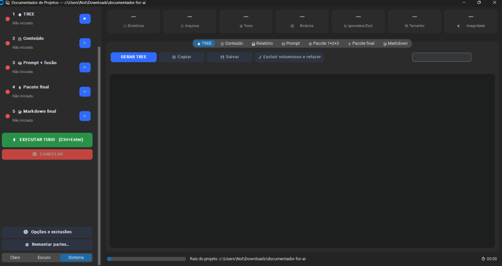
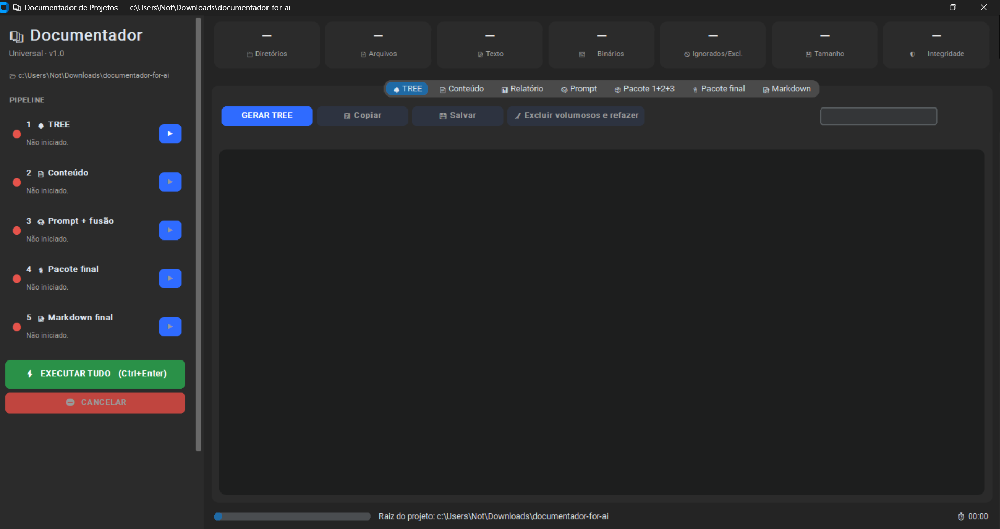
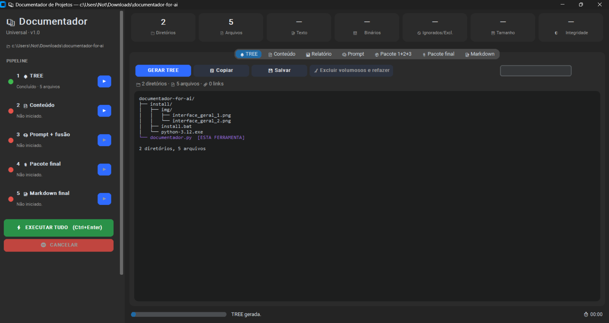
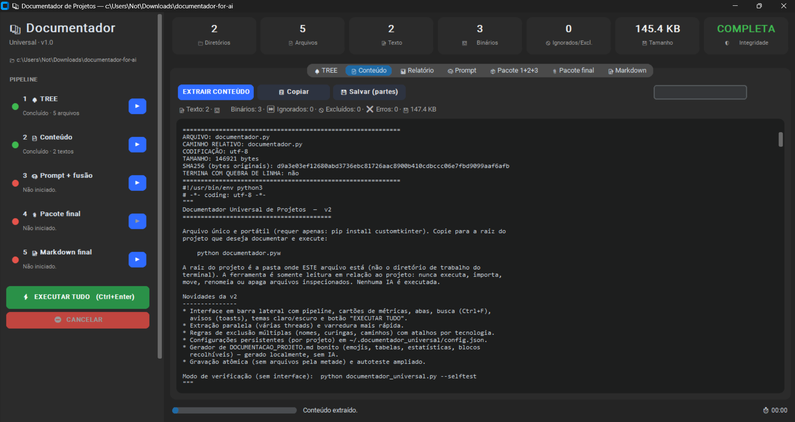
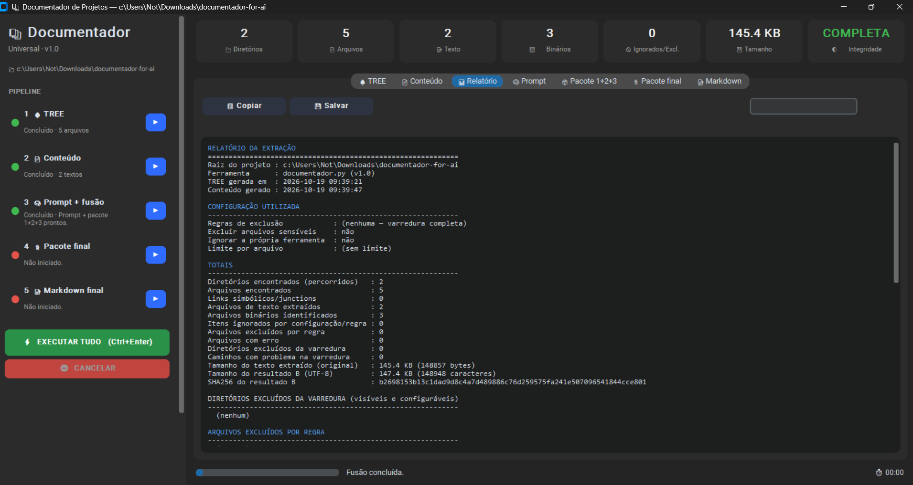
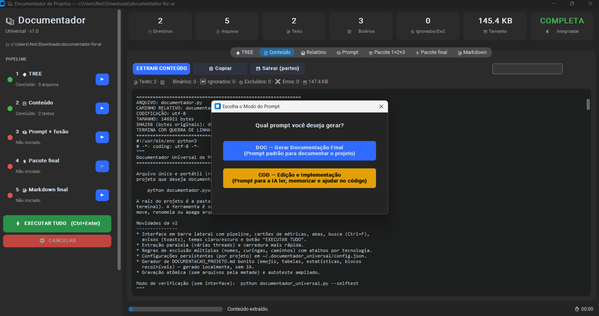
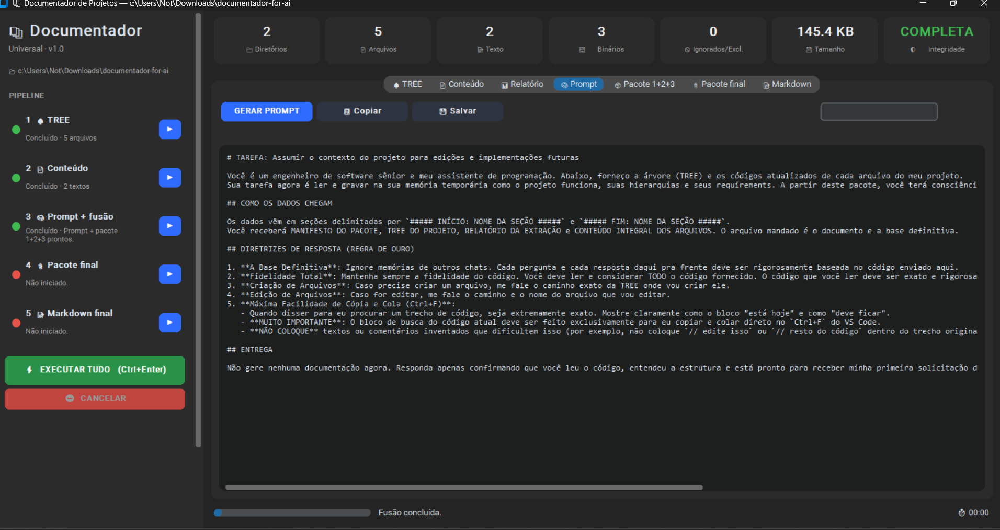
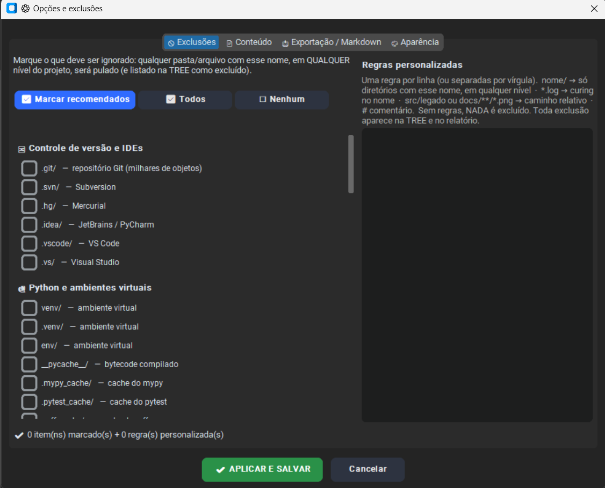

<div align="center">

# 📚 Documentador Universal de Projetos

**Transforme qualquer pasta de código em um inventário técnico completo: TREE, conteúdo integral, relatório, prompt pronto para IA e um Markdown bonito. Um único arquivo `.py`, interface moderna, 100% local.**




</div>

---

## ✨ O que é

Coloque **um arquivo** (`documentador.py`) dentro de qualquer projeto (Python, PHP, JavaScript, Java, C#, C++, web, automações...), dê dois cliques e obtenha:

- 🌳 a **TREE** completa da estrutura de pastas;
- 📄 o **conteúdo integral** de todos os arquivos de texto, com codificação, tamanho e SHA256 de cada um;
- 📊 um **relatório** do que foi lido, ignorado, excluído ou deu erro;
- 🧠 um **prompt + pacote** prontos para colar numa IA: para **gerar a documentação** ou para **editar e implementar código** com ela;
- 📝 um **Markdown final** com emojis, tabelas e blocos recolhíveis, gerado localmente.

> 🔒 A ferramenta **nunca executa, importa, move, renomeia ou apaga** nada do seu projeto. Nenhuma IA é chamada e nenhum dado sai do seu computador.

---

## 📥 Instalação (Windows)

1. Baixe o repositório em **Code → Download ZIP** e extraia.
2. Abra a pasta `install` e dê dois cliques em **`install.bat`**.
3. Pronto. O instalador faz tudo sozinho:

```text
install.bat
 ├─ Já existe Python 3.8+ no PC?
 │    ├─ SIM → verifica o Tkinter → instala a biblioteca da interface (customtkinter)
 │    └─ NÃO → instala o python-3.12.exe que está na pasta (com Tkinter e pip)
 │              → instala a biblioteca da interface (customtkinter)
 └─ Verificação final: tkinter + customtkinter funcionando ✔
```

4. Agora é só **pegar o `documentador.py` e jogar dentro da pasta do projeto** que você quer documentar. Quantas vezes quiser, em quantos projetos quiser. A instalação é feita uma vez só.

> ℹ️ No Windows, o Tkinter já vem dentro do Python. O instalador garante que ele esteja presente: usa o do seu Python se existir, e instala o do Python incluso se não existir.

### 📂 Estrutura do repositório

```text
documentador-for-ai/
│   documentador.py        ← o app (copie para a pasta do seu projeto)
│   README.md
│   LICENSE
│
└───install/
    │   install.bat        ← dois cliques: prepara tudo
    │   python-3.12.exe    ← instalador oficial do Python (usado só se faltar)
    │
    └───exemple/           ← imagens deste README
```

### 🐧 Linux / 🍎 macOS

Precisa de Python 3.8+ com Tkinter e da biblioteca da interface:

```bash
sudo apt install python3-tk        # Debian/Ubuntu (macOS: brew install python-tk)
python3 -m pip install customtkinter
python3 documentador.py
```

---

## 🚀 Como usar

1. Copie `documentador.py` para a **raiz do projeto** (a raiz é a pasta onde o arquivo está, não o diretório do terminal).
2. Abra com dois cliques ou rode `python documentador.py`.
3. Clique em **⚡ EXECUTAR TUDO** (`Ctrl+Enter`) ou rode as etapas uma a uma, pelos botões ▶ da barra lateral.

### 🖥️ A interface

Barra lateral com o pipeline e um semáforo por etapa (🔴 pendente · 🟡 processando · 🟢 concluído), cartões de métricas no topo e uma aba para cada resultado. Tema claro, escuro ou do sistema.

<div align="center">

<br><sub>Tela inicial: nada foi gerado ainda. Cada etapa só libera a seguinte quando está verde.</sub>
</div>

---

## 🧭 Passo a passo, com exemplos reais

### 1 · 🌳 TREE

A estrutura completa do projeto, sem seguir links simbólicos. A própria ferramenta aparece marcada (`[ESTA FERRAMENTA]`), assim como exclusões e erros, com cores diferentes.

<div align="center">

</div>

### 2 · 📄 Conteúdo

O conteúdo integral de cada arquivo de texto, com cabeçalho de integridade (codificação, tamanho em bytes, SHA256 e se termina com quebra de linha). Binários entram só como metadados. Os cartões do topo mostram os totais e a integridade da extração (**COMPLETA** ou **PARCIAL**).

<div align="center">

</div>

### 3 · 📊 Relatório

Tudo o que aconteceu na extração: configuração usada, totais, exclusões, binários, erros, arquivos sensíveis e a conclusão (completa ou com ressalvas).

<div align="center">

</div>

### 4 · 🧠 Prompt: dois modos

Ao gerar o prompt, você escolhe o objetivo:

<div align="center">

</div>

| Modo | Para quê |
|---|---|
| 🔵 **DOC**: Gerar Documentação Final | Prompt padrão para a IA documentar o projeto inteiro |
| 🟡 **COD**: Edição e Implementação | Prompt para a IA **ler, memorizar e ajudar no código**, com regras de resposta fáceis de copiar e colar (`Ctrl+F` no editor) |

O resultado aparece na aba **Prompt**, pronto para copiar ou salvar:

<div align="center">

</div>

Depois, o botão **FUNDIR 1+2+3** junta prompt + TREE + conteúdo + relatório num **único pacote**. Um exemplo real do resultado está em [`install/exemple/pack_1+2+3.txt`](install/exemple/pack_1+2+3.txt).

### 5 · 📎 Pacote final e 📝 Markdown

- **Pacote final:** une tudo, incluindo (opcionalmente) o seu `DOCUMENTACAO.md` anterior, para a IA **atualizar** em vez de criar do zero.
- **Markdown final:** gera, **sem IA**, um documento completo com sumário clicável, tecnologias detectadas, linguagens com barras de participação, TREE, índice, conteúdo em blocos recolhíveis, alerta de arquivos sensíveis e hashes de integridade.

---

## ⚙️ Opções e exclusões

O botão **⚙ Opções e exclusões** (barra lateral) abre a janela de configuração. Na aba **Exclusões** há uma lista de caixas de seleção com **69 nomes prontos**: marcou, qualquer pasta ou arquivo com esse nome, **em qualquer nível**, é pulado.

<div align="center">

</div>

| Grupo | Exemplos |
|---|---|
| 🔀 Controle de versão e IDEs | `.git/` `.svn/` `.idea/` `.vscode/` |
| 🐍 Python | `venv/` `.venv/` `__pycache__/` `.mypy_cache/` `.pytest_cache/` `.tox/` |
| 🟩 Node e front-end | `node_modules/` `.next/` `.nuxt/` `.angular/` `.turbo/` |
| 🏗️ Build e dependências | `dist/` `build/` `target/` `bin/` `obj/` `vendor/` |
| 🧠 Caches | `.cache/` `tmp/` `temp/` `logs/` |
| 🌐 Navegador e Selenium | `chrome_profile/` `selenium_profile/` `.wdm/` `Code Cache/` `GPUCache/` |
| 🗑️ Descartáveis | `*.log` `*.pyc` `*.tmp` `.DS_Store` `Thumbs.db` |

**☑ Marcar recomendados** (37 itens) faz um começo rápido. Para casos específicos, use as **regras personalizadas**, uma por linha:

```text
node_modules/          # só diretórios com esse nome, em qualquer nível
*.log                  # curinga no nome
src/legado             # caminho relativo
docs/**/*.png          # curinga em caminho
# linhas com # são comentários
```

Nada vem excluído por padrão, e **toda exclusão aparece na TREE e no relatório**, com a regra que a causou. Depois da TREE, **🧹 Excluir volumosos e refazer** adiciona sozinho as pastas pesadas encontradas. As abas **Conteúdo**, **Exportação / Markdown** e **Aparência** ajustam limite por arquivo, tamanho das partes, opções do Markdown, tema e escala. Tudo é salvo em `~/.documentador_universal/config.json`.

---

## ⚡ Desempenho e robustez

- Leitura **paralela** em várias threads, com resultado idêntico ao sequencial, sempre na ordem da TREE.
- Arquivos grandes ficam em arquivo temporário, não na memória.
- Gravação **atômica**: nunca sobra arquivo pela metade.
- Detecção de codificação (UTF-8, UTF-8 com BOM, UTF-16/32, Windows-1252) com verificação byte a byte.
- Binários identificados por assinatura; links simbólicos e ciclos nunca são seguidos.
- Exportação em **partes numeradas** para pacotes enormes, com remontagem verificada por SHA256 (botão 🧩 *Remontar partes*).
- Caminhos longos no Windows e árvores muito profundas suportados.
- Erros de leitura marcam a extração como **PARCIAL**, e isso fica registrado em todos os pacotes.

## 🔐 Privacidade e segurança

- 100% local: nenhum dado é enviado a lugar nenhum e nenhuma IA é executada.
- Arquivos sensíveis (`.env`, `*.pem`, `id_rsa`, `credentials.json`...) são sinalizados, e você pode excluir o **conteúdo** deles nas opções.
- ⚠️ Por padrão o conteúdo sensível **é incluído**: revise o pacote antes de colar numa IA ou compartilhar.

## 🗂️ Arquivos gerados

| Arquivo | Origem |
|---|---|
| `TREE_PROJETO.txt` | TREE |
| `CONTEUDO_PROJETO[_PARTE_NNN].txt` | Conteúdo |
| `RELATORIO_EXTRACAO.txt` | Relatório |
| `PROMPT_IA.txt` | Prompt |
| `PACOTE_FUSAO_1_2_3[_PARTE_NNN].txt` | Pacote 1+2+3 |
| `PACOTE_FINAL[_PARTE_NNN].txt` | Pacote final |
| `DOCUMENTACAO_PROJETO.md` | Markdown final |

Essas saídas são reconhecidas pelo nome e **ignoradas** nas execuções seguintes, para não contaminar o inventário.

## 🧪 Linha de comando

```bash
python documentador.py                 # abre a interface
python documentador.py --selftest      # autoteste, sem interface
```

---

## 📄 Licença

Distribuído sob a licença **MIT**. Veja o arquivo [`LICENSE`](LICENSE).

O `python-3.12.exe` em `install/` é o instalador oficial do Python, distribuído pela Python Software Foundation sob a [licença PSF](https://docs.python.org/3/license.html).
